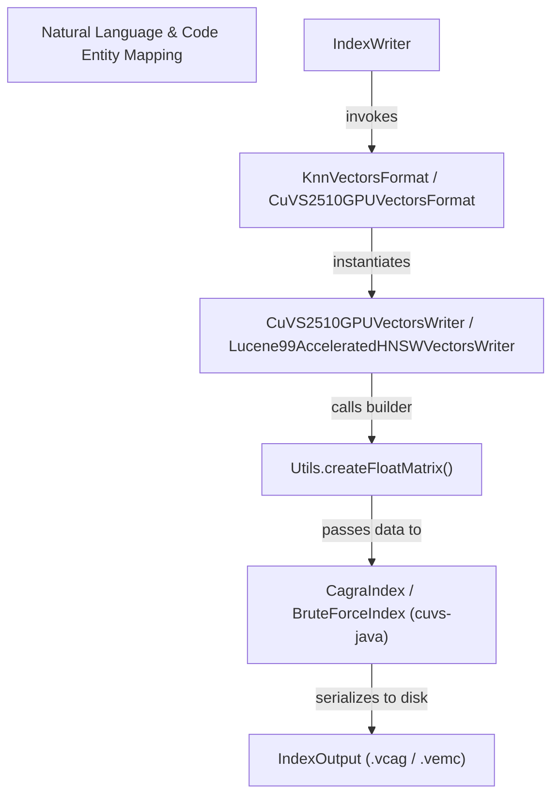
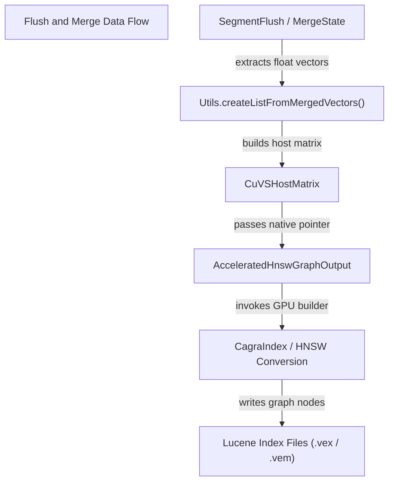
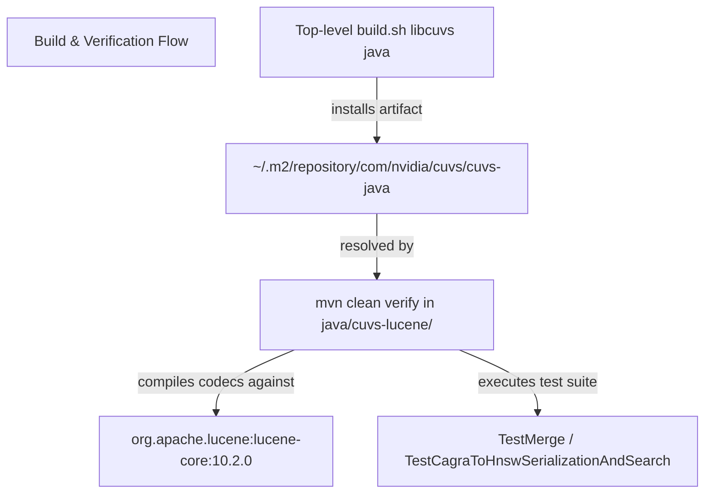

<!-- source: DeepWiki mcp.deepwiki.com · repo NVIDIA/cuvs · extra page cuvs-lucene: GPU-Accelerated Lucene Codecs · fetched 2026-10-26 -->

# cuvs-lucene: GPU-Accelerated Lucene Codecs

Relevant source files

The following files were used as context for generating this wiki page:

- [java/cuvs-lucene/README.md](java/cuvs-lucene/README.md)
- [java/cuvs-lucene/bench/pom.xml](java/cuvs-lucene/bench/pom.xml)
- [java/cuvs-lucene/build.sh](java/cuvs-lucene/build.sh)
- [java/cuvs-lucene/pom.xml](java/cuvs-lucene/pom.xml)
- [java/cuvs-lucene/src/main/java/com/nvidia/cuvs/lucene/AcceleratedHNSWParams.java](java/cuvs-lucene/src/main/java/com/nvidia/cuvs/lucene/AcceleratedHNSWParams.java)
- [java/cuvs-lucene/src/main/java/com/nvidia/cuvs/lucene/AcceleratedHNSWUtils.java](java/cuvs-lucene/src/main/java/com/nvidia/cuvs/lucene/AcceleratedHNSWUtils.java)
- [java/cuvs-lucene/src/main/java/com/nvidia/cuvs/lucene/CagraIndexParamsFactory.java](java/cuvs-lucene/src/main/java/com/nvidia/cuvs/lucene/CagraIndexParamsFactory.java)
- [java/cuvs-lucene/src/main/java/com/nvidia/cuvs/lucene/CuVS2510GPUSearchCodec.java](java/cuvs-lucene/src/main/java/com/nvidia/cuvs/lucene/CuVS2510GPUSearchCodec.java)
- [java/cuvs-lucene/src/main/java/com/nvidia/cuvs/lucene/CuVS2510GPUVectorsFormat.java](java/cuvs-lucene/src/main/java/com/nvidia/cuvs/lucene/CuVS2510GPUVectorsFormat.java)
- [java/cuvs-lucene/src/main/java/com/nvidia/cuvs/lucene/CuVS2510GPUVectorsReader.java](java/cuvs-lucene/src/main/java/com/nvidia/cuvs/lucene/CuVS2510GPUVectorsReader.java)
- [java/cuvs-lucene/src/main/java/com/nvidia/cuvs/lucene/CuVS2510GPUVectorsWriter.java](java/cuvs-lucene/src/main/java/com/nvidia/cuvs/lucene/CuVS2510GPUVectorsWriter.java)
- [java/cuvs-lucene/src/main/java/com/nvidia/cuvs/lucene/FieldWriter.java](java/cuvs-lucene/src/main/java/com/nvidia/cuvs/lucene/FieldWriter.java)
- [java/cuvs-lucene/src/main/java/com/nvidia/cuvs/lucene/FilterCuVSServiceProvider.java](java/cuvs-lucene/src/main/java/com/nvidia/cuvs/lucene/FilterCuVSServiceProvider.java)
- [java/cuvs-lucene/src/main/java/com/nvidia/cuvs/lucene/GPUFieldWriter.java](java/cuvs-lucene/src/main/java/com/nvidia/cuvs/lucene/GPUFieldWriter.java)
- [java/cuvs-lucene/src/main/java/com/nvidia/cuvs/lucene/GPUIndex.java](java/cuvs-lucene/src/main/java/com/nvidia/cuvs/lucene/GPUIndex.java)
- [java/cuvs-lucene/src/main/java/com/nvidia/cuvs/lucene/GPUKnnFloatVectorQuery.java](java/cuvs-lucene/src/main/java/com/nvidia/cuvs/lucene/GPUKnnFloatVectorQuery.java)
- [java/cuvs-lucene/src/main/java/com/nvidia/cuvs/lucene/GPUPerLeafCuVSKnnCollector.java](java/cuvs-lucene/src/main/java/com/nvidia/cuvs/lucene/GPUPerLeafCuVSKnnCollector.java)
- [java/cuvs-lucene/src/main/java/com/nvidia/cuvs/lucene/GPUSearchParams.java](java/cuvs-lucene/src/main/java/com/nvidia/cuvs/lucene/GPUSearchParams.java)
- [java/cuvs-lucene/src/main/java/com/nvidia/cuvs/lucene/IndexInputInputStream.java](java/cuvs-lucene/src/main/java/com/nvidia/cuvs/lucene/IndexInputInputStream.java)
- [java/cuvs-lucene/src/main/java/com/nvidia/cuvs/lucene/IndexOutputOutputStream.java](java/cuvs-lucene/src/main/java/com/nvidia/cuvs/lucene/IndexOutputOutputStream.java)
- [java/cuvs-lucene/src/main/java/com/nvidia/cuvs/lucene/Lucene101AcceleratedHNSWCodec.java](java/cuvs-lucene/src/main/java/com/nvidia/cuvs/lucene/Lucene101AcceleratedHNSWCodec.java)
- [java/cuvs-lucene/src/main/java/com/nvidia/cuvs/lucene/Lucene99AcceleratedHNSWVectorsFormat.java](java/cuvs-lucene/src/main/java/com/nvidia/cuvs/lucene/Lucene99AcceleratedHNSWVectorsFormat.java)
- [java/cuvs-lucene/src/main/java/com/nvidia/cuvs/lucene/Lucene99AcceleratedHNSWVectorsWriter.java](java/cuvs-lucene/src/main/java/com/nvidia/cuvs/lucene/Lucene99AcceleratedHNSWVectorsWriter.java)
- [java/cuvs-lucene/src/main/java/com/nvidia/cuvs/lucene/LuceneAcceleratedHNSWBinaryQuantizedCodec.java](java/cuvs-lucene/src/main/java/com/nvidia/cuvs/lucene/LuceneAcceleratedHNSWBinaryQuantizedCodec.java)
- [java/cuvs-lucene/src/main/java/com/nvidia/cuvs/lucene/LuceneAcceleratedHNSWBinaryQuantizedVectorsFormat.java](java/cuvs-lucene/src/main/java/com/nvidia/cuvs/lucene/LuceneAcceleratedHNSWBinaryQuantizedVectorsFormat.java)
- [java/cuvs-lucene/src/main/java/com/nvidia/cuvs/lucene/LuceneAcceleratedHNSWBinaryQuantizedVectorsWriter.java](java/cuvs-lucene/src/main/java/com/nvidia/cuvs/lucene/LuceneAcceleratedHNSWBinaryQuantizedVectorsWriter.java)
- [java/cuvs-lucene/src/main/java/com/nvidia/cuvs/lucene/LuceneAcceleratedHNSWScalarQuantizedCodec.java](java/cuvs-lucene/src/main/java/com/nvidia/cuvs/lucene/LuceneAcceleratedHNSWScalarQuantizedCodec.java)
- [java/cuvs-lucene/src/main/java/com/nvidia/cuvs/lucene/LuceneAcceleratedHNSWScalarQuantizedVectorsFormat.java](java/cuvs-lucene/src/main/java/com/nvidia/cuvs/lucene/LuceneAcceleratedHNSWScalarQuantizedVectorsFormat.java)
- [java/cuvs-lucene/src/main/java/com/nvidia/cuvs/lucene/LuceneAcceleratedHNSWScalarQuantizedVectorsWriter.java](java/cuvs-lucene/src/main/java/com/nvidia/cuvs/lucene/LuceneAcceleratedHNSWScalarQuantizedVectorsWriter.java)
- [java/cuvs-lucene/src/main/java/com/nvidia/cuvs/lucene/Utils.java](java/cuvs-lucene/src/main/java/com/nvidia/cuvs/lucene/Utils.java)
- [java/cuvs-lucene/src/main/java/com/nvidia/cuvs/lucene/package-info.java](java/cuvs-lucene/src/main/java/com/nvidia/cuvs/lucene/package-info.java)
- [java/cuvs-lucene/src/test/java/com/nvidia/cuvs/lucene/TestAcceleratedHNSWDeletedDocuments.java](java/cuvs-lucene/src/test/java/com/nvidia/cuvs/lucene/TestAcceleratedHNSWDeletedDocuments.java)
- [java/cuvs-lucene/src/test/java/com/nvidia/cuvs/lucene/TestAcceleratedHNSWOddGraphDegree.java](java/cuvs-lucene/src/test/java/com/nvidia/cuvs/lucene/TestAcceleratedHNSWOddGraphDegree.java)
- [java/cuvs-lucene/src/test/java/com/nvidia/cuvs/lucene/TestAcceleratedHNSWParams.java](java/cuvs-lucene/src/test/java/com/nvidia/cuvs/lucene/TestAcceleratedHNSWParams.java)
- [java/cuvs-lucene/src/test/java/com/nvidia/cuvs/lucene/TestAcceleratedHNSWVectorsFormatThrowableHandling.java](java/cuvs-lucene/src/test/java/com/nvidia/cuvs/lucene/TestAcceleratedHNSWVectorsFormatThrowableHandling.java)
- [java/cuvs-lucene/src/test/java/com/nvidia/cuvs/lucene/TestCagraIndexParamsFactory.java](java/cuvs-lucene/src/test/java/com/nvidia/cuvs/lucene/TestCagraIndexParamsFactory.java)
- [java/cuvs-lucene/src/test/java/com/nvidia/cuvs/lucene/TestCagraToHnswSerializationAndSearch.java](java/cuvs-lucene/src/test/java/com/nvidia/cuvs/lucene/TestCagraToHnswSerializationAndSearch.java)
- [java/cuvs-lucene/src/test/java/com/nvidia/cuvs/lucene/TestCagraToHnswSerializationAndSearchWithFallbackWriter.java](java/cuvs-lucene/src/test/java/com/nvidia/cuvs/lucene/TestCagraToHnswSerializationAndSearchWithFallbackWriter.java)
- [java/cuvs-lucene/src/test/java/com/nvidia/cuvs/lucene/TestCuVSAcceleratedHNSWDeletedDocuments.java](java/cuvs-lucene/src/test/java/com/nvidia/cuvs/lucene/TestCuVSAcceleratedHNSWDeletedDocuments.java)
- [java/cuvs-lucene/src/test/java/com/nvidia/cuvs/lucene/TestCuVSAcceleratedHNSWGaps.java](java/cuvs-lucene/src/test/java/com/nvidia/cuvs/lucene/TestCuVSAcceleratedHNSWGaps.java)
- [java/cuvs-lucene/src/test/java/com/nvidia/cuvs/lucene/TestCuVSDeletedDocuments.java](java/cuvs-lucene/src/test/java/com/nvidia/cuvs/lucene/TestCuVSDeletedDocuments.java)
- [java/cuvs-lucene/src/test/java/com/nvidia/cuvs/lucene/TestCuVSGaps.java](java/cuvs-lucene/src/test/java/com/nvidia/cuvs/lucene/TestCuVSGaps.java)
- [java/cuvs-lucene/src/test/java/com/nvidia/cuvs/lucene/TestCuVSRandomizedHNSWVectorSearch.java](java/cuvs-lucene/src/test/java/com/nvidia/cuvs/lucene/TestCuVSRandomizedHNSWVectorSearch.java)
- [java/cuvs-lucene/src/test/java/com/nvidia/cuvs/lucene/TestCuVSRandomizedVectorSearch.java](java/cuvs-lucene/src/test/java/com/nvidia/cuvs/lucene/TestCuVSRandomizedVectorSearch.java)
- [java/cuvs-lucene/src/test/java/com/nvidia/cuvs/lucene/TestGPUSearchParams.java](java/cuvs-lucene/src/test/java/com/nvidia/cuvs/lucene/TestGPUSearchParams.java)
- [java/cuvs-lucene/src/test/java/com/nvidia/cuvs/lucene/TestLucene99AcceleratedHNSWVectorsFormat.java](java/cuvs-lucene/src/test/java/com/nvidia/cuvs/lucene/TestLucene99AcceleratedHNSWVectorsFormat.java)
- [java/cuvs-lucene/src/test/java/com/nvidia/cuvs/lucene/TestMerge.java](java/cuvs-lucene/src/test/java/com/nvidia/cuvs/lucene/TestMerge.java)
- [java/cuvs-lucene/src/test/java/com/nvidia/cuvs/lucene/TestQuantizedVectorsFormats.java](java/cuvs-lucene/src/test/java/com/nvidia/cuvs/lucene/TestQuantizedVectorsFormats.java)
- [java/cuvs-lucene/src/test/java/com/nvidia/cuvs/lucene/TestUtilsThrowableHandling.java](java/cuvs-lucene/src/test/java/com/nvidia/cuvs/lucene/TestUtilsThrowableHandling.java)

## Purpose and Scope

The `cuvs-lucene` module provides pluggable Apache Lucene codecs, vector formats, writers, and readers that integrate NVIDIA's `cuVS` GPU-accelerated vector search library into Apache Lucene [java/cuvs-lucene/README.md:1-15](). By leveraging the Java Foreign Function & Memory (FFM) API and underlying native CUDA libraries (`libcuvs`), `cuvs-lucene` allows Lucene applications to offload compute-intensive approximate nearest neighbor (ANN) index construction (such as CAGRA or HNSW graphs) and vector search to NVIDIA GPUs, while maintaining a seamless fallback mechanism to standard CPU codecs when GPUs are unavailable [java/cuvs-lucene/src/main/java/com/nvidia/cuvs/lucene/Lucene99AcceleratedHNSWVectorsFormat.java:94-124]().

---

## Codecs and Formats Architecture

The module defines several custom `org.apache.lucene.codecs.KnnVectorsFormat` implementations and matching codecs that target different deployment scenarios:

*   `CuVS2510GPUVectorsFormat`: Handles GPU-accelerated index building (using CAGRA or Brute Force) and GPU-accelerated search via `CuVS2510GPUVectorsReader` and `CuVS2510GPUVectorsWriter` [java/cuvs-lucene/src/main/java/com/nvidia/cuvs/lucene/CuVS2510GPUVectorsFormat.java:25-111]().
*   `Lucene101AcceleratedHNSWCodec` (and its counterpart `Lucene99AcceleratedHNSWVectorsFormat`): Provides GPU-accelerated HNSW index building while writing an on-disk format compatible with standard Lucene readers, permitting GPU-accelerated indexing with standard CPU-based HNSW search [java/cuvs-lucene/README.md:17-20]().
*   `LuceneAcceleratedHNSWScalarQuantizedCodec` / `LuceneAcceleratedHNSWBinaryQuantizedCodec`: Specialized quantized codecs that compress vector representations using scalar or binary quantization to minimize memory footprint and accelerate bandwidth-bound distance calculations [java/cuvs-lucene/README.md:20-21]().

### Sources
* `java/cuvs-lucene/README.md:1-25`
* `java/cuvs-lucene/src/main/java/com/nvidia/cuvs/lucene/CuVS2510GPUVectorsFormat.java:25-111`
* `java/cuvs-lucene/src/main/java/com/nvidia/cuvs/lucene/Lucene99AcceleratedHNSWVectorsFormat.java:27-146`

---

## Index Writers and Readers

### `CuVS2510GPUVectorsWriter` & `CuVS2510GPUVectorsReader`
`CuVS2510GPUVectorsWriter` intercepts field vector values during segment flushing, constructs a native host/device matrix representation using `Utils.createFloatMatrix()` [java/cuvs-lucene/src/main/java/com/nvidia/cuvs/lucene/Utils.java:63-70](), and invokes native cuVS builders (such as `CagraIndex.build()`) to generate graph or brute-force indices. These indices are serialized into dedicated segment extension files (`.vcag` for index data, `.vemc` for metadata) [java/cuvs-lucene/src/main/java/com/nvidia/cuvs/lucene/CuVS2510GPUVectorsFormat.java:31-34]().

`CuVS2510GPUVectorsReader` loads these indices into GPU memory during segment initialization (unless opened under an `IOContext.Context.MERGE` context, which reduces device memory pressure during segment merges by roughly 50%) [java/cuvs-lucene/src/main/java/com/nvidia/cuvs/lucene/CuVS2510GPUVectorsReader.java:130-141]().

### Accelerated HNSW Writers
`Lucene99AcceleratedHNSWVectorsWriter` manages the bridge between Lucene's vector structures and accelerated graph construction [java/cuvs-lucene/src/main/java/com/nvidia/cuvs/lucene/Lucene99AcceleratedHNSWVectorsWriter.java:41-79](). During segment merging, `vectorBasedMerge` streams vectors directly into native host-memory matrices (`CuVSHostMatrix`) to bypass Java heap allocations and prevent Out-Of-Memory (OOM) errors [java/cuvs-lucene/src/main/java/com/nvidia/cuvs/lucene/Lucene99AcceleratedHNSWVectorsWriter.java:146-160]().

### Sources
* `java/cuvs-lucene/src/main/java/com/nvidia/cuvs/lucene/CuVS2510GPUVectorsFormat.java:25-112`
* `java/cuvs-lucene/src/main/java/com/nvidia/cuvs/lucene/CuVS2510GPUVectorsWriter.java:59-183`
* `java/cuvs-lucene/src/main/java/com/nvidia/cuvs/lucene/CuVS2510GPUVectorsReader.java:59-148`
* `java/cuvs-lucene/src/main/java/com/nvidia/cuvs/lucene/Lucene99AcceleratedHNSWVectorsWriter.java:41-160`
* `java/cuvs-lucene/src/main/java/com/nvidia/cuvs/lucene/Utils.java:63-170`

---

## GPU Search and Query Execution

Query execution against GPU-backed indices is orchestrated via custom search infrastructure:

*   `GPUKnnFloatVectorQuery`: Integrates with Lucene's search architecture to delegate vector query collection to GPU executors.
*   `GPUPerLeafCuVSKnnCollector`: Executes nearest-neighbor searches per segment leaf using `CagraQuery` or `BruteForceQuery` handles against the loaded `GPUIndex` instances [java/cuvs-lucene/src/main/java/com/nvidia/cuvs/lucene/CuVS2510GPUVectorsReader.java:16-21]() [java/cuvs-lucene/src/main/java/com/nvidia/cuvs/lucene/GPUPerLeafCuVSKnnCollector.java:1-50]().
*   `FilterCuVSServiceProvider`: Handles pre-filtering and post-filtering operations by converting Lucene `Bits` (live docs / bitsets) into bitmasks consumable by native cuVS query APIs.

### Sources
* `java/cuvs-lucene/src/main/java/com/nvidia/cuvs/lucene/CuVS2510GPUVectorsReader.java:16-53`
* `java/cuvs-lucene/src/main/java/com/nvidia/cuvs/lucene/GPUKnnFloatVectorQuery.java:1-50`
* `java/cuvs-lucene/src/main/java/com/nvidia/cuvs/lucene/GPUPerLeafCuVSKnnCollector.java:1-50`

---

## Parameters and Factories

Configuration of indexing behavior is centralized in parameter objects and builder classes:

*   `AcceleratedHNSWParams`: Encapsulates tuning parameters such as `writerThreads`, `intermediateGraphDegree`, `graphdegree`, `hnswLayers`, `maxConn`, `beamWidth`, `nnDescentNumIterations`, and the index building `Strategy` (`HEURISTIC` vs `CUSTOM`) [java/cuvs-lucene/src/main/java/com/nvidia/cuvs/lucene/AcceleratedHNSWParams.java:17-148](). Under the default `HEURISTIC` strategy, cuVS derives optimal CAGRA build configurations from HNSW-equivalent parameters [java/cuvs-lucene/src/main/java/com/nvidia/cuvs/lucene/AcceleratedHNSWParams.java:19-32]().
*   `CagraIndexParamsFactory`: Translates high-level Lucene search parameters and distance functions into native `CagraIndexParams` and `CagraSearchParams` structures.

| Parameter Class | Key Properties | Default Value | Role |
| :--- | :--- | :--- | :--- |
| `AcceleratedHNSWParams` | `maxConn`, `beamWidth`, `strategy` | `HEURISTIC`, `maxConn=32` | Controls HNSW fallback and heuristic index construction |
| `GPUSearchParams` | `cagraGraphBuildAlgo`, `distanceType` | `AUTO_SELECT`, `L2Expanded` | Tunes CAGRA build algorithm (`NN_DESCENT` or `IVF_PQ`) |

### Sources
* `java/cuvs-lucene/src/main/java/com/nvidia/cuvs/lucene/AcceleratedHNSWParams.java:17-148`
* `java/cuvs-lucene/src/main/java/com/nvidia/cuvs/lucene/CagraIndexParamsFactory.java:1-50`

---

## Segment Merging and Deleted-Document Handling

Handling segment merges and deleted documents correctly is critical for maintaining index integrity:
*   **Deletions during Merges**: During segment merging, `MergeState` provides live document bitsets (`mergeState.liveDocs`) [java/cuvs-lucene/src/main/java/com/nvidia/cuvs/lucene/Lucene99AcceleratedHNSWVectorsWriter.java:161-166](). The writer iterates over valid vectors, omitting deleted document ordinals to ensure the resulting GPU index does not allocate space for or index dead rows.
*   **Gap Management**: Tests such as `TestMerge.java`, `TestCuVSDeletedDocuments.java`, and `TestCuVSGaps.java` validate that sparse vector fields, updates, and document deletions properly update vector ordinals without corrupting graph neighbor pointers.

### Sources
* `java/cuvs-lucene/src/main/java/com/nvidia/cuvs/lucene/Lucene99AcceleratedHNSWVectorsWriter.java:146-166`
* `java/cuvs-lucene/src/test/java/com/nvidia/cuvs/lucene/TestMerge.java:1-180`
* `java/cuvs-lucene/src/test/java/com/nvidia/cuvs/lucene/TestCuVSDeletedDocuments.java:1-50`

---

## Build System, Maven Configuration, and Benchmarking Harness

The module is built using Maven (`java/cuvs-lucene/pom.xml`) [java/cuvs-lucene/pom.xml:1-53] and integrated into the top-level repository build scripts (`java/cuvs-lucene/build.sh`) [java/cuvs-lucene/build.sh:1-58](). 

*   **Dependencies**: Requires `org.apache.lucene:lucene-core:10.2.0` and `com.nvidia.cuvs:cuvs-java` [java/cuvs-lucene/pom.xml:109-148]().
*   **Benchmarking**: The `bench/` subdirectory (`java/cuvs-lucene/bench/pom.xml`) provides performance evaluation harnesses comparing query throughput and recall against standard Lucene codecs.

### Sources
* `java/cuvs-lucene/pom.xml:1-190`
* `java/cuvs-lucene/build.sh:1-59`
* `java/cuvs-lucene/bench/pom.xml:1-30`

---

