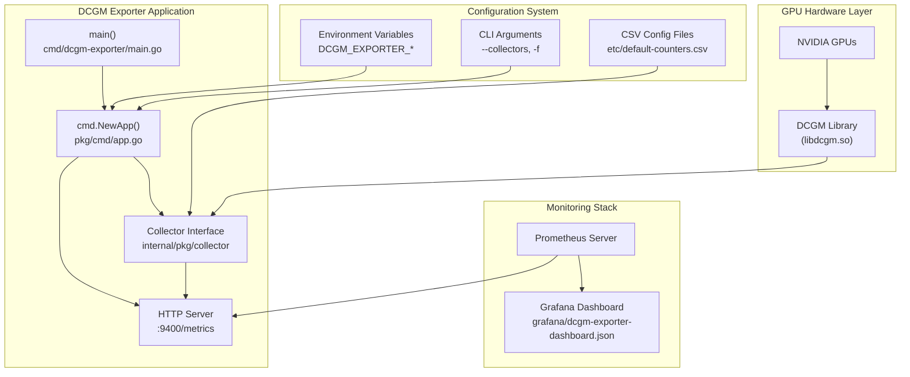
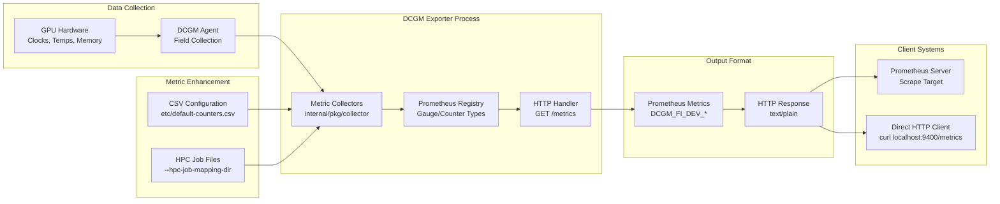

<!-- source: DeepWiki mcp.deepwiki.com · repo NVIDIA/dcgm-exporter · page 1 Overview · fetched 2026-10-26 -->

# Overview

<details>
<summary>Relevant source files</summary>

The following files were used as context for generating this wiki page:

- [README.md](README.md)
- [cmd/dcgm-exporter/main.go](cmd/dcgm-exporter/main.go)
- [go.mod](go.mod)

</details>


This document provides an overview of DCGM Exporter, a Prometheus metrics exporter for NVIDIA GPU telemetry data. It covers the system's purpose, architecture, and key integration points within GPU monitoring infrastructure.

DCGM Exporter bridges the gap between NVIDIA's Data Center GPU Manager (DCGM) and Prometheus-based monitoring systems, enabling comprehensive GPU observability in containerized and Kubernetes environments. For detailed deployment instructions, see [Installation and Deployment](#2). For configuration options, see [Configuration](#3). For metrics specifications, see [Metrics and Monitoring](#4).

## What is DCGM Exporter

DCGM Exporter is a specialized Prometheus exporter that collects GPU metrics from NVIDIA's DCGM library and exposes them via HTTP in Prometheus format [README.md:1-4](). The system is designed primarily for Kubernetes deployments as a DaemonSet, though it also supports standalone Docker container and binary execution modes [README.md:11-14](), [README.md:118-125]().

**Core Capabilities:**
- **GPU Metrics Collection**: Gathers comprehensive GPU telemetry including clocks, temperatures, memory usage, and utilization [README.md:16-21]().
- **Kubernetes Integration**: Enriches metrics with pod, container, and namespace labels when deployed in Kubernetes [README.md:75-78]().
- **Custom Metric Configuration**: Supports user-defined metric collections via CSV configuration files [README.md:139-143]().
- **HPC Job Mapping**: Can correlate GPU usage with High-Performance Computing job identifiers [README.md:95-109]().
- **Security**: Supports TLS encryption and HTTP basic authentication using `exporter-toolkit` [README.md:85-94]().

**Primary Use Cases:**
- GPU resource monitoring in Kubernetes clusters.
- Performance analysis for ML/AI workloads.
- Capacity planning for GPU infrastructure.
- SLA monitoring and alerting for GPU-accelerated applications.

Sources: [README.md:1-137]()

## System Architecture

The following diagram shows DCGM Exporter's position within the GPU monitoring ecosystem and maps system components to their corresponding code entities:

Title: DCGM Exporter System Architecture


This architecture illustrates how DCGM Exporter acts as a translation layer between low-level GPU hardware data and cloud-native monitoring systems. The `main()` function in [cmd/dcgm-exporter/main.go:28-34]() initializes the application through `cmd.NewApp()`, which orchestrates metric collection and HTTP serving.

Sources: [cmd/dcgm-exporter/main.go:28-34](), [README.md:156-160](), [README.md:167-172]()

## Data Flow and Metric Pipeline

The following diagram shows how GPU metrics flow through the system, from hardware collection to Prometheus ingestion:

Title: Metric Collection Pipeline


The data pipeline begins with DCGM collecting raw GPU field data, which gets processed by collector interfaces. When Kubernetes integration is enabled, the system enriches metrics with pod and container labels [README.md:75-78]().

**Metric Format Example:**
```
DCGM_FI_DEV_SM_CLOCK{gpu="0", UUID="GPU-604ac...", pod="training-job-xyz", container="pytorch", namespace="ml-team"} 1350
```

For details, see [Architecture](#1.1).

Sources: [README.md:13-27](), [README.md:67-79](), [README.md:95-109]()

## Deployment Models

DCGM Exporter supports multiple deployment patterns, each suited to different operational requirements:

| Deployment Type | Use Case | Key Components |
|-----------------|----------|----------------|
| **Standalone Binary** | Development, testing, single-node | `make binary`, local DCGM installation [README.md:121]() |
| **Docker Container** | Single-node production, bare metal | `nvcr.io/nvidia/k8s/dcgm-exporter` image [README.md:14]() |
| **Kubernetes DaemonSet** | Multi-node clusters, manual deployment | `kubectl create -f dcgm-exporter.yaml` [README.md:59]() |
| **Helm Chart** | Production Kubernetes, customizable | `gpu-helm-charts/dcgm-exporter` [README.md:51-54]() |
| **GPU Operator Integration** | Enterprise Kubernetes, full GPU stack | Embedded within NVIDIA GPU Operator [README.md:31]() |

**Default Configuration:**
- **Port**: 9400 [README.md:14]()
- **Metrics Endpoint**: `/metrics` [README.md:15]()
- **Default Collectors**: `etc/default-counters.csv` [README.md:142]()

The most common production deployment uses the Helm chart, which provides comprehensive customization options. For enterprise environments, DCGM Exporter is typically deployed as part of the NVIDIA GPU Operator.

Sources: [README.md:10-14](), [README.md:29-54](), [README.md:110-137]()

## Key Integration Points

DCGM Exporter integrates with several external systems:

**NVIDIA DCGM Library**
- **Purpose**: Low-level GPU data collection interface [README.md:3]().
- **Integration**: Direct library calls to collect DCGM field values via `github.com/NVIDIA/go-dcgm` [go.mod:8]().

**Kubernetes**
- **Purpose**: Maps GPU devices to pods and containers.
- **Integration**: Uses Kubelet APIs and environment variables like `NODE_NAME` [go.mod:33]().

**Prometheus Ecosystem**
- **Service Discovery**: Integration via Prometheus Operator ServiceMonitors.
- **Metric Format**: Standard Prometheus text exposition format [README.md:16-21]().
- **Dashboard**: Pre-built Grafana dashboard at `grafana/dcgm-exporter-dashboard.json` [README.md:171]().

**Configuration Sources**
- **CSV Files**: Metric field definitions in `etc/default-counters.csv` [README.md:142]().
- **CLI Arguments**: Command-line flags parsed using `github.com/urfave/cli/v2` [go.mod:24]().
- **Security**: TLS and Basic Auth via `github.com/prometheus/exporter-toolkit` [go.mod:21]().

For details, see [Key Features](#1.2).

Sources: [README.md:85-94](), [README.md:167-172](), [go.mod:7-35]()

---

