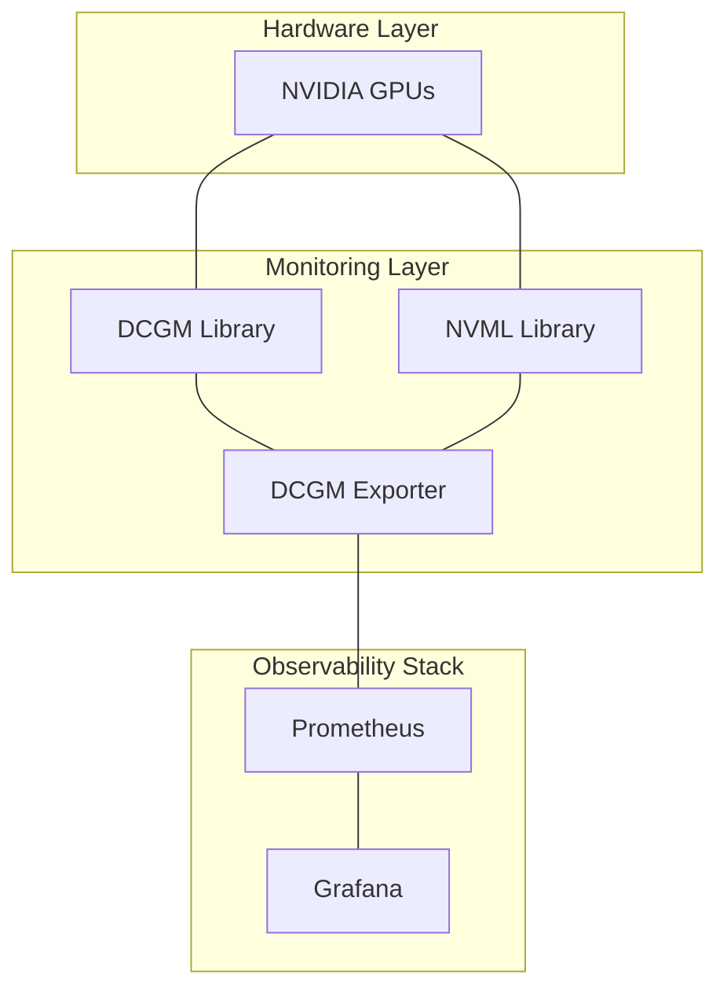
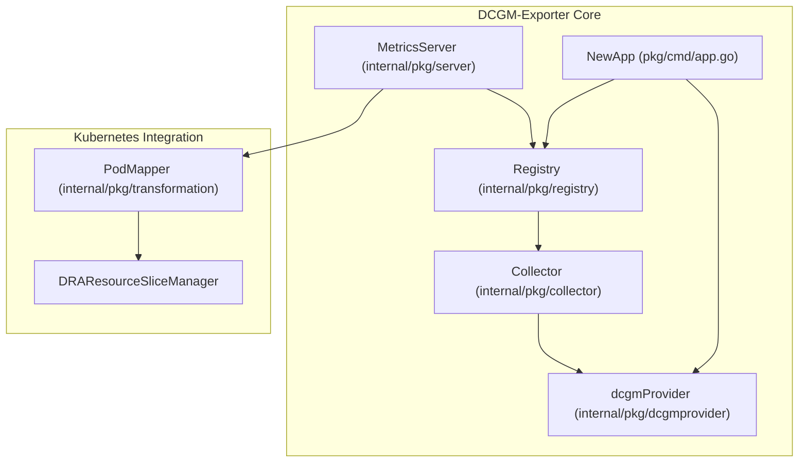
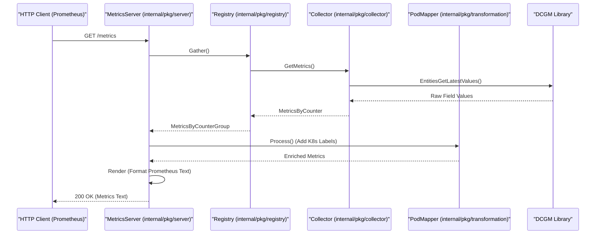
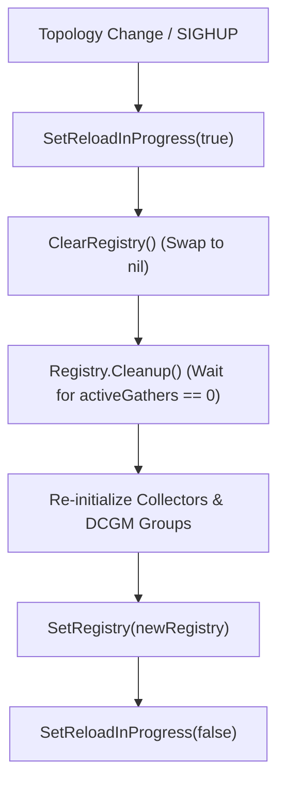

<!-- source: DeepWiki mcp.deepwiki.com · repo NVIDIA/dcgm-exporter · page 1.1 Architecture · fetched 2026-10-26 -->

# Architecture

Relevant source files

The following files were used as context for generating this wiki page:

- [internal/mocks/pkg/dcgmprovider/mock_client.go](internal/mocks/pkg/dcgmprovider/mock_client.go)
- [internal/pkg/appconfig/types.go](internal/pkg/appconfig/types.go)
- [internal/pkg/dcgmprovider/dcgm.go](internal/pkg/dcgmprovider/dcgm.go)
- [internal/pkg/dcgmprovider/types.go](internal/pkg/dcgmprovider/types.go)
- [internal/pkg/registry/registry.go](internal/pkg/registry/registry.go)
- [internal/pkg/server/server.go](internal/pkg/server/server.go)
- [internal/pkg/transformation/types.go](internal/pkg/transformation/types.go)
- [pkg/cmd/app.go](pkg/cmd/app.go)

This document describes the system architecture of DCGM Exporter, detailing how it collects, processes, and exposes NVIDIA GPU metrics for Prometheus. It explains the key components, their interactions, and the overall data flow from GPU hardware to monitoring systems.

## Overview

DCGM Exporter is an application that bridges NVIDIA GPU hardware and monitoring systems like Prometheus. It leverages NVIDIA's Data Center GPU Manager (DCGM) and NVIDIA Management Library (NVML) to collect various GPU metrics and exposes them in Prometheus format for monitoring and visualization.

Sources: [pkg/cmd/app.go:22-22](), [pkg/cmd/app.go:33-33](), [pkg/cmd/app.go:107-110]()

## Component Architecture

DCGM Exporter consists of several key components that work together to collect and expose GPU metrics. The system is designed around a central `Registry` that manages multiple `Collector` instances.

Sources: [pkg/cmd/app.go:107-121](), [internal/pkg/server/server.go:46-73](), [internal/pkg/registry/registry.go:44-50](), [internal/pkg/transformation/types.go:42-51]()

### Key Components

1.  **DCGM Provider**: A singleton interface ([internal/pkg/dcgmprovider/dcgm.go:30-35]()) that abstracts interactions with the underlying `libdcgm` library. It handles both embedded and standalone (remote) host engine connections ([internal/pkg/dcgmprovider/dcgm.go:69-92]()).
2.  **Registry**: Acts as the central management point for all active collectors ([internal/pkg/registry/registry.go:44-50]()). It handles the orchestration of metric gathering across different entity groups (GPUs, NvSwitches, CPUs).
3.  **Collectors**: Specialized units that query DCGM for specific field values. They are registered into the `Registry` via `EntityCollectorTuple` ([internal/pkg/registry/registry.go:61-68]()).
4.  **Metrics Server**: An HTTP server built using `gorilla/mux` that exposes the `/metrics` and `/health` endpoints ([internal/pkg/server/server.go:46-51]()). It uses `prometheus/exporter-toolkit` for web configuration including TLS and authentication ([internal/pkg/server/server.go:63-67]()).
5.  **Pod Mapper**: A transformation component that watches the Kubernetes API for pod events and maps GPU device IDs to Kubernetes metadata like Pod Name, Namespace, and UID ([internal/pkg/transformation/types.go:42-51]()).

## Metrics Collection Pipeline

The pipeline follows a structured flow: **Provider → Collector → Registry → Transformation → Render → HTTP**.

### 1. Collection (Gathering)
When a scrape request arrives, the `Registry.Gather()` function is called ([internal/pkg/registry/registry.go:71-75]()). It executes all registered collectors in parallel using an `errgroup` ([internal/pkg/registry/registry.go:93-102]()).

### 2. Transformation
After metrics are gathered, the `MetricsServer` applies a list of `Transform` interfaces ([internal/pkg/transformation/types.go:37-40]()). The primary transformation is the `PodMapper`, which enriches metrics with Kubernetes metadata if `--kubernetes` is enabled ([pkg/cmd/app.go:143-149]()).

### 3. Rendering
The final step converts the internal `MetricsByCounter` structures into the Prometheus text format for transmission over HTTP.

Sources: [internal/pkg/registry/registry.go:71-136](), [internal/pkg/server/server.go:70-73](), [internal/pkg/transformation/types.go:37-40]()

## Hot-Reload and Topology Handling

DCGM Exporter implements a hot-reload mechanism to handle configuration changes or GPU topology updates (e.g., GPU bind/unbind events in a cloud environment).

*   **Reload State**: The `MetricsServer` tracks `reloadInProgress` using an atomic boolean ([internal/pkg/server/server.go:76-76]()).
*   **Safe Cleanup**: The `Registry` uses reference counting (`activeGathers`) to ensure that DCGM resources are not cleaned up while a metric scrape is currently in flight ([internal/pkg/registry/registry.go:141-153]()).
*   **Dynamic Watching**: If enabled via `--enable-gpu-bind-unbind-watch`, the exporter polls for device changes and triggers a registry swap ([pkg/cmd/app.go:103-104]()).

Sources: [internal/pkg/server/server.go:148-178](), [internal/pkg/registry/registry.go:141-188](), [pkg/cmd/app.go:103-104]()

## Kubernetes Integration Details

The integration with Kubernetes involves several sub-systems to provide high-fidelity mapping:

*   **Kubelet Pod Resources API**: Used to discover which GPU devices are assigned to which pods by connecting to the Kubelet socket ([pkg/cmd/app.go:93-93]()).
*   **DRA (Dynamic Resource Allocation)**: Supported via the `DRAResourceSliceManager`, which watches `ResourceSlice` objects to map devices in newer Kubernetes versions ([internal/pkg/transformation/types.go:79-86]()).
*   **Label Filtering**: A `LabelFilterCache` with LRU eviction is used to efficiently process pod label allowlists without impacting scrape performance ([internal/pkg/transformation/types.go:54-61]()).

Sources: [internal/pkg/transformation/types.go:42-108](), [pkg/cmd/app.go:93-101]()

## Data Structures

| Type | Location | Purpose |
| :--- | :--- | :--- |
| `Config` | `internal/pkg/appconfig/types.go:41` | Central configuration object for the entire application. |
| `Registry` | `internal/pkg/registry/registry.go:44` | Manages the lifecycle and gathering of all collectors. |
| `PodMapper` | `internal/pkg/transformation/types.go:42` | Implements the `Transform` interface for K8s metadata. |
| `DCGM` | `internal/pkg/dcgmprovider/types.go:29` | Interface for all DCGM library operations. |
| `MetricsServer` | `internal/pkg/server/server.go:56` | Handles HTTP routing and metric rendering orchestration. |

Sources: [internal/pkg/appconfig/types.go:41-79](), [internal/pkg/registry/registry.go:44-50](), [internal/pkg/transformation/types.go:42-51](), [internal/pkg/dcgmprovider/types.go:29-63]()

---

