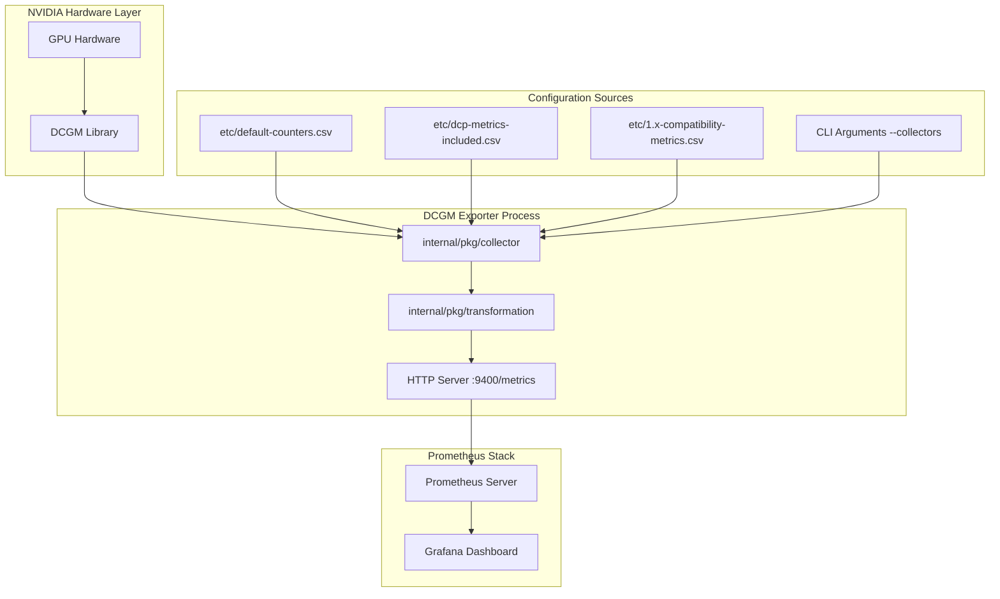
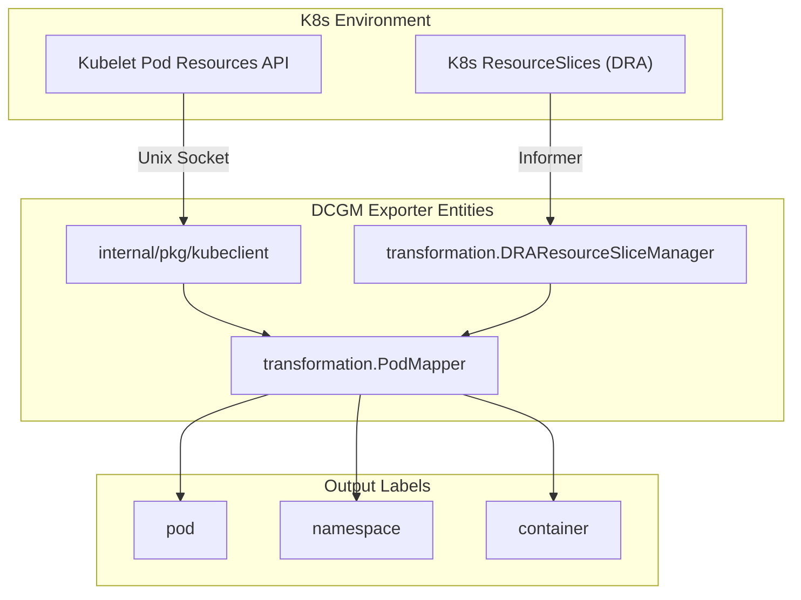
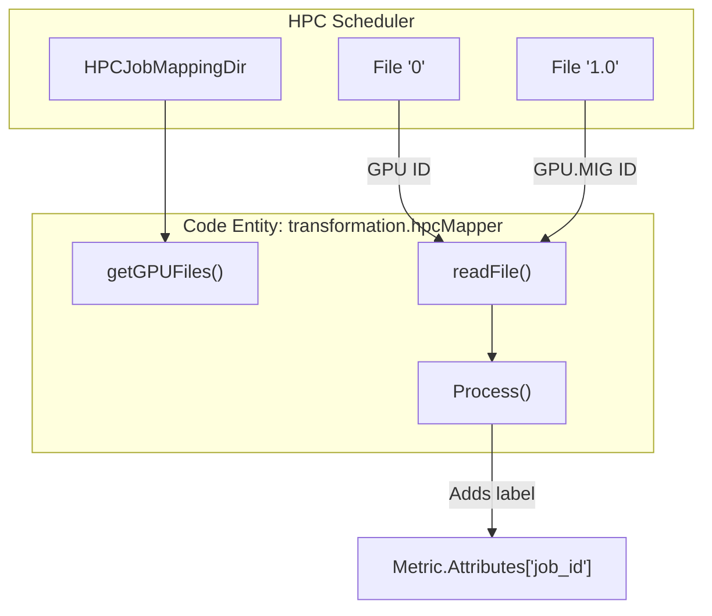

<!-- source: DeepWiki mcp.deepwiki.com · repo NVIDIA/dcgm-exporter · page 1.2 Key Features · fetched 2026-10-26 -->

# Key Features

Relevant source files

The following files were used as context for generating this wiki page:

- [README.md](README.md)
- [deployment/values.yaml](deployment/values.yaml)
- [internal/pkg/transformation/dra.go](internal/pkg/transformation/dra.go)
- [internal/pkg/transformation/hpc.go](internal/pkg/transformation/hpc.go)
- [internal/pkg/transformation/hpc_test.go](internal/pkg/transformation/hpc_test.go)

This document describes the core features and capabilities of DCGM Exporter, focusing on its technical implementation and configuration options. DCGM Exporter serves as a Prometheus-compatible exporter that collects NVIDIA GPU metrics using the NVIDIA DCGM library and exposes them for monitoring systems.

## Prometheus Integration

DCGM Exporter provides native Prometheus integration by exposing GPU metrics through a standard HTTP `/metrics` endpoint on port 9400. The exporter transforms DCGM field data into Prometheus-compatible metrics with proper typing and labels.

### Metrics Collection Architecture

The exporter supports multiple metric types including gauges for instantaneous values (temperature, utilization) and counters for accumulating values (energy consumption, error counts).

**Sources:** [README.md:10-27](), [etc/default-counters.csv:1-92](), [etc/dcp-metrics-included.csv:1-91]()

## Kubernetes Native Integration

DCGM Exporter is designed for Kubernetes environments with DaemonSet deployment and automatic service discovery through ServiceMonitor resources. It integrates with the Kubelet Pod Resources API to map GPU devices to specific Pods.

### Kubernetes Integration Components

The Kubernetes integration provides:
- **Pod Resource Mapping**: Access to kubelet pod resources API via the path defined in `kubeletPath` [deployment/values.yaml:187-187]().
- **Dynamic Resource Allocation (DRA) Support**: The `DRAResourceSliceManager` uses Kubernetes Informers to track `ResourceSlice` objects, allowing the exporter to map DRA-managed GPUs and MIG devices to their respective UUIDs [internal/pkg/transformation/dra.go:36-75]().
- **Automatic Label Enhancement**: Pod, namespace, and container labels are added to metrics when the `--kubernetes` flag is enabled.
- **ServiceMonitor Integration**: Automatic Prometheus discovery via the `ServiceMonitor` resource [deployment/values.yaml:127-149]().

**Sources:** [deployment/values.yaml:127-149](), [deployment/values.yaml:187-187](), [internal/pkg/transformation/dra.go:36-75](), [README.md:29-84]()

## Flexible Metrics Configuration

DCGM Exporter supports multiple metric configuration approaches through CSV files and runtime parameters. Users can toggle profiling metrics by switching between the default and DCP-included CSV files [deployment/values.yaml:22-24]().

### Available Metric Sets

| Configuration File | Purpose | Metric Count |
|-------------------|---------|--------------|
| `etc/default-counters.csv` | Standard GPU monitoring metrics | ~20 active metrics |
| `etc/dcp-metrics-included.csv` | Datacenter profiling metrics | ~25 active metrics |
| `etc/1.x-compatibility-metrics.csv` | Legacy compatibility metrics | ~15 metrics |

Custom metric configurations can be specified using the `-f` option or `--collectors` flag [README.md:156-160](). The exporter also supports hot-reloading metrics from a Kubernetes ConfigMap via the `-m` argument [deployment/values.yaml:36-38]().

**Sources:** [README.md:139-166](), [deployment/values.yaml:22-24](), [deployment/values.yaml:36-38]()

## Security Features

DCGM Exporter implements security features through the Prometheus `exporter-toolkit` for production deployments.

### Security Configuration

Security features include:
- **TLS Encryption**: HTTPS endpoint support with custom certificates. In Helm deployments, this can be configured via `tlsServerConfig` with support for autogenerated self-signed certificates or existing secrets [deployment/values.yaml:190-215]().
- **Basic Authentication**: Username/password protection for the metrics endpoint, configured via the `basicAuth` values [deployment/values.yaml:217-219]().
- **Command-line Interface**: Support for the `--web-config-file` flag to load security configurations [README.md:87-91]().

**Sources:** [README.md:85-94](), [deployment/values.yaml:190-219]()

## HPC Job Mapping

DCGM Exporter supports High-Performance Computing (HPC) job mapping to associate GPU metrics with specific compute jobs (e.g., Slurm).

### HPC Mapping Implementation

The `hpcMapper` implementation:
- **Directory Watching**: Monitors a directory specified by `--hpc-job-mapping-dir` or `DCGM_HPC_JOB_MAPPING_DIR` [internal/pkg/transformation/hpc.go:39-52]().
- **File Conventions**: Matches files named after GPU IDs (e.g., `0`) or MIG instances (e.g., `2.0`) using regex [internal/pkg/transformation/hpc.go:163-166]().
- **Metric Transformation**: Reads Job IDs from these files and injects them as the `job_id` attribute into the metrics [internal/pkg/transformation/hpc.go:94-127]().

**Sources:** [README.md:95-109](), [internal/pkg/transformation/hpc.go:39-52](), [internal/pkg/transformation/hpc.go:163-166](), [internal/pkg/transformation/hpc.go:94-127]()

## Multi-Deployment and Architecture Support

DCGM Exporter supports multiple deployment methods and hardware architectures.

### Deployment Options

| Method | Use Case | Configuration |
|--------|----------|---------------|
| **Binary Installation** | Direct host deployment | `make binary && make install` |
| **Docker Container** | Containerized deployment | `docker run --gpus all --cap-add SYS_ADMIN` |
| **Kubernetes DaemonSet** | K8s cluster deployment | `kubectl create -f dcgm-exporter.yaml` |
| **Helm Chart** | Production K8s deployment | `helm install gpu-helm-charts/dcgm-exporter` |

### Container Requirements
- **System Capabilities**: `SYS_ADMIN` is required for profiling metrics (`DCGM_FI_PROF_*`) [deployment/values.yaml:98-100]().
- **Multi-Arch**: The project supports building for `linux/amd64` and `linux/arm64` and offers image variants including `ubuntu22.04`, `ubi9`, and `distroless` [README.md:14-14]().

**Sources:** [README.md:11-27](), [README.md:110-137](), [deployment/values.yaml:98-100]()

## Monitoring and Visualization

The project includes an official Grafana dashboard (ID: 12239) and a local JSON definition at `grafana/dcgm-exporter-dashboard.json` [README.md:167-173]().

**Sources:** [README.md:167-173]()

---

