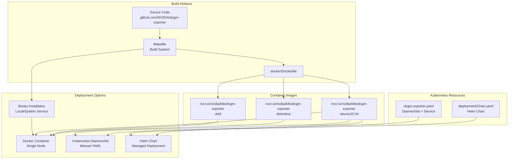
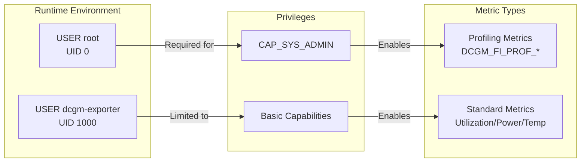
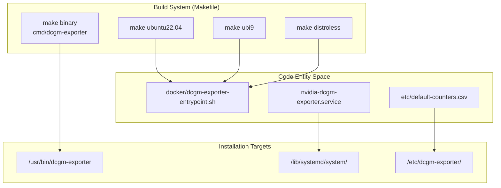

<!-- source: DeepWiki mcp.deepwiki.com · repo NVIDIA/dcgm-exporter · page 2 Installation and Deployment · fetched 2026-10-26 -->

# Installation and Deployment

<details>
<summary>Relevant source files</summary>

The following files were used as context for generating this wiki page:

- [Makefile](Makefile)
- [README.md](README.md)
- [docker/Dockerfile](docker/Dockerfile)

</details>


This document provides an overview of the different methods available for installing and deploying DCGM Exporter in various environments. DCGM Exporter can be deployed as a standalone binary, Docker container, Kubernetes DaemonSet, or using Helm charts depending on your infrastructure requirements.

For detailed configuration options, see [Configuration](#3). For development and building from source, see [Development Guide](#5). For monitoring setup and Grafana dashboards, see [Metrics and Monitoring](#4).

## Deployment Methods Overview

DCGM Exporter supports multiple deployment strategies to accommodate different infrastructure setups and operational requirements:



**Sources:** [README.md:10-84](), [Makefile:33-96](), [docker/Dockerfile:1-113]()

## Prerequisites

Before deploying DCGM Exporter, ensure your environment meets these requirements:

| Component | Requirement | Purpose |
|-----------|-------------|---------|
| **NVIDIA GPU** | DCGM-compatible GPU | Metrics collection source |
| **DCGM Library** | DCGM 4.0+ | GPU metrics API [docker/Dockerfile:141-142]() |
| **Container Runtime** | Docker/containerd with NVIDIA runtime | GPU access in containers [README.md:33-34]() |
| **Go Version** | 1.24+ | For building from source [Makefile:24](), [README.md:114]() |

### Runtime Capabilities and Security

DCGM Exporter requires specific privileges for advanced metrics collection, specifically profiling fields.



**Sources:** [docker/Dockerfile:158-188](), [README.md:14]()

## Deployment Architecture

The following diagram shows how the build system translates source code into deployable entities across different targets:



**Sources:** [Makefile:36-44](), [Makefile:120-128](), [docker/Dockerfile:153-190]()

## Container Image Variants

DCGM Exporter provides multiple container base images via the [docker/Dockerfile]() and [Makefile]():

| Image Variant | Base Image | Use Case |
|---------------|------------|----------|
| **ubuntu22.04** | `nvcr.io/nvidia/cuda:13.1.1-base-ubuntu22.04` | Standard Ubuntu environment [Makefile:73]() |
| **ubi9** | `nvcr.io/nvidia/cuda:13.1.1-base-ubi9` | Red Hat Enterprise Linux compatibility [Makefile:66]() |
| **distroless** | `runtime-distroless` target | Minimal attack surface, security-focused [Makefile:77]() |

All images support multi-architecture builds for `linux/amd64` and `linux/arm64` [Makefile:28]().

**Sources:** [Makefile:62-80](), [docker/Dockerfile:113-200]()

## Quick Start Examples

### Docker Container
Standard deployment with profiling capabilities:
```bash
docker run -d --gpus all --cap-add SYS_ADMIN --rm -p 9400:9400 \
  nvcr.io/nvidia/k8s/dcgm-exporter:4.5.2-4.8.1-distroless
```

### Kubernetes (Helm)
The recommended way to install on Kubernetes:
```bash
helm repo add gpu-helm-charts https://nvidia.github.io/dcgm-exporter/helm-charts
helm install dcgm-exporter gpu-helm-charts/dcgm-exporter
```

**Sources:** [README.md:14-54]()

## Detailed Installation Instructions

For specific deployment scenarios, refer to the following detailed guides:

- **[Binary Installation](#2.1)** — Instructions for building and installing DCGM Exporter from source as a binary [Makefile:36-44](), including the systemd service unit [Makefile:127-128]().
- **[Docker Deployment](#2.2)** — Guide for running DCGM Exporter as a Docker container, including multi-architecture builds [Makefile:89](), the entrypoint script [docker/Dockerfile:190](), and required capabilities.
- **[Kubernetes Deployment](#2.3)** — Manual Kubernetes deployment using YAML manifests and DaemonSet configuration [README.md:59]().
- **[Helm Chart Deployment](#2.4)** — Comprehensive guide for deploying DCGM Exporter using Helm charts with customizable values [README.md:35-54]().

**Sources:** [README.md:9-137](), [Makefile:33-132](), [docker/Dockerfile:113-190]()

---

