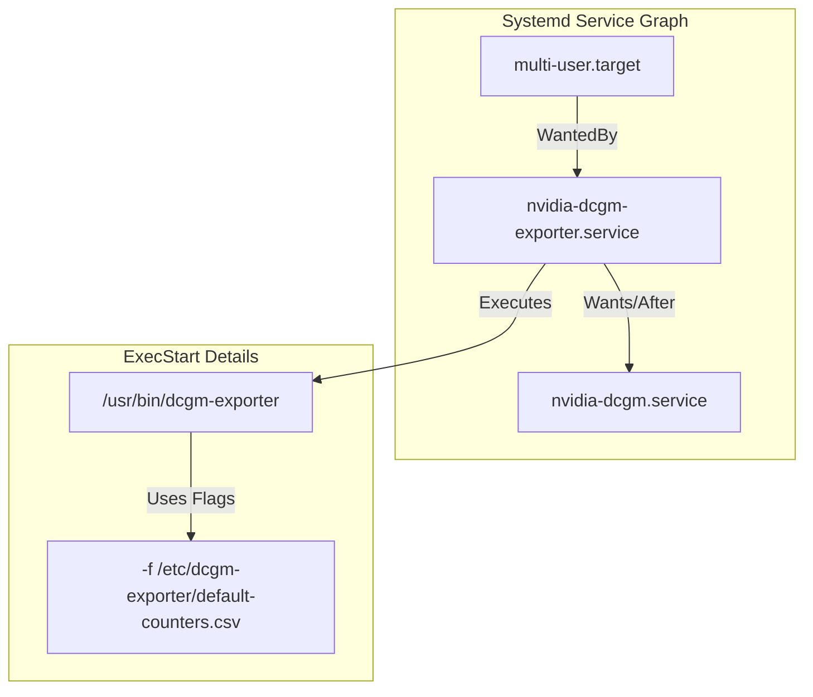

<!-- source: DeepWiki mcp.deepwiki.com · repo NVIDIA/dcgm-exporter · page 2.1 Binary Installation · fetched 2026-10-26 -->

# Binary Installation

<details>
<summary>Relevant source files</summary>

The following files were used as context for generating this wiki page:

- [Makefile](Makefile)
- [hack/VERSION](hack/VERSION)
- [packaging/config-files/systemd/nvidia-dcgm-exporter.service](packaging/config-files/systemd/nvidia-dcgm-exporter.service)

</details>


This page provides detailed instructions for installing DCGM Exporter as a binary directly on a system. This method is ideal for environments where containerization is not preferred or where direct systemd integration is required.

## Overview

Binary installation involves compiling the Go source code into an executable or extracting it from a pre-built package. The exporter then runs as a background process, typically managed by `systemd`, to collect GPU metrics and expose them via an HTTP endpoint.

```mermaid
flowchart TB
    subgraph "Build Phase"
        "Makefile" -- "runs" --> "go build"
        "cmd/dcgm-exporter/main.go" -- "compiles to" --> "dcgm-exporter binary"
    end

    subgraph "Installation Phase"
        "dcgm-exporter binary" -- "install -m 755" --> "/usr/bin/dcgm-exporter"
        "etc/default-counters.csv" -- "install -m 644" --> "/etc/dcgm-exporter/default-counters.csv"
        "nvidia-dcgm-exporter.service" -- "cp" --> "/lib/systemd/system/"
    end

    subgraph "Runtime Phase"
        "/usr/bin/dcgm-exporter" -- "reads" --> "/etc/dcgm-exporter/default-counters.csv"
        "systemd" -- "manages" --> "/usr/bin/dcgm-exporter"
    end
```
Sources: [Makefile:36-45](), [Makefile:118-128](), [packaging/config-files/systemd/nvidia-dcgm-exporter.service:28-28]()

## Prerequisites

Before installing, ensure the following are available:
*   **NVIDIA Drivers**: Installed and functional.
*   **DCGM**: The `nvidia-dcgm` service must be running.
*   **Go**: Version 1.24.13 (if building from source).
*   **Build Tools**: `make`, `gcc`, and `libc-dev`.

Sources: [Makefile:24-24](), [packaging/config-files/systemd/nvidia-dcgm-exporter.service:18-19]()

## Installation Methods

### Method 1: Building from Source

The `Makefile` provides targets to build the binary and install it to the local system.

1.  **Compile the binary**:
    The `binary` target executes `go build` with specific linker flags to embed the version information.
    ```bash
    make binary
    ```
    [Makefile:36-37]()

2.  **Install to system paths**:
    The `install` target moves the binary and default configuration files to standard Linux directories.
    ```bash
    sudo make install
    ```
    [Makefile:42-45]()

| Component | Source Path | Destination Path |
| :--- | :--- | :--- |
| **Binary** | `cmd/dcgm-exporter/dcgm-exporter` | `/usr/bin/dcgm-exporter` |
| **Counters** | `./etc/default-counters.csv` | `/etc/dcgm-exporter/default-counters.csv` |

Sources: [Makefile:36-45]()

### Method 2: Creating a Portable Tarball

You can package the exporter into a distribution tarball containing the binary, configuration, and systemd unit file.

```bash
# For x86_64
make package-amd64

# For ARM64
make package-arm64
```

The `package-build` target performs the following steps:
1.  Builds a temporary Docker image to ensure a clean build environment. [Makefile:118-118]()
2.  Creates a directory structure mimicking the root filesystem. [Makefile:119-121]()
3.  Copies the binary from the container to `/usr/bin`. [Makefile:123-123]()
4.  Copies the `nvidia-dcgm-exporter.service` file to `/lib/systemd/system/`. [Makefile:126-128]()
5.  Compresses the result into `dist/dcgm_exporter-linux-<arch>-<version>.tar.gz`. [Makefile:131-131]()

Sources: [Makefile:101-132]()

## Systemd Integration

To run DCGM Exporter as a system service, use the provided unit file located at `packaging/config-files/systemd/nvidia-dcgm-exporter.service`.

### Service Configuration

The service is configured to depend on the DCGM engine (`nvidia-dcgm.service`).



**Key Service Properties**:
*   **User**: Runs as `root` to ensure access to DCGM sockets. [packaging/config-files/systemd/nvidia-dcgm-exporter.service:22-22]()
*   **Logging**: Outputs are appended to `/var/log/dcgm-exporter.log`. [packaging/config-files/systemd/nvidia-dcgm-exporter.service:25-26]()
*   **Execution**: Starts the exporter with the default counters file using the `-f` flag. [packaging/config-files/systemd/nvidia-dcgm-exporter.service:28-28]()
*   **Restart**: Configured to restart `on-abort`. [packaging/config-files/systemd/nvidia-dcgm-exporter.service:30-30]()

Sources: [packaging/config-files/systemd/nvidia-dcgm-exporter.service:16-33]()

### Enabling the Service

Once the files are in place, manage the service using `systemctl`:

```bash
# Reload systemd to recognize the new unit
sudo systemctl daemon-reload

# Enable and start the service
sudo systemctl enable --now nvidia-dcgm-exporter

# Verify status
systemctl status nvidia-dcgm-exporter
```

## Binary Versioning

The build process uses the `hack/VERSION` file to determine the version strings injected into the binary.

*   `NEW_DCGM_VERSION`: The version of the underlying DCGM library. [hack/VERSION:3-3]()
*   `NEW_EXPORTER_VERSION`: The version of the exporter wrapper. [hack/VERSION:4-4]()

These are combined into the `BuildVersion` variable in the `main` package during compilation. [Makefile:23-26](), [Makefile:37-37]()

Sources: [hack/VERSION:1-4](), [Makefile:23-37]()

---

