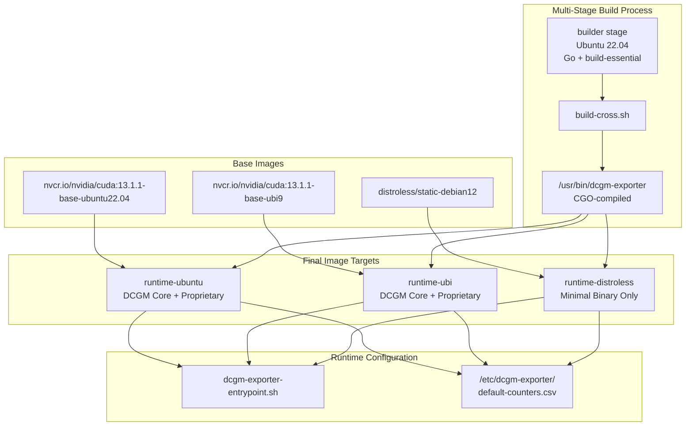
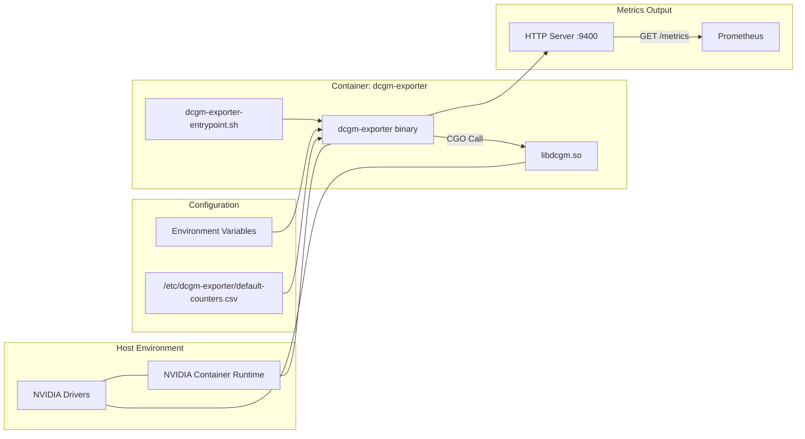
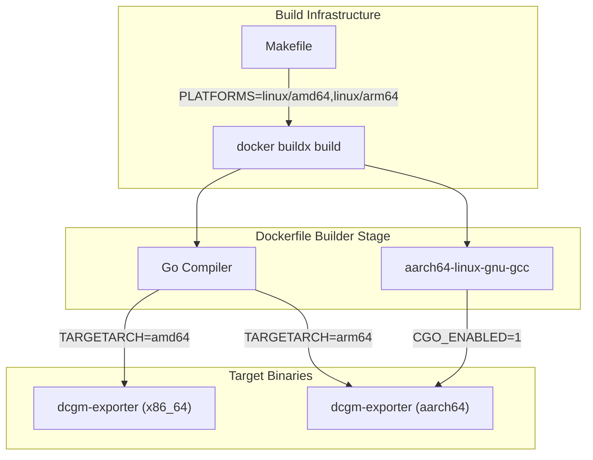

<!-- source: DeepWiki mcp.deepwiki.com · repo NVIDIA/dcgm-exporter · page 2.2 Docker Deployment · fetched 2026-10-26 -->

# Docker Deployment

<details>
<summary>Relevant source files</summary>

The following files were used as context for generating this wiki page:

- [Makefile](Makefile)
- [docker/Dockerfile](docker/Dockerfile)
- [docker/dcgm-exporter-entrypoint.sh](docker/dcgm-exporter-entrypoint.sh)

</details>


This page covers running DCGM Exporter as a Docker container, including available container images, configuration options, and deployment commands. For deploying on Kubernetes, see [Kubernetes Deployment](#2.3). For Helm-based deployment, see [Helm Chart Deployment](#2.4).

## Available Container Images

DCGM Exporter provides multiple container variants to support different deployment environments and base image preferences:

| Image Variant | Base Image | Use Case |
|---------------|------------|----------|
| `ubuntu22.04` | Ubuntu 22.04 with CUDA | General purpose, full Ubuntu environment |
| `ubi9` | Red Hat UBI 9 with CUDA | Enterprise environments requiring Red Hat compatibility |
| `distroless` | Distroless base | Minimal attack surface, production security |

All images are available from the NVIDIA Container Registry. The image tag follows the format `[DCGM_VERSION]-[EXPORTER_VERSION]-[OS_VARIANT]`. [Makefile:26-95]()

### Container Architecture

The build process uses a unified multi-stage `Dockerfile` to produce all variants. [docker/Dockerfile:1-195]()



Sources: [docker/Dockerfile:20-113](), [docker/Dockerfile:195-200](), [Makefile:62-80]()

## Quick Start

The simplest way to run DCGM Exporter in Docker is:

```bash
docker run -d --gpus all --cap-add SYS_ADMIN --rm -p 9400:9400 \
    nvcr.io/nvidia/k8s/dcgm-exporter:4.3.1-4.4.1-ubuntu22.04
```

Test the deployment:

```bash
curl localhost:9400/metrics
```

This exposes GPU metrics on port 9400 at the `/metrics` endpoint.

## Container Configuration

### Required Docker Options and Capabilities

| Option | Purpose | Required |
|--------|---------|----------|
| `--gpus all` | GPU access via NVIDIA Container Runtime | Yes |
| `--cap-add SYS_ADMIN` | Required for Profiling metrics (`DCGM_FI_PROF_*`) | Optional (Recommended) |
| `-p 9400:9400` | Expose metrics endpoint | Yes |

### Runtime Security and Entrypoint

The container uses a simple shell entrypoint `dcgm-exporter-entrypoint.sh` that executes the binary. [docker/dcgm-exporter-entrypoint.sh:1-7]()

**Security Implementation Details:**
- **User:** The container defaults to `USER root` [docker/Dockerfile:188]() because Docker's `--cap-add` grants capabilities to UID 0. [docker/Dockerfile:158-161]()
- **Capabilities:** Profiling metrics require `CAP_SYS_ADMIN`. The application performs runtime capability checking in `internal/pkg/capabilities`. [docker/Dockerfile:163-167]()
- **Non-Root Option:** For basic metrics (non-profiling), the container can be run as `USER 1000` (the `dcgm-exporter` user). [docker/Dockerfile:128-129](), [docker/Dockerfile:178-181]()

### Environment Variables

The container behavior is influenced by these variables set in the `Dockerfile`:

| Variable | Default | Description |
|----------|---------|-------------|
| `NVIDIA_DRIVER_CAPABILITIES` | `compute,utility,compat32` | Driver capabilities for the container [docker/Dockerfile:149]() |
| `NVIDIA_DISABLE_REQUIRE` | `true` | Disables NVIDIA container constraints [docker/Dockerfile:150]() |
| `NVIDIA_VISIBLE_DEVICES` | `all` | Controls which GPUs are visible [docker/Dockerfile:151]() |

### Deployment Data Flow



Sources: [docker/dcgm-exporter-entrypoint.sh:7](), [docker/Dockerfile:134-135](), [docker/Dockerfile:141-142]()

## Multi-Architecture Support

DCGM Exporter supports `linux/amd64` and `linux/arm64`. [Makefile:28]()

### Build System Implementation

The build system uses `docker buildx` to perform cross-platform builds within the `builder` stage. [Makefile:29](), [docker/Dockerfile:20]()

- For `arm64` builds, the builder installs `gcc-aarch64-linux-gnu` and `libc6-dev-arm64-cross`. [docker/Dockerfile:37-40]()
- A specialized script, `build-cross.sh`, handles the specific `GOARCH` and `CC` environment variables for CGO. [docker/Dockerfile:95-102]()

### Multi-Architecture Diagram



Sources: [Makefile:81-96](), [docker/Dockerfile:31-42](), [docker/Dockerfile:98-102]()

## Building Custom Container Images

### Local Builds

To build an image for your local architecture:

```bash
# Build current architecture for a specific variant (e.g., ubuntu22.04)
make local CONTAINER=ubuntu22.04
```
[Makefile:55-60]()

### Multi-Platform Builds

To build and push multi-architecture images:

```bash
# Builds all variants (ubuntu22.04, ubi9, distroless) for both platforms
make push REGISTRY=your-registry
```
[Makefile:50-54]()

### Image Customization

The `Makefile` allows overriding key versions:
- `DCGM_VERSION`: Version of the DCGM library. [Makefile:23]()
- `GOLANG_VERSION`: Version of the Go compiler. [Makefile:24]()
- `VERSION`: Version of the exporter. [Makefile:25]()

Sources: [Makefile:15-34](), [Makefile:81-96]()

## Container Security Summary

1.  **User Identity:** A non-root user `dcgm-exporter` (UID 1000) is created in the image. [docker/Dockerfile:128-129]()
2.  **File Permissions:** Executables are set to `755` and configuration files to `644`. [docker/Dockerfile:133-136]()
3.  **DCGM Packages:** Only necessary core and proprietary DCGM packages are installed to minimize image size. [docker/Dockerfile:141-142]()
4.  **Capability Check:** The application is designed to warn if `CAP_SYS_ADMIN` is missing when profiling metrics are requested, rather than failing silently or requiring full privileges for basic operation. [docker/Dockerfile:163-166]()

Sources: [docker/Dockerfile:127-187]()

---

