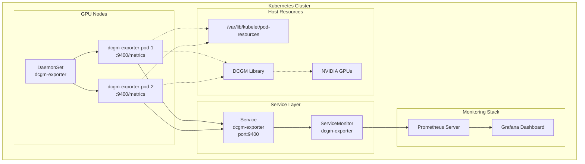
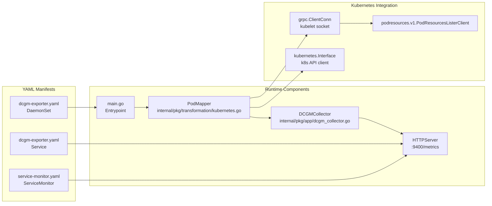
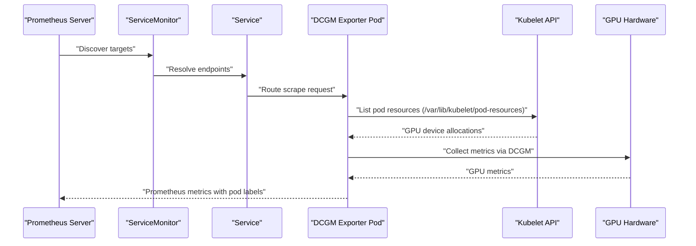

<!-- source: DeepWiki mcp.deepwiki.com · repo NVIDIA/dcgm-exporter · page 2.3 Kubernetes Deployment · fetched 2026-10-26 -->

# Kubernetes Deployment

<details>
<summary>Relevant source files</summary>

The following files were used as context for generating this wiki page:

- [dcgm-exporter.yaml](dcgm-exporter.yaml)
- [deployment/templates/clusterrole.yaml](deployment/templates/clusterrole.yaml)
- [deployment/templates/clusterrolebinding.yaml](deployment/templates/clusterrolebinding.yaml)
- [service-monitor.yaml](service-monitor.yaml)

</details>


This document covers manual Kubernetes deployment of DCGM Exporter using raw YAML manifests and DaemonSet configuration. For automated deployment using Helm charts with customizable values, see [2.4 Helm Chart Deployment]().

## Overview

Manual Kubernetes deployment involves applying pre-configured YAML manifests directly to your cluster. This approach provides full control over the deployment configuration but requires more manual setup compared to Helm-based deployment. The DCGM Exporter runs as a `DaemonSet` [dcgm-exporter.yaml:16-18]() to ensure GPU metrics collection on every GPU-enabled node in the cluster.

The deployment consists of three main Kubernetes resources:
- **DaemonSet**: Runs the DCGM Exporter pod on each GPU node [dcgm-exporter.yaml:16-18]().
- **Service**: Exposes the metrics endpoint for scraping [dcgm-exporter.yaml:80-83]().
- **ServiceMonitor**: Configures Prometheus Operator to discover and scrape metrics [service-monitor.yaml:15-18]().

## Deployment Architecture

### Component Overview


Sources: [dcgm-exporter.yaml:15-77](), [service-monitor.yaml:15-30]()

### Code Entity Mapping


Sources: [dcgm-exporter.yaml:37-51](), [service-monitor.yaml:23-29]()

## Manual Deployment Process

### Basic Deployment

Deploy DCGM Exporter using the provided manifest:

```bash
kubectl create -f https://raw.githubusercontent.com/NVIDIA/dcgm-exporter/master/dcgm-exporter.yaml
```

This creates the `DaemonSet` and `Service` resources [dcgm-exporter.yaml:15-94]().

### ServiceMonitor for Prometheus

If using Prometheus Operator, deploy the `ServiceMonitor` to allow Prometheus to automatically discover the `:9400/metrics` endpoint [service-monitor.yaml:15-30]().

```bash
kubectl create -f https://raw.githubusercontent.com/NVIDIA/dcgm-exporter/master/service-monitor.yaml
```

### Verification

Verify the deployment status:

```bash
# Check DaemonSet status
kubectl get daemonset dcgm-exporter

# Check pods on GPU nodes
kubectl get pods -l app.kubernetes.io/name=dcgm-exporter

# Test metrics endpoint via port-forward
kubectl port-forward <pod-name> 9400:9400
curl http://localhost:9400/metrics
```

Sources: [dcgm-exporter.yaml:18-21](), [service-monitor.yaml:18-21]()

## Core Components Configuration

### DaemonSet Configuration

The `DaemonSet` ensures DCGM Exporter runs on every GPU node with the following key configurations [dcgm-exporter.yaml:16-77]():

| Configuration | Value | Purpose |
|---------------|--------|---------|
| `image` | `nvcr.io/nvidia/k8s/dcgm-exporter:4.5.2-4.8.1-distroless` | Container image [dcgm-exporter.yaml:38]() |
| `securityContext.runAsUser` | `0` | Root privileges for DCGM access [dcgm-exporter.yaml:54]() |
| `securityContext.capabilities` | `["SYS_ADMIN"]` | Required for profiling metrics (`DCGM_FI_PROF_*`) [dcgm-exporter.yaml:56]() |
| `ports.containerPort` | `9400` | Metrics endpoint port [dcgm-exporter.yaml:51]() |
| `volumeMounts` | `/var/lib/kubelet/pod-resources` | Path to Kubelet Pod Resources API [dcgm-exporter.yaml:65]() |

### Environment Variables

| Variable | Value | Purpose |
|----------|--------|---------|
| `DCGM_EXPORTER_LISTEN` | `:9400` | Listen address for metrics server [dcgm-exporter.yaml:41]() |
| `DCGM_EXPORTER_KUBERNETES` | `true` | Enables Kubernetes integration features [dcgm-exporter.yaml:43]() |
| `NODE_NAME` | `spec.nodeName` | Identifies the host node for resource mapping [dcgm-exporter.yaml:47]() |

### Volume Mounts

The pod requires access to the kubelet pod resources API to map GPU devices to specific Pod UIDs and Names [dcgm-exporter.yaml:62-76]():

```yaml
volumeMounts:
- name: "pod-gpu-resources"
  readOnly: true
  mountPath: "/var/lib/kubelet/pod-resources"

volumes:
- name: "pod-gpu-resources"
  hostPath:
    path: "/var/lib/kubelet/pod-resources"
```

## RBAC Requirements

When features like Pod Labels or Pod UIDs are enabled, DCGM Exporter requires a `ClusterRole` to interact with the Kubernetes API [deployment/templates/clusterrole.yaml:1-12]().

| API Group | Resources | Verbs |
|-----------|-----------|-------|
| `""` (Core) | `pods` | `get`, `list`, `watch` |
| `resource.k8s.io` | `resourceslices` | `get`, `list`, `watch` |

Sources: [deployment/templates/clusterrole.yaml:8-11](), [deployment/templates/clusterrolebinding.yaml:1-16]()

## Service and Monitoring Integration

### Service Configuration

The `Service` provides a stable endpoint for scraping metrics across the `DaemonSet` [dcgm-exporter.yaml:80-94]():

```yaml
kind: Service
apiVersion: v1
metadata:
  name: "dcgm-exporter"
spec:
  selector:
    app.kubernetes.io/name: "dcgm-exporter"
  ports:
  - name: "metrics"
    port: 9400
```

### ServiceMonitor Integration

The `ServiceMonitor` allows the Prometheus Operator to scrape metrics automatically [service-monitor.yaml:15-30]():

```yaml
apiVersion: monitoring.coreos.com/v1
kind: ServiceMonitor
metadata:
  name: "dcgm-exporter"
spec:
  selector:
    matchLabels:
      app.kubernetes.io/name: "dcgm-exporter"
  endpoints:
  - port: "metrics"
    path: "/metrics"
```

### Monitoring Flow


Sources: [dcgm-exporter.yaml:42-47](), [dcgm-exporter.yaml:63-65](), [service-monitor.yaml:27-29]()

## Resource Limits

The default manifest includes recommended resource constraints for the exporter [dcgm-exporter.yaml:66-72]():

| Type | CPU | Memory |
|------|-----|--------|
| Limits | `200m` | `256Mi` |
| Requests | `100m` | `128Mi` |

Sources: [dcgm-exporter.yaml:1-94](), [service-monitor.yaml:1-30](), [deployment/templates/clusterrole.yaml:1-12]()

---

