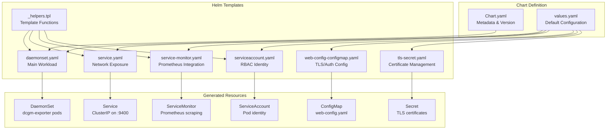
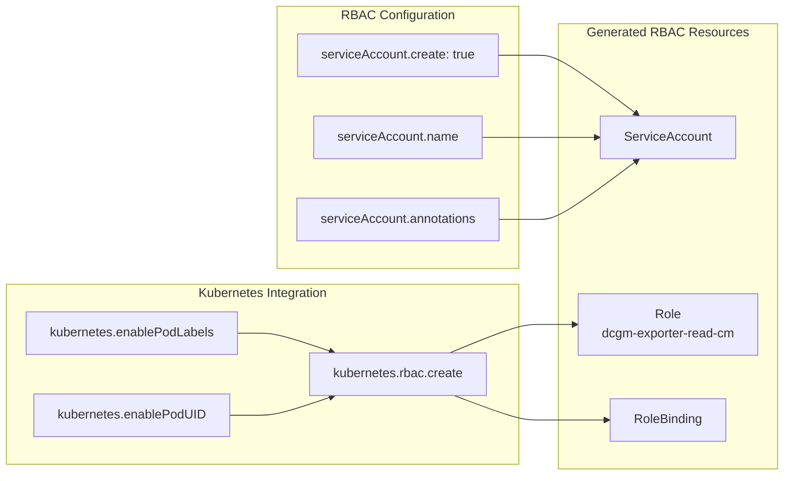
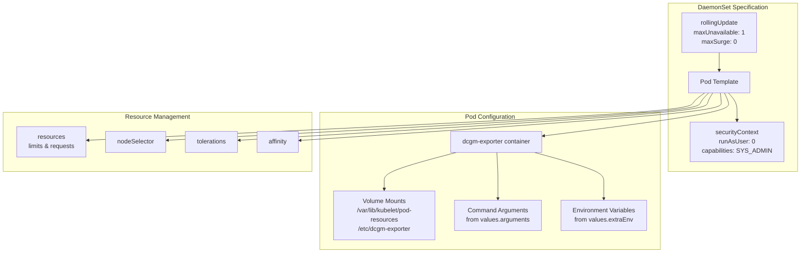
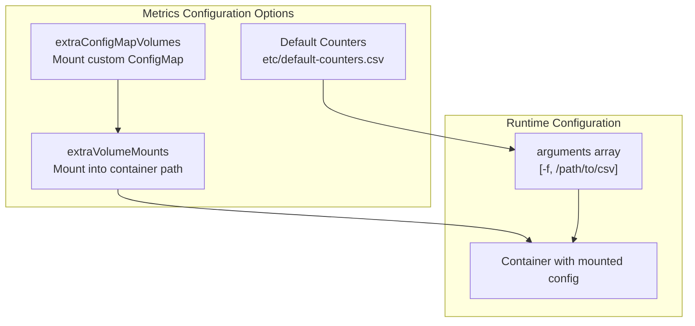

<!-- source: DeepWiki mcp.deepwiki.com · repo NVIDIA/dcgm-exporter · page 2.4 Helm Chart Deployment · fetched 2026-10-26 -->

# Helm Chart Deployment

<details>
<summary>Relevant source files</summary>

The following files were used as context for generating this wiki page:

- [deployment/Chart.yaml](deployment/Chart.yaml)
- [deployment/templates/NOTES.txt](deployment/templates/NOTES.txt)
- [deployment/templates/_helpers.tpl](deployment/templates/_helpers.tpl)
- [deployment/templates/daemonset.yaml](deployment/templates/daemonset.yaml)
- [deployment/templates/role.yaml](deployment/templates/role.yaml)
- [deployment/templates/rolebinding.yaml](deployment/templates/rolebinding.yaml)
- [deployment/templates/service-monitor.yaml](deployment/templates/service-monitor.yaml)
- [deployment/templates/serviceaccount.yaml](deployment/templates/serviceaccount.yaml)
- [deployment/values.yaml](deployment/values.yaml)

</details>


This document provides comprehensive guidance for deploying DCGM Exporter using the official Helm chart. It covers chart installation, configuration options, and the Kubernetes resources that are generated during deployment.

For manual Kubernetes deployment without Helm, see [2.3 Kubernetes Deployment](). For configuration details specific to metrics and monitoring, see [3. Configuration]().

## Chart Overview

The DCGM Exporter Helm chart provides a declarative way to deploy DCGM Exporter as a DaemonSet across GPU-enabled Kubernetes nodes. The chart is structured around a comprehensive values configuration system that generates multiple Kubernetes resources for monitoring GPU metrics.

### Chart Structure



**Sources:** [deployment/Chart.yaml:1-18](), [deployment/values.yaml:1-240](), [deployment/templates/_helpers.tpl:1-97]()

## Installation

### Basic Installation

Install DCGM Exporter using the default configuration:

```bash
helm repo add nvidia https://helm.ngc.nvidia.com/nvidia
helm repo update
helm install dcgm-exporter nvidia/dcgm-exporter
```

### Installation with Custom Values

Create a custom values file to override defaults:

```bash
helm install dcgm-exporter nvidia/dcgm-exporter -f custom-values.yaml
```

### Installation from Source

Clone the repository and install the chart locally:

```bash
git clone https://github.com/NVIDIA/dcgm-exporter.git
cd dcgm-exporter
helm install dcgm-exporter ./deployment
```

## Core Configuration Components

The chart's configuration system is built around several key components defined in the `values.yaml` file:

### Image Configuration

The chart uses the official NVIDIA DCGM Exporter image from NGC:

| Parameter | Default Value | Description |
|-----------|---------------|-------------|
| `image.repository` | `nvcr.io/nvidia/k8s/dcgm-exporter` | Container image repository |
| `image.tag` | `4.5.2-4.8.1-distroless` | Image tag (defaults to appVersion) |
| `image.pullPolicy` | `IfNotPresent` | Image pull policy |

**Sources:** [deployment/values.yaml:15-21](), [deployment/Chart.yaml:6-6]()

### Arguments and Metrics Configuration

The exporter's behavior is controlled through command-line arguments and metrics configuration:

```yaml
arguments: ["-f", "/etc/dcgm-exporter/default-counters.csv"]
```

The chart supports several argument patterns via the `arguments` key:
- `-r <HOST>:<PORT>` - Connect to an already running hostengine [deployment/values.yaml:27-28]()
- `-n` - Remove the hostname tag from the output [deployment/values.yaml:29-30]()
- `-d <device_spec>` - Specify the devices to monitor (e.g., `g+i` for MIG) [deployment/values.yaml:31-35]()
- `-m <namespace:configmap>` - Specify the namespace and name of a configmap containing watched exporter fields [deployment/values.yaml:36-38]()

**Sources:** [deployment/values.yaml:22-39](), [deployment/templates/daemonset.yaml:123-125]()

### Service Account and RBAC

The chart manages the `ServiceAccount` and required `Role` / `RoleBinding` for accessing Kubernetes metadata or configuration.



**Sources:** [deployment/values.yaml:65-74](), [deployment/templates/serviceaccount.yaml:1-28](), [deployment/templates/role.yaml:1-13](), [deployment/templates/rolebinding.yaml:1-16]()

## Kubernetes Resource Generation

The Helm chart generates multiple Kubernetes resources based on the values configuration:

### DaemonSet Configuration

The primary workload is deployed as a DaemonSet to ensure DCGM Exporter runs on every GPU node. It mounts the Kubelet pod-resources socket to map GPUs to pods.



**Sources:** [deployment/values.yaml:75-80](), [deployment/values.yaml:95-105](), [deployment/values.yaml:120-126](), [deployment/values.yaml:150-166](), [deployment/templates/daemonset.yaml:1-188]()

### Service and ServiceMonitor

The chart creates networking resources for Prometheus integration. The `ServiceMonitor` is compatible with the Prometheus Operator.

| Resource | Purpose | Configuration |
|----------|---------|---------------|
| Service | Exposes metrics endpoint | `service.enable: true`, `service.port: 9400` |
| ServiceMonitor | Prometheus scraping config | `serviceMonitor.enabled: true`, `serviceMonitor.interval: 15s` |

**Sources:** [deployment/values.yaml:107-118](), [deployment/values.yaml:127-149](), [deployment/templates/service-monitor.yaml:1-43]()

## Advanced Configuration

### TLS and Security Configuration

The chart supports HTTPS encryption and basic authentication through the `tlsServerConfig` and `basicAuth` sections:

```yaml
tlsServerConfig:
  enabled: false
  autoGenerated: true
  existingSecret: ""
  certFilename: "tls.crt"
  keyFilename: "tls.key"
  caFilename: "ca.crt"
  clientAuthType: ""

basicAuth:
  users: {}
```

When TLS or Basic Auth is enabled, the chart generates:
- A `web-config.yaml` file provided via a ConfigMap [deployment/templates/daemonset.yaml:89-93]()
- Environment variable `DCGM_EXPORTER_WEB_CONFIG_FILE` pointing to `/etc/dcgm-exporter/web-config.yaml` [deployment/templates/daemonset.yaml:155-158]()
- A Secret with TLS certificates if `autoGenerated` is true or an `existingSecret` is provided [deployment/templates/daemonset.yaml:82-87]()

**Sources:** [deployment/values.yaml:190-219](), [deployment/templates/daemonset.yaml:155-158](), [deployment/templates/_helpers.tpl:82-96]()

### Custom Metrics Configuration

The chart provides multiple approaches for mounting custom metric CSV files:



Example of mounting a custom ConfigMap for metrics:
```yaml
extraConfigMapVolumes:
  - name: exporter-metrics-volume
    configMap:
      name: exporter-metrics-config-map
      items:
      - key: metrics
        path: default-counters.csv

extraVolumeMounts:
  - name: exporter-metrics-volume
    mountPath: /etc/dcgm-exporter/default-counters.csv
    subPath: default-counters.csv
```

**Sources:** [deployment/values.yaml:171-183](), [deployment/templates/daemonset.yaml:99-101](), [deployment/templates/daemonset.yaml:182-184]()

### Kubernetes Integration Features

The chart provides advanced Kubernetes integration capabilities through environment variables and RBAC:

| Feature | Configuration | Purpose |
|---------|---------------|---------|
| Pod Labels | `kubernetes.enablePodLabels: true` | Include pod labels in GPU metrics via `DCGM_EXPORTER_KUBERNETES_ENABLE_POD_LABELS` |
| Pod UID | `kubernetes.enablePodUID: true` | Include pod UID in GPU metrics via `DCGM_EXPORTER_KUBERNETES_ENABLE_POD_UID` |
| DRA Support | `kubernetesDRA.enabled: true` | Support Dynamic Resource Allocation via `KUBERNETES_ENABLE_DRA` |

**Sources:** [deployment/templates/daemonset.yaml:135-162](), [deployment/values.yaml:202-218]()

### Debug and Troubleshooting Configuration

The chart includes debugging capabilities that allow dumping internal state to the host:

```yaml
debugDump:
  enabled: false
  directory: "/tmp/dcgm-exporter-debug"
  retention: 24
  compression: true
```

When enabled, the chart configures the `--dump-enabled`, `--dump-directory`, and `--dump-retention` flags on the exporter container.

**Sources:** [deployment/values.yaml:220-230](), [deployment/templates/daemonset.yaml:126-133]()

## Monitoring Integration

The chart is designed for seamless Prometheus integration through the `ServiceMonitor` resource. It supports custom intervals, relabeling, and metric relabeling rules.

```yaml
serviceMonitor:
  enabled: true
  interval: 15s
  scrapeTimeout: 10s
  honorLabels: false
  relabelings: []
  metricRelabelings: []
```

The `ServiceMonitor` targets the `metrics` port (9400) and the `/metrics` path.

**Sources:** [deployment/values.yaml:127-149](), [deployment/templates/service-monitor.yaml:33-42]()

---

