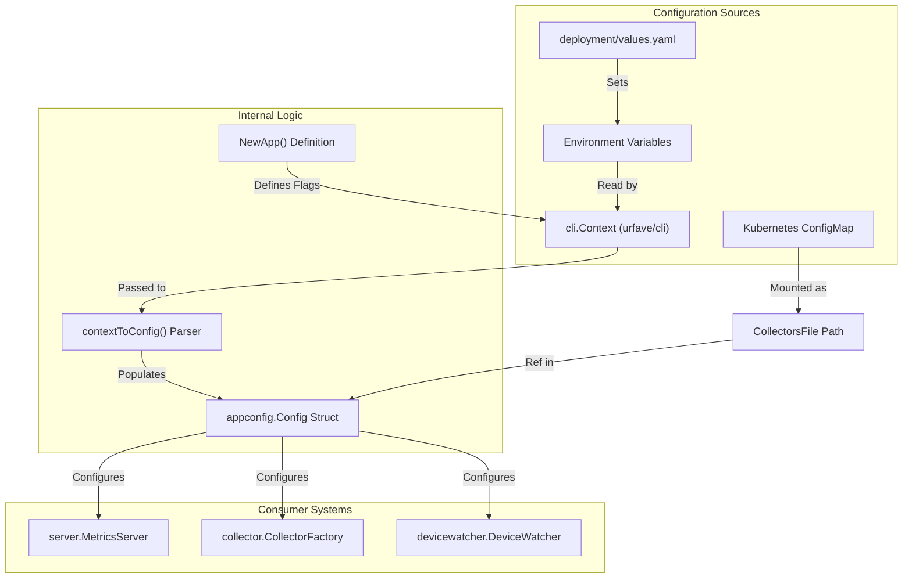
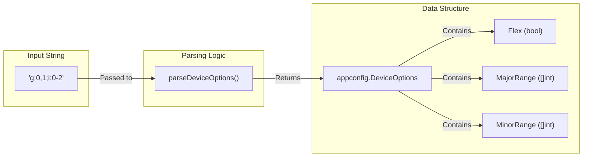

<!-- source: DeepWiki mcp.deepwiki.com · repo NVIDIA/dcgm-exporter · page 3 Configuration · fetched 2026-10-26 -->

# Configuration

Relevant source files

The following files were used as context for generating this wiki page:

- [internal/pkg/appconfig/types.go](internal/pkg/appconfig/types.go)
- [pkg/cmd/app.go](pkg/cmd/app.go)

DCGM Exporter supports a multi-layered configuration model involving CLI flags, environment variables, Helm chart values, and Kubernetes ConfigMaps. Configuration logic is centralized in the `pkg/cmd/app.go` file, where the `contextToConfig` function populates the `appconfig.Config` struct used throughout the application lifecycle.

## Configuration Flow Architecture

The following diagram illustrates how configuration sources are prioritized and mapped to internal code entities.

**Configuration Mapping Diagram**

Sources: [pkg/cmd/app.go:107-114](), [pkg/cmd/app.go:663-722](), [internal/pkg/appconfig/types.go:41-79](), [deployment/values.yaml:15-325]()

## Configuration Areas

DCGM Exporter configuration is divided into several specialized areas. For detailed implementation details, refer to the child pages linked below.

### [Command-line Options](#3.1)
The exporter uses the `urfave/cli` library to define its interface. Flags are defined as constants (e.g., `CLIFieldsFile`, `CLIAddress`) and support both short and long formats. Key options include device selection strings for GPUs, NvSwitches, and CPUs, as well as collection intervals.
*   **Key Logic**: `NewApp()` defines the flags [pkg/cmd/app.go:107-324]().
*   **For details, see [Command-line Options](#3.1).**

### [Environment Variables](#3.2)
Almost every CLI flag has a corresponding environment variable defined in the `EnvVars` slice of the flag definition. This is the primary configuration method for containerized deployments via Docker or Helm.
*   **Naming Pattern**: Most variables use the `DCGM_EXPORTER_` prefix (e.g., `DCGM_EXPORTER_LISTEN`) [pkg/cmd/app.go:134]().
*   **For details, see [Environment Variables](#3.2).**

### [Metrics Configuration](#3.3)
This area covers how to define which DCGM fields are collected and exposed. The configuration is typically a CSV file (default: `/etc/dcgm-exporter/default-counters.csv`). The exporter supports hot-reloading these configurations without a restart.
*   **Key Logic**: `CLIFieldsFile` constant [pkg/cmd/app.go:68]() and `CollectorsFile` field in `Config` [internal/pkg/appconfig/types.go:42]().
*   **For details, see [Metrics Configuration](#3.3).**

### [Kubernetes Integration](#3.4)
When running in Kubernetes, the exporter can map GPU metrics to specific Pods. This requires configuring the Kubelet Pod Resources socket and enabling specific mapping flags. It also supports the newer Dynamic Resource Allocation (DRA) API.
*   **Key Flags**: `CLIKubernetes` [pkg/cmd/app.go:144](), `CLIKubernetesEnableDRA` [pkg/cmd/app.go:101](), and `CLIPodResourcesKubeletSocket` [pkg/cmd/app.go:93]().
*   **For details, see [Kubernetes Integration](#3.4).**

### [Security Configuration](#3.5)
The exporter provides built-in support for securing the `/metrics` endpoint. This includes TLS encryption and Basic Authentication, configured via a `web-config.yaml` file.
*   **Key Logic**: `CLIWebConfigFile` [pkg/cmd/app.go:85]() and `WebConfigFile` field in `Config` [internal/pkg/appconfig/types.go:63]().
*   **For details, see [Security Configuration](#3.5).**

## Device Selection Logic

A critical part of the configuration is the `DeviceOptions` struct, which determines which hardware entities are monitored. This is parsed from strings using the `FlexKey` ("f"), `MajorKey` ("g"), and `MinorKey` ("i") syntax.

**Device Selection Code Entity Map**

Sources: [pkg/cmd/app.go:41-44](), [pkg/cmd/app.go:600-661](), [internal/pkg/appconfig/types.go:27-31]()

## Advanced Debugging and Dumps
The exporter includes a `DumpConfig` system that allows for file-based debugging of the internal state. This is configured via flags like `CLIDumpEnabled` and `CLIDumpDirectory`, allowing developers to capture the state of the metric registry and device lists for troubleshooting.
*   **Structure**: `DumpConfig` struct [internal/pkg/appconfig/types.go:34-39]().
*   **Flags**: `CLIDumpEnabled`, `CLIDumpDirectory`, `CLIDumpRetention`, `CLIDumpCompression` [pkg/cmd/app.go:97-100]().

Sources: [pkg/cmd/app.go:97-100](), [internal/pkg/appconfig/types.go:34-39](), [internal/pkg/appconfig/types.go:74]()

---

