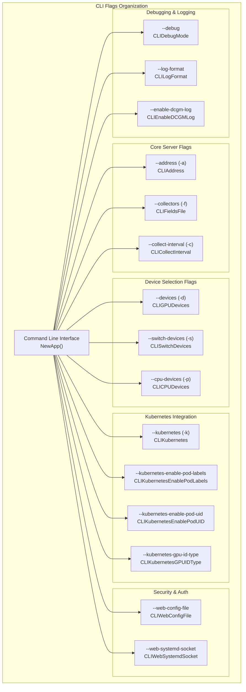
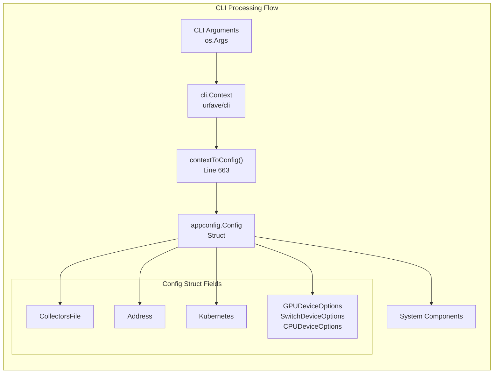
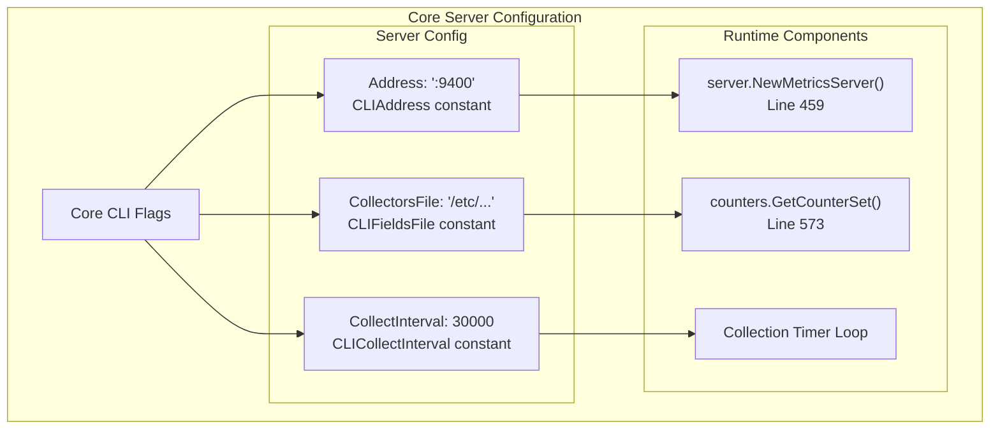
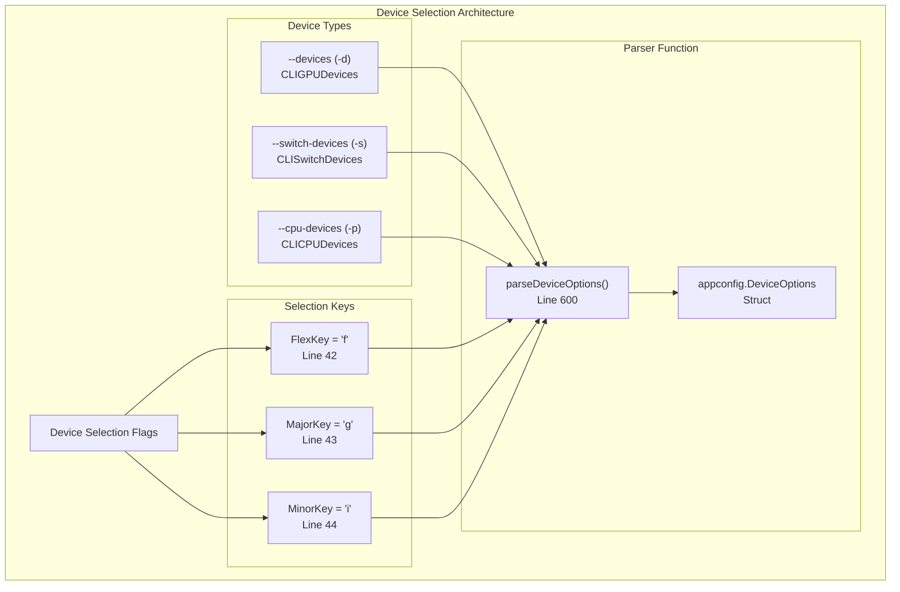
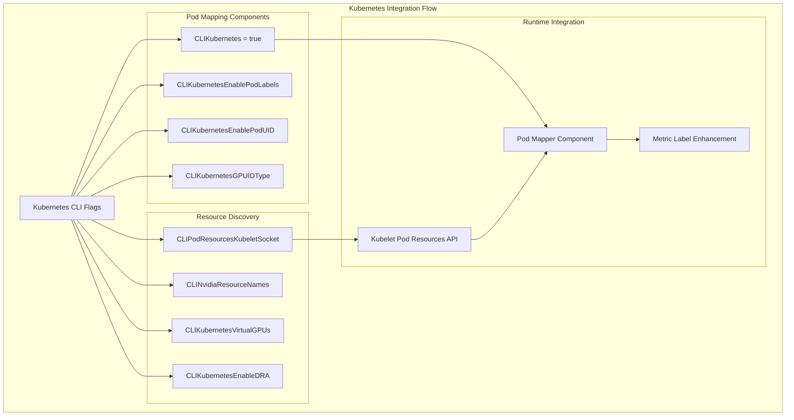
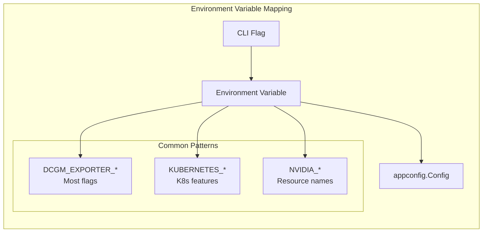

<!-- source: DeepWiki mcp.deepwiki.com · repo NVIDIA/dcgm-exporter · page 3.1 Command-line Options · fetched 2026-10-26 -->

# Command-line Options

Relevant source files

The following files were used as context for generating this wiki page:

- [README.md](README.md)
- [internal/pkg/appconfig/types.go](internal/pkg/appconfig/types.go)
- [pkg/cmd/app.go](pkg/cmd/app.go)

This document provides a comprehensive reference for all command-line flags and arguments available in DCGM Exporter. These options control the behavior of the `dcgm-exporter` binary, including metric collection, Kubernetes integration, device selection, and server configuration.

For information about environment variables that can be used as alternatives to command-line flags, see [Environment Variables](#3.2). For details about configuring which metrics are collected, see [Metrics Configuration](#3.3).

## Flag Categories and Organization

DCGM Exporter's command-line interface is organized into several functional categories, each serving different aspects of the system's operation. The flags are defined within the `NewApp()` function in the `cmd` package.

Sources: [pkg/cmd/app.go:67-105](), [pkg/cmd/app.go:107-344]()

## Configuration Flow Architecture

The command-line flags are processed through a well-defined flow that transforms CLI arguments into internal configuration structures defined in `appconfig.Config`.

Sources: [pkg/cmd/app.go:663-722](), [internal/pkg/appconfig/types.go:41-79]()

## Core Server Configuration

### Basic Server Options

| Flag | Short | Default | Description |
|------|-------|---------|-------------|
| `--address` | `-a` | `:9400` | HTTP server bind address and port |
| `--collectors` | `-f` | `/etc/dcgm-exporter/default-counters.csv` | Path to metrics configuration file |
| `--collect-interval` | `-c` | `30000` | Metric collection interval in milliseconds |

The core server flags control the fundamental operation of the DCGM Exporter HTTP server and metric collection engine.

Sources: [pkg/cmd/app.go:68-70](), [pkg/cmd/app.go:122-142](), [pkg/cmd/app.go:459-462](), [pkg/cmd/app.go:573-574]()

### Remote DCGM Connection

| Flag | Short | Default | Description |
|------|-------|---------|-------------|
| `--remote-hostengine-info` | `-r` | `localhost:5555` | Remote DCGM hostengine connection string |

This option enables connecting to a remote DCGM hostengine instead of the local one.

Sources: [pkg/cmd/app.go:77](), [pkg/cmd/app.go:171-177]()

## Device Selection Options

Device selection uses a flexible syntax that allows monitoring different types of hardware entities. The selection syntax is defined by the `deviceUsageTemplate` constant and parsed into `DeviceOptions`.

### Device Selection Syntax

The device selection follows this pattern: `[key][:id1[,id2-id3...]]`

- **`f` (Flex)**: Automatically monitor GPUs or GPU instances based on MIG mode. [pkg/cmd/app.go:42]()
- **`g` (Major)**: Monitor top-level entities (GPUs, NvSwitches, CPUs). [pkg/cmd/app.go:43]()
- **`i` (Minor)**: Monitor sub-level entities (GPU instances, NvLinks, CPU cores). [pkg/cmd/app.go:44]()

### Device Selection Examples

| Flag Value | Meaning |
|------------|---------|
| `f` | Monitor all GPUs (no MIG) or all GPU instances (MIG enabled) |
| `g` | Monitor all GPUs |
| `g:0,1` | Monitor GPUs 0 and 1 |
| `i` | Monitor all GPU instances (MIG mode only) |
| `i:0,2-4` | Monitor GPU instances 0, 2, 3, and 4 |

Sources: [pkg/cmd/app.go:46-64](), [pkg/cmd/app.go:600-661](), [internal/pkg/appconfig/types.go:27-31]()

## Kubernetes Integration Options

DCGM Exporter provides extensive Kubernetes integration capabilities through dedicated command-line flags.

### Core Kubernetes Flags

| Flag | Default | Description |
|------|---------|-------------|
| `--kubernetes` (`-k`) | `false` | Enable Kubernetes pod mapping |
| `--kubernetes-enable-pod-labels` | `false` | Include pod labels in metrics |
| `--kubernetes-enable-pod-uid` | `false` | Include pod UID in metrics |
| `--kubernetes-gpu-id-type` | `uuid` | GPU ID type for mapping (`uuid` or `device-name`) |

### Advanced Kubernetes Features

| Flag | Default | Description |
|------|---------|-------------|
| `--pod-resources-kubelet-socket` | `/var/lib/kubelet/pod-resources/kubelet.sock` | Kubelet socket path |
| `--nvidia-resource-names` | `[]` | Custom NVIDIA resource names |
| `--kubernetes-virtual-gpus` | `false` | Support virtual GPU metrics |
| `--kubernetes-enable-dra` | `false` | Enable Dynamic Resource Allocation |
| `--hpc-job-mapping-dir` | `""` | HPC job mapping directory |

Sources: [pkg/cmd/app.go:143-150](), [pkg/cmd/app.go:179-218](), [pkg/cmd/app.go:270-323]()

## Security and Authentication

DCGM Exporter supports TLS encryption and authentication through web configuration files compatible with Prometheus exporter toolkit.

### Security Configuration Flags

| Flag | Default | Description |
|------|---------|-------------|
| `--web-config-file` | `""` | Path to web configuration file for TLS/auth |
| `--web-systemd-socket` | `false` | Use systemd socket activation (Linux only) |

The web configuration follows the [Prometheus exporter toolkit specification](https://github.com/prometheus/exporter-toolkit/blob/master/docs/web-configuration.md).

Sources: [pkg/cmd/app.go:220-225](), [pkg/cmd/app.go:327-332](), [README.md:85-93]()

## Advanced Features

### ConfigMap Integration

| Flag | Short | Default | Description |
|------|-------|---------|-------------|
| `--configmap-data` | `-m` | `none` | Kubernetes ConfigMap for metric configuration |

### Testing and Development

| Flag | Default | Description |
|------|---------|-------------|
| `--fake-gpus` | `false` | Accept fake GPUs for testing |
| `--no-hostname` (`-n`) | `false` | Omit hostname from metrics |
| `--use-old-namespace` (`-o`) | `false` | Use legacy 1.x metric namespace |

### Debug Dump Configuration

| Flag | Default | Description |
|------|---------|-------------|
| `--dump-enabled` | `false` | Enable debug dump files |
| `--dump-directory` | `/tmp/dcgm-exporter-debug` | Debug dump directory |
| `--dump-retention` | `24` | Dump file retention in hours |
| `--dump-compression` | `true` | Compress debug dump files |

Sources: [pkg/cmd/app.go:294-317](), [internal/pkg/appconfig/types.go:34-39]()

## Logging and Debugging

### Core Logging Options

| Flag | Default | Description |
|------|---------|-------------|
| `--debug` | `false` | Enable debug output |
| `--log-format` | `text` | Log format (`text` or `json`) |

### DCGM-Specific Logging

| Flag | Default | Description |
|------|---------|-------------|
| `--enable-dcgm-log` | `false` | Enable DCGM library logging |
| `--dcgm-log-level` | `NONE` | DCGM log level (`NONE`, `FATAL`, `ERROR`, `WARN`, `INFO`, `DEBUG`, `VERB`) |

### Event Window Configuration

| Flag | Short | Default | Description |
|------|-------|---------|-------------|
| `--xid-count-window-size` | `-x` | `300000` | XID error counting window (ms) |
| `--clock-events-count-window-size` | | `300000` | Clock events counting window (ms) |

Sources: [pkg/cmd/app.go:226-251](), [pkg/cmd/app.go:253-262]()

## Environment Variable Mapping

Every command-line flag has a corresponding environment variable that can be used instead. The environment variables follow the pattern `DCGM_EXPORTER_*` or specific prefixes for certain features.

### Example Environment Variables

| Flag | Environment Variable |
|------|---------------------|
| `--address` | `DCGM_EXPORTER_LISTEN` |
| `--collectors` | `DCGM_EXPORTER_COLLECTORS` |
| `--kubernetes` | `DCGM_EXPORTER_KUBERNETES` |
| `--debug` | `DCGM_EXPORTER_DEBUG` |
| `--nvidia-resource-names` | `NVIDIA_RESOURCE_NAMES` |

Sources: [pkg/cmd/app.go:127](), [pkg/cmd/app.go:134](), [pkg/cmd/app.go:148](), [pkg/cmd/app.go:244](), [pkg/cmd/app.go:286]()

---

