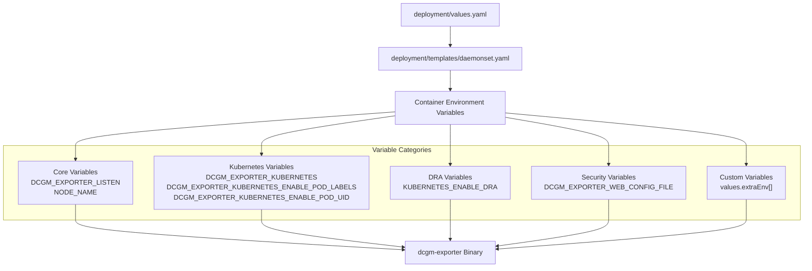
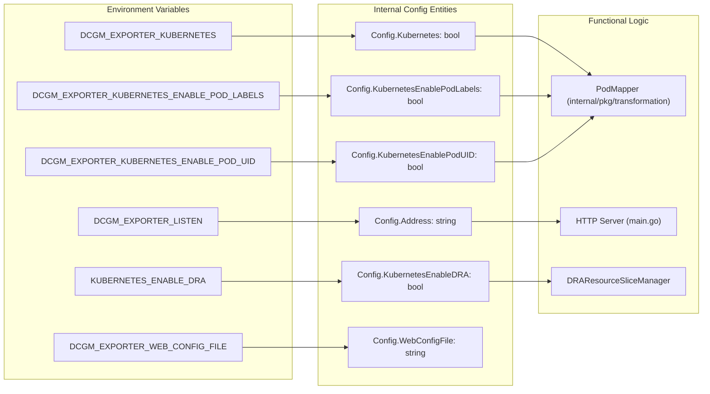

<!-- source: DeepWiki mcp.deepwiki.com · repo NVIDIA/dcgm-exporter · page 3.2 Environment Variables · fetched 2026-10-26 -->

# Environment Variables

<details>
<summary>Relevant source files</summary>

The following files were used as context for generating this wiki page:

- [dcgm-exporter.yaml](dcgm-exporter.yaml)
- [deployment/templates/daemonset.yaml](deployment/templates/daemonset.yaml)
- [deployment/values.yaml](deployment/values.yaml)

</details>


Environment variables provide runtime configuration for DCGM Exporter, controlling behavior for Kubernetes integration, security settings, debugging, and operational parameters. These variables are primarily used in containerized deployments where command-line arguments may be less convenient.

For command-line configuration options, see [Command-line Options](3.1). For Kubernetes-specific integration settings, see [Kubernetes Integration](3.4).

## Core Environment Variables

### DCGM_EXPORTER_KUBERNETES
Enables Kubernetes integration mode when set to `"true"`. This is automatically set in Helm and standard DaemonSet deployments to enable pod resource discovery through the kubelet API.

**Default**: Not set (disabled)  
**Required**: Yes for Kubernetes deployments to map GPUs to Pods.

[dcgm-exporter.yaml:42-43]()
[deployment/templates/daemonset.yaml:135-136]()

### DCGM_EXPORTER_LISTEN
Specifies the address and port for the HTTP metrics server to bind to.

**Default**: `:9400`  
**Format**: `[host]:port` or `:port`  
**Example**: `:9400`, `0.0.0.0:9400`

[dcgm-exporter.yaml:40-41]()
[deployment/templates/daemonset.yaml:149-150]()
[deployment/values.yaml:115]()

### NODE_NAME
Contains the Kubernetes node name where the exporter pod is running. This is typically populated from the pod's `spec.nodeName` field via the Kubernetes Downward API.

**Source**: Kubernetes `fieldRef`  
**Usage**: Node identification for the Kubelet Pod Resources API client.

[dcgm-exporter.yaml:44-47]()
[deployment/templates/daemonset.yaml:151-154]()

## Kubernetes Integration Variables

### DCGM_EXPORTER_KUBERNETES_ENABLE_POD_LABELS
Enables collection and inclusion of Kubernetes pod labels as Prometheus metric labels.

**Default**: Not set (disabled)  
**Security Note**: Requires RBAC permissions to get/list pods if enabled.

[deployment/templates/daemonset.yaml:137-140]()

### DCGM_EXPORTER_KUBERNETES_ENABLE_POD_UID  
Enables inclusion of Kubernetes pod UID as a metric attribute.

**Default**: Not set (disabled)  

[deployment/templates/daemonset.yaml:141-144]()

### DCGM_EXPORTER_KUBERNETES_POD_LABEL_ALLOWLIST_REGEX
A comma-separated list of regex patterns used to filter which pod labels are exported as metric labels.

[deployment/templates/daemonset.yaml:145-148]()

### KUBERNETES_ENABLE_DRA
Enables Dynamic Resource Allocation (DRA) support for capturing metrics from GPUs managed by the NVIDIA k8s-dra-driver.

**Default**: Not set (disabled)  

[deployment/templates/daemonset.yaml:159-162]()

Sources: [deployment/templates/daemonset.yaml:135-162](), [dcgm-exporter.yaml:40-47]()

## Security Configuration Variables

### DCGM_EXPORTER_WEB_CONFIG_FILE
Path to the web configuration file containing TLS and authentication settings. This variable triggers the exporter to use HTTPS and/or Basic Auth.

**Default**: Not set  
**Standard Path**: `/etc/dcgm-exporter/web-config.yaml`  

[deployment/templates/daemonset.yaml:155-158]()

## Environment Variable Configuration Flow

The following diagram shows how environment variables flow from Helm values to the running container:

Title: Helm to Container Environment Flow


Sources: [deployment/templates/daemonset.yaml:134-165](), [deployment/values.yaml:184]()

## Environment Variable to Configuration Mapping

This diagram illustrates how environment variables map to internal configuration structures and runtime components:

Title: Internal Configuration Mapping


Sources: [deployment/templates/daemonset.yaml:134-162](), [deployment/values.yaml:107-115]()

## Setting Environment Variables

### Helm Chart Deployment

Environment variables in Helm deployments are configured through `values.yaml`:

| Helm Value | Environment Variable | Purpose |
|------------|---------------------|---------|
| `service.address` | `DCGM_EXPORTER_LISTEN` | HTTP server bind address |
| `kubernetes.enablePodLabels` | `DCGM_EXPORTER_KUBERNETES_ENABLE_POD_LABELS` | Pod label collection |
| `kubernetes.enablePodUID` | `DCGM_EXPORTER_KUBERNETES_ENABLE_POD_UID` | Pod UID collection |
| `kubernetesDRA.enabled` | `KUBERNETES_ENABLE_DRA` | DRA support |
| `tlsServerConfig.enabled` | `DCGM_EXPORTER_WEB_CONFIG_FILE` | Security configuration |
| `extraEnv[]` | Custom variables | Additional environment variables |

[deployment/values.yaml:107-184]()

### Custom Environment Variables

Additional environment variables can be added using the `extraEnv` array in Helm values. This is useful for passing proxy settings or custom labels.

```yaml
extraEnv:
  - name: CUSTOM_VARIABLE
    value: "custom_value"
  - name: SECRET_VALUE
    valueFrom:
      secretKeyRef:
        name: my-secret
        key: secret-key
```

[deployment/values.yaml:184]()
[deployment/templates/daemonset.yaml:163-165]()

### Docker Deployment

For direct Docker deployments, environment variables are set using the `-e` flag:

```bash
docker run -e DCGM_EXPORTER_KUBERNETES=true \
           -e DCGM_EXPORTER_LISTEN=:9400 \
           nvcr.io/nvidia/k8s/dcgm-exporter:latest
```

## Configuration Processing

Environment variables are processed during application startup. The values are used to initialize components such as the `PodMapper`, which determines how GPU metrics are associated with Kubernetes metadata.

If `DCGM_EXPORTER_KUBERNETES` is set to true, the exporter attempts to connect to the Kubelet socket defined by `kubeletPath` (default `/var/lib/kubelet/pod-resources`) to resolve pod-to-GPU mappings.

Sources: [deployment/templates/daemonset.yaml:79-81](), [deployment/values.yaml:187]()

---

