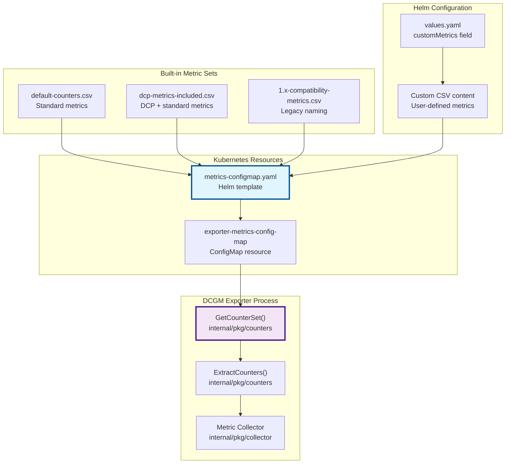
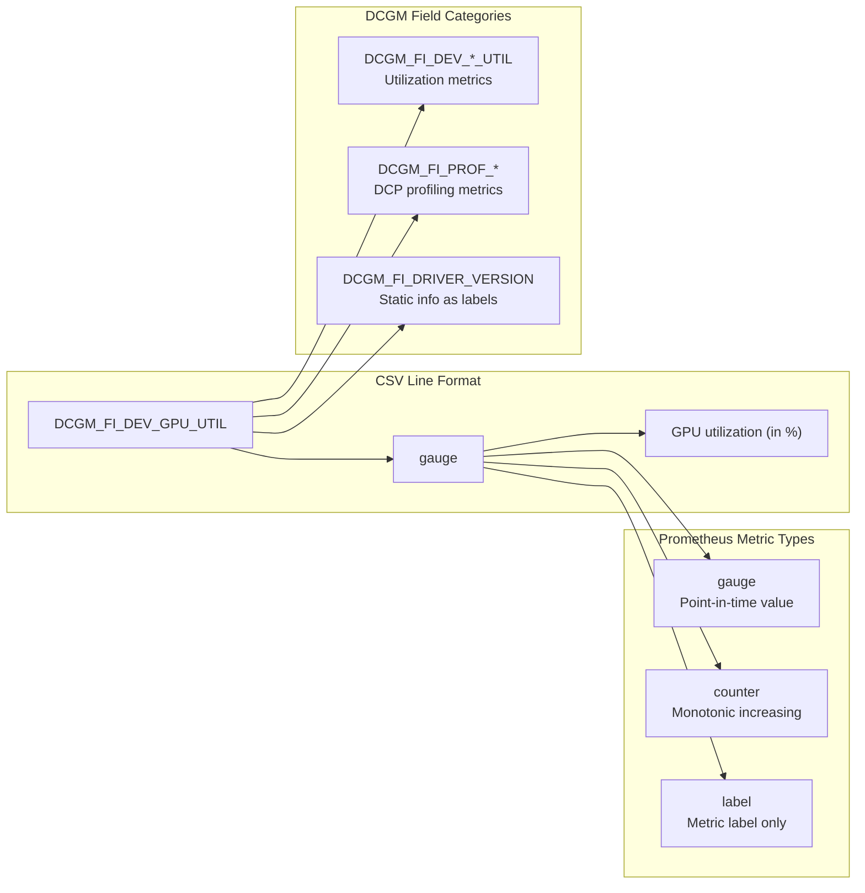
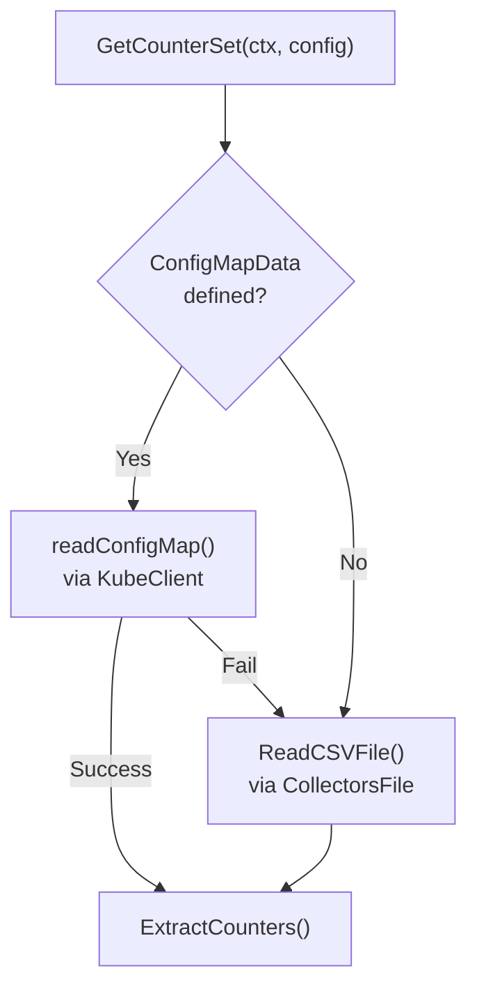

<!-- source: DeepWiki mcp.deepwiki.com · repo NVIDIA/dcgm-exporter · page 3.3 Metrics Configuration · fetched 2026-10-26 -->

# Metrics Configuration

<details>
<summary>Relevant source files</summary>

The following files were used as context for generating this wiki page:

- [deployment/templates/metrics-configmap.yaml](deployment/templates/metrics-configmap.yaml)
- [etc/1.x-compatibility-metrics.csv](etc/1.x-compatibility-metrics.csv)
- [etc/dcp-metrics-included.csv](etc/dcp-metrics-included.csv)
- [etc/default-counters.csv](etc/default-counters.csv)
- [internal/pkg/counters/counter_config.go](internal/pkg/counters/counter_config.go)
- [internal/pkg/counters/types.go](internal/pkg/counters/types.go)
- [internal/pkg/transformation/kubernetes_mig_test.go](internal/pkg/transformation/kubernetes_mig_test.go)
- [tests/integration/testdata/default-counters.csv](tests/integration/testdata/default-counters.csv)

</details>


This document covers how to configure which GPU metrics are collected and exposed by DCGM Exporter. It explains the CSV-based metric definition format, built-in metric sets, custom metric configuration through Helm values, and the Kubernetes ConfigMap integration system.

## Configuration System Overview

DCGM Exporter uses a flexible metrics configuration system that supports both built-in metric sets and custom metric definitions. The system is built around CSV files that define which DCGM fields to collect and how to expose them as Prometheus metrics.

**Metrics Configuration Flow**


Sources: [deployment/templates/metrics-configmap.yaml:1-96](), [etc/default-counters.csv:1-99](), [etc/dcp-metrics-included.csv:1-91](), [internal/pkg/counters/counter_config.go:35-75]()

## CSV Format Specification

The metrics configuration uses a CSV format where each line defines a single metric. Lines starting with `#` are treated as comments and ignored by the parser. The `ReadCSVFile` function in `internal/pkg/counters/counter_config.go` specifically sets `r.Comment = '#'` to handle this [internal/pkg/counters/counter_config.go:77-90]().

**CSV Format Structure**


The three fields are separated by commas and parsed by `ExtractCounters` [internal/pkg/counters/counter_config.go:92-144]():

| Field | Description | Example |
|-------|-------------|---------|
| DCGM Field | DCGM field identifier from NVIDIA DCGM library | `DCGM_FI_DEV_GPU_UTIL` |
| Metric Type | Prometheus metric type: `gauge`, `counter`, or `label` | `gauge` |
| Help Text | Human-readable description for the metric | `GPU utilization (in %)` |

Sources: [etc/default-counters.csv:1-4](), [deployment/templates/metrics-configmap.yaml:14-16](), [internal/pkg/counters/counter_config.go:104-108]()

## Implementation Details

The `Counter` struct is the primary data structure for individual metric definitions [internal/pkg/counters/types.go:25-30]().

```go
type Counter struct {
	FieldID   dcgm.Short `json:"field_id"`
	FieldName string     `json:"field_name"`
	PromType  string     `json:"prom_type"`
	Help      string     `json:"help"`
}
```

The `ExtractCounters` function iterates through CSV records, trims whitespace, and validates that each record has exactly 3 fields [internal/pkg/counters/counter_config.go:95-108](). It uses `dcgm.GetFieldID` to map field names to their numeric identifiers [internal/pkg/counters/counter_config.go:110]().

### Data Center Profiling (DCP) Filtering
Metrics are filtered based on support using `fieldIsSupported` [internal/pkg/counters/counter_config.go:146-164](). If a field falls within the DCP range and `CollectDCP` is false in the application config, the metric is skipped [internal/pkg/counters/counter_config.go:151-153]().

## Built-in Metric Sets

DCGM Exporter provides three built-in metric configurations:

### Default Counters
The standard metric set provides essential GPU monitoring metrics.
- **Clock frequencies**: `DCGM_FI_DEV_SM_CLOCK`, `DCGM_FI_DEV_MEM_CLOCK` [etc/default-counters.csv:6-7]()
- **Temperature**: `DCGM_FI_DEV_MEMORY_TEMP`, `DCGM_FI_DEV_GPU_TEMP` [etc/default-counters.csv:10-11]()
- **Power**: `DCGM_FI_DEV_POWER_USAGE`, `DCGM_FI_DEV_TOTAL_ENERGY_CONSUMPTION` [etc/default-counters.csv:14-15]()
- **Utilization**: GPU, Memory, Encoder, and Decoder [etc/default-counters.csv:23-26]()

### DCP Metrics Included
An extended metric set that includes all default metrics plus additional Data Center Profiling (DCP) metrics.
- **PCIe Bandwidth**: `DCGM_FI_PROF_PCIE_TX_BYTES`, `DCGM_FI_PROF_PCIE_RX_BYTES` [etc/dcp-metrics-included.csv:89-90]()
- **Engine Activity**: `DCGM_FI_PROF_GR_ENGINE_ACTIVE`, `DCGM_FI_PROF_PIPE_TENSOR_ACTIVE`, `DCGM_FI_PROF_DRAM_ACTIVE` [etc/dcp-metrics-included.csv:81-85]()

### 1.x Compatibility Metrics
Maintains naming conventions from DCGM Exporter v1.x using lowercase names like `dcgm_gpu_utilization` [etc/1.x-compatibility-metrics.csv:23]().

## Custom Metrics and ConfigMaps

In Kubernetes environments, the exporter can load metrics from a ConfigMap. The `GetCounterSet` function checks `c.ConfigMapData` to decide whether to fetch data from the Kubernetes API or fall back to a local CSV file [internal/pkg/counters/counter_config.go:43-67]().

**Metric Loading Logic**


### ConfigMap Generation Logic
The Helm template `metrics-configmap.yaml` uses conditional logic to populate the `metrics` key. If `.Values.customMetrics` is provided, it is rendered directly; otherwise, a default set of metrics is embedded [deployment/templates/metrics-configmap.yaml:9-13]().

Sources: [deployment/templates/metrics-configmap.yaml:1-96](), [internal/pkg/counters/counter_config.go:35-75](), [internal/pkg/counters/counter_config.go:166-191]()

---

