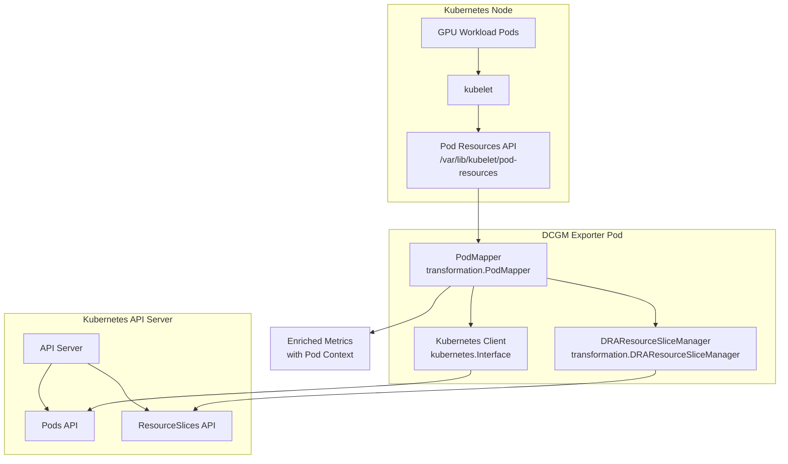
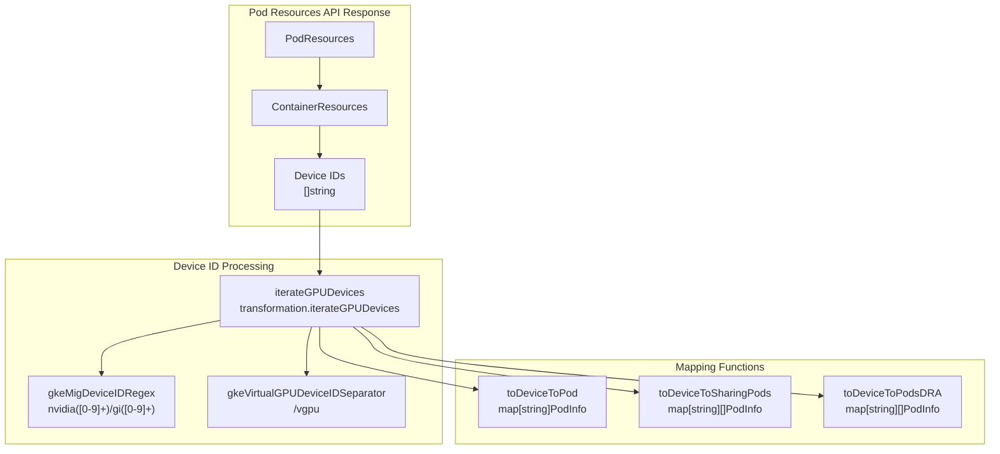

<!-- source: DeepWiki mcp.deepwiki.com · repo NVIDIA/dcgm-exporter · page 3.4 Kubernetes Integration · fetched 2026-10-26 -->

# Kubernetes Integration

<details>
<summary>Relevant source files</summary>

The following files were used as context for generating this wiki page:

- [deployment/values.yaml](deployment/values.yaml)
- [internal/pkg/kubeclient/client.go](internal/pkg/kubeclient/client.go)
- [internal/pkg/transformation/dra.go](internal/pkg/transformation/dra.go)
- [internal/pkg/transformation/kubernetes.go](internal/pkg/transformation/kubernetes.go)

</details>


This document covers the Kubernetes-specific configuration options and features of DCGM Exporter. It explains how to enable pod-to-GPU mapping, metadata enrichment, and advanced GPU allocation scenarios within Kubernetes clusters.

For general deployment in Kubernetes, see [Kubernetes Deployment](#2.3) and [Helm Chart Deployment](#2.4). For basic configuration options, see [Command-line Options](#3.1) and [Environment Variables](#3.2).

## Overview

DCGM Exporter provides deep Kubernetes integration by connecting to the kubelet's Pod Resources API to correlate GPU metrics with pod and container information. This enables monitoring systems to associate GPU utilization with specific workloads, namespaces, and applications.

The integration is controlled by the `PodMapper` transformer, which processes metrics after collection and adds Kubernetes context as metric attributes and labels.

### Core Integration Architecture



Sources: [internal/pkg/transformation/kubernetes.go:94-152](), [internal/pkg/transformation/kubernetes.go:197-199](), [deployment/values.yaml:187-216]()

## Pod-to-GPU Mapping

The core functionality maps GPU devices to the pods and containers using them through the kubelet's Pod Resources API. This mapping supports various GPU allocation scenarios including full GPUs, MIG devices, and virtual GPUs.

### Device ID Resolution Flow



Sources: [internal/pkg/transformation/kubernetes.go:67-92](), [internal/pkg/transformation/kubernetes.go:54-60]()

### Supported Device ID Formats

The system handles multiple device ID formats to support different Kubernetes GPU operators and allocation strategies:

| Format | Example | Use Case |
|--------|---------|----------|
| GPU UUID | `b8ea3855-276c-c9cb-b366-c6fa655957c5` | Standard GPU allocation |
| MIG UUID | `MIG-b8ea3855-276c-c9cb-b366-c6fa655957c5` | NVIDIA MIG devices |
| GKE MIG | `nvidia0/gi0` | Google Kubernetes Engine MIG |
| GKE Virtual GPU | `nvidia0/vgpu1` | GKE virtual GPU sharing |

Sources: [internal/pkg/transformation/kubernetes.go:57-60](), [internal/pkg/transformation/kubernetes.go:67-92]()

## Metadata Enrichment

When enabled, the integration enriches GPU metrics with pod metadata by querying the Kubernetes API server. This provides additional context for monitoring and alerting.

### Pod Labels Integration

Pod labels are added as Prometheus labels to GPU metrics when `KubernetesEnablePodLabels` is enabled. Label names are sanitized to ensure Prometheus compatibility. DCGM Exporter uses an LRU cache to manage pod label metadata efficiently.

**Configuration:**
- Environment variable: `DCGM_EXPORTER_KUBERNETES_ENABLE_POD_LABELS=true`
- Helm value: `kubernetes.enablePodLabels: true`
- Regex filtering: `DCGM_EXPORTER_KUBERNETES_POD_LABEL_ALLOWLIST_REGEX`

**Implementation:**
- `LabelFilterCache` provides LRU caching for filtered labels [internal/pkg/transformation/kubernetes.go:155-195]().
- Default cache size is 150,000 entries if not specified [internal/pkg/transformation/kubernetes.go:98-101]().
- `PodMapper` initializes a `SharedInformerFactory` to watch pods on the local node [internal/pkg/transformation/kubernetes.go:124-141]().

### Pod UID Integration

Pod UIDs are added as metric attributes when `KubernetesEnablePodUID` is enabled, providing unique pod identification across the cluster lifecycle.

**Configuration:**
- Environment variable: `DCGM_EXPORTER_KUBERNETES_ENABLE_POD_UID=true`
- Helm value: `kubernetes.enablePodUID: true`

Sources: [internal/pkg/transformation/kubernetes.go:94-112](), [deployment/values.yaml:81-83]()

## Advanced GPU Scenarios

### Dynamic Resource Allocation (DRA)

DRA support enables advanced GPU resource management using Kubernetes' Dynamic Resource Allocation API.

**DRA Components:**
- `DRAResourceSliceManager`: Monitors `ResourceSlices` via informers [internal/pkg/transformation/dra.go:36-76]().
- `deviceToUUID`: Maps resource pool devices to GPU UUIDs [internal/pkg/transformation/dra.go:48-50]().
- `migDevices`: Tracks MIG device relationships (parent UUID, profile) [internal/pkg/transformation/dra.go:142-157]().

**DRA Data Flow:**
1. `NewDRAResourceSliceManager` starts a `SharedInformerFactory` for `ResourceSlices` [internal/pkg/transformation/dra.go:42-43]().
2. `onAddOrUpdate` parses device attributes like `uuid`, `parentUUID`, and `profile` [internal/pkg/transformation/dra.go:120-163]().
3. `GetDeviceInfo` allows the `PodMapper` to resolve a pool/device pair to a hardware UUID [internal/pkg/transformation/dra.go:91-111]().

Sources: [internal/pkg/transformation/dra.go:1-179](), [internal/pkg/transformation/kubernetes.go:142-150]()

## Configuration Options

### Helm Chart Values

```yaml
# deployment/values.yaml
kubernetes:
  enablePodLabels: false
  enablePodUID: false

kubernetesDRA:
  enabled: false

# Path to the kubelet socket for /pod-resources
kubeletPath: "/var/lib/kubelet/pod-resources"
```

Sources: [deployment/values.yaml:187](), [deployment/values.yaml:119-127]()

## RBAC Requirements

Kubernetes integration requires specific permissions to access pod information and resource slices.

### ServiceAccount Configuration

The deployment uses a dedicated ServiceAccount for API access. If `serviceAccount.create` is true, a name is generated or the specified name is used [deployment/values.yaml:66-74]().

### Security Context

DCGM Exporter typically requires `SYS_ADMIN` capabilities to collect profiling metrics (`DCGM_FI_PROF_*`), though it can run as non-root without profiling [deployment/values.yaml:95-105]().

Sources: [deployment/values.yaml:95-105](), [internal/pkg/kubeclient/client.go:24-36]()

---

