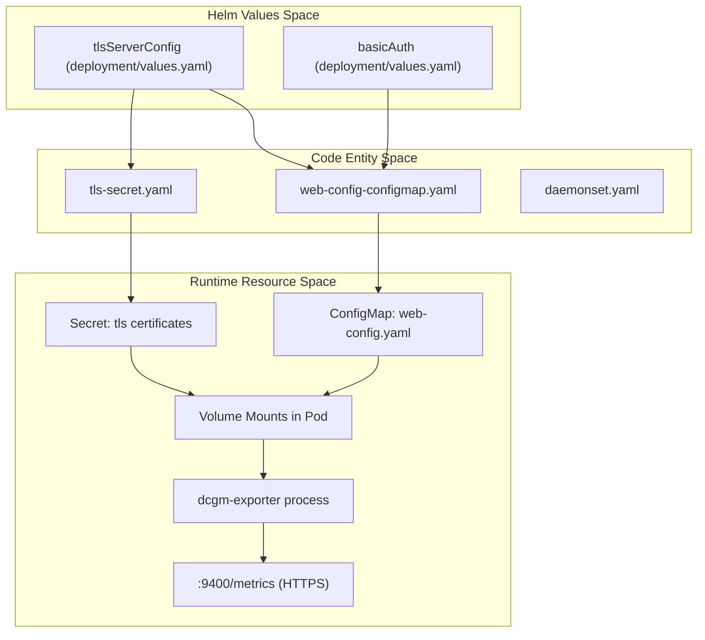
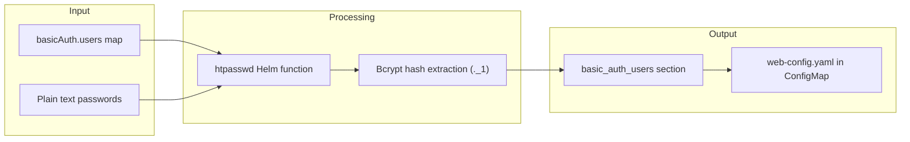
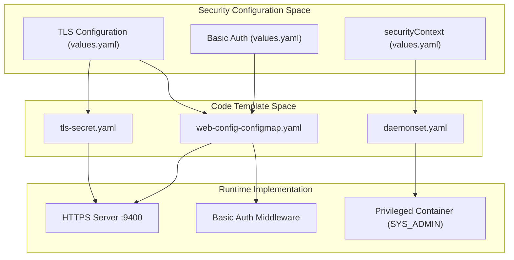

<!-- source: DeepWiki mcp.deepwiki.com · repo NVIDIA/dcgm-exporter · page 3.5 Security Configuration · fetched 2026-10-26 -->

# Security Configuration

<details>
<summary>Relevant source files</summary>

The following files were used as context for generating this wiki page:

- [deployment/templates/tls-secret.yaml](deployment/templates/tls-secret.yaml)
- [deployment/templates/web-config-configmap.yaml](deployment/templates/web-config-configmap.yaml)
- [deployment/values.yaml](deployment/values.yaml)
- [security.md](security.md)

</details>


This document covers security configuration options for DCGM Exporter, including TLS encryption, basic authentication, container security contexts, and Kubernetes RBAC. These features secure the metrics endpoint and control access to GPU monitoring data.

For general configuration options, see [Configuration](#3). For Kubernetes-specific integration settings, see [Kubernetes Integration](#3.4).

## TLS/HTTPS Configuration

DCGM Exporter supports TLS encryption to secure the metrics endpoint. TLS configuration is managed through the `tlsServerConfig` section in Helm values.

### TLS Configuration Flow



Sources: [deployment/values.yaml:190-216](), [deployment/templates/web-config-configmap.yaml:14-39](), [deployment/templates/tls-secret.yaml:16-42]()

### Enabling TLS

| Configuration | Description | Default |
|---------------|-------------|---------|
| `tlsServerConfig.enabled` | Enable HTTPS for metrics endpoint | `false` |
| `tlsServerConfig.autoGenerated` | Use self-signed certificates | `true` |
| `tlsServerConfig.existingSecret` | Use existing TLS secret | `""` |

```yaml
tlsServerConfig:
  enabled: true
  autoGenerated: true  # For development/testing only
```

Sources: [deployment/values.yaml:190-196]()

### Certificate Management

DCGM Exporter supports two certificate management approaches:

**Auto-Generated Certificates (Development)**
When `autoGenerated` is true, the Helm chart uses `genCA` and `genSignedCert` to create a 365-day self-signed certificate.
```yaml
tlsServerConfig:
  enabled: true
  autoGenerated: true
  certFilename: "tls.crt"
  keyFilename: "tls.key"
```

**External Certificates (Production)**
If an `existingSecret` is provided, the chart skips secret generation and expects the secret to contain the specified filenames.
```yaml
tlsServerConfig:
  enabled: true
  autoGenerated: false
  existingSecret: "dcgm-exporter-tls"
  certFilename: "tls.crt"
  keyFilename: "tls.key"
```

Sources: [deployment/values.yaml:193-202](), [deployment/templates/tls-secret.yaml:26-34]()

### Client Authentication

TLS client authentication requires clients (like Prometheus) to present valid certificates. This is configured via the `clientAuthType` mapping to Golang `crypto/tls` policies.

```yaml
tlsServerConfig:
  enabled: true
  clientAuthType: "RequireAndVerifyClientCert"
  caFilename: "ca.crt"
  ca: |
    -----BEGIN CERTIFICATE-----
    <CA certificate content>
    -----END CERTIFICATE-----
```

| Client Auth Type | Description |
|------------------|-------------|
| `RequireAndVerifyClientCert` | Require and verify client certificates (Recommended for security) |
| `""` | No client authentication (default) |

Sources: [deployment/values.yaml:203-215](), [deployment/templates/web-config-configmap.yaml:28-31]()

## Basic Authentication

DCGM Exporter supports HTTP basic authentication for controlling access to metrics.

### Basic Auth Configuration

```yaml
basicAuth:
  users:
    prometheus: "secure-password"
    grafana: "another-password"
```

The `web-config-configmap.yaml` template generates bcrypt-hashed passwords automatically using the `htpasswd` Helm function, ensuring that plain-text passwords are not stored in the Kubernetes `ConfigMap`.

Sources: [deployment/values.yaml:217-219](), [deployment/templates/web-config-configmap.yaml:33-38]()

### Web Config Generation



Sources: [deployment/templates/web-config-configmap.yaml:34-37]()

## Container Security Context

DCGM Exporter requires specific privileges to access GPU hardware and system information, particularly for profiling metrics.

### Security Context Configuration

```yaml
securityContext:
  runAsNonRoot: false
  runAsUser: 0
  capabilities:
    add: ["SYS_ADMIN"]
    drop: ["ALL"]
  allowPrivilegeEscalation: false

podSecurityContext: {}
```

| Setting | Value | Reason |
|---------|-------|--------|
| `runAsUser: 0` | Root user | Required for GPU device access and DCGM initialization |
| `SYS_ADMIN` capability | Added | Required for profiling metrics (`DCGM_FI_PROF_*`) |
| `runAsNonRoot: false` | Disabled | Must run as root to access device nodes |

Sources: [deployment/values.yaml:95-104]()

### Security Considerations

The elevated privileges are necessary because:
- The DCGM library requires direct GPU hardware access.
- Accessing the Kubelet pod-resources API socket requires root or specific group permissions.
- Profiling metrics require `CAP_SYS_ADMIN`.

For non-root execution without profiling metrics, users can set `runAsNonRoot: true`, `runAsUser: 1000`, and remove `SYS_ADMIN` from `capabilities.add`.

Sources: [deployment/values.yaml:103-104]()

## Kubernetes RBAC

DCGM Exporter requires Kubernetes permissions when pod labels or UIDs are enabled to map GPU metrics to specific pods.

### RBAC Resources

When `serviceAccount.create` is true, the Helm chart creates a `ServiceAccount` and associated RBAC resources.

| Resource | Permissions | Purpose |
|----------|------------|---------|
| `ClusterRole` | `get`, `list`, `watch` on `pods` | Read pod metadata for mapping |
| `ClusterRoleBinding` | Links ServiceAccount to ClusterRole | Grant permissions across the cluster |

Sources: [deployment/values.yaml:66-73](), [deployment/templates/serviceaccount.yaml]()

## Security Integration Flow

The following diagram bridges the high-level security configuration to the underlying code templates and runtime entities.



Sources: [deployment/templates/web-config-configmap.yaml](), [deployment/templates/tls-secret.yaml](), [deployment/values.yaml:95-101](), [deployment/values.yaml:190-219]()

## Security Best Practices

### Production Deployment Security

1. **Use External TLS Certificates**: Avoid `autoGenerated: true` in production. Use certificates signed by a trusted CA via `existingSecret`.
2. **Enable Client Certificate Authentication**: Use `clientAuthType: "RequireAndVerifyClientCert"` to ensure only authorized scrapers (like Prometheus) can access the endpoint.
3. **Configure Strong Basic Authentication**: Use unique, high-entropy passwords in the `basicAuth.users` map.
4. **Minimal Capabilities**: If profiling metrics are not required, remove `SYS_ADMIN` from `capabilities.add` to reduce the container's attack surface.
5. **Network Policies**: Implement Kubernetes `NetworkPolicy` resources to restrict ingress to port `9400` only from the Prometheus namespace.

Sources: [deployment/values.yaml:95-104](), [deployment/values.yaml:190-219]()

---

