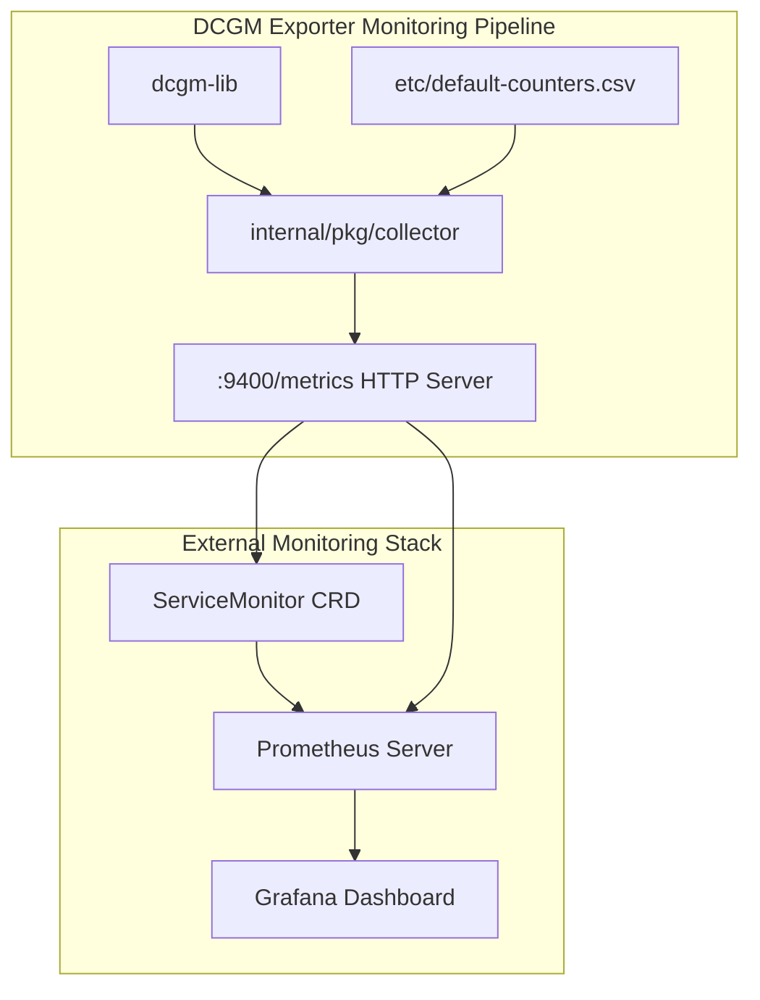
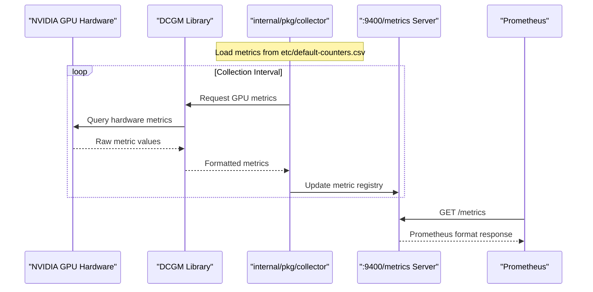
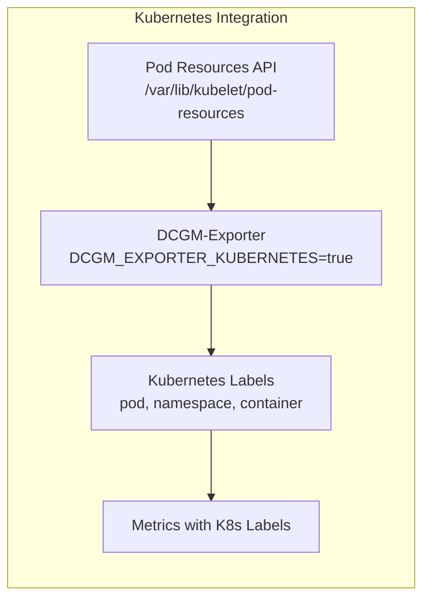
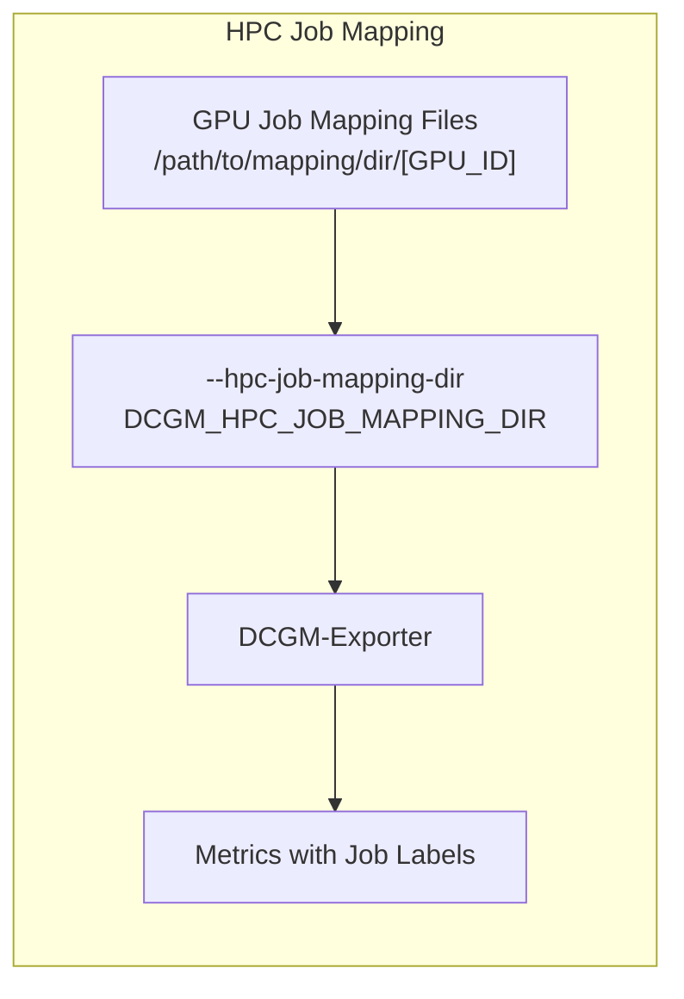

<!-- source: DeepWiki mcp.deepwiki.com · repo NVIDIA/dcgm-exporter · page 4 Metrics and Monitoring · fetched 2026-10-26 -->

# Metrics and Monitoring

<details>
<summary>Relevant source files</summary>

The following files were used as context for generating this wiki page:

- [README.md](README.md)
- [deployment/values.yaml](deployment/values.yaml)

</details>


This document provides an overview of the metrics and monitoring capabilities of DCGM Exporter. It covers the monitoring pipeline, metric collection architecture, and integration with monitoring systems like Prometheus and Grafana.

## Monitoring Pipeline Architecture

DCGM Exporter implements a complete GPU monitoring pipeline that collects metrics from NVIDIA GPUs and exposes them for monitoring systems. The pipeline consists of metric collectors, HTTP servers, and integration points with Kubernetes and monitoring stacks.

### Core Monitoring Components



The monitoring pipeline processes metrics through several key components:

| Component | File/Location | Purpose |
|-----------|---------------|---------|
| Metric Collectors | `internal/pkg/collector` | Collect GPU metrics from DCGM |
| HTTP Metrics Server | Port `:9400/metrics` | Expose Prometheus-compatible metrics endpoint |
| Configuration Files | `etc/default-counters.csv`, `etc/dcp-metrics-included.csv` | Define which metrics to collect |
| Grafana Dashboard | `grafana/dcgm-exporter-dashboard.json` | Visualize GPU metrics |

Sources: [README.md:141-143](), [deployment/values.yaml:22-24](), [deployment/values.yaml:127-130]()

## Metrics Collection and Monitoring

DCGM Exporter collects GPU metrics in real-time and exposes them through multiple monitoring integration points. The system supports different metric configurations and monitoring scenarios.

### Metric Collection Flow



### Monitoring Integration Points

The DCGM Exporter provides several integration points for different monitoring scenarios:

| Integration | Configuration | Purpose |
|-------------|---------------|---------|
| Prometheus Metrics | `:9400/metrics` endpoint | Standard Prometheus scraping |
| Grafana Dashboard | `grafana/dcgm-exporter-dashboard.json` | Pre-built visualization dashboard |
| ServiceMonitor CRD | `deployment/templates/servicemonitor.yaml` | Automatic Prometheus discovery |
| Custom Metrics | `arguments: ["-f", "/path/to/csv"]` | User-defined metric collections |

Sources: [README.md:15-27](), [README.md:168-172](), [deployment/values.yaml:24-24](), [deployment/values.yaml:127-132]()

## Monitoring Configurations

DCGM Exporter supports multiple monitoring configurations through different CSV files and runtime options. For a complete catalog of available metrics, see [Available Metrics](#4.1). For details on Prometheus metric types and internal data structures, see [Metric Types](#4.2).

### Available Monitoring Profiles

| Configuration File | Use Case | Key Metrics |
|-------------------|----------|-------------|
| `etc/default-counters.csv` | Standard monitoring | Temperature, power, utilization, memory |
| `etc/dcp-metrics-included.csv` | Data center profiling | Tensor core, DRAM active, PCIe throughput |

### Metric Naming Conventions

The system uses different naming conventions based on the metric source:
- **Standard metrics**: `DCGM_FI_DEV_*` prefix (e.g., `DCGM_FI_DEV_SM_CLOCK`) [README.md:152-153]()
- **Profiling metrics**: `DCGM_FI_PROF_*` prefix (e.g., `DCGM_FI_PROF_PIPE_TENSOR_ACTIVE`) [deployment/values.yaml:99-99]()

Sources: [README.md:141-154](), [deployment/values.yaml:22-24]()

## Grafana Dashboard Integration

DCGM Exporter includes a pre-built Grafana dashboard that provides comprehensive GPU monitoring visualization. For detailed information on the dashboard structure and metric mappings, see [Grafana Dashboard](#4.4).

The Grafana dashboard ([grafana/dcgm-exporter-dashboard.json]()) provides several visualization panels for thermal performance, power consumption, workload utilization, and memory usage.

Sources: [README.md:168-172]()

## Customizing Metrics

DCGM-Exporter allows customization of the metrics that are collected and exposed. This can be done by specifying a custom CSV file using the `-f` or `--collectors` command-line option. For a guide on defining custom metrics and using ConfigMaps for hot-reloading, see [Custom Metrics](#4.3).

The format of the CSV file is:
```csv
# DCGM FIELD, Prometheus metric type, help message
DCGM_FI_DEV_SM_CLOCK, gauge, SM clock frequency (in MHz).
```

Sources: [README.md:141-165](), [deployment/values.yaml:24-24](), [deployment/values.yaml:36-38]()

## Kubernetes Integration

When deployed in Kubernetes, DCGM-Exporter runs as a DaemonSet and can automatically add pod, namespace, and container labels to metrics. It discovers GPU allocation through the Kubelet Pod Resources API.



Sources: [README.md:75-77](), [deployment/values.yaml:186-187]()

## HPC Job Metrics Labels

DCGM-Exporter supports including High-Performance Computing (HPC) job information in metric labels. To enable this, users must run the exporter with the `--hpc-job-mapping-dir` parameter or the `DCGM_HPC_JOB_MAPPING_DIR` environment variable.



Sources: [README.md:95-108]()

---

