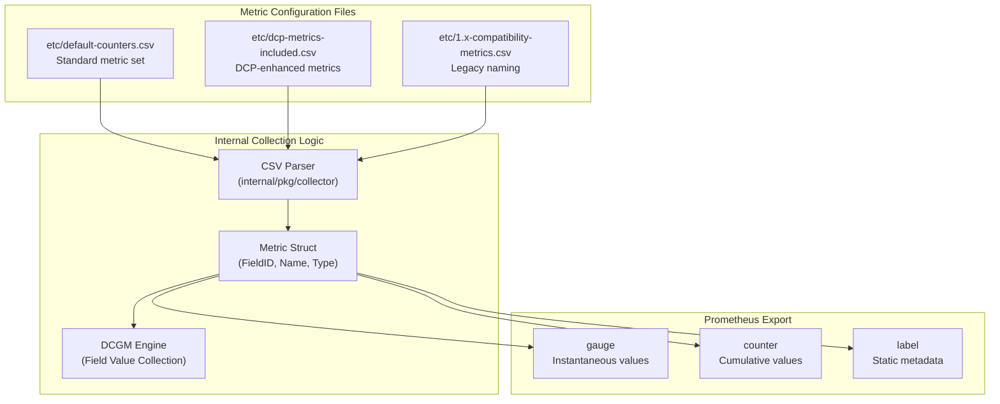
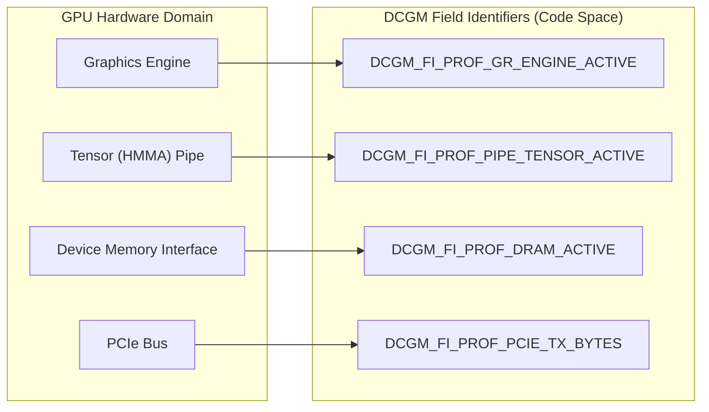

<!-- source: DeepWiki mcp.deepwiki.com · repo NVIDIA/dcgm-exporter · page 4.1 Available Metrics · fetched 2026-10-26 -->

# Available Metrics

<details>
<summary>Relevant source files</summary>

The following files were used as context for generating this wiki page:

- [deployment/values.yaml](deployment/values.yaml)
- [etc/1.x-compatibility-metrics.csv](etc/1.x-compatibility-metrics.csv)
- [etc/dcp-metrics-included.csv](etc/dcp-metrics-included.csv)
- [etc/default-counters.csv](etc/default-counters.csv)
- [tests/integration/testdata/default-counters.csv](tests/integration/testdata/default-counters.csv)

</details>


This document provides a comprehensive catalog of all DCGM (Data Center GPU Manager) metrics that can be collected and exposed by the DCGM Exporter. It covers the default metric configurations, specialized metric sets, and the relationship between different metric collection profiles.

For information about configuring which metrics to collect, see [Metrics Configuration](#3.3). For details about Prometheus metric types and their usage, see [Metric Types](#4.2).

## Metric Configuration Overview

DCGM Exporter supports multiple metric configuration profiles through CSV files that define which DCGM fields to collect, their Prometheus metric types, and help descriptions. The system uses three primary configuration files:

### Metric Data Flow and Code Entities

The following diagram illustrates how CSV configuration files are parsed and mapped to internal collection structures.



Sources: [etc/default-counters.csv:1-99](), [etc/dcp-metrics-included.csv:1-91](), [etc/1.x-compatibility-metrics.csv:1-67]()

## Default Metrics Catalog

The following sections detail all metrics available in the default configuration ([etc/default-counters.csv]()), organized by functional category.

### Clock Frequencies

| DCGM Field | Metric Type | Description | Units |
|------------|-------------|-------------|-------|
| `DCGM_FI_DEV_SM_CLOCK` | gauge | SM clock frequency | MHz |
| `DCGM_FI_DEV_MEM_CLOCK` | gauge | Memory clock frequency | MHz |

Sources: [etc/default-counters.csv:6-7]()

### Temperature Monitoring

| DCGM Field | Metric Type | Description | Units |
|------------|-------------|-------------|-------|
| `DCGM_FI_DEV_MEMORY_TEMP` | gauge | Memory temperature | °C |
| `DCGM_FI_DEV_GPU_TEMP` | gauge | GPU temperature | °C |

Sources: [etc/default-counters.csv:10-11]()

### Power Consumption

| DCGM Field | Metric Type | Description | Units |
|------------|-------------|-------------|-------|
| `DCGM_FI_DEV_POWER_USAGE` | gauge | Current power draw | W |
| `DCGM_FI_DEV_TOTAL_ENERGY_CONSUMPTION` | counter | Total energy consumption since boot | mJ |

Sources: [etc/default-counters.csv:14-15]()

### PCIe Metrics

| DCGM Field | Metric Type | Description | Units |
|------------|-------------|-------------|-------|
| `DCGM_FI_DEV_PCIE_REPLAY_COUNTER` | counter | Total number of PCIe retries | count |
| `DCGM_FI_PROF_PCIE_TX_BYTES` | gauge | PCIe transmission rate | bytes/sec |
| `DCGM_FI_PROF_PCIE_RX_BYTES` | gauge | PCIe reception rate | bytes/sec |

**Note**: The profiling PCIe metrics (`DCGM_FI_PROF_PCIE_*`) are only available on datacenter Volta GPUs and newer and require specific capabilities if running in containers.

Sources: [etc/default-counters.csv:20-21](), [etc/default-counters.csv:97-98](), [deployment/values.yaml:98-99]()

### GPU Utilization

| DCGM Field | Metric Type | Description | Units |
|------------|-------------|-------------|-------|
| `DCGM_FI_DEV_GPU_UTIL` | gauge | GPU utilization | % |
| `DCGM_FI_DEV_MEM_COPY_UTIL` | gauge | Memory utilization | % |
| `DCGM_FI_DEV_ENC_UTIL` | gauge | Encoder utilization | % |
| `DCGM_FI_DEV_DEC_UTIL` | gauge | Decoder utilization | % |

**Note**: Sample periods for utilization metrics vary depending on the GPU product.

Sources: [etc/default-counters.csv:23-26]()

### Memory Usage

| DCGM Field | Metric Type | Description | Units |
|------------|-------------|-------------|-------|
| `DCGM_FI_DEV_FB_FREE` | gauge | Framebuffer memory free | MiB |
| `DCGM_FI_DEV_FB_USED` | gauge | Framebuffer memory used | MiB |
| `DCGM_FI_DEV_FB_RESERVED` | gauge | Framebuffer memory reserved | MiB |

Sources: [etc/default-counters.csv:45-47]()

### Error Detection and Correction

| DCGM Field | Metric Type | Description | Units |
|------------|-------------|-------------|-------|
| `DCGM_FI_DEV_XID_ERRORS` | gauge | Value of the last XID error encountered | error_code |
| `DCGM_FI_DEV_UNCORRECTABLE_REMAPPED_ROWS` | counter | Number of remapped rows for uncorrectable errors | count |
| `DCGM_FI_DEV_CORRECTABLE_REMAPPED_ROWS` | counter | Number of remapped rows for correctable errors | count |
| `DCGM_FI_DEV_ROW_REMAP_FAILURE` | gauge | Whether remapping of rows has failed | boolean |

Sources: [etc/default-counters.csv:29](), [etc/default-counters.csv:72-74]()

### NVLink Connectivity

| DCGM Field | Metric Type | Description | Units |
|------------|-------------|-------------|-------|
| `DCGM_FI_DEV_NVLINK_BANDWIDTH_TOTAL` | counter | Total NVLink bandwidth counters for all lanes | count |

Sources: [etc/default-counters.csv:65]()

### Virtualization

| DCGM Field | Metric Type | Description | Units |
|------------|-------------|-------------|-------|
| `DCGM_FI_DEV_VGPU_LICENSE_STATUS` | gauge | vGPU License status | status_code |

Sources: [etc/default-counters.csv:69]()

## Datacenter Profiling (DCP) Metrics

The DCP metrics provide detailed performance profiling information and are supported on NVIDIA datacenter Volta GPUs and newer. These metrics are available in both the default configuration and the specialized DCP configuration.

### Hardware to Code Mapping

This diagram bridges the physical GPU components to the specific DCGM Field Identifiers (FI) used in the exporter code.



| DCGM Field | Metric Type | Description | Units |
|------------|-------------|-------------|-------|
| `DCGM_FI_PROF_GR_ENGINE_ACTIVE` | gauge | Ratio of time the graphics engine is active | ratio |
| `DCGM_FI_PROF_PIPE_TENSOR_ACTIVE` | gauge | Ratio of cycles the tensor (HMMA) pipe is active | ratio |
| `DCGM_FI_PROF_DRAM_ACTIVE` | gauge | Ratio of cycles the device memory interface is active | ratio |

Sources: [etc/default-counters.csv:89-93](), [etc/dcp-metrics-included.csv:81-85]()

## Static Configuration Labels

These fields appear as labels on other metrics rather than as standalone metrics, providing static configuration and version information:

| DCGM Field | Description |
|------------|-------------|
| `DCGM_FI_DRIVER_VERSION` | NVIDIA Driver Version |

Sources: [etc/default-counters.csv:77]()

## Legacy Compatibility Metrics

The 1.x compatibility configuration ([etc/1.x-compatibility-metrics.csv]()) provides metrics with lowercase naming conventions for backward compatibility:

### Naming Convention Differences

| Current Name | Legacy Name |
|--------------|-------------|
| `DCGM_FI_DEV_SM_CLOCK` | `dcgm_sm_clock` |
| `DCGM_FI_DEV_MEM_CLOCK` | `dcgm_memory_clock` |
| `DCGM_FI_DEV_GPU_UTIL` | `dcgm_gpu_utilization` |
| `DCGM_FI_DEV_FB_FREE` | `dcgm_fb_free` |
| `DCGM_FI_DEV_FB_USED` | `dcgm_fb_used` |

Sources: [etc/1.x-compatibility-metrics.csv:6-7](), [etc/1.x-compatibility-metrics.csv:23-24](), [etc/1.x-compatibility-metrics.csv:38-39]()

## Optional Metrics

Many metrics are available but commented out in the default configurations. These can be enabled by uncommenting them in custom metric configurations:

### Throttling Violations
- `DCGM_FI_DEV_POWER_VIOLATION` - Throttling duration due to power constraints
- `DCGM_FI_DEV_THERMAL_VIOLATION` - Throttling duration due to thermal constraints  
- `DCGM_FI_DEV_SYNC_BOOST_VIOLATION` - Throttling duration due to sync-boost constraints
- `DCGM_FI_DEV_BOARD_LIMIT_VIOLATION` - Throttling duration due to board limit constraints

### ECC Error Details
- `DCGM_FI_DEV_ECC_SBE_VOL_TOTAL` - Total number of single-bit volatile ECC errors
- `DCGM_FI_DEV_ECC_DBE_VOL_TOTAL` - Total number of double-bit volatile ECC errors
- `DCGM_FI_DEV_ECC_SBE_AGG_TOTAL` - Total number of single-bit persistent ECC errors
- `DCGM_FI_DEV_ECC_DBE_AGG_TOTAL` - Total number of double-bit persistent ECC errors

### Advanced NVLink Metrics
- `DCGM_FI_DEV_NVLINK_CRC_FLIT_ERROR_COUNT_TOTAL` - NVLink flow-control CRC errors
- `DCGM_FI_DEV_NVLINK_REPLAY_ERROR_COUNT_TOTAL` - NVLink retries

Sources: [etc/default-counters.csv:31-35](), [etc/default-counters.csv:50-53](), [etc/default-counters.csv:61-63]()

## Metric Format Structure

All metric configurations follow this CSV format:

```csv
# DCGM FIELD, Prometheus metric type, help message
DCGM_FI_DEV_GPU_TEMP, gauge, GPU temperature (in C).
```

- Lines starting with `#` are comments [etc/default-counters.csv:2]().
- Three comma-separated values: DCGM field name, Prometheus metric type, description [etc/default-counters.csv:3]().
- Metric types: `gauge`, `counter`, or `label` [etc/default-counters.csv:3]().
- Descriptions should include units in parentheses where applicable [etc/default-counters.csv:6]().

Sources: [etc/default-counters.csv:1-3](), [etc/dcp-metrics-included.csv:1-3]()

---

