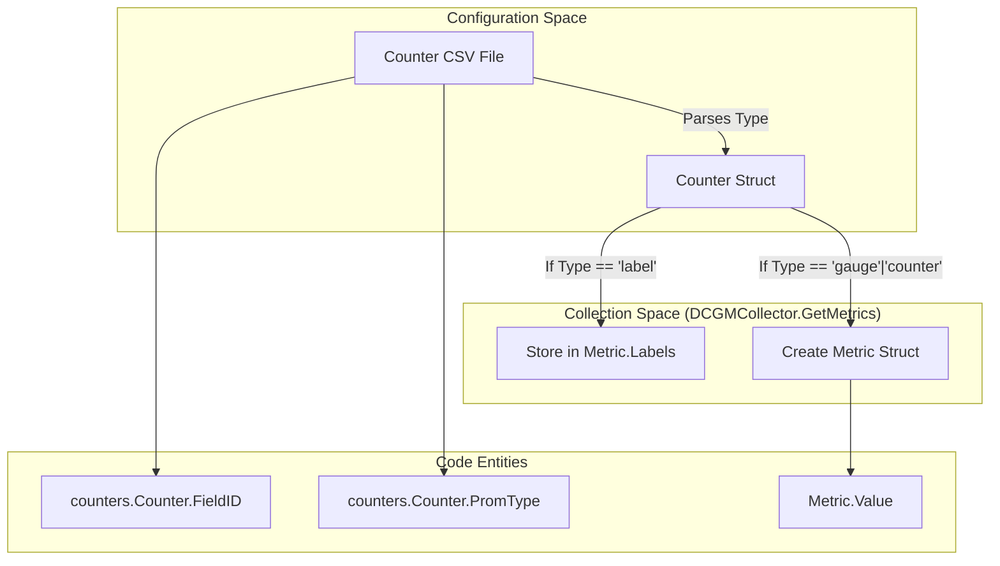
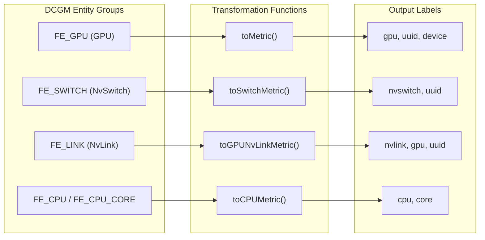

<!-- source: DeepWiki mcp.deepwiki.com · repo NVIDIA/dcgm-exporter · page 4.2 Metric Types · fetched 2026-10-26 -->

# Metric Types

<details>
<summary>Relevant source files</summary>

The following files were used as context for generating this wiki page:

- [internal/pkg/collector/collector_factory.go](internal/pkg/collector/collector_factory.go)
- [internal/pkg/collector/collector_factory_test.go](internal/pkg/collector/collector_factory_test.go)
- [internal/pkg/collector/const.go](internal/pkg/collector/const.go)
- [internal/pkg/collector/gpu_collector.go](internal/pkg/collector/gpu_collector.go)
- [internal/pkg/collector/p2p_status_collector.go](internal/pkg/collector/p2p_status_collector.go)
- [internal/pkg/collector/p2p_status_collector_test.go](internal/pkg/collector/p2p_status_collector_test.go)
- [internal/pkg/collector/xid_errors.go](internal/pkg/collector/xid_errors.go)

</details>


This page provides a technical deep dive into how DCGM Exporter handles Prometheus metric types (gauge, counter, label), the internal data structures used to represent them, and how various hardware entities (GPUs, NvSwitches, CPUs, NvLinks) are mapped to metric outputs.

## Metric Data Structures

At the core of the collection pipeline are the `Metric` and `Counter` structs. These structures bridge the gap between raw DCGM field values and Prometheus-formatted strings.

### The Metric Struct
The `Metric` struct is the primary unit of data after collection. It contains the value, the associated counter definition, and all metadata required to generate Prometheus labels.

| Field | Type | Description |
| :--- | :--- | :--- |
| `Counter` | `counters.Counter` | The definition (Name, ID, Type) from the CSV config. |
| `Value` | `string` | The string representation of the collected value. |
| `UUID` | `string` | The unique identifier for the entity (e.g., GPU UUID). |
| `GPU` | `string` | The GPU index (if applicable). |
| `Labels` | `map[string]string` | Dynamic labels collected via `label` type fields. |
| `Attributes` | `map[string]string` | Internal metadata used for metric rendering. |

Sources: [internal/pkg/collector/types.go:27-46]()

### MetricsByCounter
Collected metrics are organized into a `MetricsByCounter` map. This structure groups all instances of a specific metric (e.g., `DCGM_FI_DEV_GPU_TEMP` for all GPUs) together, which optimizes the rendering phase.

```go
type MetricsByCounter map[counters.Counter][]Metric
```

Sources: [internal/pkg/collector/types.go:48-48]()

## Prometheus Metric Types Implementation

DCGM Exporter maps DCGM fields to three logical types defined in the counter CSV files: `gauge`, `counter`, and `label`.

### Mapping Logic and Code Flow


Sources: [internal/pkg/collector/gpu_collector.go:138-146](), [internal/pkg/collector/gpu_collector.go:158-166]()

### 1. Gauge
Gauges represent values that can arbitrarily increase or decrease (e.g., `DCGM_FI_DEV_GPU_TEMP`). In the `DCGMCollector.GetMetrics()` loop, if a field is marked as a gauge, its value is converted to a string and stored in the `Metric` struct for immediate export.
- **Source**: [internal/pkg/collector/gpu_collector.go:86-136]()

### 2. Counter
Counters represent monotonic values that only increase (e.g., `DCGM_FI_DEV_TOTAL_ENERGY_CONSUMPTION`). While DCGM Exporter treats them similarly to gauges during the `GetMetrics` phase, the `PromType` field ensures the Prometheus scraper interprets the series correctly for functions like `rate()` or `increase()`.
- **Source**: [internal/pkg/collector/gpu_collector.go:158-189]()

### 3. Label
Fields marked as `label` (e.g., `DCGM_FI_DRIVER_VERSION`) are not exported as independent time series. Instead, they are intercepted during the processing of an entity's values and added to the `Labels` map of all other metrics for that entity.
- **Implementation**: [internal/pkg/collector/gpu_collector.go:163-166]()

## Entity Group Mapping

DCGM Exporter handles multiple hardware entity types. The `DCGMCollector` uses specific transformation functions to map these entities to the correct Prometheus label sets.

### Entity Mapping Architecture


Sources: [internal/pkg/collector/gpu_collector.go:113-132](), [internal/pkg/collector/collector_factory.go:61-67]()

### Mapping Details by Entity

| Entity Group | Function | Key Labels Added |
| :--- | :--- | :--- |
| **GPU** (`FE_GPU`) | `toMetric` | `gpu`, `UUID`, `device`, `model`, `PCI_BUS_ID` |
| **NvSwitch** (`FE_SWITCH`) | `toSwitchMetric` | `nvswitch`, `UUID` |
| **NvLink** (`FE_LINK`) | `toGPUNvLinkMetric` | `nvlink`, `gpu`, `UUID` |
| **CPU** (`FE_CPU`) | `toCPUMetric` | `gpu` (as CPU ID), `GPUDevice` (as Parent ID) |

Sources: [internal/pkg/collector/gpu_collector.go:148-190](), [internal/pkg/collector/gpu_collector.go:192-237](), [internal/pkg/collector/gpu_collector.go:239-270]()

## Exporter-Specific (Virtual) Metrics

In addition to standard DCGM fields, the exporter calculates "virtual" metrics that do not exist directly in DCGM. These are managed by specialized collectors created in the `collectorFactory`.

### Peer-to-Peer (P2P) Status
The `p2pStatusCollector` generates metrics for NvLink P2P connectivity between GPUs. It maps raw DCGM status codes to human-readable strings.

- **Metric**: `DCGM_EXP_P2P_STATUS`
- **Labels**: `peer_gpu`, `link_status`
- **Mapping Function**: `p2pStatusToString` converts status codes (0-6) to strings like `OK`, `GPUNotSupported`, or `Unknown`.

Sources: [internal/pkg/collector/p2p_status_collector.go:49-92](), [internal/pkg/collector/p2p_status_collector.go:94-113](), [internal/pkg/collector/const.go:25-31]()

### XID Errors
The `XIDCollector` tracks GPU error events. It utilizes a static mapping `xidErrCodeToText` to provide context for NVIDIA XID error codes.

- **Mapping**: [internal/pkg/collector/xid_errors.go:20-194]()
- **Collector Initialization**: [internal/pkg/collector/collector_factory.go:173-174]()

## Data Flow: From DCGM to Prometheus

The `collectorFactory` orchestrates the creation of collectors based on the `CounterSet`.

1. **Initialization**: `InitCollectorFactory` receives the desired counters. [internal/pkg/collector/collector_factory.go:42-54]()
2. **Registration**: `NewCollectors()` iterates through supported `Field_Entity_Group` types. [internal/pkg/collector/collector_factory.go:56-91]()
3. **Collection**: The `DCGMCollector.GetMetrics()` call triggers `EntityGetLatestValues` or `LinkGetLatestValues` from the `dcgmprovider`. [internal/pkg/collector/gpu_collector.go:94-100]()
4. **Transformation**: Values are passed to the `to*Metric` functions described above to populate the `MetricsByCounter` map. [internal/pkg/collector/gpu_collector.go:113-132]()

Sources: [internal/pkg/collector/collector_factory.go:1-197](), [internal/pkg/collector/gpu_collector.go:86-136]()

---

