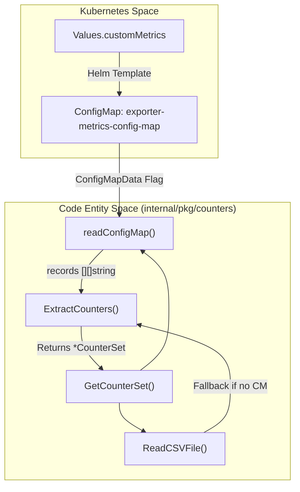
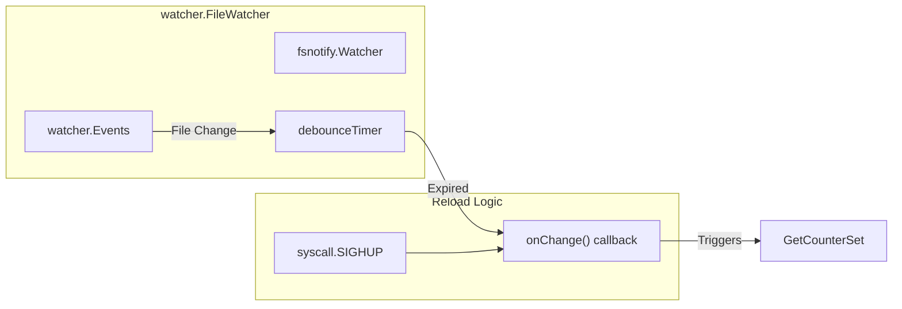

<!-- source: DeepWiki mcp.deepwiki.com · repo NVIDIA/dcgm-exporter · page 4.3 Custom Metrics · fetched 2026-10-26 -->

# Custom Metrics

<details>
<summary>Relevant source files</summary>

The following files were used as context for generating this wiki page:

- [deployment/templates/metrics-configmap.yaml](deployment/templates/metrics-configmap.yaml)
- [internal/pkg/counters/counter_config.go](internal/pkg/counters/counter_config.go)
- [internal/pkg/transformation/kubernetes_mig_test.go](internal/pkg/transformation/kubernetes_mig_test.go)
- [internal/pkg/watcher/file.go](internal/pkg/watcher/file.go)
- [tests/integration/reload_test.go](tests/integration/reload_test.go)

</details>


This document explains how to define and configure custom metric collections in DCGM Exporter using Helm chart values and Kubernetes ConfigMaps. It covers the technical implementation of the CSV format, the hot-reload mechanism, and how the exporter watches for configuration changes.

## Overview

DCGM Exporter uses a flexible metric collection system where the specific DCGM fields to be exported are defined in a CSV-formatted configuration. While the exporter provides a robust set of default metrics, users can override these by providing a custom configuration via a Kubernetes ConfigMap. This allows for fine-grained control over GPU telemetry without recompiling the binary.

## Custom Metrics Format

The configuration uses a 3-column CSV format. The internal parser identifies these fields and maps them to DCGM Field IDs and Prometheus metric types.

| Column | Description | Code Entity / Example |
|-----------|-------------|---------|
| **DCGM Field** | The string identifier for the DCGM field. | `DCGM_FI_DEV_GPU_UTIL` |
| **Metric Type** | The Prometheus export type. | `gauge`, `counter`, or `label` |
| **Help Message** | The description string for the Prometheus `# HELP` metadata. | `GPU utilization (in %).` |

### Field Parsing Logic
The `ExtractCounters` function processes these records:
1. It calls `dcgm.GetFieldID(record[0])` to resolve the string to a numeric ID [internal/pkg/counters/counter_config.go:110-110]().
2. It checks for "Legacy" fields (1.x compatibility) using `dcgm.IsLegacyField` [internal/pkg/counters/counter_config.go:111-111]().
3. It validates the Prometheus type against a supported map `promMetricType` [internal/pkg/counters/counter_config.go:135-135]().
4. It filters out unsupported fields based on the active configuration (e.g., DCP profiling metrics) via `fieldIsSupported` [internal/pkg/counters/counter_config.go:130-133]().

Sources: [internal/pkg/counters/counter_config.go:92-144](), [deployment/templates/metrics-configmap.yaml:14-16]()

## Configuration Data Flow

The following diagram bridges the high-level Kubernetes configuration to the internal Go functions responsible for loading metrics.



Sources: [internal/pkg/counters/counter_config.go:35-75](), [deployment/templates/metrics-configmap.yaml:9-13]()

## Hot-Reload and ConfigMap Watching

DCGM Exporter supports dynamic reconfiguration without process restarts through two primary mechanisms: signal handling and filesystem watching.

### 1. SIGHUP Signal Handling
The exporter listens for the `SIGHUP` signal. When received, it triggers a reload of the metric registry and collector configuration. This is validated in integration tests which verify that the `/metrics` endpoint remains consistent across multiple reloads [tests/integration/reload_test.go:127-163]().

### 2. File Watcher (fsnotify)
The `FileWatcher` struct in `internal/pkg/watcher/file.go` monitors the configuration file for changes. 
- **Implementation**: It uses `fsnotify` to watch the directory containing the metrics file [internal/pkg/watcher/file.go:85-88]().
- **Debouncing**: To handle atomic writes or multiple rapid updates (common with Kubernetes ConfigMap updates), it implements a 200ms debounce delay [internal/pkg/watcher/file.go:61-61]().
- **Logic**: It compares the file's `ModTime` to avoid spurious reloads [internal/pkg/watcher/file.go:123-126]().



Sources: [internal/pkg/watcher/file.go:74-161](), [tests/integration/reload_test.go:75-171]()

## Helm Chart Integration

### Defining Custom Metrics
Custom metrics are defined in `values.yaml` under the `customMetrics` key. If this key is populated, the Helm template generates a ConfigMap containing the CSV data [deployment/templates/metrics-configmap.yaml:9-11]().

### Kubernetes Deployment Configuration
To ensure the exporter uses the custom metrics, the ConfigMap must be mounted into the pod. The default approach mounts the ConfigMap data to `/etc/dcgm-exporter/default-counters.csv`.

**Example ConfigMap Structure:**
```yaml
apiVersion: v1
kind: ConfigMap
metadata:
  name: exporter-metrics-config-map
data:
  metrics: |
    DCGM_FI_DEV_GPU_UTIL, gauge, GPU utilization (in %).
    DCGM_FI_DEV_FB_USED, gauge, Framebuffer memory used (in MiB).
```

Sources: [deployment/templates/metrics-configmap.yaml:1-13](), [internal/pkg/counters/counter_config.go:166-182]()

## Technical Implementation Details

### The CounterSet Structure
The `CounterSet` struct (returned by `GetCounterSet`) categorizes metrics into two groups:
1. **DCGMCounters**: Standard metrics collected directly via DCGM field IDs [internal/pkg/counters/counter_config.go:139-140]().
2. **ExporterCounters**: Internal metrics or derived fields identified by `IdentifyMetricType` [internal/pkg/counters/counter_config.go:119-125]().

### Error Handling during Load
- If a ConfigMap is specified but inaccessible, the exporter attempts to fall back to the local `CollectorsFile` [internal/pkg/counters/counter_config.go:59-62]().
- Malformed CSV lines (not exactly 3 fields) will cause `ExtractCounters` to return an error, preventing invalid configurations from being loaded [internal/pkg/counters/counter_config.go:104-108]().

Sources: [internal/pkg/counters/counter_config.go:35-75](), [internal/pkg/counters/counter_config.go:92-144]()

---

