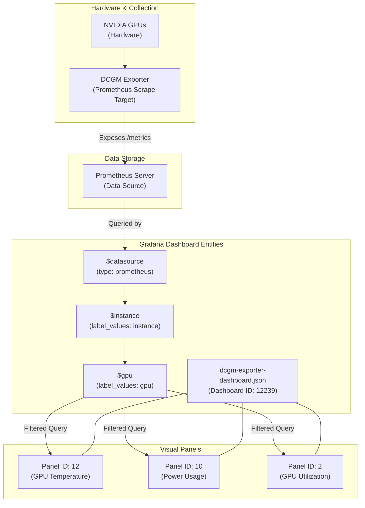
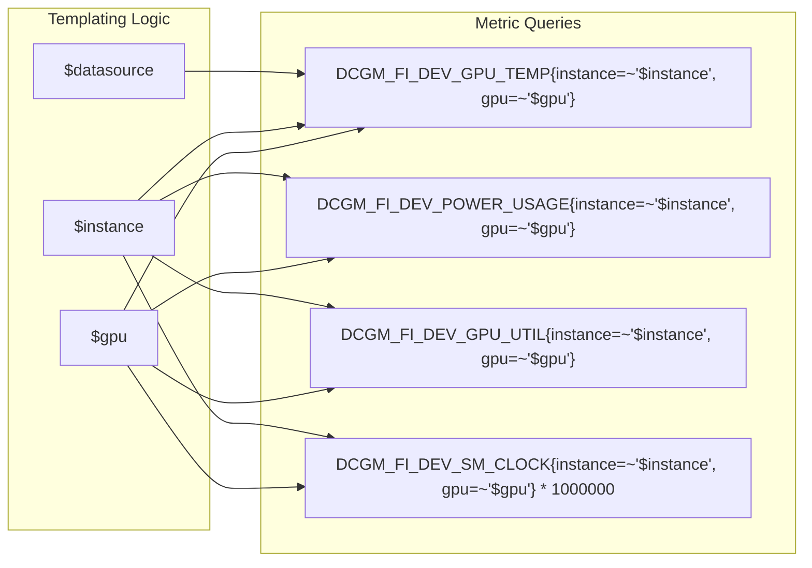

<!-- source: DeepWiki mcp.deepwiki.com · repo NVIDIA/dcgm-exporter · page 4.4 Grafana Dashboard · fetched 2026-10-26 -->

# Grafana Dashboard

Relevant source files

The following files were used as context for generating this wiki page:

- [grafana/dcgm-exporter-dashboard.json](grafana/dcgm-exporter-dashboard.json)

This page covers the pre-built Grafana dashboard provided with DCGM Exporter for visualizing GPU metrics collected from Kubernetes clusters. The dashboard displays real-time and historical GPU performance data including temperature, power usage, utilization, and memory consumption.

For information about the specific metrics exposed by DCGM Exporter, see [Available Metrics](#4.1). For details about configuring custom metrics collection, see [Custom Metrics](#4.3).

## Dashboard Overview

The DCGM Exporter includes a ready-to-use Grafana dashboard that provides comprehensive GPU monitoring capabilities for Kubernetes environments. The dashboard is designed to work with Prometheus as the data source and displays metrics collected from NVIDIA GPUs across cluster nodes.

The dashboard features multiple visualization panels showing key GPU performance indicators, with support for multi-GPU systems and multi-node clusters through templated variables.

**Dashboard Components:**

| Panel | Metric | Visualization | Purpose |
|-------|--------|---------------|---------|
| GPU Temperature | `DCGM_FI_DEV_GPU_TEMP` | Line Graph + Gauge | Monitor thermal performance |
| GPU Power Usage | `DCGM_FI_DEV_POWER_USAGE` | Line Graph + Gauge | Track power consumption |
| GPU SM Clocks | `DCGM_FI_DEV_SM_CLOCK` | Line Graph | Monitor streaming multiprocessor frequency |
| GPU Utilization | `DCGM_FI_DEV_GPU_UTIL` | Line Graph | Track compute usage percentage |
| Framebuffer Memory | `DCGM_FI_DEV_FB_USED` | Line Graph | Monitor GPU memory consumption |
| Tensor Core Utilization | `DCGM_FI_PROF_PIPE_TENSOR_ACTIVE` | Line Graph | Track Tensor Core usage |

Sources: [grafana/dcgm-exporter-dashboard.json:42-43](), [grafana/dcgm-exporter-dashboard.json:49-140](), [grafana/dcgm-exporter-dashboard.json:202-292](), [grafana/dcgm-exporter-dashboard.json:404-492](), [grafana/dcgm-exporter-dashboard.json:493-581](), [grafana/dcgm-exporter-dashboard.json:582-670]()

## Dashboard Architecture

The following diagram illustrates the flow of data from the hardware level to the Grafana visualization layer, mapping system components to their respective dashboard configurations.

Sources: [grafana/dcgm-exporter-dashboard.json:42-44](), [grafana/dcgm-exporter-dashboard.json:55](), [grafana/dcgm-exporter-dashboard.json:730-794]()

## Installation and Setup

### Prerequisites

- Grafana server (version 6.7.3 or later) [grafana/dcgm-exporter-dashboard.json:13-14]()
- Prometheus data source (version 1.0.0 or later) [grafana/dcgm-exporter-dashboard.json:23-26]()
- DCGM Exporter deployed and collecting metrics
- ServiceMonitor configured for Prometheus discovery

### Importing the Dashboard

The dashboard can be imported into Grafana using several methods:

**Method 1: Grafana.com Import**
- Use dashboard ID `12239` in Grafana's import interface [grafana/dcgm-exporter-dashboard.json:44]()
- Configure the Prometheus data source when prompted

**Method 2: JSON Import**
- Use the dashboard JSON file directly from the repository
- Import via Grafana's dashboard import functionality [grafana/dcgm-exporter-dashboard.json:1-27]()

**Method 3: Automated Deployment**
- Include dashboard provisioning in Grafana deployment configurations
- Reference the dashboard JSON in ConfigMaps for Kubernetes deployments

## Panel Configuration and Queries

The dashboard relies on specific PromQL expressions that utilize the templated variables to filter data by node and device.

Sources: [grafana/dcgm-exporter-dashboard.json:93-98](), [grafana/dcgm-exporter-dashboard.json:246-250](), [grafana/dcgm-exporter-dashboard.json:404-410](), [grafana/dcgm-exporter-dashboard.json:497-501]()

### Individual Panel Details

**GPU Temperature Panel (ID: 12)**
- Query: `DCGM_FI_DEV_GPU_TEMP{instance=~"$instance", gpu=~"$gpu"}` [grafana/dcgm-exporter-dashboard.json:93]()
- Format: Celsius [grafana/dcgm-exporter-dashboard.json:120]()
- Thresholds: green < 83°C (yellow) < 87°C (red) [grafana/dcgm-exporter-dashboard.json:162-178]()
- Includes both time series line graph and average value gauge [grafana/dcgm-exporter-dashboard.json:110](), [grafana/dcgm-exporter-dashboard.json:200]()

**GPU Power Usage Panel (ID: 10)**
- Query: `DCGM_FI_DEV_POWER_USAGE{instance=~"$instance", gpu=~"$gpu"}` [grafana/dcgm-exporter-dashboard.json:246]()
- Format: Watts [grafana/dcgm-exporter-dashboard.json:272]()
- Shows individual GPU consumption over time [grafana/dcgm-exporter-dashboard.json:262]()

**GPU SM Clocks Panel (ID: 2)**
- Query: `DCGM_FI_DEV_SM_CLOCK{instance=~"$instance", gpu=~"$gpu"} * 1000000` [grafana/dcgm-exporter-dashboard.json:404]()
- Format: Hertz (multiplied by 1M to convert from MHz to Hz) [grafana/dcgm-exporter-dashboard.json:431]()
- Shows streaming multiprocessor clock frequencies [grafana/dcgm-exporter-dashboard.json:415]()

**GPU Utilization Panel (ID: 4)**
- Query: `DCGM_FI_DEV_GPU_UTIL{instance=~"$instance", gpu=~"$gpu"}` [grafana/dcgm-exporter-dashboard.json:497]()
- Format: Percentage (0-100%) [grafana/dcgm-exporter-dashboard.json:524]()
- Displays compute utilization over time [grafana/dcgm-exporter-dashboard.json:508]()

## Templating Variables

The dashboard uses three templating variables defined in the `templating` section to enable dynamic filtering:

### Datasource Variable
- **Name**: `datasource`
- **Type**: `datasource` 
- **Query**: `prometheus` [grafana/dcgm-exporter-dashboard.json:731-747]()
- **Purpose**: Allows selection of different Prometheus instances.

### Instance Variable  
- **Name**: `instance`
- **Type**: `query`
- **Query**: `label_values(DCGM_FI_DEV_GPU_TEMP, instance)` [grafana/dcgm-exporter-dashboard.json:749-771]()
- **Multi-select**: Enabled with "All" option.
- **Purpose**: Filters metrics by Kubernetes node/instance.

### GPU Variable
- **Name**: `gpu` 
- **Type**: `query`
- **Query**: `label_values(DCGM_FI_DEV_GPU_TEMP, gpu)` [grafana/dcgm-exporter-dashboard.json:772-794]()
- **Multi-select**: Enabled with "All" option.
- **Purpose**: Filters metrics by specific GPU device ID.

## Time Controls and Refresh

The dashboard is configured with practical time controls for GPU monitoring:

- **Default Time Range**: Last 15 minutes (`now-15m` to `now`) [grafana/dcgm-exporter-dashboard.json:809-813]()
- **Refresh Intervals**: Includes 5s, 10s, 30s, 1m, 5m, 15m, 30m, 1h, 2h, and 1d. [grafana/dcgm-exporter-dashboard.json:797-808]()

The short refresh intervals (5-30 seconds) are particularly useful for real-time monitoring of GPU workloads, while longer intervals support historical analysis and capacity planning.

## Customization Options

### Panel Modifications

All panels can be customized through Grafana's edit interface:
- Adjust alert thresholds for temperature and power gauges [grafana/dcgm-exporter-dashboard.json:162-178]()
- Modify legend display options (table format, statistics shown) [grafana/dcgm-exporter-dashboard.json:66-76]()
- Change visualization types (graph, gauge, stat panels) [grafana/dcgm-exporter-dashboard.json:110](), [grafana/dcgm-exporter-dashboard.json:200]()

### Adding Custom Metrics

Additional panels can be created using other DCGM metrics exposed by the exporter:
- Use the existing templating variables (`$instance`, `$gpu`) for consistency [grafana/dcgm-exporter-dashboard.json:730-794]()
- Follow the established query patterns for multi-GPU environments
- Maintain the dashboard's color scheme and layout conventions

Sources: [grafana/dcgm-exporter-dashboard.json:43](), [grafana/dcgm-exporter-dashboard.json:731-747]()

---

