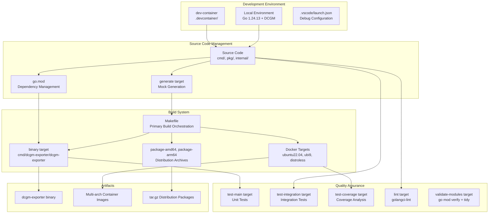
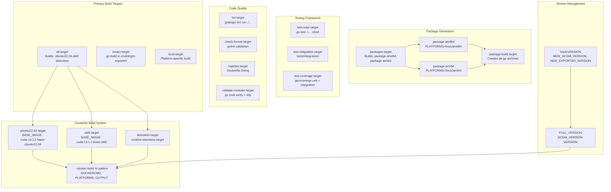

<!-- source: DeepWiki mcp.deepwiki.com · repo NVIDIA/dcgm-exporter · page 5 Development Guide · fetched 2026-10-26 -->

# Development Guide

Relevant source files

The following files were used as context for generating this wiki page:

- [CONTRIBUTING.md](CONTRIBUTING.md)
- [LICENSE](LICENSE)
- [Makefile](Makefile)
- [go.mod](go.mod)

This guide provides comprehensive information for developers who want to contribute to, modify, or build DCGM Exporter from source. It covers the development environment setup, build system architecture, testing procedures, and release workflow.

For information about installation and deployment of pre-built releases, see [Installation and Deployment](#2). For configuration options and runtime behavior, see [Configuration](#3).

## Development Workflow Overview

The DCGM Exporter development workflow centers around a comprehensive build system that supports multiple architectures, container formats, and deployment methods. The primary development cycle involves source code modification, local building and testing, and integration with the broader Kubernetes ecosystem.

Sources: [Makefile:1-192](), [go.mod:1-35]()

## Build System Architecture

The build system is orchestrated by the main `Makefile` which defines a comprehensive set of targets for different build scenarios, testing approaches, and artifact generation. The system supports cross-platform builds and multiple container base images.

Sources: [Makefile:15-30](), [Makefile:33-80](), [Makefile:81-97](), [Makefile:98-132](), [Makefile:135-159](), [Makefile:161-193]()

## Development Environment Options

DCGM Exporter supports multiple development environment configurations to accommodate different developer preferences and system constraints. For detailed setup instructions, see [Development Environment Setup](#5.1).

### Containerized Development Environment

The project supports development container configurations (DevContainers) to provide a consistent environment with all required dependencies pre-installed.

**Development Specifications:**
- Go Version: `1.24.13` (configured in [Makefile:24]() and [go.mod:5]())
- DCGM Version: Defined via `NEW_DCGM_VERSION` in `hack/VERSION` [Makefile:15-23]()
- Base OS Support: Ubuntu 22.04 and UBI9 [Makefile:66-74]()

### Local Development Environment

For developers preferring local development, the system requires:
- Go 1.24.13 (specified in [go.mod:5]())
- DCGM libraries and headers compatible with the version in `hack/VERSION`
- Docker with BuildKit support for container builds [Makefile:84-85]()
- Development tools: `golangci-lint`, `gotestsum`, `gocovmerge` [Makefile:140-155](), [Makefile:163]()

Sources: [Makefile:15-26](), [go.mod:3-5](), [Makefile:140-158]()

## Key Development Commands

The development workflow is driven by well-defined Makefile targets that handle common development tasks. For details on the build process, see [Building from Source](#5.2).

### Build Commands

| Command | Purpose | Output |
|---------|---------|--------|
| `make binary` | Build standalone binary | `cmd/dcgm-exporter/dcgm-exporter` [Makefile:36-37]() |
| `make local` | Platform-specific container build | Local Docker image [Makefile:55-60]() |
| `make all` | Build all supported image variants | `ubuntu22.04`, `ubi9`, `distroless` [Makefile:34]() |
| `make packages` | Distribution packages | `dist/*.tar.gz` archives [Makefile:99-132]() |

### Testing and Validation

Comprehensive testing is integrated into the Makefile. For details, see [Testing](#5.3).

| Command | Purpose | Scope |
|---------|---------|-------|
| `make test-main` | Unit tests | `go test ./... -short` [Makefile:39-40]() |
| `make test-integration` | Integration tests | `tests/integration/` [Makefile:135-136]() |
| `make test-coverage` | Coverage analysis | Merged unit and integration reports [Makefile:138-159]() |
| `make lint` | Static code analysis | `golangci-lint` [Makefile:161-163]() |
| `make validate` | Full validation suite | Modules, Dockerfiles, and formatting [Makefile:191-193]() |

Sources: [Makefile:36-40](), [Makefile:55-60](), [Makefile:99-132](), [Makefile:135-159](), [Makefile:161-193]()

## Dependency and Release Management

DCGM Exporter's dependency structure is managed through Go modules. For information on the release workflow, see [Release Process](#5.4).

### Core Dependencies

The project relies on NVIDIA-maintained libraries for GPU management and standard Prometheus tools for metrics exposition.

| Module | Purpose |
|--------|---------|
| `github.com/NVIDIA/go-dcgm` | DCGM library bindings [go.mod:8]() |
| `github.com/NVIDIA/go-nvml` | NVML library integration [go.mod:9]() |
| `github.com/prometheus/exporter-toolkit` | Exporter framework utilities [go.mod:21]() |
| `k8s.io/kubelet` | Kubelet pod resources API for Kubernetes integration [go.mod:33]() |

### Versioning Strategy

The project uses a composite versioning strategy that combines the DCGM version and the Exporter-specific version.
- **DCGM Version**: Sourced from `NEW_DCGM_VERSION` in `hack/VERSION` [Makefile:15-23]().
- **Exporter Version**: Sourced from `NEW_EXPORTER_VERSION` in `hack/VERSION` [Makefile:25]().
- **Full Version**: Formatted as `${DCGM_VERSION}-${VERSION}` [Makefile:26]().

Sources: [go.mod:1-35](), [Makefile:15-26]()

---

