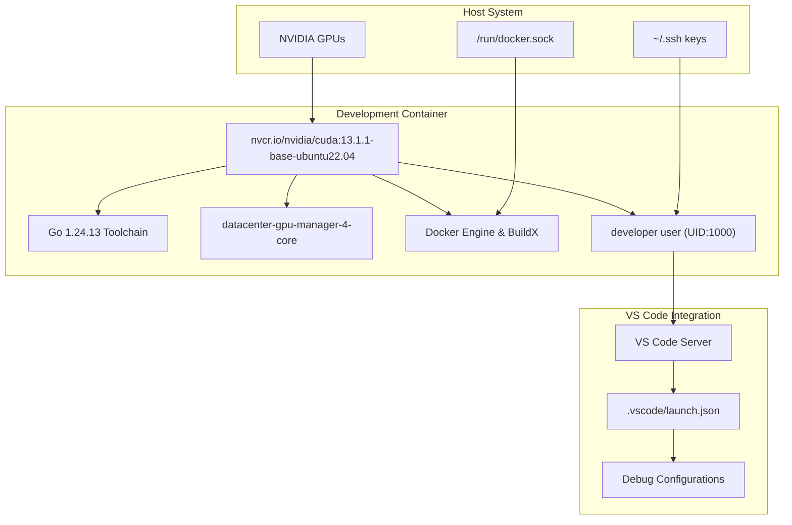
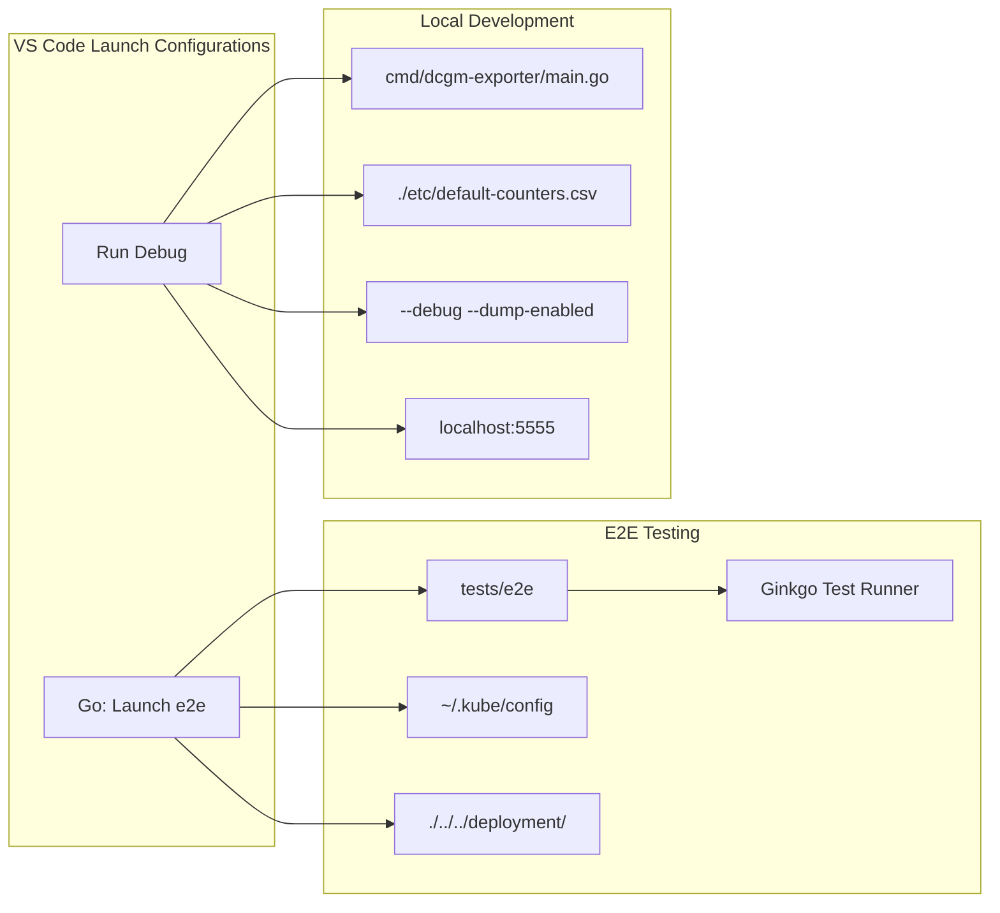
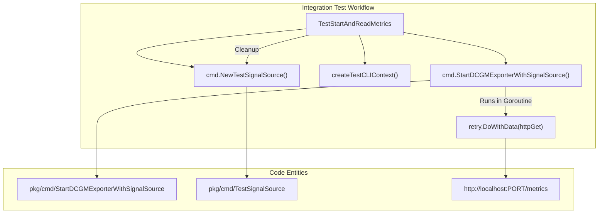
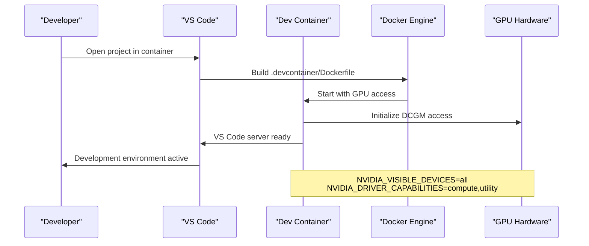

<!-- source: DeepWiki mcp.deepwiki.com · repo NVIDIA/dcgm-exporter · page 5.1 Development Environment Setup · fetched 2026-10-26 -->

# Development Environment Setup

<details>
<summary>Relevant source files</summary>

The following files were used as context for generating this wiki page:

- [.devcontainer/Dockerfile](.devcontainer/Dockerfile)
- [.devcontainer/devcontainer.json](.devcontainer/devcontainer.json)
- [.envrc](.envrc)
- [.golangci.yml](.golangci.yml)
- [.vscode/launch.json](.vscode/launch.json)
- [tests/integration/start_read_test.go](tests/integration/start_read_test.go)
- [tests/integration/start_with_tls_test.go](tests/integration/start_with_tls_test.go)

</details>


This document covers setting up a complete development environment for DCGM Exporter using development containers and VS Code. It includes container configuration, IDE integration, and testing framework setup for contributors working on the codebase.

For information about building the project from source, see [Building from Source](#5.2). For details about running tests, see [Testing](#5.3).

## Development Container Environment

DCGM Exporter provides a pre-configured development container that includes all necessary dependencies for development, testing, and debugging. The container is based on NVIDIA CUDA runtime with the Go toolchain and DCGM libraries.

### Container Architecture



Sources: [.devcontainer/Dockerfile:1-41](), [.devcontainer/devcontainer.json:1-22]()

### Container Configuration

The development container includes essential components:

| Component | Version | Purpose |
|-----------|---------|---------|
| Base Image | `nvcr.io/nvidia/cuda:13.1.1-base-ubuntu22.04` | CUDA runtime environment [[.devcontainer/Dockerfile:1]()] |
| Go Toolchain | `1.24.13` | Go development and building [[.devcontainer/Dockerfile:2]()] |
| DCGM Core | `datacenter-gpu-manager-4-core` | GPU monitoring library [[.devcontainer/Dockerfile:26]()] |
| Docker Engine | `docker-ce` | Container builds and multi-arch support [[.devcontainer/Dockerfile:36]()] |
| Build Tools | `gcc`, `g++`, `make`, `pkg-config` | Compilation dependencies [[.devcontainer/Dockerfile:20-24]()] |

The container automatically configures:
- User `developer` with sudo access and UID 1000 for file permission compatibility [[.devcontainer/Dockerfile:3-11]()]
- Go workspace at `/go` with proper `GOPATH` and `PATH` configuration [[.devcontainer/Dockerfile:87-90]()]
- NVIDIA container runtime capabilities for GPU access [[.devcontainer/Dockerfile:93-96]()]
- Docker-in-Docker support for building container images [[.devcontainer/devcontainer.json:9]()]

Sources: [.devcontainer/Dockerfile:1-90](), [.devcontainer/devcontainer.json:1-22]()

### GPU Access Configuration

The development environment is configured for direct GPU access:

```bash
# Environment variables set in container
NVIDIA_DRIVER_CAPABILITIES=compute,utility,compat32
NVIDIA_DISABLE_REQUIRE="true"
NVIDIA_VISIBLE_DEVICES=all
```

Container runtime arguments enable privileged access and GPU passthrough:
- `--gpus=all` - Access to all host GPUs [[.devcontainer/devcontainer.json:19]()]
- `--privileged` - Required for DCGM operations [[.devcontainer/devcontainer.json:7]()]
- `--cap-add=SYS_ADMIN` - System administration capabilities [[.devcontainer/devcontainer.json:16]()]

Sources: [.devcontainer/Dockerfile:93-96](), [.devcontainer/devcontainer.json:7-20]()

## VS Code Integration

The development environment includes pre-configured VS Code launch configurations for debugging and testing workflows.

### Debug Configurations



Sources: [.vscode/launch.json:1-45]()

### Launch Configuration Details

The VS Code configuration provides two main debugging scenarios:

**E2E Test Debugging** (`Go: Launch e2e`):
- Targets: `${workspaceFolder}/tests/e2e` [[.vscode/launch.json:12]()]
- Test framework: Ginkgo with verbose output (`--ginkgo.v`) [[.vscode/launch.json:15]()]
- Kubernetes integration via kubeconfig (`~/.kube/config`) [[.vscode/launch.json:16-17]()]
- Helm chart deployment from `./../../deployment/` [[.vscode/launch.json:18-19]()]
- Build tags: `-tags=e2e` [[.vscode/launch.json:26]()]

**Local Application Debugging** (`Run Debug`):
- Entry point: `cmd/dcgm-exporter/main.go` [[.vscode/launch.json:34]()]
- Default metrics: `./etc/default-counters.csv` [[.vscode/launch.json:36-37]()]
- Debug features: `--debug --dump-enabled` flags [[.vscode/launch.json:38-39]()]
- Remote DCGM: `localhost:5555` connection via `-r` flag [[.vscode/launch.json:40-41]()]

Sources: [.vscode/launch.json:7-44]()

## Testing Framework Setup

The development environment supports unit, integration, and end-to-end testing. Integration tests often utilize a signal source to manage application lifecycle.

### Integration Testing Pattern

Integration tests like `TestStartAndReadMetrics` demonstrate how to programmatically start the exporter and verify metric collection.



Sources: [tests/integration/start_read_test.go:34-89](), [tests/integration/start_with_tls_test.go:19-134]()

### Security Testing Setup

The environment supports testing secure configurations, including TLS and Basic Authentication. Integration tests verify:
- Rejection of plain HTTP requests when TLS is enabled [[tests/integration/start_with_tls_test.go:66-82]()]
- Successful metric retrieval with valid Basic Auth credentials over HTTPS [[tests/integration/start_with_tls_test.go:83-107]()]
- Unauthorized access handling for invalid credentials [[tests/integration/start_with_tls_test.go:109-133]()]

Sources: [tests/integration/start_with_tls_test.go:1-135]()

## Development Workflow

### Container Startup Process



Sources: [.devcontainer/devcontainer.json:8-20](), [.devcontainer/Dockerfile:93-96]()

### Prerequisites

Before using the development environment:

1. **Host Requirements**:
   - NVIDIA GPU with compatible drivers.
   - Docker Engine with NVIDIA Container Toolkit.
   - VS Code with Dev Containers extension.

2. **Access Requirements**:
   - SSH keys in `${env:HOME}/.ssh` are mounted into the container at `/home/developer/.ssh` [[.devcontainer/devcontainer.json:10]()]
   - Docker socket access via `/run/docker.sock` for container management [[.devcontainer/devcontainer.json:9]()]

3. **System Configuration**:
   - `binfmt` support is installed via `postStartCommand` to support multi-architecture emulation [[.devcontainer/devcontainer.json:21]()]
   - Linter configuration is defined in `.golangci.yml` for code quality checks [[.golangci.yml:1-40]()]

Sources: [.devcontainer/devcontainer.json:1-22](), [.golangci.yml:1-40]()

---

