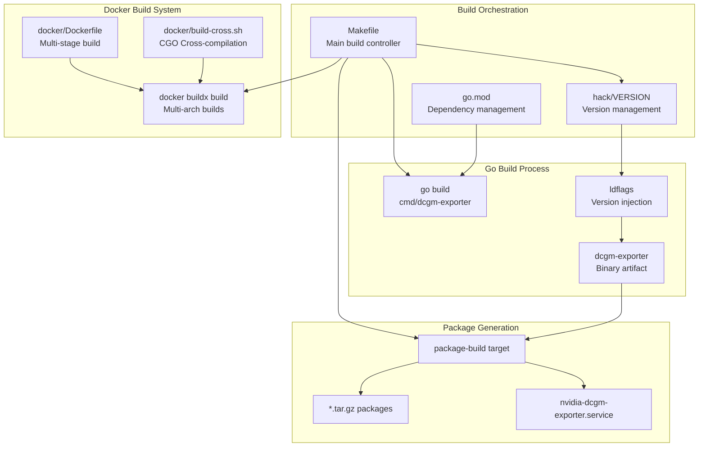
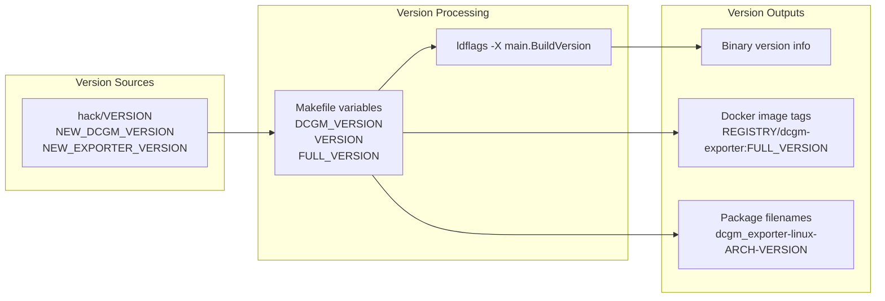
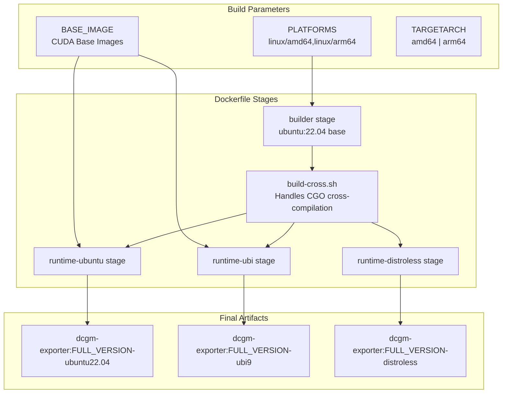
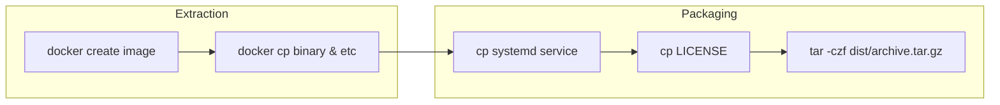

<!-- source: DeepWiki mcp.deepwiki.com · repo NVIDIA/dcgm-exporter · page 5.2 Building from Source · fetched 2026-10-26 -->

# Building from Source

<details>
<summary>Relevant source files</summary>

The following files were used as context for generating this wiki page:

- [.github/workflows/go.yml](.github/workflows/go.yml)
- [Makefile](Makefile)
- [docker/Dockerfile](docker/Dockerfile)
- [go.mod](go.mod)
- [hack/VERSION](hack/VERSION)

</details>


This document covers the complete build system for DCGM Exporter, including build dependencies, build targets, multi-architecture container builds, and package generation. It focuses on the technical implementation of the build process using Go, Docker, and Make.

For information about setting up a development environment, see [Development Environment Setup](). For details about the testing process, see [Testing]().

## Prerequisites and Dependencies

DCGM Exporter requires specific dependencies for building from source. The build system is designed to work with Go modules and requires DCGM libraries for GPU metric collection.

### Core Dependencies

| Dependency | Version | Purpose |
|------------|---------|---------|
| Go | 1.24.13 | Primary language runtime [Makefile:24](), [go.mod:5]() |
| DCGM | 4.5.2 | NVIDIA Data Center GPU Manager [hack/VERSION:3]() |
| Docker | Latest | Container builds with Buildx support [Makefile:29]() |
| Make | Latest | Build orchestration [Makefile:1-32]() |

The Go module dependencies are managed in [go.mod:1-35]() with direct dependencies including:

- `github.com/NVIDIA/go-dcgm` - DCGM Go bindings [go.mod:8]()
- `github.com/prometheus/common` - Prometheus common libraries [go.mod:20]()
- `github.com/urfave/cli/v2` - CLI framework [go.mod:24]()
- `k8s.io/client-go` - Kubernetes client libraries [go.mod:32]()

**Sources:** [go.mod:1-35](), [Makefile:24](), [hack/VERSION:3]()

## Build System Architecture

The build system uses a multi-layered approach combining Make, Go, and Docker to support various deployment targets and architectures.

### Build System Components



**Sources:** [Makefile:1-132](), [docker/Dockerfile:1-102](), [go.mod:1-35]()

### Version Management System

The versioning is derived from `hack/VERSION`, which defines both the DCGM and Exporter versions.



**Sources:** [hack/VERSION:1-4](), [Makefile:15-26](), [Makefile:37]()

## Build Targets and Processes

The Makefile defines multiple build targets for different deployment scenarios and architectures.

### Primary Build Targets

| Target | Purpose | Output |
|--------|---------|--------|
| `binary` | Local Go binary build | `cmd/dcgm-exporter/dcgm-exporter` [Makefile:36-37]() |
| `install` | System installation | `/usr/bin/dcgm-exporter` [Makefile:42-44]() |
| `ubuntu22.04` | Ubuntu 22.04 container | Docker image [Makefile:73-74]() |
| `ubi9` | Red Hat UBI 9 container | Docker image [Makefile:66-67]() |
| `distroless` | Minimal distroless container | Docker image [Makefile:76-79]() |
| `packages` | Distribution packages | `.tar.gz` archives for amd64/arm64 [Makefile:98-105]() |

### Binary Build Process

The core binary build uses Go with specific ldflags for version injection and `trimpath` for reproducible builds:

```bash
cd cmd/dcgm-exporter; $(GO) build -trimpath -ldflags "-X main.BuildVersion=${DCGM_VERSION}-${VERSION}"
```

**Sources:** [Makefile:36-37]()

### Container Build Process

The container build system uses a single multi-stage `docker/Dockerfile` with specific targets for each variant (`runtime-ubuntu`, `runtime-ubi`, `runtime-distroless`).



**Sources:** [docker/Dockerfile:20-113](), [docker/Dockerfile:195](), [Makefile:81-96]()

### Package Generation Process

The `package-build` target extracts artifacts from the built Docker images to create distribution-ready archives. It performs architecture mapping (e.g., `amd64` to `x86-64` and `arm64` to `sbsa`).



**Sources:** [Makefile:107-132]()

## Build Outputs and Artifacts

### Binary Artifacts
- **Binary**: `cmd/dcgm-exporter/dcgm-exporter` [Makefile:37]()
- **Config**: `/etc/dcgm-exporter/default-counters.csv` [Makefile:44]()

### Container Images
- **Ubuntu**: `nvcr.io/nvidia/cuda:13.1.1-base-ubuntu22.04` [Makefile:73]()
- **UBI9**: `nvcr.io/nvidia/cuda:13.1.1-base-ubi9` [Makefile:66]()
- **Distroless**: Minimal runtime [Makefile:77]()

### Distribution Packages
Archives are generated in the `dist/` directory with the following structure:
```
dcgm_exporter-linux-[arch]-[version].tar.gz
├── dcgm_exporter/
│   ├── usr/bin/dcgm-exporter
│   ├── etc/dcgm-exporter/
│   ├── lib/systemd/system/nvidia-dcgm-exporter.service
│   └── LICENSE
```
**Sources:** [Makefile:116-131]()

## Development Workflow Integration

### Code Quality and Validation
The build system includes several validation targets:
- `check-format`: Validates code formatting using `gofmt` [Makefile:46-48]().
- `lint`: Runs `golangci-lint` with a 10m timeout [Makefile:161-163]().
- `hadolint`: Lints Dockerfiles for best practices [Makefile:165-181]().
- `validate-modules`: Verifies Go module integrity and tidiness [Makefile:183-189]().

### Testing Targets
- `test-main`: Runs short unit tests [Makefile:39-40]().
- `test-integration`: Runs integration tests with the race detector [Makefile:135-136]().
- `test-coverage`: Merges unit and integration test coverage into `tests.cov` [Makefile:138-158]().

**Sources:** [Makefile:39-48](), [Makefile:135-193]()

---

