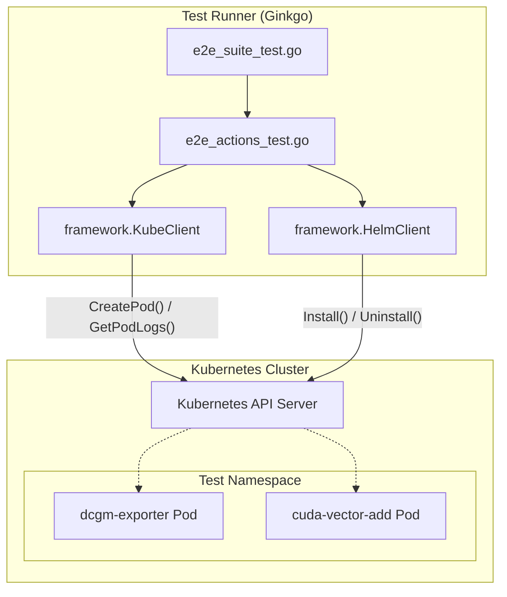
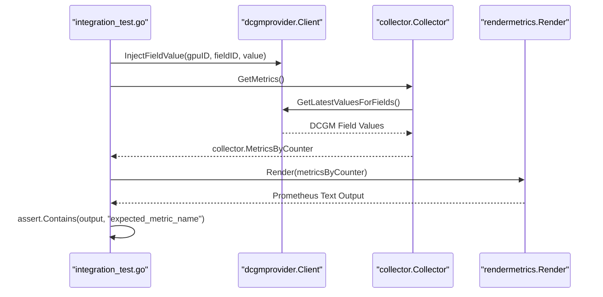

<!-- source: DeepWiki mcp.deepwiki.com · repo NVIDIA/dcgm-exporter · page 5.3 Testing · fetched 2026-10-26 -->

# Testing

<details>
<summary>Relevant source files</summary>

The following files were used as context for generating this wiki page:

- [internal/pkg/integration_test/collector_test.go](internal/pkg/integration_test/collector_test.go)
- [internal/pkg/integration_test/transformation_test.go](internal/pkg/integration_test/transformation_test.go)
- [internal/pkg/server/server_test.go](internal/pkg/server/server_test.go)
- [internal/pkg/testutils/test_utils.go](internal/pkg/testutils/test_utils.go)
- [pkg/cmd/app_test.go](pkg/cmd/app_test.go)
- [tests/docker/Makefile](tests/docker/Makefile)
- [tests/docker/README.md](tests/docker/README.md)
- [tests/e2e/Makefile](tests/e2e/Makefile)
- [tests/e2e/e2e_actions_test.go](tests/e2e/e2e_actions_test.go)
- [tests/e2e/e2e_suite_test.go](tests/e2e/e2e_suite_test.go)
- [tests/e2e/internal/framework/helm.go](tests/e2e/internal/framework/helm.go)
- [tests/e2e/internal/framework/kube.go](tests/e2e/internal/framework/kube.go)
- [tests/e2e/main_test.go](tests/e2e/main_test.go)
- [tests/integration/README.md](tests/integration/README.md)

</details>


This document provides a comprehensive guide to testing the DCGM Exporter codebase. It covers unit testing, integration testing, and end-to-end (E2E) testing using the Ginkgo/Gomega framework, as well as specialized Docker image validation.

## Test Types

DCGM Exporter employs a multi-layered testing strategy to ensure reliability across different environments and configurations.

### End-to-End (E2E) Tests
The E2E suite validates the exporter in a real Kubernetes environment. It uses Helm to deploy the exporter, schedules GPU workloads, and verifies that metrics are correctly collected and labeled.

### Integration Tests
Integration tests validate the interaction between internal components (e.g., `Collector`, `Registry`, and `Transformations`) and the DCGM library. These tests often use fake GPU entities to simulate hardware without requiring physical GPUs for every test case.

### Unit Tests
Unit tests focus on individual logic components, such as metric parsing in `counters` or server request handling in `server`. These tests utilize Go's standard `testing` package and `testify/assert`.

### Docker Image Tests
A specialized test suite validates the various Docker image variants (Ubuntu, UBI, Distroless) to ensure they start correctly, serve the `/metrics` and `/health` endpoints, and handle signals gracefully.

Sources: [tests/e2e/e2e_suite_test.go:139-140](), [internal/pkg/integration_test/collector_test.go:17-45](), [tests/docker/README.md:5-12]()

## End-to-End Testing Framework

The E2E framework is built on [Ginkgo](https://onsi.github.io/ginkgo/) and [Gomega](https://onsi.github.io/gomega/). It automates the lifecycle of a Kubernetes deployment to verify exporter behavior.

### E2E Test Architecture



### Key E2E Functions and Logic
- **`shouldInstallHelmChart`**: Uses the `HelmClient` to deploy the exporter with specific values (e.g., enabling TLS or Basic Auth) [tests/e2e/e2e_actions_test.go:143-168]().
- **`shouldCreateWorkloadPod`**: Deploys a `cuda-vector-add` container to generate GPU activity, ensuring the exporter has active processes to report [tests/e2e/e2e_suite_test.go:52-54]().
- **`shouldReadMetrics`**: Performs an HTTP request (often via port-forwarding) to the exporter's `:9400/metrics` endpoint and parses the Prometheus text format [tests/e2e/e2e_suite_test.go:169-171]().

Sources: [tests/e2e/e2e_suite_test.go:41-72](), [tests/e2e/internal/framework/kube.go:48-68](), [tests/e2e/e2e_actions_test.go:40-45]()

## Integration Testing

Integration tests bridge the gap between unit tests and E2E tests by testing multiple components together in a controlled environment.

### Data Flow: Collector to Prometheus Output



### Key Components in Integration Tests
- **`dcgmprovider.SmartDCGMInit`**: Initializes a real or fake DCGM engine for the test duration [internal/pkg/integration_test/collector_test.go:60-77]().
- **`devicewatchlistmanager.WatchListManager`**: Manages which GPU fields are being watched during the test [internal/pkg/integration_test/collector_test.go:106-110]().
- **`transformation.PodMapper`**: Specifically tested to ensure GPU UUIDs map correctly to Kubernetes Pod metadata using a mock PodResources server [internal/pkg/integration_test/transformation_test.go:104-108]().

Sources: [internal/pkg/integration_test/collector_test.go:88-150](), [internal/pkg/integration_test/transformation_test.go:47-137]()

## Docker Image Testing

The Docker test suite ensures that the containerized versions of DCGM Exporter are production-ready.

### Validated Scenarios
- **Startup**: The container starts without panics and produces logs [tests/docker/README.md:131-134]().
- **Endpoints**: Verifies `/metrics` returns HTTP 200 and valid Prometheus data, and `/health` returns HTTP 200 [tests/docker/README.md:140-147]().
- **Graceful Shutdown**: Ensures the process responds correctly to termination signals [tests/docker/README.md:137-138]().

### Running Docker Tests
The `tests/docker/Makefile` provides targets for different image variants:
- `make docker-test-ubuntu`
- `make docker-test-ubi`
- `make docker-test-distroless`

Sources: [tests/docker/Makefile:29-67](), [tests/docker/README.md:126-148]()

## Running Tests

### End-to-End Tests
E2E tests require a configured `KUBECONFIG`. They are invoked via the `tests/e2e/Makefile`.

| Command | Description |
|---------|-------------|
| `make e2e-test` | Runs the full suite [tests/e2e/Makefile:42-44](). |
| `make e2e-tls` | Runs only tests labeled with `tls` [tests/e2e/Makefile:58-63](). |
| `make e2e-basic-auth` | Runs only tests labeled with `basicAuth` [tests/e2e/Makefile:52-57](). |

### Integration and Unit Tests
Integration tests are typically run via the root Makefile or directly via `go test`.

```bash
# Run integration tests (requires DCGM installed)
make test-integration

# Run a specific integration test
make test-integration -e TEST_ARGS="-test.run TestClockEventsCollector_Gather"
```

Sources: [tests/e2e/Makefile:24-40](), [tests/integration/README.md:8-24]()

## Mock Generation

The project uses `gomock` for generating mocks of internal interfaces, allowing for isolated testing of components like the `MetricsServer`.

### Mocked Interfaces
- `collector.Collector`: Mocked in `server_test.go` to simulate metric collection without a DCGM engine [internal/pkg/server/server_test.go:32-43]().
- `dcgmprovider.DCGM`: Mocked to simulate various DCGM engine responses [pkg/cmd/app_test.go:30-33]().

Sources: [internal/pkg/server/server_test.go:94-108](), [pkg/cmd/app_test.go:208-213]()

---

