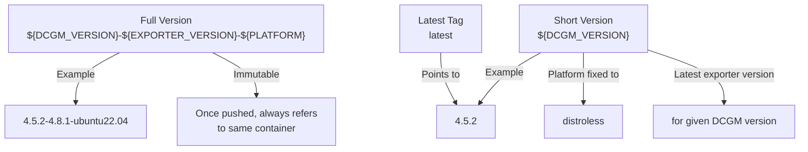
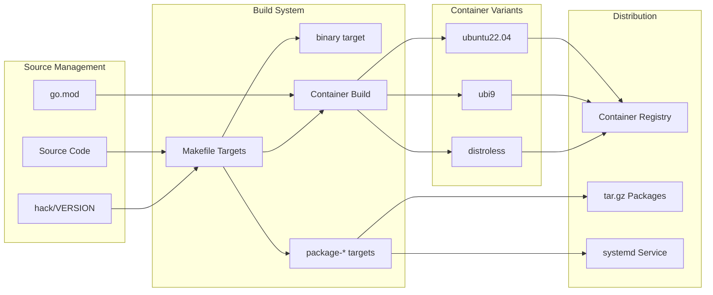
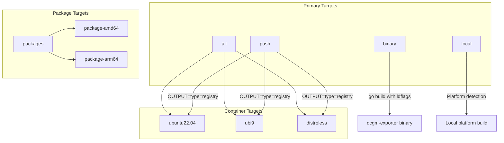
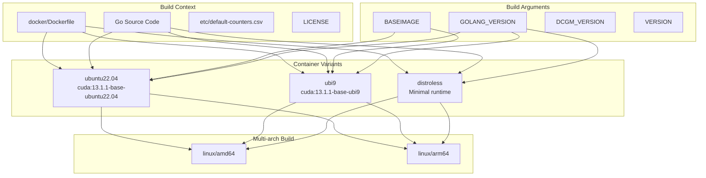
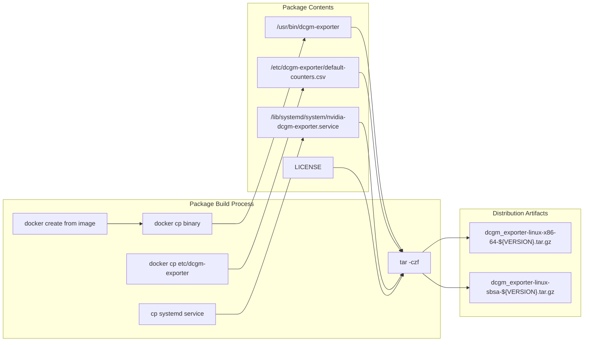

<!-- source: DeepWiki mcp.deepwiki.com · repo NVIDIA/dcgm-exporter · page 5.4 Release Process · fetched 2026-10-26 -->

# Release Process

Relevant source files

The following files were used as context for generating this wiki page:

- [Makefile](Makefile)
- [RELEASE.md](RELEASE.md)
- [hack/VERSION](hack/VERSION)

This document covers the release process for DCGM Exporter, including versioning strategy, build workflows, and distribution packaging. The release process transforms source code into versioned container images and distribution packages that are published to registries and made available for deployment.

For information about building DCGM Exporter from source during development, see [Building from Source](#5.2). For deployment procedures, see [Helm Chart Deployment](#2.4).

## Versioning Strategy

DCGM Exporter uses a multi-component versioning scheme that combines DCGM library versions with exporter-specific versions and platform identifiers.

### Version Components

The DCGM Exporter version consists of three major components:

| Component | Example | Description |
|-----------|---------|-------------|
| DCGM Version | `4.5.2` | Version of the underlying DCGM library |
| Exporter Version | `4.8.1` | Version of the DCGM Exporter application |
| Platform | `ubuntu22.04` | Base container platform (e.g., `ubi9`, `distroless`) |

Sources: [RELEASE.md:7-10](), [hack/VERSION:3-4]()

### Version Forms

The overall container version has three distinct forms:

Sources: [RELEASE.md:12-22]()

## Release Workflow

The release process follows a structured workflow that transforms source code through multiple build stages to create distributable artifacts.

### Build and Release Pipeline

Sources: [Makefile:33-132](), [RELEASE.md:25-28]()

### Release Cadence

DCGM Exporter releases follow a demand-driven schedule that typically aligns with DCGM library releases. The project maintains a single version branch and functions with the latest `go-dcgm` bindings.

Sources: [RELEASE.md:23-28]()

## Build System Integration

The release process is orchestrated through the main `Makefile`, which defines targets for different build stages and distribution formats.

### Core Build Targets

The `Makefile` uses variables defined in `hack/VERSION` to populate build-time version information.

Sources: [Makefile:15-31](), [Makefile:33-60](), [Makefile:98-132]()

### Build Variables and Configuration

The build system uses several key variables that control versioning and output:

| Variable | Source | Purpose |
|----------|--------|---------|
| `DCGM_VERSION` | `hack/VERSION` (via `NEW_DCGM_VERSION`) | DCGM library version [Makefile:23]() |
| `VERSION` | `hack/VERSION` (via `NEW_EXPORTER_VERSION`) | Exporter version [Makefile:25]() |
| `FULL_VERSION` | Computed: `$(DCGM_VERSION)-$(VERSION)` | Combined version string [Makefile:26]() |
| `PLATFORMS` | `Makefile` | Target architectures (default: `linux/amd64,linux/arm64`) [Makefile:28]() |
| `OUTPUT` | `Makefile` | Build output type (e.g., `type=oci`, `type=docker`, `type=registry`) [Makefile:27]() |
| `REGISTRY` | `Makefile` | Container registry (default: `nvidia`) [Makefile:17]() |

Sources: [Makefile:15-31](), [hack/VERSION:3-4]()

## Container Image Build Process

DCGM Exporter produces multiple container variants to support different deployment scenarios and base image preferences. The build process uses `docker buildx` for multi-architecture support.

### Container Build Architecture

Sources: [Makefile:24-30](), [Makefile:62-96]()

## Package Distribution

In addition to container images, the release process creates traditional distribution packages (`.tar.gz`) for environments that require binary installations.

### Package Creation Workflow

The `package-build` target extracts the binary and configuration from a built container to ensure consistency between containerized and binary releases.

Sources: [Makefile:107-132]()

### Package Architecture Mapping

The build system maps Go architecture names to distribution package architecture names:

| Go Architecture (`PLATFORMS`) | Package Architecture (`ARCH`) | Target Platform |
|----------------|---------------------|-----------------|
| `linux/amd64` | `x86-64` | Intel/AMD 64-bit |
| `linux/arm64` | `sbsa` | ARM 64-bit Server Base System Architecture |

Sources: [Makefile:109-116]()

## Version File Structure

The `hack/VERSION` file serves as the single source of truth for versioning during the release process. It defines both the previous and current versions for DCGM and the Exporter.

| Variable | Description |
|----------|-------------|
| `OLD_DCGM_VERSION` | Previous DCGM library version |
| `OLD_EXPORTER_VERSION` | Previous Exporter version |
| `NEW_DCGM_VERSION` | Target DCGM library version for release |
| `NEW_EXPORTER_VERSION` | Target Exporter version for release |

Sources: [hack/VERSION:1-4](), [Makefile:15]()

---

