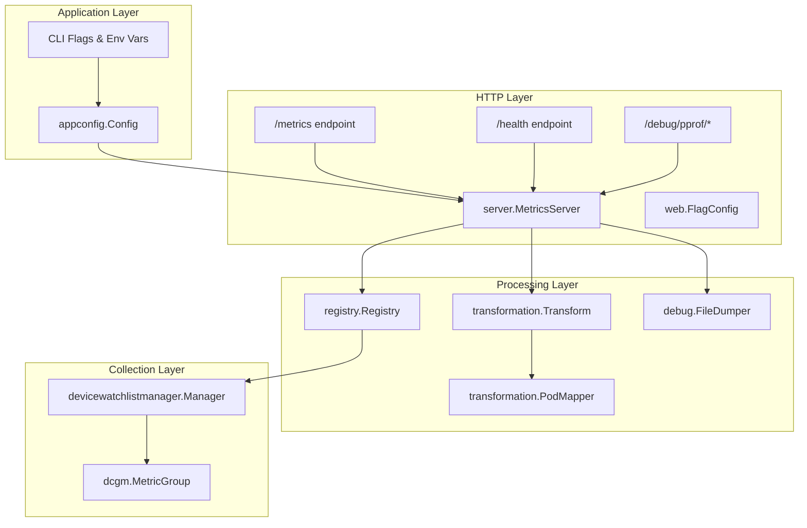
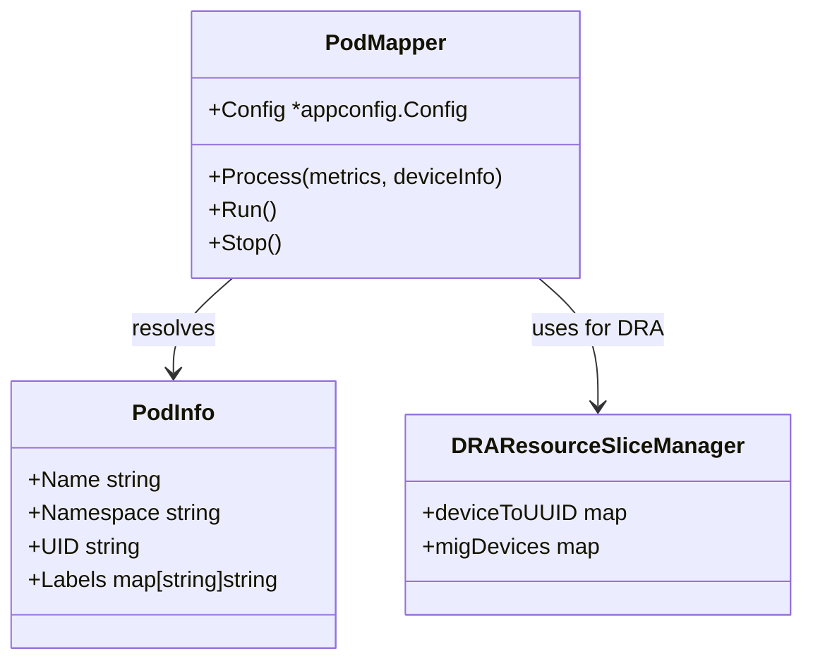

<!-- source: DeepWiki mcp.deepwiki.com · repo NVIDIA/dcgm-exporter · page 7 API Reference · fetched 2026-10-26 -->

# API Reference

Relevant source files

The following files were used as context for generating this wiki page:

- [internal/pkg/appconfig/types.go](internal/pkg/appconfig/types.go)
- [internal/pkg/server/server.go](internal/pkg/server/server.go)
- [internal/pkg/transformation/types.go](internal/pkg/transformation/types.go)

This document provides a comprehensive technical reference for DCGM Exporter's APIs, HTTP endpoints, configuration formats, and internal interfaces. This serves as a reference for developers integrating with, monitoring, or extending DCGM Exporter.

## API Overview

DCGM Exporter exposes several interfaces for configuration, monitoring, and integration:

1.  **HTTP API**: Prometheus-compatible metrics endpoint, health checks, and profiling.
2.  **Command-line Interface**: Comprehensive CLI with configuration flags and environment variables.
3.  **Configuration File Formats**: CSV metric definitions, web configuration (TLS/Auth), and debug dump settings.
4.  **Internal Go APIs**: Core interfaces for collectors, device management, and registry.

**Core API Components Architecture**

Sources: [internal/pkg/server/server.go:46-73](), [internal/pkg/appconfig/types.go:41-79]()

## HTTP API

DCGM Exporter provides a primary HTTP server implemented in `server.MetricsServer` [internal/pkg/server/server.go:56-73](). It exposes metrics, health status, and runtime profiling data.

### Endpoints

| Endpoint | Method | Description |
| :--- | :--- | :--- |
| `/metrics` | GET | GPU metrics in Prometheus exposition format. |
| `/health` | GET | Returns `200 OK` if the exporter is healthy. Supports `X-Reload-In-Progress` header. |
| `/debug/pprof/` | GET | Index page for Go runtime profiling (heap, goroutine, etc.). |

The server supports TLS encryption and basic authentication via the `web-config-file` [internal/pkg/server/server.go:63-67]().

For detailed documentation on response formats and headers, see **[HTTP Endpoints](#7.1)**.

Sources: [internal/pkg/server/server.go:101-116](), [internal/pkg/server/server.go:77-99]()

## Configuration Formats

DCGM Exporter uses several configuration formats to control its behavior at runtime.

### Internal Config Structure
The core configuration is managed via the `appconfig.Config` struct [internal/pkg/appconfig/types.go:41-79](), which aggregates settings for Kubernetes integration, device filtering, and collection intervals.

### Metric Definitions (CSV)
Metrics are defined using a 3-column CSV format (Field ID, Type, Help string). This allows users to customize which DCGM fields are exposed as Prometheus metrics.

### Web and Security Configuration
Security settings for the HTTP server, including TLS certificates and basic authentication, are defined in a `web-config.yaml` file [internal/pkg/server/server.go:66-67]().

### Debug Dump Configuration
DCGM Exporter can be configured to dump internal state to files for troubleshooting via the `DumpConfig` struct [internal/pkg/appconfig/types.go:34-39]().

For detailed specifications of these formats, see **[Configuration File Formats](#7.2)**.

Sources: [internal/pkg/appconfig/types.go:27-31](), [internal/pkg/appconfig/types.go:34-39]()

## Internal Go APIs

DCGM Exporter provides internal interfaces to handle data transformation and registry management.

### Transformation Interface
The `transformation.Transform` interface [internal/pkg/transformation/types.go:37-40]() allows for modifying or enriching metrics before they are served. The most prominent implementation is the `PodMapper` [internal/pkg/transformation/types.go:42-51](), which associates GPU metrics with Kubernetes Pod metadata.

**Kubernetes Entity Mapping**

Sources: [internal/pkg/transformation/types.go:37-40](), [internal/pkg/transformation/types.go:42-51](), [internal/pkg/transformation/types.go:69-77]()

### Registry Management
The `MetricsServer` manages a `registry.Registry` [internal/pkg/server/server.go:49]() which acts as the central store for collected metrics.
- `GetRegistry()`: Returns the current registry [internal/pkg/server/server.go:160-167]().
- `SetRegistry()`: Updates the registry, typically used during hot-reloads [internal/pkg/server/server.go:154-156]().
- `ClearRegistry()`: Swaps the current registry with `nil` [internal/pkg/server/server.go:148-150]().

### Hot Reload State
The server tracks if a reload is in progress via `SetReloadInProgress(bool)` [internal/pkg/server/server.go:171-173](). This state is used to signal to scrapers (like Prometheus) that the metrics may be temporarily unavailable or incomplete.

Sources: [internal/pkg/server/server.go:171-178](), [internal/pkg/server/server.go:148-156]()

---

