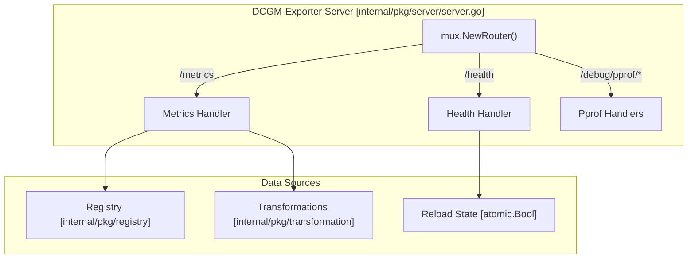
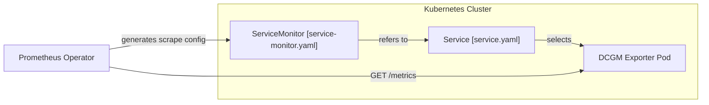
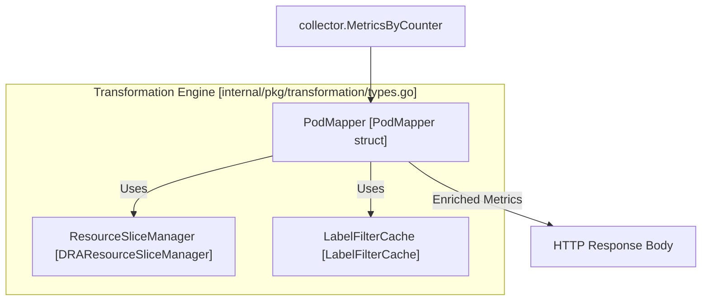

<!-- source: DeepWiki mcp.deepwiki.com · repo NVIDIA/dcgm-exporter · page 7.1 HTTP Endpoints · fetched 2026-10-26 -->

# HTTP Endpoints

<details>
<summary>Relevant source files</summary>

The following files were used as context for generating this wiki page:

- [deployment/templates/service-monitor.yaml](deployment/templates/service-monitor.yaml)
- [deployment/templates/service.yaml](deployment/templates/service.yaml)
- [internal/pkg/server/server.go](internal/pkg/server/server.go)
- [internal/pkg/transformation/types.go](internal/pkg/transformation/types.go)
- [service-monitor.yaml](service-monitor.yaml)

</details>


This document outlines the HTTP endpoints exposed by DCGM Exporter, which provide access to NVIDIA GPU metrics, health status, and profiling data. These endpoints are the primary interface for monitoring systems like Prometheus and for administrative troubleshooting.

## Overview

DCGM Exporter exposes a set of HTTP endpoints using the `gorilla/mux` router [internal/pkg/server/server.go:51](). The server implementation in `internal/pkg/server` handles metric gathering, transformation (such as Kubernetes pod mapping), and exposition.


Sources: [internal/pkg/server/server.go:51-116](), [internal/pkg/server/types.go:37-54]()

## Core Endpoints

### 1. `/metrics`
The primary endpoint for scraping GPU metrics in Prometheus exposition format.

*   **Implementation**: Handled by `serverv1.Metrics` [internal/pkg/server/server.go:102]().
*   **Data Flow**:
    1.  The handler retrieves the current `Registry` [internal/pkg/server/server.go:160-167]().
    2.  It executes configured `Transformations` (e.g., `PodMapper`) to enrich metrics with Kubernetes metadata [internal/pkg/server/server.go:70]().
    3.  Metrics are rendered into the Prometheus text format.
*   **Custom Headers**:
    *   `X-Reload-In-Progress`: Returns `true` if a hot-reload of the device watchlist or configuration is currently active [internal/pkg/server/server.go:171-179]().
    *   `X-Registry-Available`: Returns `true` if the internal registry is initialized and ready to serve data.

### 2. `/health`
Provides the operational status of the exporter.

*   **Implementation**: Handled by `serverv1.Health` [internal/pkg/server/server.go:101]().
*   **Behavior**:
    *   Returns `HTTP 200 OK` if the exporter is running.
    *   Used by Kubernetes liveness and readiness probes to ensure the container is responsive.
    *   Can be checked to see if a reload is in progress via the `IsReloadInProgress()` state [internal/pkg/server/server.go:176-179]().

### 3. `/debug/pprof/`
Exposes Go runtime profiling data for performance analysis and troubleshooting [internal/pkg/server/server.go:106-116]().

| Endpoint | Description |
| :--- | :--- |
| `/debug/pprof/heap` | Memory allocation profile of live objects |
| `/debug/pprof/goroutine` | Stack traces of all current goroutines |
| `/debug/pprof/allocs` | A sampling of all past memory allocations |
| `/debug/pprof/profile` | CPU profile (requires duration parameter) |
| `/debug/pprof/trace` | Execution trace of the current program |

Sources: [internal/pkg/server/server.go:77-116](), [internal/pkg/server/server.go:160-179]()

## Kubernetes Integration and ServiceMonitor

For Kubernetes deployments, DCGM Exporter is typically paired with a `ServiceMonitor` resource to automate discovery by the Prometheus Operator.

### Service Discovery Logic
The `ServiceMonitor` targets the `metrics` port (default `9400`) and the `/metrics` path.



### Service Configuration
The `Service` defines the named port `metrics` which is referenced by the `ServiceMonitor` [deployment/templates/service.yaml:34-36]().

```yaml
ports:
- name: "metrics"
  port: 9400
  targetPort: 9400
  protocol: TCP
```

### ServiceMonitor Configuration
The `ServiceMonitor` allows for advanced Prometheus features like `relabelings` and `metricRelabelings` [deployment/templates/service-monitor.yaml:39-42]().

```yaml
spec:
  endpoints:
  - port: "metrics"
    path: "/metrics"
    interval: "15s"
    honorLabels: true
```

Sources: [service-monitor.yaml:15-30](), [deployment/templates/service-monitor.yaml:33-42](), [deployment/templates/service.yaml:33-37]()

## Data Transformation Pipeline

When `/metrics` is called, the exporter does not just return raw DCGM data; it passes the data through a series of `Transform` interfaces.



### Key Components:
*   **PodMapper**: Maps GPU device IDs to Kubernetes Pod metadata (Name, Namespace, UID) [internal/pkg/transformation/types.go:42-51]().
*   **DRAResourceSliceManager**: Handles Dynamic Resource Allocation (DRA) mapping for clusters using the new Kubernetes resource management API [internal/pkg/transformation/types.go:79-86]().
*   **LabelFilterCache**: An LRU-based cache that filters which Kubernetes labels are allowed to be exported as Prometheus labels to prevent cardinality explosions [internal/pkg/transformation/types.go:54-61]().

Sources: [internal/pkg/transformation/types.go:37-61](), [internal/pkg/transformation/types.go:79-86](), [internal/pkg/server/server.go:70]()

## Security and Server Lifecycle

### Web Configuration
The server supports TLS and Basic Auth via the `--web-config-file` flag, which is passed to the Prometheus `exporter-toolkit` [internal/pkg/server/server.go:63-67]().

### Debug Dumps
If enabled via `c.DumpConfig`, the server can periodically dump internal state to files for troubleshooting [internal/pkg/server/server.go:54](), [internal/pkg/server/server.go:188-193]().

### Shutdown
The `NewMetricsServer` function returns a `cleanup` closure that ensures the `PodMapper` and `ResourceSliceManager` are stopped gracefully to prevent goroutine leaks [internal/pkg/server/server.go:132-143]().

Sources: [internal/pkg/server/server.go:54-73](), [internal/pkg/server/server.go:132-143](), [internal/pkg/server/server.go:188-196]()

---

