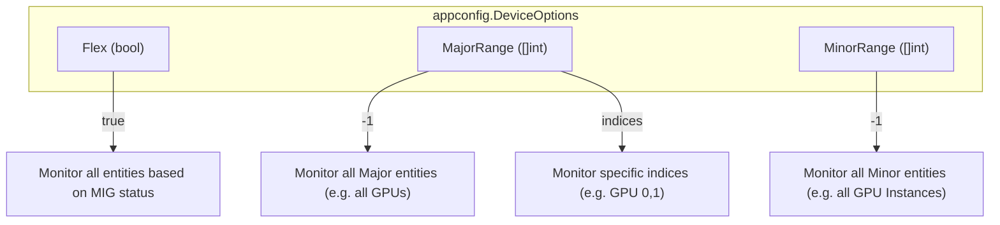
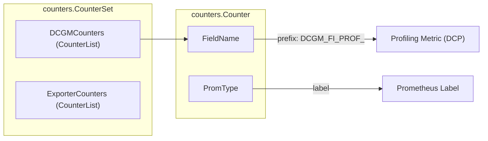
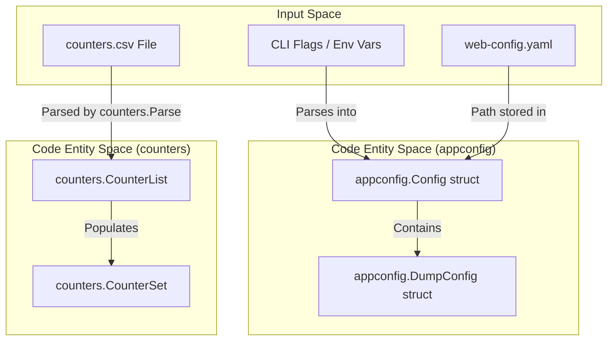

<!-- source: DeepWiki mcp.deepwiki.com · repo NVIDIA/dcgm-exporter · page 7.2 Configuration File Formats · fetched 2026-10-26 -->

# Configuration File Formats

Relevant source files

The following files were used as context for generating this wiki page:

- [deployment/templates/web-config-configmap.yaml](deployment/templates/web-config-configmap.yaml)
- [etc/1.x-compatibility-metrics.csv](etc/1.x-compatibility-metrics.csv)
- [etc/default-counters.csv](etc/default-counters.csv)
- [internal/pkg/appconfig/types.go](internal/pkg/appconfig/types.go)
- [internal/pkg/counters/types.go](internal/pkg/counters/types.go)
- [tests/integration/testdata/default-counters.csv](tests/integration/testdata/default-counters.csv)

This page documents the technical specifications for configuration files used by DCGM Exporter to manage metric collection, security, and internal application behavior.

## Internal Configuration Structure

The `Config` struct in `internal/pkg/appconfig/types.go` is the central data structure that holds the state derived from CLI flags and environment variables. This struct governs how the exporter interacts with the DCGM engine and Kubernetes.

### Config Struct Fields

| Field | Type | Description |
|-------|------|-------------|
| `CollectorsFile` | `string` | Path to the CSV file defining metrics to collect. |
| `CollectInterval` | `int` | Interval in milliseconds between metric collection cycles. |
| `Kubernetes` | `bool` | Enables Kubernetes-specific features like pod label collection. |
| `GPUDeviceOptions` | `DeviceOptions` | Defines which GPUs to monitor (Flex mode or specific indices). |
| `WebConfigFile` | `string` | Path to the `web-config.yaml` for TLS and Auth. |
| `ConfigMapData` | `string` | Raw string data containing metric configurations from a ConfigMap. |
| `DumpConfig` | `DumpConfig` | Settings for file-based debug dumps (directory, retention, compression). |

### Device Selection Logic
The `DeviceOptions` struct defines the granularity of monitoring for GPUs, Switches, and CPUs.
[internal/pkg/appconfig/types.go:27-31]()

Sources: [internal/pkg/appconfig/types.go:27-79]()

## Metrics Configuration (CSV)

The exporter defines metrics using a 3-column CSV format. These files are parsed into `Counter` objects within a `CounterSet`.

### CSV Format Specification
Lines starting with `#` are ignored. Each data line follows:
`DCGM_FIELD_ID, Prometheus_type, Help_string`

[etc/default-counters.csv:1-3]()

### Metric Mapping Logic
The `Counter` struct in `internal/pkg/counters/types.go` represents a single row from the CSV.

| Field | Type | Code Reference |
|-------|------|----------------|
| `FieldID` | `dcgm.Short` | [internal/pkg/counters/types.go:26]() |
| `FieldName` | `string` | [internal/pkg/counters/types.go:27]() |
| `PromType` | `string` | [internal/pkg/counters/types.go:28]() |

**Supported Types:**
- `gauge`: Numeric values like `DCGM_FI_DEV_GPU_TEMP`. [etc/default-counters.csv:11]()
- `counter`: Cumulative values like `DCGM_FI_DEV_TOTAL_ENERGY_CONSUMPTION`. [etc/default-counters.csv:15]()
- `label`: Static metadata like `DCGM_FI_DRIVER_VERSION`. [etc/default-counters.csv:77]()

### Profiling Metrics (DCP)
Metrics prefixed with `DCGM_FI_PROF_` are identified as profiling metrics. The `Counter.IsProfilingMetric()` function checks for this prefix to enable specific DCGM watch frequencies.
[internal/pkg/counters/types.go:36-38]()

Sources: [internal/pkg/counters/types.go:25-70](), [etc/default-counters.csv:87-98]()

## Web Configuration (YAML)

The `web-config.yaml` file provides the schema for the HTTP server's security layer, supporting TLS and Basic Authentication.

### Schema Specification
[deployment/templates/web-config-configmap.yaml:24-38]()

- `tls_server_config`:
    - `cert_file`: Path to the TLS certificate.
    - `key_file`: Path to the TLS private key.
    - `client_auth_type`: (Optional) Policy for TLS client auth.
    - `client_ca_file`: (Optional) Path to CA for verifying client certs.
- `basic_auth_users`:
    - A map of `username: password_hash` (bcrypt).

### Kubernetes Integration
In Helm deployments, this file is typically generated into a `ConfigMap` and mounted to `/etc/dcgm-exporter/web-config.yaml`.
[deployment/templates/web-config-configmap.yaml:14-23]()

## Data Flow: Config to Runtime

The following diagram bridges the "Natural Language" configuration concepts to the "Code Entity" space.

Sources: [internal/pkg/appconfig/types.go:41-79](), [internal/pkg/counters/types.go:62-65]()

## Related Pages
- [3.1 Command-line Options]()
- [3.2 Environment Variables]()
- [3.3 Metrics Configuration]()
- [7.1 HTTP Endpoints]()

---

