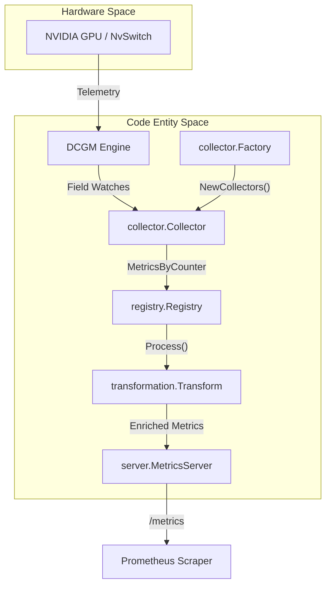
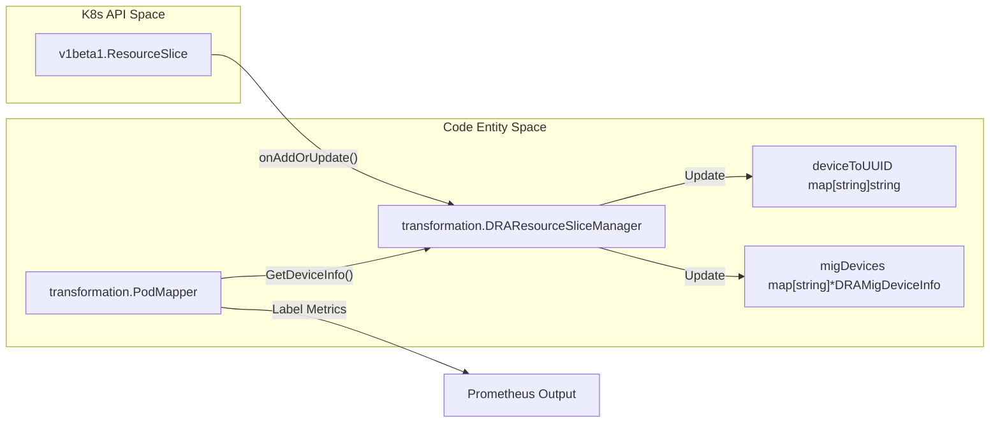

<!-- source: DeepWiki mcp.deepwiki.com · repo NVIDIA/dcgm-exporter · page 8 Glossary · fetched 2026-10-26 -->

# Glossary

Relevant source files

The following files were used as context for generating this wiki page:

- [README.md](README.md)
- [deployment/Chart.yaml](deployment/Chart.yaml)
- [go.mod](go.mod)
- [internal/pkg/appconfig/types.go](internal/pkg/appconfig/types.go)
- [internal/pkg/collector/collector_factory.go](internal/pkg/collector/collector_factory.go)
- [internal/pkg/collector/collector_factory_test.go](internal/pkg/collector/collector_factory_test.go)
- [internal/pkg/server/server.go](internal/pkg/server/server.go)
- [internal/pkg/transformation/dra.go](internal/pkg/transformation/dra.go)
- [internal/pkg/transformation/types.go](internal/pkg/transformation/types.go)

This page provides definitions for codebase-specific terms, domain concepts, and technical jargon used within the DCGM Exporter project. It serves as a reference for onboarding engineers to understand how high-level concepts map to internal code structures.

## Core Domain Concepts

### DCGM (Data Center GPU Manager)
The underlying NVIDIA library used to manage and monitor NVIDIA GPUs. The exporter interacts with DCGM via the `go-dcgm` bindings [go.mod:8](). It provides the "Field IDs" (FIs) that represent specific hardware metrics.

### Entity Group
A classification of hardware components that DCGM can monitor. In the exporter, these are mapped to `dcgm.Field_Entity_Group` types. Supported entity groups include:
*   `FE_GPU`: Physical GPUs.
*   `FE_SWITCH`: NvSwitches.
*   `FE_LINK`: NvLinks.
*   `FE_CPU` / `FE_CPU_CORE`: CPU-level metrics.

**Implementation Pointer:** [internal/pkg/collector/collector_factory.go:61-67]()

### MIG (Multi-Instance GPU)
A feature of NVIDIA Ampere and later architectures that allows a GPU to be partitioned into multiple isolated instances. The exporter handles MIG by monitoring "Minor" indices (GPU Instances) when MIG mode is enabled.

**Implementation Pointer:** [internal/pkg/appconfig/types.go:28-31]()

## Codebase Terminology

### Collector
An internal component responsible for gathering metrics for a specific `Entity Group`. There are two primary categories:
1.  **DCGM Collector**: Fetches metrics directly from the DCGM engine using field watches.
2.  **Exporter Collector**: Computes synthetic or derived metrics (e.g., XID error counts, clock event counts) that are not simple gauges in DCGM.

**Implementation Pointer:** [internal/pkg/collector/collector_factory.go:146-196]()

### Registry
A thread-safe container that stores the current state of collected metrics. The `MetricsServer` swaps registries during hot reloads or device topology changes (bind/unbind events) to ensure metric consistency.

**Implementation Pointer:** [internal/pkg/server/server.go:148-167]()

### Transformation
A pipeline step that modifies or enriches collected metrics before they are rendered to the Prometheus format. The most common transformation is `PodMapper`, which adds Kubernetes metadata (Pod name, namespace, UID) to GPU metrics.

**Implementation Pointer:** [internal/pkg/transformation/types.go:37-40]()

---

## Technical Architecture Diagrams

### Metric Collection Pipeline
The following diagram illustrates the flow from hardware entities to the HTTP `/metrics` endpoint, mapping system components to code entities.

**Sources:** [internal/pkg/collector/collector_factory.go:31-33](), [internal/pkg/server/server.go:102-102](), [internal/pkg/transformation/types.go:37-40]()

### Kubernetes Resource Mapping (DRA)
This diagram shows how the `DRAResourceSliceManager` bridges the gap between Kubernetes `ResourceSlices` and physical GPU UUIDs.

**Sources:** [internal/pkg/transformation/dra.go:91-111](), [internal/pkg/transformation/types.go:79-86](), [internal/pkg/transformation/dra.go:120-163]()

---

## Glossary Table

| Term | Definition | Code Pointer |
| :--- | :--- | :--- |
| **CounterSet** | A collection of DCGM and Exporter-specific counters parsed from a CSV file. | [internal/pkg/collector/collector_factory.go:36-36]() |
| **DCP** | DCGM Profiling metrics (e.g., Tensor Core utilization). Enabled via `CollectDCP`. | [internal/pkg/appconfig/types.go:51-51]() |
| **DeviceOptions** | Configuration for filtering which GPUs/Switches are monitored (Flex, Major, Minor). | [internal/pkg/appconfig/types.go:27-31]() |
| **DRA** | Dynamic Resource Allocation; a K8s feature for requesting specialized resources. | [internal/pkg/transformation/dra.go:36-50]() |
| **Field ID (FI)** | A unique integer representing a specific metric in DCGM (e.g., `DCGM_FI_DEV_SM_CLOCK`). | [README.md:152-154]() |
| **HPC Job Mapping** | Associating GPU metrics with specific cluster job IDs via flat files. | [README.md:95-108]() |
| **Hot Reload** | The process of reloading metric configurations without restarting the process. | [internal/pkg/server/server.go:169-178]() |
| **PodMapper** | A `Transform` implementation that queries the Kubelet or API Server for Pod metadata. | [internal/pkg/transformation/types.go:42-51]() |
| **WatchList** | A list of entities and fields that a collector is currently monitoring. | [internal/pkg/collector/collector_factory.go:71-71]() |

**Sources:** [internal/pkg/appconfig/types.go:27-79](), [internal/pkg/collector/collector_factory.go:35-54](), [internal/pkg/transformation/types.go:17-108](), [README.md:95-165]()