# Page: Overview

# Overview

<details>
<summary>Relevant source files</summary>

The following files were used as context for generating this wiki page:

- [README.md](README.md)
- [cmd/dcgm-exporter/main.go](cmd/dcgm-exporter/main.go)
- [go.mod](go.mod)

</details>


This document provides an overview of DCGM Exporter, a Prometheus metrics exporter for NVIDIA GPU telemetry data. It covers the system's purpose, architecture, and key integration points within GPU monitoring infrastructure.

DCGM Exporter bridges the gap between NVIDIA's Data Center GPU Manager (DCGM) and Prometheus-based monitoring systems, enabling comprehensive GPU observability in containerized and Kubernetes environments. For detailed deployment instructions, see [Installation and Deployment](#2). For configuration options, see [Configuration](#3). For metrics specifications, see [Metrics and Monitoring](#4).

## What is DCGM Exporter

DCGM Exporter is a specialized Prometheus exporter that collects GPU metrics from NVIDIA's DCGM library and exposes them via HTTP in Prometheus format [README.md:1-4](). The system is designed primarily for Kubernetes deployments as a DaemonSet, though it also supports standalone Docker container and binary execution modes [README.md:11-14](), [README.md:118-125]().

**Core Capabilities:**
- **GPU Metrics Collection**: Gathers comprehensive GPU telemetry including clocks, temperatures, memory usage, and utilization [README.md:16-21]().
- **Kubernetes Integration**: Enriches metrics with pod, container, and namespace labels when deployed in Kubernetes [README.md:75-78]().
- **Custom Metric Configuration**: Supports user-defined metric collections via CSV configuration files [README.md:139-143]().
- **HPC Job Mapping**: Can correlate GPU usage with High-Performance Computing job identifiers [README.md:95-109]().
- **Security**: Supports TLS encryption and HTTP basic authentication using `exporter-toolkit` [README.md:85-94]().

**Primary Use Cases:**
- GPU resource monitoring in Kubernetes clusters.
- Performance analysis for ML/AI workloads.
- Capacity planning for GPU infrastructure.
- SLA monitoring and alerting for GPU-accelerated applications.

Sources: [README.md:1-137]()

## System Architecture

The following diagram shows DCGM Exporter's position within the GPU monitoring ecosystem and maps system components to their corresponding code entities:

Title: DCGM Exporter System Architecture
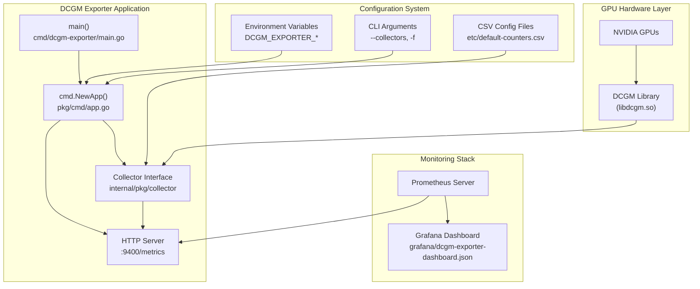

This architecture illustrates how DCGM Exporter acts as a translation layer between low-level GPU hardware data and cloud-native monitoring systems. The `main()` function in [cmd/dcgm-exporter/main.go:28-34]() initializes the application through `cmd.NewApp()`, which orchestrates metric collection and HTTP serving.

Sources: [cmd/dcgm-exporter/main.go:28-34](), [README.md:156-160](), [README.md:167-172]()

## Data Flow and Metric Pipeline

The following diagram shows how GPU metrics flow through the system, from hardware collection to Prometheus ingestion:

Title: Metric Collection Pipeline
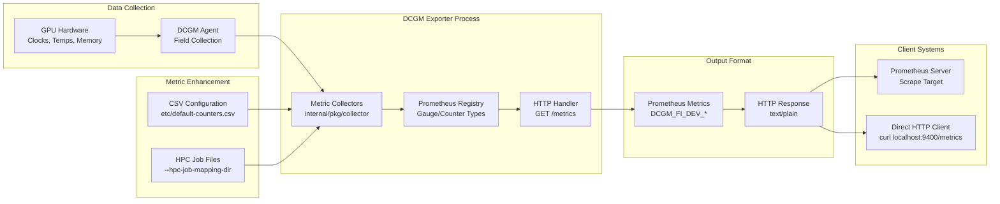

The data pipeline begins with DCGM collecting raw GPU field data, which gets processed by collector interfaces. When Kubernetes integration is enabled, the system enriches metrics with pod and container labels [README.md:75-78]().

**Metric Format Example:**
```
DCGM_FI_DEV_SM_CLOCK{gpu="0", UUID="GPU-604ac...", pod="training-job-xyz", container="pytorch", namespace="ml-team"} 1350
```

For details, see [Architecture](#1.1).

Sources: [README.md:13-27](), [README.md:67-79](), [README.md:95-109]()

## Deployment Models

DCGM Exporter supports multiple deployment patterns, each suited to different operational requirements:

| Deployment Type | Use Case | Key Components |
|-----------------|----------|----------------|
| **Standalone Binary** | Development, testing, single-node | `make binary`, local DCGM installation [README.md:121]() |
| **Docker Container** | Single-node production, bare metal | `nvcr.io/nvidia/k8s/dcgm-exporter` image [README.md:14]() |
| **Kubernetes DaemonSet** | Multi-node clusters, manual deployment | `kubectl create -f dcgm-exporter.yaml` [README.md:59]() |
| **Helm Chart** | Production Kubernetes, customizable | `gpu-helm-charts/dcgm-exporter` [README.md:51-54]() |
| **GPU Operator Integration** | Enterprise Kubernetes, full GPU stack | Embedded within NVIDIA GPU Operator [README.md:31]() |

**Default Configuration:**
- **Port**: 9400 [README.md:14]()
- **Metrics Endpoint**: `/metrics` [README.md:15]()
- **Default Collectors**: `etc/default-counters.csv` [README.md:142]()

The most common production deployment uses the Helm chart, which provides comprehensive customization options. For enterprise environments, DCGM Exporter is typically deployed as part of the NVIDIA GPU Operator.

Sources: [README.md:10-14](), [README.md:29-54](), [README.md:110-137]()

## Key Integration Points

DCGM Exporter integrates with several external systems:

**NVIDIA DCGM Library**
- **Purpose**: Low-level GPU data collection interface [README.md:3]().
- **Integration**: Direct library calls to collect DCGM field values via `github.com/NVIDIA/go-dcgm` [go.mod:8]().

**Kubernetes**
- **Purpose**: Maps GPU devices to pods and containers.
- **Integration**: Uses Kubelet APIs and environment variables like `NODE_NAME` [go.mod:33]().

**Prometheus Ecosystem**
- **Service Discovery**: Integration via Prometheus Operator ServiceMonitors.
- **Metric Format**: Standard Prometheus text exposition format [README.md:16-21]().
- **Dashboard**: Pre-built Grafana dashboard at `grafana/dcgm-exporter-dashboard.json` [README.md:171]().

**Configuration Sources**
- **CSV Files**: Metric field definitions in `etc/default-counters.csv` [README.md:142]().
- **CLI Arguments**: Command-line flags parsed using `github.com/urfave/cli/v2` [go.mod:24]().
- **Security**: TLS and Basic Auth via `github.com/prometheus/exporter-toolkit` [go.mod:21]().

For details, see [Key Features](#1.2).

Sources: [README.md:85-94](), [README.md:167-172](), [go.mod:7-35]()

---

# Page: Architecture

# Architecture

<details>
<summary>Relevant source files</summary>

The following files were used as context for generating this wiki page:

- [internal/mocks/pkg/dcgmprovider/mock_client.go](internal/mocks/pkg/dcgmprovider/mock_client.go)
- [internal/pkg/appconfig/types.go](internal/pkg/appconfig/types.go)
- [internal/pkg/dcgmprovider/dcgm.go](internal/pkg/dcgmprovider/dcgm.go)
- [internal/pkg/dcgmprovider/types.go](internal/pkg/dcgmprovider/types.go)
- [internal/pkg/registry/registry.go](internal/pkg/registry/registry.go)
- [internal/pkg/server/server.go](internal/pkg/server/server.go)
- [internal/pkg/transformation/types.go](internal/pkg/transformation/types.go)
- [pkg/cmd/app.go](pkg/cmd/app.go)

</details>


This document describes the system architecture of DCGM Exporter, detailing how it collects, processes, and exposes NVIDIA GPU metrics for Prometheus. It explains the key components, their interactions, and the overall data flow from GPU hardware to monitoring systems.

## Overview

DCGM Exporter is an application that bridges NVIDIA GPU hardware and monitoring systems like Prometheus. It leverages NVIDIA's Data Center GPU Manager (DCGM) and NVIDIA Management Library (NVML) to collect various GPU metrics and exposes them in Prometheus format for monitoring and visualization.

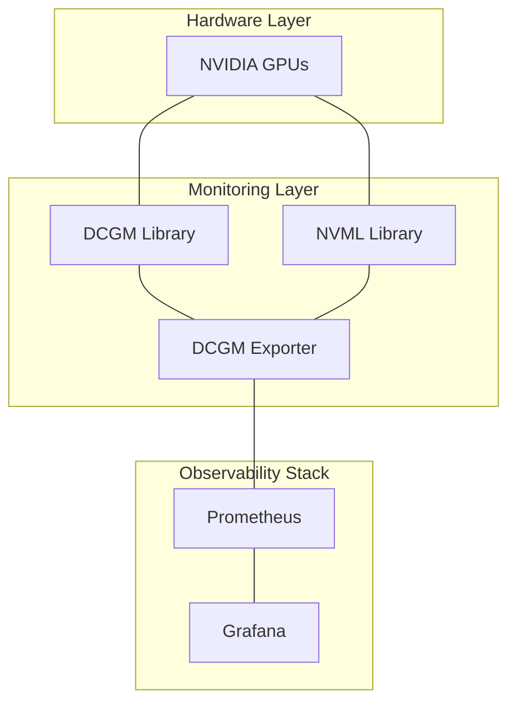

Sources: [pkg/cmd/app.go:22-22](), [pkg/cmd/app.go:33-33](), [pkg/cmd/app.go:107-110]()

## Component Architecture

DCGM Exporter consists of several key components that work together to collect and expose GPU metrics. The system is designed around a central `Registry` that manages multiple `Collector` instances.

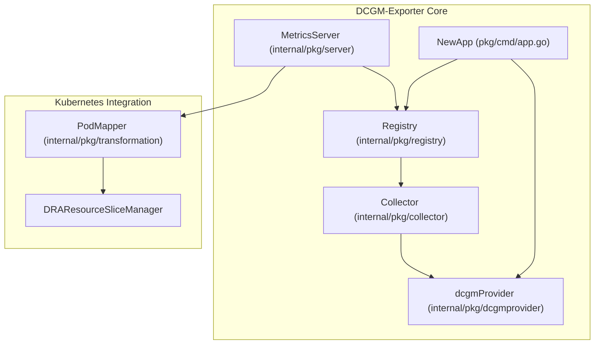

Sources: [pkg/cmd/app.go:107-121](), [internal/pkg/server/server.go:46-73](), [internal/pkg/registry/registry.go:44-50](), [internal/pkg/transformation/types.go:42-51]()

### Key Components

1.  **DCGM Provider**: A singleton interface ([internal/pkg/dcgmprovider/dcgm.go:30-35]()) that abstracts interactions with the underlying `libdcgm` library. It handles both embedded and standalone (remote) host engine connections ([internal/pkg/dcgmprovider/dcgm.go:69-92]()).
2.  **Registry**: Acts as the central management point for all active collectors ([internal/pkg/registry/registry.go:44-50]()). It handles the orchestration of metric gathering across different entity groups (GPUs, NvSwitches, CPUs).
3.  **Collectors**: Specialized units that query DCGM for specific field values. They are registered into the `Registry` via `EntityCollectorTuple` ([internal/pkg/registry/registry.go:61-68]()).
4.  **Metrics Server**: An HTTP server built using `gorilla/mux` that exposes the `/metrics` and `/health` endpoints ([internal/pkg/server/server.go:46-51]()). It uses `prometheus/exporter-toolkit` for web configuration including TLS and authentication ([internal/pkg/server/server.go:63-67]()).
5.  **Pod Mapper**: A transformation component that watches the Kubernetes API for pod events and maps GPU device IDs to Kubernetes metadata like Pod Name, Namespace, and UID ([internal/pkg/transformation/types.go:42-51]()).

## Metrics Collection Pipeline

The pipeline follows a structured flow: **Provider → Collector → Registry → Transformation → Render → HTTP**.

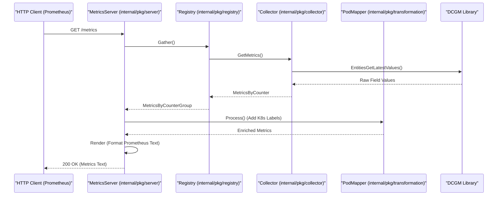

### 1. Collection (Gathering)
When a scrape request arrives, the `Registry.Gather()` function is called ([internal/pkg/registry/registry.go:71-75]()). It executes all registered collectors in parallel using an `errgroup` ([internal/pkg/registry/registry.go:93-102]()).

### 2. Transformation
After metrics are gathered, the `MetricsServer` applies a list of `Transform` interfaces ([internal/pkg/transformation/types.go:37-40]()). The primary transformation is the `PodMapper`, which enriches metrics with Kubernetes metadata if `--kubernetes` is enabled ([pkg/cmd/app.go:143-149]()).

### 3. Rendering
The final step converts the internal `MetricsByCounter` structures into the Prometheus text format for transmission over HTTP.

Sources: [internal/pkg/registry/registry.go:71-136](), [internal/pkg/server/server.go:70-73](), [internal/pkg/transformation/types.go:37-40]()

## Hot-Reload and Topology Handling

DCGM Exporter implements a hot-reload mechanism to handle configuration changes or GPU topology updates (e.g., GPU bind/unbind events in a cloud environment).

*   **Reload State**: The `MetricsServer` tracks `reloadInProgress` using an atomic boolean ([internal/pkg/server/server.go:76-76]()).
*   **Safe Cleanup**: The `Registry` uses reference counting (`activeGathers`) to ensure that DCGM resources are not cleaned up while a metric scrape is currently in flight ([internal/pkg/registry/registry.go:141-153]()).
*   **Dynamic Watching**: If enabled via `--enable-gpu-bind-unbind-watch`, the exporter polls for device changes and triggers a registry swap ([pkg/cmd/app.go:103-104]()).

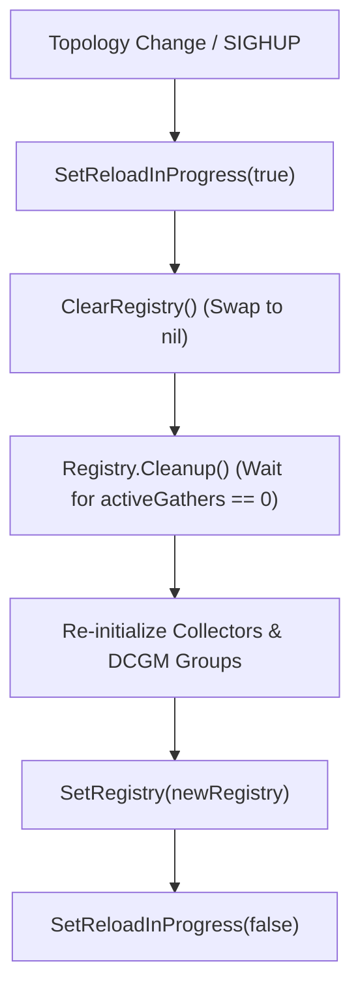

Sources: [internal/pkg/server/server.go:148-178](), [internal/pkg/registry/registry.go:141-188](), [pkg/cmd/app.go:103-104]()

## Kubernetes Integration Details

The integration with Kubernetes involves several sub-systems to provide high-fidelity mapping:

*   **Kubelet Pod Resources API**: Used to discover which GPU devices are assigned to which pods by connecting to the Kubelet socket ([pkg/cmd/app.go:93-93]()).
*   **DRA (Dynamic Resource Allocation)**: Supported via the `DRAResourceSliceManager`, which watches `ResourceSlice` objects to map devices in newer Kubernetes versions ([internal/pkg/transformation/types.go:79-86]()).
*   **Label Filtering**: A `LabelFilterCache` with LRU eviction is used to efficiently process pod label allowlists without impacting scrape performance ([internal/pkg/transformation/types.go:54-61]()).

Sources: [internal/pkg/transformation/types.go:42-108](), [pkg/cmd/app.go:93-101]()

## Data Structures

| Type | Location | Purpose |
| :--- | :--- | :--- |
| `Config` | `internal/pkg/appconfig/types.go:41` | Central configuration object for the entire application. |
| `Registry` | `internal/pkg/registry/registry.go:44` | Manages the lifecycle and gathering of all collectors. |
| `PodMapper` | `internal/pkg/transformation/types.go:42` | Implements the `Transform` interface for K8s metadata. |
| `DCGM` | `internal/pkg/dcgmprovider/types.go:29` | Interface for all DCGM library operations. |
| `MetricsServer` | `internal/pkg/server/server.go:56` | Handles HTTP routing and metric rendering orchestration. |

Sources: [internal/pkg/appconfig/types.go:41-79](), [internal/pkg/registry/registry.go:44-50](), [internal/pkg/transformation/types.go:42-51](), [internal/pkg/dcgmprovider/types.go:29-63]()

---

# Page: Key Features

# Key Features

<details>
<summary>Relevant source files</summary>

The following files were used as context for generating this wiki page:

- [README.md](README.md)
- [deployment/values.yaml](deployment/values.yaml)
- [internal/pkg/transformation/dra.go](internal/pkg/transformation/dra.go)
- [internal/pkg/transformation/hpc.go](internal/pkg/transformation/hpc.go)
- [internal/pkg/transformation/hpc_test.go](internal/pkg/transformation/hpc_test.go)

</details>


This document describes the core features and capabilities of DCGM Exporter, focusing on its technical implementation and configuration options. DCGM Exporter serves as a Prometheus-compatible exporter that collects NVIDIA GPU metrics using the NVIDIA DCGM library and exposes them for monitoring systems.

## Prometheus Integration

DCGM Exporter provides native Prometheus integration by exposing GPU metrics through a standard HTTP `/metrics` endpoint on port 9400. The exporter transforms DCGM field data into Prometheus-compatible metrics with proper typing and labels.

### Metrics Collection Architecture

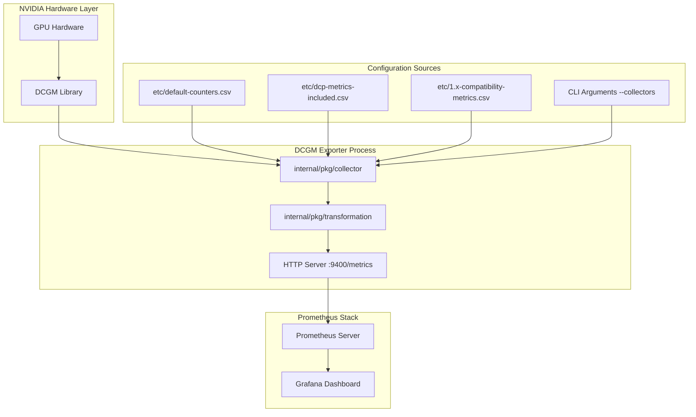

The exporter supports multiple metric types including gauges for instantaneous values (temperature, utilization) and counters for accumulating values (energy consumption, error counts).

**Sources:** [README.md:10-27](), [etc/default-counters.csv:1-92](), [etc/dcp-metrics-included.csv:1-91]()

## Kubernetes Native Integration

DCGM Exporter is designed for Kubernetes environments with DaemonSet deployment and automatic service discovery through ServiceMonitor resources. It integrates with the Kubelet Pod Resources API to map GPU devices to specific Pods.

### Kubernetes Integration Components

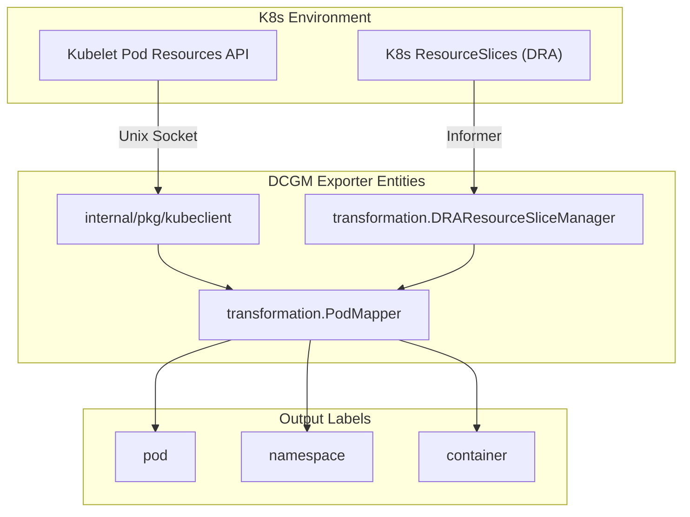

The Kubernetes integration provides:
- **Pod Resource Mapping**: Access to kubelet pod resources API via the path defined in `kubeletPath` [deployment/values.yaml:187-187]().
- **Dynamic Resource Allocation (DRA) Support**: The `DRAResourceSliceManager` uses Kubernetes Informers to track `ResourceSlice` objects, allowing the exporter to map DRA-managed GPUs and MIG devices to their respective UUIDs [internal/pkg/transformation/dra.go:36-75]().
- **Automatic Label Enhancement**: Pod, namespace, and container labels are added to metrics when the `--kubernetes` flag is enabled.
- **ServiceMonitor Integration**: Automatic Prometheus discovery via the `ServiceMonitor` resource [deployment/values.yaml:127-149]().

**Sources:** [deployment/values.yaml:127-149](), [deployment/values.yaml:187-187](), [internal/pkg/transformation/dra.go:36-75](), [README.md:29-84]()

## Flexible Metrics Configuration

DCGM Exporter supports multiple metric configuration approaches through CSV files and runtime parameters. Users can toggle profiling metrics by switching between the default and DCP-included CSV files [deployment/values.yaml:22-24]().

### Available Metric Sets

| Configuration File | Purpose | Metric Count |
|-------------------|---------|--------------|
| `etc/default-counters.csv` | Standard GPU monitoring metrics | ~20 active metrics |
| `etc/dcp-metrics-included.csv` | Datacenter profiling metrics | ~25 active metrics |
| `etc/1.x-compatibility-metrics.csv` | Legacy compatibility metrics | ~15 metrics |

Custom metric configurations can be specified using the `-f` option or `--collectors` flag [README.md:156-160](). The exporter also supports hot-reloading metrics from a Kubernetes ConfigMap via the `-m` argument [deployment/values.yaml:36-38]().

**Sources:** [README.md:139-166](), [deployment/values.yaml:22-24](), [deployment/values.yaml:36-38]()

## Security Features

DCGM Exporter implements security features through the Prometheus `exporter-toolkit` for production deployments.

### Security Configuration

Security features include:
- **TLS Encryption**: HTTPS endpoint support with custom certificates. In Helm deployments, this can be configured via `tlsServerConfig` with support for autogenerated self-signed certificates or existing secrets [deployment/values.yaml:190-215]().
- **Basic Authentication**: Username/password protection for the metrics endpoint, configured via the `basicAuth` values [deployment/values.yaml:217-219]().
- **Command-line Interface**: Support for the `--web-config-file` flag to load security configurations [README.md:87-91]().

**Sources:** [README.md:85-94](), [deployment/values.yaml:190-219]()

## HPC Job Mapping

DCGM Exporter supports High-Performance Computing (HPC) job mapping to associate GPU metrics with specific compute jobs (e.g., Slurm).

### HPC Mapping Implementation

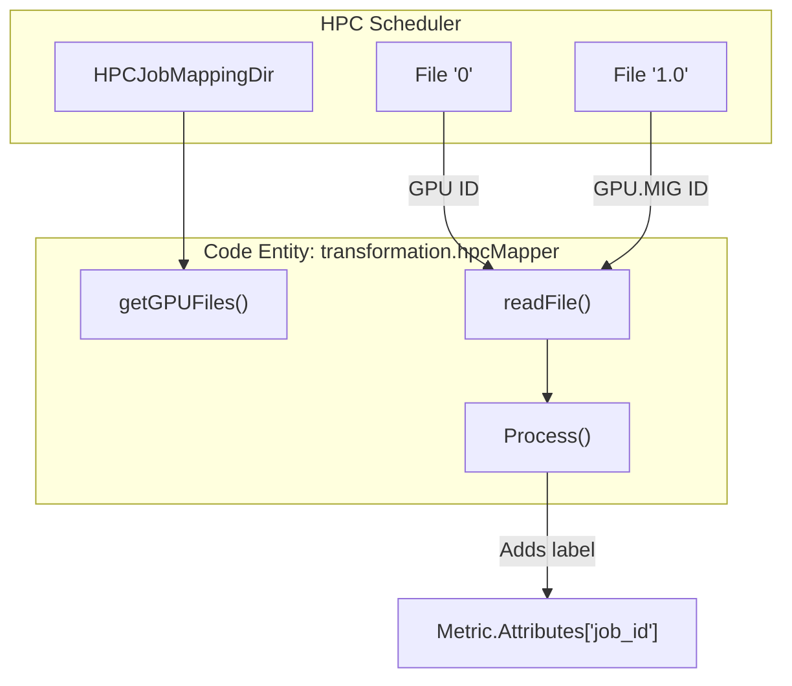

The `hpcMapper` implementation:
- **Directory Watching**: Monitors a directory specified by `--hpc-job-mapping-dir` or `DCGM_HPC_JOB_MAPPING_DIR` [internal/pkg/transformation/hpc.go:39-52]().
- **File Conventions**: Matches files named after GPU IDs (e.g., `0`) or MIG instances (e.g., `2.0`) using regex [internal/pkg/transformation/hpc.go:163-166]().
- **Metric Transformation**: Reads Job IDs from these files and injects them as the `job_id` attribute into the metrics [internal/pkg/transformation/hpc.go:94-127]().

**Sources:** [README.md:95-109](), [internal/pkg/transformation/hpc.go:39-52](), [internal/pkg/transformation/hpc.go:163-166](), [internal/pkg/transformation/hpc.go:94-127]()

## Multi-Deployment and Architecture Support

DCGM Exporter supports multiple deployment methods and hardware architectures.

### Deployment Options

| Method | Use Case | Configuration |
|--------|----------|---------------|
| **Binary Installation** | Direct host deployment | `make binary && make install` |
| **Docker Container** | Containerized deployment | `docker run --gpus all --cap-add SYS_ADMIN` |
| **Kubernetes DaemonSet** | K8s cluster deployment | `kubectl create -f dcgm-exporter.yaml` |
| **Helm Chart** | Production K8s deployment | `helm install gpu-helm-charts/dcgm-exporter` |

### Container Requirements
- **System Capabilities**: `SYS_ADMIN` is required for profiling metrics (`DCGM_FI_PROF_*`) [deployment/values.yaml:98-100]().
- **Multi-Arch**: The project supports building for `linux/amd64` and `linux/arm64` and offers image variants including `ubuntu22.04`, `ubi9`, and `distroless` [README.md:14-14]().

**Sources:** [README.md:11-27](), [README.md:110-137](), [deployment/values.yaml:98-100]()

## Monitoring and Visualization

The project includes an official Grafana dashboard (ID: 12239) and a local JSON definition at `grafana/dcgm-exporter-dashboard.json` [README.md:167-173]().

**Sources:** [README.md:167-173]()

---

# Page: Installation and Deployment

# Installation and Deployment

<details>
<summary>Relevant source files</summary>

The following files were used as context for generating this wiki page:

- [Makefile](Makefile)
- [README.md](README.md)
- [docker/Dockerfile](docker/Dockerfile)

</details>


This document provides an overview of the different methods available for installing and deploying DCGM Exporter in various environments. DCGM Exporter can be deployed as a standalone binary, Docker container, Kubernetes DaemonSet, or using Helm charts depending on your infrastructure requirements.

For detailed configuration options, see [Configuration](#3). For development and building from source, see [Development Guide](#5). For monitoring setup and Grafana dashboards, see [Metrics and Monitoring](#4).

## Deployment Methods Overview

DCGM Exporter supports multiple deployment strategies to accommodate different infrastructure setups and operational requirements:

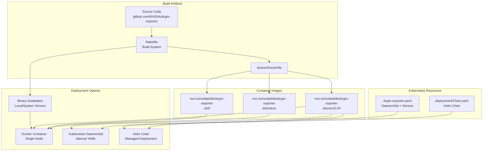

**Sources:** [README.md:10-84](), [Makefile:33-96](), [docker/Dockerfile:1-113]()

## Prerequisites

Before deploying DCGM Exporter, ensure your environment meets these requirements:

| Component | Requirement | Purpose |
|-----------|-------------|---------|
| **NVIDIA GPU** | DCGM-compatible GPU | Metrics collection source |
| **DCGM Library** | DCGM 4.0+ | GPU metrics API [docker/Dockerfile:141-142]() |
| **Container Runtime** | Docker/containerd with NVIDIA runtime | GPU access in containers [README.md:33-34]() |
| **Go Version** | 1.24+ | For building from source [Makefile:24](), [README.md:114]() |

### Runtime Capabilities and Security

DCGM Exporter requires specific privileges for advanced metrics collection, specifically profiling fields.

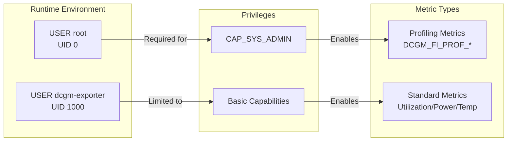

**Sources:** [docker/Dockerfile:158-188](), [README.md:14]()

## Deployment Architecture

The following diagram shows how the build system translates source code into deployable entities across different targets:

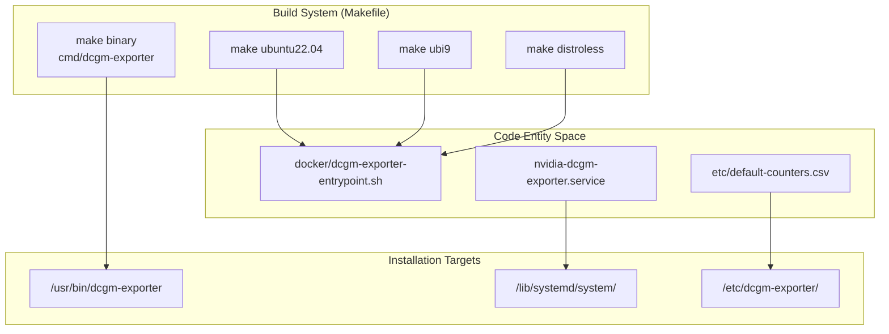

**Sources:** [Makefile:36-44](), [Makefile:120-128](), [docker/Dockerfile:153-190]()

## Container Image Variants

DCGM Exporter provides multiple container base images via the [docker/Dockerfile]() and [Makefile]():

| Image Variant | Base Image | Use Case |
|---------------|------------|----------|
| **ubuntu22.04** | `nvcr.io/nvidia/cuda:13.1.1-base-ubuntu22.04` | Standard Ubuntu environment [Makefile:73]() |
| **ubi9** | `nvcr.io/nvidia/cuda:13.1.1-base-ubi9` | Red Hat Enterprise Linux compatibility [Makefile:66]() |
| **distroless** | `runtime-distroless` target | Minimal attack surface, security-focused [Makefile:77]() |

All images support multi-architecture builds for `linux/amd64` and `linux/arm64` [Makefile:28]().

**Sources:** [Makefile:62-80](), [docker/Dockerfile:113-200]()

## Quick Start Examples

### Docker Container
Standard deployment with profiling capabilities:
```bash
docker run -d --gpus all --cap-add SYS_ADMIN --rm -p 9400:9400 \
  nvcr.io/nvidia/k8s/dcgm-exporter:4.5.2-4.8.1-distroless
```

### Kubernetes (Helm)
The recommended way to install on Kubernetes:
```bash
helm repo add gpu-helm-charts https://nvidia.github.io/dcgm-exporter/helm-charts
helm install dcgm-exporter gpu-helm-charts/dcgm-exporter
```

**Sources:** [README.md:14-54]()

## Detailed Installation Instructions

For specific deployment scenarios, refer to the following detailed guides:

- **[Binary Installation](#2.1)** — Instructions for building and installing DCGM Exporter from source as a binary [Makefile:36-44](), including the systemd service unit [Makefile:127-128]().
- **[Docker Deployment](#2.2)** — Guide for running DCGM Exporter as a Docker container, including multi-architecture builds [Makefile:89](), the entrypoint script [docker/Dockerfile:190](), and required capabilities.
- **[Kubernetes Deployment](#2.3)** — Manual Kubernetes deployment using YAML manifests and DaemonSet configuration [README.md:59]().
- **[Helm Chart Deployment](#2.4)** — Comprehensive guide for deploying DCGM Exporter using Helm charts with customizable values [README.md:35-54]().

**Sources:** [README.md:9-137](), [Makefile:33-132](), [docker/Dockerfile:113-190]()

---

# Page: Binary Installation

# Binary Installation

<details>
<summary>Relevant source files</summary>

The following files were used as context for generating this wiki page:

- [Makefile](Makefile)
- [hack/VERSION](hack/VERSION)
- [packaging/config-files/systemd/nvidia-dcgm-exporter.service](packaging/config-files/systemd/nvidia-dcgm-exporter.service)

</details>


This page provides detailed instructions for installing DCGM Exporter as a binary directly on a system. This method is ideal for environments where containerization is not preferred or where direct systemd integration is required.

## Overview

Binary installation involves compiling the Go source code into an executable or extracting it from a pre-built package. The exporter then runs as a background process, typically managed by `systemd`, to collect GPU metrics and expose them via an HTTP endpoint.

```mermaid
flowchart TB
    subgraph "Build Phase"
        "Makefile" -- "runs" --> "go build"
        "cmd/dcgm-exporter/main.go" -- "compiles to" --> "dcgm-exporter binary"
    end

    subgraph "Installation Phase"
        "dcgm-exporter binary" -- "install -m 755" --> "/usr/bin/dcgm-exporter"
        "etc/default-counters.csv" -- "install -m 644" --> "/etc/dcgm-exporter/default-counters.csv"
        "nvidia-dcgm-exporter.service" -- "cp" --> "/lib/systemd/system/"
    end

    subgraph "Runtime Phase"
        "/usr/bin/dcgm-exporter" -- "reads" --> "/etc/dcgm-exporter/default-counters.csv"
        "systemd" -- "manages" --> "/usr/bin/dcgm-exporter"
    end
```
Sources: [Makefile:36-45](), [Makefile:118-128](), [packaging/config-files/systemd/nvidia-dcgm-exporter.service:28-28]()

## Prerequisites

Before installing, ensure the following are available:
*   **NVIDIA Drivers**: Installed and functional.
*   **DCGM**: The `nvidia-dcgm` service must be running.
*   **Go**: Version 1.24.13 (if building from source).
*   **Build Tools**: `make`, `gcc`, and `libc-dev`.

Sources: [Makefile:24-24](), [packaging/config-files/systemd/nvidia-dcgm-exporter.service:18-19]()

## Installation Methods

### Method 1: Building from Source

The `Makefile` provides targets to build the binary and install it to the local system.

1.  **Compile the binary**:
    The `binary` target executes `go build` with specific linker flags to embed the version information.
    ```bash
    make binary
    ```
    [Makefile:36-37]()

2.  **Install to system paths**:
    The `install` target moves the binary and default configuration files to standard Linux directories.
    ```bash
    sudo make install
    ```
    [Makefile:42-45]()

| Component | Source Path | Destination Path |
| :--- | :--- | :--- |
| **Binary** | `cmd/dcgm-exporter/dcgm-exporter` | `/usr/bin/dcgm-exporter` |
| **Counters** | `./etc/default-counters.csv` | `/etc/dcgm-exporter/default-counters.csv` |

Sources: [Makefile:36-45]()

### Method 2: Creating a Portable Tarball

You can package the exporter into a distribution tarball containing the binary, configuration, and systemd unit file.

```bash
# For x86_64
make package-amd64

# For ARM64
make package-arm64
```

The `package-build` target performs the following steps:
1.  Builds a temporary Docker image to ensure a clean build environment. [Makefile:118-118]()
2.  Creates a directory structure mimicking the root filesystem. [Makefile:119-121]()
3.  Copies the binary from the container to `/usr/bin`. [Makefile:123-123]()
4.  Copies the `nvidia-dcgm-exporter.service` file to `/lib/systemd/system/`. [Makefile:126-128]()
5.  Compresses the result into `dist/dcgm_exporter-linux-<arch>-<version>.tar.gz`. [Makefile:131-131]()

Sources: [Makefile:101-132]()

## Systemd Integration

To run DCGM Exporter as a system service, use the provided unit file located at `packaging/config-files/systemd/nvidia-dcgm-exporter.service`.

### Service Configuration

The service is configured to depend on the DCGM engine (`nvidia-dcgm.service`).

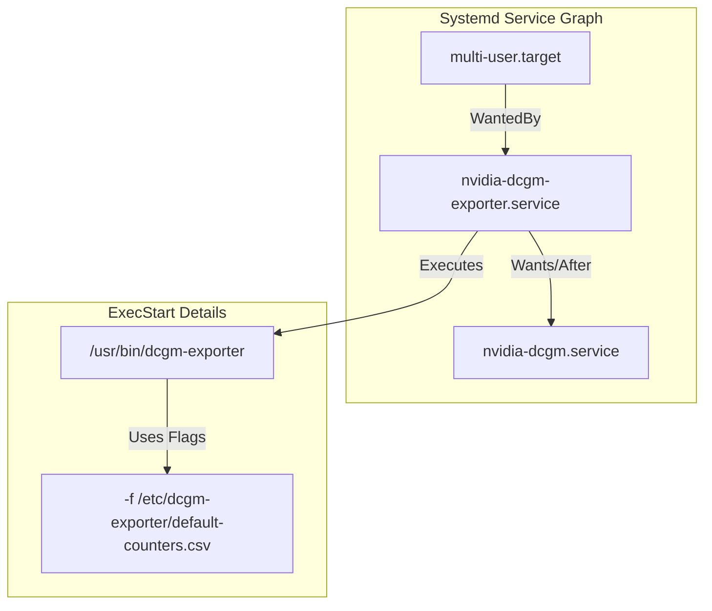

**Key Service Properties**:
*   **User**: Runs as `root` to ensure access to DCGM sockets. [packaging/config-files/systemd/nvidia-dcgm-exporter.service:22-22]()
*   **Logging**: Outputs are appended to `/var/log/dcgm-exporter.log`. [packaging/config-files/systemd/nvidia-dcgm-exporter.service:25-26]()
*   **Execution**: Starts the exporter with the default counters file using the `-f` flag. [packaging/config-files/systemd/nvidia-dcgm-exporter.service:28-28]()
*   **Restart**: Configured to restart `on-abort`. [packaging/config-files/systemd/nvidia-dcgm-exporter.service:30-30]()

Sources: [packaging/config-files/systemd/nvidia-dcgm-exporter.service:16-33]()

### Enabling the Service

Once the files are in place, manage the service using `systemctl`:

```bash
# Reload systemd to recognize the new unit
sudo systemctl daemon-reload

# Enable and start the service
sudo systemctl enable --now nvidia-dcgm-exporter

# Verify status
systemctl status nvidia-dcgm-exporter
```

## Binary Versioning

The build process uses the `hack/VERSION` file to determine the version strings injected into the binary.

*   `NEW_DCGM_VERSION`: The version of the underlying DCGM library. [hack/VERSION:3-3]()
*   `NEW_EXPORTER_VERSION`: The version of the exporter wrapper. [hack/VERSION:4-4]()

These are combined into the `BuildVersion` variable in the `main` package during compilation. [Makefile:23-26](), [Makefile:37-37]()

Sources: [hack/VERSION:1-4](), [Makefile:23-37]()

---

# Page: Docker Deployment

# Docker Deployment

<details>
<summary>Relevant source files</summary>

The following files were used as context for generating this wiki page:

- [Makefile](Makefile)
- [docker/Dockerfile](docker/Dockerfile)
- [docker/dcgm-exporter-entrypoint.sh](docker/dcgm-exporter-entrypoint.sh)

</details>


This page covers running DCGM Exporter as a Docker container, including available container images, configuration options, and deployment commands. For deploying on Kubernetes, see [Kubernetes Deployment](#2.3). For Helm-based deployment, see [Helm Chart Deployment](#2.4).

## Available Container Images

DCGM Exporter provides multiple container variants to support different deployment environments and base image preferences:

| Image Variant | Base Image | Use Case |
|---------------|------------|----------|
| `ubuntu22.04` | Ubuntu 22.04 with CUDA | General purpose, full Ubuntu environment |
| `ubi9` | Red Hat UBI 9 with CUDA | Enterprise environments requiring Red Hat compatibility |
| `distroless` | Distroless base | Minimal attack surface, production security |

All images are available from the NVIDIA Container Registry. The image tag follows the format `[DCGM_VERSION]-[EXPORTER_VERSION]-[OS_VARIANT]`. [Makefile:26-95]()

### Container Architecture

The build process uses a unified multi-stage `Dockerfile` to produce all variants. [docker/Dockerfile:1-195]()

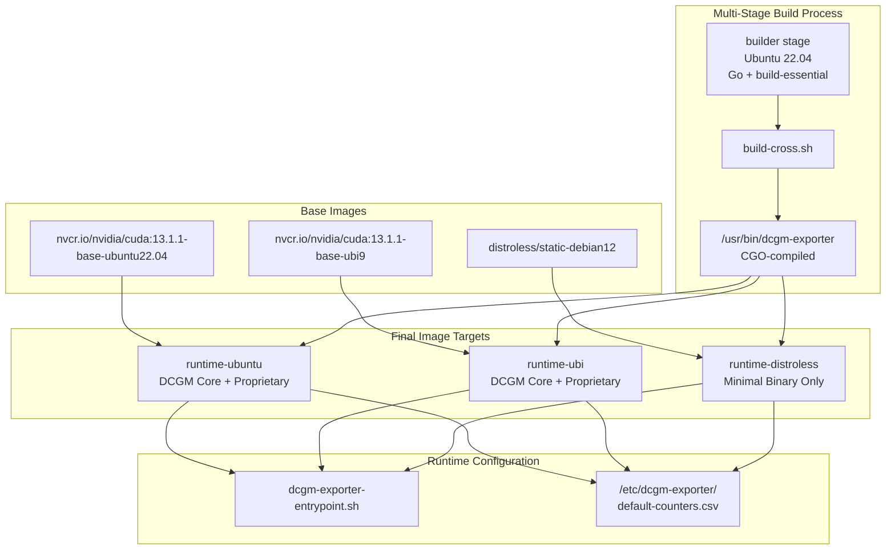

Sources: [docker/Dockerfile:20-113](), [docker/Dockerfile:195-200](), [Makefile:62-80]()

## Quick Start

The simplest way to run DCGM Exporter in Docker is:

```bash
docker run -d --gpus all --cap-add SYS_ADMIN --rm -p 9400:9400 \
    nvcr.io/nvidia/k8s/dcgm-exporter:4.3.1-4.4.1-ubuntu22.04
```

Test the deployment:

```bash
curl localhost:9400/metrics
```

This exposes GPU metrics on port 9400 at the `/metrics` endpoint.

## Container Configuration

### Required Docker Options and Capabilities

| Option | Purpose | Required |
|--------|---------|----------|
| `--gpus all` | GPU access via NVIDIA Container Runtime | Yes |
| `--cap-add SYS_ADMIN` | Required for Profiling metrics (`DCGM_FI_PROF_*`) | Optional (Recommended) |
| `-p 9400:9400` | Expose metrics endpoint | Yes |

### Runtime Security and Entrypoint

The container uses a simple shell entrypoint `dcgm-exporter-entrypoint.sh` that executes the binary. [docker/dcgm-exporter-entrypoint.sh:1-7]()

**Security Implementation Details:**
- **User:** The container defaults to `USER root` [docker/Dockerfile:188]() because Docker's `--cap-add` grants capabilities to UID 0. [docker/Dockerfile:158-161]()
- **Capabilities:** Profiling metrics require `CAP_SYS_ADMIN`. The application performs runtime capability checking in `internal/pkg/capabilities`. [docker/Dockerfile:163-167]()
- **Non-Root Option:** For basic metrics (non-profiling), the container can be run as `USER 1000` (the `dcgm-exporter` user). [docker/Dockerfile:128-129](), [docker/Dockerfile:178-181]()

### Environment Variables

The container behavior is influenced by these variables set in the `Dockerfile`:

| Variable | Default | Description |
|----------|---------|-------------|
| `NVIDIA_DRIVER_CAPABILITIES` | `compute,utility,compat32` | Driver capabilities for the container [docker/Dockerfile:149]() |
| `NVIDIA_DISABLE_REQUIRE` | `true` | Disables NVIDIA container constraints [docker/Dockerfile:150]() |
| `NVIDIA_VISIBLE_DEVICES` | `all` | Controls which GPUs are visible [docker/Dockerfile:151]() |

### Deployment Data Flow

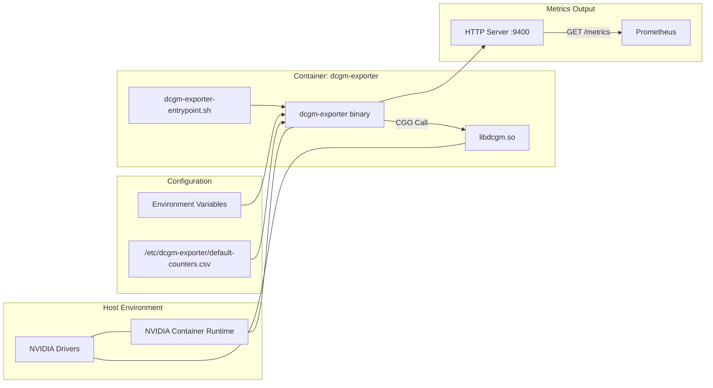

Sources: [docker/dcgm-exporter-entrypoint.sh:7](), [docker/Dockerfile:134-135](), [docker/Dockerfile:141-142]()

## Multi-Architecture Support

DCGM Exporter supports `linux/amd64` and `linux/arm64`. [Makefile:28]()

### Build System Implementation

The build system uses `docker buildx` to perform cross-platform builds within the `builder` stage. [Makefile:29](), [docker/Dockerfile:20]()

- For `arm64` builds, the builder installs `gcc-aarch64-linux-gnu` and `libc6-dev-arm64-cross`. [docker/Dockerfile:37-40]()
- A specialized script, `build-cross.sh`, handles the specific `GOARCH` and `CC` environment variables for CGO. [docker/Dockerfile:95-102]()

### Multi-Architecture Diagram

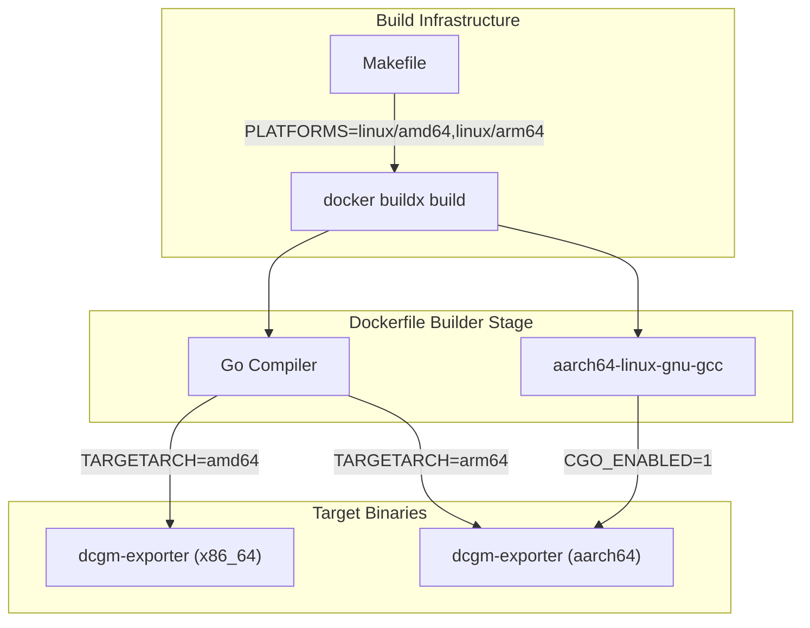

Sources: [Makefile:81-96](), [docker/Dockerfile:31-42](), [docker/Dockerfile:98-102]()

## Building Custom Container Images

### Local Builds

To build an image for your local architecture:

```bash
# Build current architecture for a specific variant (e.g., ubuntu22.04)
make local CONTAINER=ubuntu22.04
```
[Makefile:55-60]()

### Multi-Platform Builds

To build and push multi-architecture images:

```bash
# Builds all variants (ubuntu22.04, ubi9, distroless) for both platforms
make push REGISTRY=your-registry
```
[Makefile:50-54]()

### Image Customization

The `Makefile` allows overriding key versions:
- `DCGM_VERSION`: Version of the DCGM library. [Makefile:23]()
- `GOLANG_VERSION`: Version of the Go compiler. [Makefile:24]()
- `VERSION`: Version of the exporter. [Makefile:25]()

Sources: [Makefile:15-34](), [Makefile:81-96]()

## Container Security Summary

1.  **User Identity:** A non-root user `dcgm-exporter` (UID 1000) is created in the image. [docker/Dockerfile:128-129]()
2.  **File Permissions:** Executables are set to `755` and configuration files to `644`. [docker/Dockerfile:133-136]()
3.  **DCGM Packages:** Only necessary core and proprietary DCGM packages are installed to minimize image size. [docker/Dockerfile:141-142]()
4.  **Capability Check:** The application is designed to warn if `CAP_SYS_ADMIN` is missing when profiling metrics are requested, rather than failing silently or requiring full privileges for basic operation. [docker/Dockerfile:163-166]()

Sources: [docker/Dockerfile:127-187]()

---

# Page: Kubernetes Deployment

# Kubernetes Deployment

<details>
<summary>Relevant source files</summary>

The following files were used as context for generating this wiki page:

- [dcgm-exporter.yaml](dcgm-exporter.yaml)
- [deployment/templates/clusterrole.yaml](deployment/templates/clusterrole.yaml)
- [deployment/templates/clusterrolebinding.yaml](deployment/templates/clusterrolebinding.yaml)
- [service-monitor.yaml](service-monitor.yaml)

</details>


This document covers manual Kubernetes deployment of DCGM Exporter using raw YAML manifests and DaemonSet configuration. For automated deployment using Helm charts with customizable values, see [2.4 Helm Chart Deployment]().

## Overview

Manual Kubernetes deployment involves applying pre-configured YAML manifests directly to your cluster. This approach provides full control over the deployment configuration but requires more manual setup compared to Helm-based deployment. The DCGM Exporter runs as a `DaemonSet` [dcgm-exporter.yaml:16-18]() to ensure GPU metrics collection on every GPU-enabled node in the cluster.

The deployment consists of three main Kubernetes resources:
- **DaemonSet**: Runs the DCGM Exporter pod on each GPU node [dcgm-exporter.yaml:16-18]().
- **Service**: Exposes the metrics endpoint for scraping [dcgm-exporter.yaml:80-83]().
- **ServiceMonitor**: Configures Prometheus Operator to discover and scrape metrics [service-monitor.yaml:15-18]().

## Deployment Architecture

### Component Overview
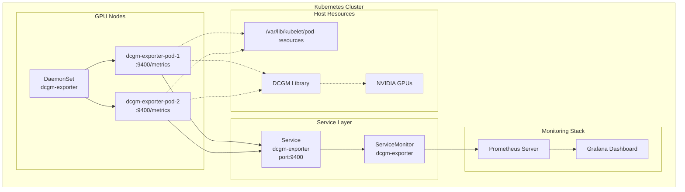

Sources: [dcgm-exporter.yaml:15-77](), [service-monitor.yaml:15-30]()

### Code Entity Mapping
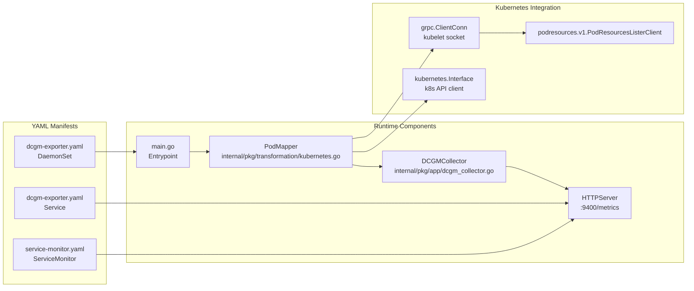

Sources: [dcgm-exporter.yaml:37-51](), [service-monitor.yaml:23-29]()

## Manual Deployment Process

### Basic Deployment

Deploy DCGM Exporter using the provided manifest:

```bash
kubectl create -f https://raw.githubusercontent.com/NVIDIA/dcgm-exporter/master/dcgm-exporter.yaml
```

This creates the `DaemonSet` and `Service` resources [dcgm-exporter.yaml:15-94]().

### ServiceMonitor for Prometheus

If using Prometheus Operator, deploy the `ServiceMonitor` to allow Prometheus to automatically discover the `:9400/metrics` endpoint [service-monitor.yaml:15-30]().

```bash
kubectl create -f https://raw.githubusercontent.com/NVIDIA/dcgm-exporter/master/service-monitor.yaml
```

### Verification

Verify the deployment status:

```bash
# Check DaemonSet status
kubectl get daemonset dcgm-exporter

# Check pods on GPU nodes
kubectl get pods -l app.kubernetes.io/name=dcgm-exporter

# Test metrics endpoint via port-forward
kubectl port-forward <pod-name> 9400:9400
curl http://localhost:9400/metrics
```

Sources: [dcgm-exporter.yaml:18-21](), [service-monitor.yaml:18-21]()

## Core Components Configuration

### DaemonSet Configuration

The `DaemonSet` ensures DCGM Exporter runs on every GPU node with the following key configurations [dcgm-exporter.yaml:16-77]():

| Configuration | Value | Purpose |
|---------------|--------|---------|
| `image` | `nvcr.io/nvidia/k8s/dcgm-exporter:4.5.2-4.8.1-distroless` | Container image [dcgm-exporter.yaml:38]() |
| `securityContext.runAsUser` | `0` | Root privileges for DCGM access [dcgm-exporter.yaml:54]() |
| `securityContext.capabilities` | `["SYS_ADMIN"]` | Required for profiling metrics (`DCGM_FI_PROF_*`) [dcgm-exporter.yaml:56]() |
| `ports.containerPort` | `9400` | Metrics endpoint port [dcgm-exporter.yaml:51]() |
| `volumeMounts` | `/var/lib/kubelet/pod-resources` | Path to Kubelet Pod Resources API [dcgm-exporter.yaml:65]() |

### Environment Variables

| Variable | Value | Purpose |
|----------|--------|---------|
| `DCGM_EXPORTER_LISTEN` | `:9400` | Listen address for metrics server [dcgm-exporter.yaml:41]() |
| `DCGM_EXPORTER_KUBERNETES` | `true` | Enables Kubernetes integration features [dcgm-exporter.yaml:43]() |
| `NODE_NAME` | `spec.nodeName` | Identifies the host node for resource mapping [dcgm-exporter.yaml:47]() |

### Volume Mounts

The pod requires access to the kubelet pod resources API to map GPU devices to specific Pod UIDs and Names [dcgm-exporter.yaml:62-76]():

```yaml
volumeMounts:
- name: "pod-gpu-resources"
  readOnly: true
  mountPath: "/var/lib/kubelet/pod-resources"

volumes:
- name: "pod-gpu-resources"
  hostPath:
    path: "/var/lib/kubelet/pod-resources"
```

## RBAC Requirements

When features like Pod Labels or Pod UIDs are enabled, DCGM Exporter requires a `ClusterRole` to interact with the Kubernetes API [deployment/templates/clusterrole.yaml:1-12]().

| API Group | Resources | Verbs |
|-----------|-----------|-------|
| `""` (Core) | `pods` | `get`, `list`, `watch` |
| `resource.k8s.io` | `resourceslices` | `get`, `list`, `watch` |

Sources: [deployment/templates/clusterrole.yaml:8-11](), [deployment/templates/clusterrolebinding.yaml:1-16]()

## Service and Monitoring Integration

### Service Configuration

The `Service` provides a stable endpoint for scraping metrics across the `DaemonSet` [dcgm-exporter.yaml:80-94]():

```yaml
kind: Service
apiVersion: v1
metadata:
  name: "dcgm-exporter"
spec:
  selector:
    app.kubernetes.io/name: "dcgm-exporter"
  ports:
  - name: "metrics"
    port: 9400
```

### ServiceMonitor Integration

The `ServiceMonitor` allows the Prometheus Operator to scrape metrics automatically [service-monitor.yaml:15-30]():

```yaml
apiVersion: monitoring.coreos.com/v1
kind: ServiceMonitor
metadata:
  name: "dcgm-exporter"
spec:
  selector:
    matchLabels:
      app.kubernetes.io/name: "dcgm-exporter"
  endpoints:
  - port: "metrics"
    path: "/metrics"
```

### Monitoring Flow
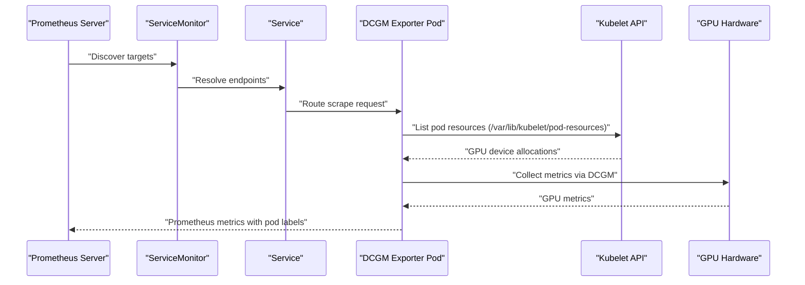

Sources: [dcgm-exporter.yaml:42-47](), [dcgm-exporter.yaml:63-65](), [service-monitor.yaml:27-29]()

## Resource Limits

The default manifest includes recommended resource constraints for the exporter [dcgm-exporter.yaml:66-72]():

| Type | CPU | Memory |
|------|-----|--------|
| Limits | `200m` | `256Mi` |
| Requests | `100m` | `128Mi` |

Sources: [dcgm-exporter.yaml:1-94](), [service-monitor.yaml:1-30](), [deployment/templates/clusterrole.yaml:1-12]()

---

# Page: Helm Chart Deployment

# Helm Chart Deployment

<details>
<summary>Relevant source files</summary>

The following files were used as context for generating this wiki page:

- [deployment/Chart.yaml](deployment/Chart.yaml)
- [deployment/templates/NOTES.txt](deployment/templates/NOTES.txt)
- [deployment/templates/_helpers.tpl](deployment/templates/_helpers.tpl)
- [deployment/templates/daemonset.yaml](deployment/templates/daemonset.yaml)
- [deployment/templates/role.yaml](deployment/templates/role.yaml)
- [deployment/templates/rolebinding.yaml](deployment/templates/rolebinding.yaml)
- [deployment/templates/service-monitor.yaml](deployment/templates/service-monitor.yaml)
- [deployment/templates/serviceaccount.yaml](deployment/templates/serviceaccount.yaml)
- [deployment/values.yaml](deployment/values.yaml)

</details>


This document provides comprehensive guidance for deploying DCGM Exporter using the official Helm chart. It covers chart installation, configuration options, and the Kubernetes resources that are generated during deployment.

For manual Kubernetes deployment without Helm, see [2.3 Kubernetes Deployment](). For configuration details specific to metrics and monitoring, see [3. Configuration]().

## Chart Overview

The DCGM Exporter Helm chart provides a declarative way to deploy DCGM Exporter as a DaemonSet across GPU-enabled Kubernetes nodes. The chart is structured around a comprehensive values configuration system that generates multiple Kubernetes resources for monitoring GPU metrics.

### Chart Structure

```mermaid
graph TB
    subgraph "Chart Definition"
        ChartYAML["Chart.yaml<br/>Metadata & Version"]
        ValuesYAML["values.yaml<br/>Default Configuration"]
    end
    
    subgraph "Helm Templates"
        DaemonSetTpl["daemonset.yaml<br/>Main Workload"]
        ServiceTpl["service.yaml<br/>Network Exposure"]
        ServiceMonitorTpl["service-monitor.yaml<br/>Prometheus Integration"]
        ServiceAccountTpl["serviceaccount.yaml<br/>RBAC Identity"]
        WebConfigTpl["web-config-configmap.yaml<br/>TLS/Auth Config"]
        TLSSecretTpl["tls-secret.yaml<br/>Certificate Management"]
        HelpersTpl["_helpers.tpl<br/>Template Functions"]
    end
    
    subgraph "Generated Resources"
        DaemonSet["DaemonSet<br/>dcgm-exporter pods"]
        Service["Service<br/>ClusterIP on :9400"]
        ServiceMonitor["ServiceMonitor<br/>Prometheus scraping"]
        ServiceAccount["ServiceAccount<br/>Pod identity"]
        WebConfigCM["ConfigMap<br/>web-config.yaml"]
        TLSSecret["Secret<br/>TLS certificates"]
    end
    
    ChartYAML --> DaemonSetTpl
    ValuesYAML --> DaemonSetTpl
    ValuesYAML --> ServiceTpl
    ValuesYAML --> ServiceMonitorTpl
    ValuesYAML --> ServiceAccountTpl
    ValuesYAML --> WebConfigTpl
    ValuesYAML --> TLSSecretTpl
    
    DaemonSetTpl --> DaemonSet
    ServiceTpl --> Service
    ServiceMonitorTpl --> ServiceMonitor
    ServiceAccountTpl --> ServiceAccount
    WebConfigTpl --> WebConfigCM
    TLSSecretTpl --> TLSSecret
    
    HelpersTpl --> DaemonSetTpl
    HelpersTpl --> ServiceTpl
    HelpersTpl --> ServiceMonitorTpl
    HelpersTpl --> ServiceAccountTpl
```

**Sources:** [deployment/Chart.yaml:1-18](), [deployment/values.yaml:1-240](), [deployment/templates/_helpers.tpl:1-97]()

## Installation

### Basic Installation

Install DCGM Exporter using the default configuration:

```bash
helm repo add nvidia https://helm.ngc.nvidia.com/nvidia
helm repo update
helm install dcgm-exporter nvidia/dcgm-exporter
```

### Installation with Custom Values

Create a custom values file to override defaults:

```bash
helm install dcgm-exporter nvidia/dcgm-exporter -f custom-values.yaml
```

### Installation from Source

Clone the repository and install the chart locally:

```bash
git clone https://github.com/NVIDIA/dcgm-exporter.git
cd dcgm-exporter
helm install dcgm-exporter ./deployment
```

## Core Configuration Components

The chart's configuration system is built around several key components defined in the `values.yaml` file:

### Image Configuration

The chart uses the official NVIDIA DCGM Exporter image from NGC:

| Parameter | Default Value | Description |
|-----------|---------------|-------------|
| `image.repository` | `nvcr.io/nvidia/k8s/dcgm-exporter` | Container image repository |
| `image.tag` | `4.5.2-4.8.1-distroless` | Image tag (defaults to appVersion) |
| `image.pullPolicy` | `IfNotPresent` | Image pull policy |

**Sources:** [deployment/values.yaml:15-21](), [deployment/Chart.yaml:6-6]()

### Arguments and Metrics Configuration

The exporter's behavior is controlled through command-line arguments and metrics configuration:

```yaml
arguments: ["-f", "/etc/dcgm-exporter/default-counters.csv"]
```

The chart supports several argument patterns via the `arguments` key:
- `-r <HOST>:<PORT>` - Connect to an already running hostengine [deployment/values.yaml:27-28]()
- `-n` - Remove the hostname tag from the output [deployment/values.yaml:29-30]()
- `-d <device_spec>` - Specify the devices to monitor (e.g., `g+i` for MIG) [deployment/values.yaml:31-35]()
- `-m <namespace:configmap>` - Specify the namespace and name of a configmap containing watched exporter fields [deployment/values.yaml:36-38]()

**Sources:** [deployment/values.yaml:22-39](), [deployment/templates/daemonset.yaml:123-125]()

### Service Account and RBAC

The chart manages the `ServiceAccount` and required `Role` / `RoleBinding` for accessing Kubernetes metadata or configuration.

```mermaid
graph LR
    subgraph "RBAC Configuration"
        ServiceAccountCreate["serviceAccount.create: true"]
        ServiceAccountName["serviceAccount.name"]
        ServiceAccountAnnotations["serviceAccount.annotations"]
    end
    
    subgraph "Kubernetes Integration"
        EnablePodLabels["kubernetes.enablePodLabels"]
        EnablePodUID["kubernetes.enablePodUID"]
        RBACCreate["kubernetes.rbac.create"]
    end
    
    subgraph "Generated RBAC Resources"
        ServiceAccountRes["ServiceAccount"]
        RoleRes["Role<br/>dcgm-exporter-read-cm"]
        RoleBindingRes["RoleBinding"]
    end
    
    ServiceAccountCreate --> ServiceAccountRes
    ServiceAccountName --> ServiceAccountRes
    ServiceAccountAnnotations --> ServiceAccountRes
    
    EnablePodLabels --> RBACCreate
    EnablePodUID --> RBACCreate
    RBACCreate --> RoleRes
    RBACCreate --> RoleBindingRes
```

**Sources:** [deployment/values.yaml:65-74](), [deployment/templates/serviceaccount.yaml:1-28](), [deployment/templates/role.yaml:1-13](), [deployment/templates/rolebinding.yaml:1-16]()

## Kubernetes Resource Generation

The Helm chart generates multiple Kubernetes resources based on the values configuration:

### DaemonSet Configuration

The primary workload is deployed as a DaemonSet to ensure DCGM Exporter runs on every GPU node. It mounts the Kubelet pod-resources socket to map GPUs to pods.

```mermaid
graph TB
    subgraph "DaemonSet Specification"
        RollingUpdate["rollingUpdate<br/>maxUnavailable: 1<br/>maxSurge: 0"]
        PodTemplate["Pod Template"]
        SecurityContext["securityContext<br/>runAsUser: 0<br/>capabilities: SYS_ADMIN"]
    end
    
    subgraph "Pod Configuration"
        Container["dcgm-exporter container"]
        VolumeMounts["Volume Mounts<br/>/var/lib/kubelet/pod-resources<br/>/etc/dcgm-exporter"]
        Arguments["Command Arguments<br/>from values.arguments"]
        EnvVars["Environment Variables<br/>from values.extraEnv"]
    end
    
    subgraph "Resource Management"
        Resources["resources<br/>limits & requests"]
        NodeSelector["nodeSelector"]
        Tolerations["tolerations"]
        Affinity["affinity"]
    end
    
    RollingUpdate --> PodTemplate
    PodTemplate --> Container
    PodTemplate --> SecurityContext
    Container --> VolumeMounts
    Container --> Arguments
    Container --> EnvVars
    PodTemplate --> Resources
    PodTemplate --> NodeSelector
    PodTemplate --> Tolerations
    PodTemplate --> Affinity
```

**Sources:** [deployment/values.yaml:75-80](), [deployment/values.yaml:95-105](), [deployment/values.yaml:120-126](), [deployment/values.yaml:150-166](), [deployment/templates/daemonset.yaml:1-188]()

### Service and ServiceMonitor

The chart creates networking resources for Prometheus integration. The `ServiceMonitor` is compatible with the Prometheus Operator.

| Resource | Purpose | Configuration |
|----------|---------|---------------|
| Service | Exposes metrics endpoint | `service.enable: true`, `service.port: 9400` |
| ServiceMonitor | Prometheus scraping config | `serviceMonitor.enabled: true`, `serviceMonitor.interval: 15s` |

**Sources:** [deployment/values.yaml:107-118](), [deployment/values.yaml:127-149](), [deployment/templates/service-monitor.yaml:1-43]()

## Advanced Configuration

### TLS and Security Configuration

The chart supports HTTPS encryption and basic authentication through the `tlsServerConfig` and `basicAuth` sections:

```yaml
tlsServerConfig:
  enabled: false
  autoGenerated: true
  existingSecret: ""
  certFilename: "tls.crt"
  keyFilename: "tls.key"
  caFilename: "ca.crt"
  clientAuthType: ""

basicAuth:
  users: {}
```

When TLS or Basic Auth is enabled, the chart generates:
- A `web-config.yaml` file provided via a ConfigMap [deployment/templates/daemonset.yaml:89-93]()
- Environment variable `DCGM_EXPORTER_WEB_CONFIG_FILE` pointing to `/etc/dcgm-exporter/web-config.yaml` [deployment/templates/daemonset.yaml:155-158]()
- A Secret with TLS certificates if `autoGenerated` is true or an `existingSecret` is provided [deployment/templates/daemonset.yaml:82-87]()

**Sources:** [deployment/values.yaml:190-219](), [deployment/templates/daemonset.yaml:155-158](), [deployment/templates/_helpers.tpl:82-96]()

### Custom Metrics Configuration

The chart provides multiple approaches for mounting custom metric CSV files:

```mermaid
graph TB
    subgraph "Metrics Configuration Options"
        DefaultCSV["Default Counters<br/>etc/default-counters.csv"]
        ExtraConfigMapVolumes["extraConfigMapVolumes<br/>Mount custom ConfigMap"]
        ExtraVolumeMounts["extraVolumeMounts<br/>Mount into container path"]
    end
    
    subgraph "Runtime Configuration"
        Arguments["arguments array<br/>[-f, /path/to/csv]"]
        Container["Container with mounted config"]
    end
    
    DefaultCSV --> Arguments
    ExtraConfigMapVolumes --> ExtraVolumeMounts
    ExtraVolumeMounts --> Container
    Arguments --> Container
```

Example of mounting a custom ConfigMap for metrics:
```yaml
extraConfigMapVolumes:
  - name: exporter-metrics-volume
    configMap:
      name: exporter-metrics-config-map
      items:
      - key: metrics
        path: default-counters.csv

extraVolumeMounts:
  - name: exporter-metrics-volume
    mountPath: /etc/dcgm-exporter/default-counters.csv
    subPath: default-counters.csv
```

**Sources:** [deployment/values.yaml:171-183](), [deployment/templates/daemonset.yaml:99-101](), [deployment/templates/daemonset.yaml:182-184]()

### Kubernetes Integration Features

The chart provides advanced Kubernetes integration capabilities through environment variables and RBAC:

| Feature | Configuration | Purpose |
|---------|---------------|---------|
| Pod Labels | `kubernetes.enablePodLabels: true` | Include pod labels in GPU metrics via `DCGM_EXPORTER_KUBERNETES_ENABLE_POD_LABELS` |
| Pod UID | `kubernetes.enablePodUID: true` | Include pod UID in GPU metrics via `DCGM_EXPORTER_KUBERNETES_ENABLE_POD_UID` |
| DRA Support | `kubernetesDRA.enabled: true` | Support Dynamic Resource Allocation via `KUBERNETES_ENABLE_DRA` |

**Sources:** [deployment/templates/daemonset.yaml:135-162](), [deployment/values.yaml:202-218]()

### Debug and Troubleshooting Configuration

The chart includes debugging capabilities that allow dumping internal state to the host:

```yaml
debugDump:
  enabled: false
  directory: "/tmp/dcgm-exporter-debug"
  retention: 24
  compression: true
```

When enabled, the chart configures the `--dump-enabled`, `--dump-directory`, and `--dump-retention` flags on the exporter container.

**Sources:** [deployment/values.yaml:220-230](), [deployment/templates/daemonset.yaml:126-133]()

## Monitoring Integration

The chart is designed for seamless Prometheus integration through the `ServiceMonitor` resource. It supports custom intervals, relabeling, and metric relabeling rules.

```yaml
serviceMonitor:
  enabled: true
  interval: 15s
  scrapeTimeout: 10s
  honorLabels: false
  relabelings: []
  metricRelabelings: []
```

The `ServiceMonitor` targets the `metrics` port (9400) and the `/metrics` path.

**Sources:** [deployment/values.yaml:127-149](), [deployment/templates/service-monitor.yaml:33-42]()

---

# Page: Configuration

# Configuration

<details>
<summary>Relevant source files</summary>

The following files were used as context for generating this wiki page:

- [internal/pkg/appconfig/types.go](internal/pkg/appconfig/types.go)
- [pkg/cmd/app.go](pkg/cmd/app.go)

</details>


DCGM Exporter supports a multi-layered configuration model involving CLI flags, environment variables, Helm chart values, and Kubernetes ConfigMaps. Configuration logic is centralized in the `pkg/cmd/app.go` file, where the `contextToConfig` function populates the `appconfig.Config` struct used throughout the application lifecycle.

## Configuration Flow Architecture

The following diagram illustrates how configuration sources are prioritized and mapped to internal code entities.

**Configuration Mapping Diagram**
```mermaid
flowchart TD
    subgraph "Configuration Sources"
        CLI_CONTEXT["cli.Context (urfave/cli)"]
        ENV_VARS["Environment Variables"]
        HELM_VALUES["deployment/values.yaml"]
        CONFIGMAP["Kubernetes ConfigMap"]
    end
    
    subgraph "Internal Logic"
        NEW_APP["NewApp() Definition"]
        CONTEXT_TO_CONFIG["contextToConfig() Parser"]
        APP_CONFIG["appconfig.Config Struct"]
    end

    subgraph "Consumer Systems"
        METRICS_SERVER["server.MetricsServer"]
        COLLECTOR_FACTORY["collector.CollectorFactory"]
        DEVICE_WATCHER["devicewatcher.DeviceWatcher"]
    end
    
    HELM_VALUES --"Sets"--> ENV_VARS
    ENV_VARS --"Read by"--> CLI_CONTEXT
    NEW_APP --"Defines Flags"--> CLI_CONTEXT
    CLI_CONTEXT --"Passed to"--> CONTEXT_TO_CONFIG
    
    CONFIGMAP --"Mounted as"--> FILE_PATH["CollectorsFile Path"]
    
    CONTEXT_TO_CONFIG --"Populates"--> APP_CONFIG
    FILE_PATH --"Ref in"--> APP_CONFIG
    
    APP_CONFIG --"Configures"--> METRICS_SERVER
    APP_CONFIG --"Configures"--> COLLECTOR_FACTORY
    APP_CONFIG --"Configures"--> DEVICE_WATCHER
```
Sources: [pkg/cmd/app.go:107-114](), [pkg/cmd/app.go:663-722](), [internal/pkg/appconfig/types.go:41-79](), [deployment/values.yaml:15-325]()

## Configuration Areas

DCGM Exporter configuration is divided into several specialized areas. For detailed implementation details, refer to the child pages linked below.

### [Command-line Options](#3.1)
The exporter uses the `urfave/cli` library to define its interface. Flags are defined as constants (e.g., `CLIFieldsFile`, `CLIAddress`) and support both short and long formats. Key options include device selection strings for GPUs, NvSwitches, and CPUs, as well as collection intervals.
*   **Key Logic**: `NewApp()` defines the flags [pkg/cmd/app.go:107-324]().
*   **For details, see [Command-line Options](#3.1).**

### [Environment Variables](#3.2)
Almost every CLI flag has a corresponding environment variable defined in the `EnvVars` slice of the flag definition. This is the primary configuration method for containerized deployments via Docker or Helm.
*   **Naming Pattern**: Most variables use the `DCGM_EXPORTER_` prefix (e.g., `DCGM_EXPORTER_LISTEN`) [pkg/cmd/app.go:134]().
*   **For details, see [Environment Variables](#3.2).**

### [Metrics Configuration](#3.3)
This area covers how to define which DCGM fields are collected and exposed. The configuration is typically a CSV file (default: `/etc/dcgm-exporter/default-counters.csv`). The exporter supports hot-reloading these configurations without a restart.
*   **Key Logic**: `CLIFieldsFile` constant [pkg/cmd/app.go:68]() and `CollectorsFile` field in `Config` [internal/pkg/appconfig/types.go:42]().
*   **For details, see [Metrics Configuration](#3.3).**

### [Kubernetes Integration](#3.4)
When running in Kubernetes, the exporter can map GPU metrics to specific Pods. This requires configuring the Kubelet Pod Resources socket and enabling specific mapping flags. It also supports the newer Dynamic Resource Allocation (DRA) API.
*   **Key Flags**: `CLIKubernetes` [pkg/cmd/app.go:144](), `CLIKubernetesEnableDRA` [pkg/cmd/app.go:101](), and `CLIPodResourcesKubeletSocket` [pkg/cmd/app.go:93]().
*   **For details, see [Kubernetes Integration](#3.4).**

### [Security Configuration](#3.5)
The exporter provides built-in support for securing the `/metrics` endpoint. This includes TLS encryption and Basic Authentication, configured via a `web-config.yaml` file.
*   **Key Logic**: `CLIWebConfigFile` [pkg/cmd/app.go:85]() and `WebConfigFile` field in `Config` [internal/pkg/appconfig/types.go:63]().
*   **For details, see [Security Configuration](#3.5).**

## Device Selection Logic

A critical part of the configuration is the `DeviceOptions` struct, which determines which hardware entities are monitored. This is parsed from strings using the `FlexKey` ("f"), `MajorKey` ("g"), and `MinorKey` ("i") syntax.

**Device Selection Code Entity Map**
```mermaid
flowchart LR
    subgraph "Input String"
        STR["'g:0,1;i:0-2'"]
    end

    subgraph "Parsing Logic"
        PARSE["parseDeviceOptions()"]
    end

    subgraph "Data Structure"
        DO["appconfig.DeviceOptions"]
        F["Flex (bool)"]
        MAJ["MajorRange ([]int)"]
        MIN["MinorRange ([]int)"]
    end

    STR --"Passed to"--> PARSE
    PARSE --"Returns"--> DO
    DO --"Contains"--> F
    DO --"Contains"--> MAJ
    DO --"Contains"--> MIN
```
Sources: [pkg/cmd/app.go:41-44](), [pkg/cmd/app.go:600-661](), [internal/pkg/appconfig/types.go:27-31]()

## Advanced Debugging and Dumps
The exporter includes a `DumpConfig` system that allows for file-based debugging of the internal state. This is configured via flags like `CLIDumpEnabled` and `CLIDumpDirectory`, allowing developers to capture the state of the metric registry and device lists for troubleshooting.
*   **Structure**: `DumpConfig` struct [internal/pkg/appconfig/types.go:34-39]().
*   **Flags**: `CLIDumpEnabled`, `CLIDumpDirectory`, `CLIDumpRetention`, `CLIDumpCompression` [pkg/cmd/app.go:97-100]().

Sources: [pkg/cmd/app.go:97-100](), [internal/pkg/appconfig/types.go:34-39](), [internal/pkg/appconfig/types.go:74]()

---

# Page: Command-line Options

# Command-line Options

<details>
<summary>Relevant source files</summary>

The following files were used as context for generating this wiki page:

- [README.md](README.md)
- [internal/pkg/appconfig/types.go](internal/pkg/appconfig/types.go)
- [pkg/cmd/app.go](pkg/cmd/app.go)

</details>


This document provides a comprehensive reference for all command-line flags and arguments available in DCGM Exporter. These options control the behavior of the `dcgm-exporter` binary, including metric collection, Kubernetes integration, device selection, and server configuration.

For information about environment variables that can be used as alternatives to command-line flags, see [Environment Variables](#3.2). For details about configuring which metrics are collected, see [Metrics Configuration](#3.3).

## Flag Categories and Organization

DCGM Exporter's command-line interface is organized into several functional categories, each serving different aspects of the system's operation. The flags are defined within the `NewApp()` function in the `cmd` package.

```mermaid
graph TB
    subgraph "CLI Flags Organization"
        CLI["Command Line Interface<br/>NewApp()"]
        
        subgraph "Core Server Flags"
            ADDRESS["--address (-a)<br/>CLIAddress"]
            COLLECTORS["--collectors (-f)<br/>CLIFieldsFile"]
            INTERVAL["--collect-interval (-c)<br/>CLICollectInterval"]
        end
        
        subgraph "Device Selection Flags"
            GPU_DEVICES["--devices (-d)<br/>CLIGPUDevices"]
            SWITCH_DEVICES["--switch-devices (-s)<br/>CLISwitchDevices"]
            CPU_DEVICES["--cpu-devices (-p)<br/>CLICPUDevices"]
        end
        
        subgraph "Kubernetes Integration"
            K8S["--kubernetes (-k)<br/>CLIKubernetes"]
            POD_LABELS["--kubernetes-enable-pod-labels<br/>CLIKubernetesEnablePodLabels"]
            POD_UID["--kubernetes-enable-pod-uid<br/>CLIKubernetesEnablePodUID"]
            GPU_ID_TYPE["--kubernetes-gpu-id-type<br/>CLIKubernetesGPUIDType"]
        end
        
        subgraph "Security & Auth"
            WEB_CONFIG["--web-config-file<br/>CLIWebConfigFile"]
            SYSTEMD_SOCKET["--web-systemd-socket<br/>CLIWebSystemdSocket"]
        end
        
        subgraph "Debugging & Logging"
            DEBUG["--debug<br/>CLIDebugMode"]
            LOG_FORMAT["--log-format<br/>CLILogFormat"]
            DCGM_LOG["--enable-dcgm-log<br/>CLIEnableDCGMLog"]
        end
        
        CLI --> ADDRESS
        CLI --> COLLECTORS  
        CLI --> INTERVAL
        CLI --> GPU_DEVICES
        CLI --> SWITCH_DEVICES
        CLI --> CPU_DEVICES
        CLI --> K8S
        CLI --> POD_LABELS
        CLI --> POD_UID
        CLI --> GPU_ID_TYPE
        CLI --> WEB_CONFIG
        CLI --> SYSTEMD_SOCKET
        CLI --> DEBUG
        CLI --> LOG_FORMAT
        CLI --> DCGM_LOG
    end
```

Sources: [pkg/cmd/app.go:67-105](), [pkg/cmd/app.go:107-344]()

## Configuration Flow Architecture

The command-line flags are processed through a well-defined flow that transforms CLI arguments into internal configuration structures defined in `appconfig.Config`.

```mermaid
graph LR
    subgraph "CLI Processing Flow"
        CLI_ARGS["CLI Arguments<br/>os.Args"]
        CLI_CONTEXT["cli.Context<br/>urfave/cli"]
        CONFIG_FUNC["contextToConfig()<br/>Line 663"]
        APP_CONFIG["appconfig.Config<br/>Struct"]
        COMPONENTS["System Components"]
        
        CLI_ARGS --> CLI_CONTEXT
        CLI_CONTEXT --> CONFIG_FUNC
        CONFIG_FUNC --> APP_CONFIG
        APP_CONFIG --> COMPONENTS
        
        subgraph "Config Struct Fields"
            COLLECTORS_FILE["CollectorsFile"]
            ADDRESS_FIELD["Address"]
            KUBERNETES_FIELD["Kubernetes"]
            DEVICE_OPTIONS["GPUDeviceOptions<br/>SwitchDeviceOptions<br/>CPUDeviceOptions"]
        end
        
        APP_CONFIG --> COLLECTORS_FILE
        APP_CONFIG --> ADDRESS_FIELD
        APP_CONFIG --> KUBERNETES_FIELD
        APP_CONFIG --> DEVICE_OPTIONS
    end
```

Sources: [pkg/cmd/app.go:663-722](), [internal/pkg/appconfig/types.go:41-79]()

## Core Server Configuration

### Basic Server Options

| Flag | Short | Default | Description |
|------|-------|---------|-------------|
| `--address` | `-a` | `:9400` | HTTP server bind address and port |
| `--collectors` | `-f` | `/etc/dcgm-exporter/default-counters.csv` | Path to metrics configuration file |
| `--collect-interval` | `-c` | `30000` | Metric collection interval in milliseconds |

The core server flags control the fundamental operation of the DCGM Exporter HTTP server and metric collection engine.

```mermaid
graph TB
    subgraph "Core Server Configuration"
        CLI_FLAGS["Core CLI Flags"]
        
        subgraph "Server Config"
            ADDRESS_VAL["Address: ':9400'<br/>CLIAddress constant"]
            INTERVAL_VAL["CollectInterval: 30000<br/>CLICollectInterval constant"]
            COLLECTORS_VAL["CollectorsFile: '/etc/...'<br/>CLIFieldsFile constant"]
        end
        
        subgraph "Runtime Components"
            HTTP_SERVER["server.NewMetricsServer()<br/>Line 459"]
            COUNTER_SET["counters.GetCounterSet()<br/>Line 573"]
            COLLECTION_LOOP["Collection Timer Loop"]
        end
        
        CLI_FLAGS --> ADDRESS_VAL
        CLI_FLAGS --> INTERVAL_VAL  
        CLI_FLAGS --> COLLECTORS_VAL
        
        ADDRESS_VAL --> HTTP_SERVER
        COLLECTORS_VAL --> COUNTER_SET
        INTERVAL_VAL --> COLLECTION_LOOP
    end
```

Sources: [pkg/cmd/app.go:68-70](), [pkg/cmd/app.go:122-142](), [pkg/cmd/app.go:459-462](), [pkg/cmd/app.go:573-574]()

### Remote DCGM Connection

| Flag | Short | Default | Description |
|------|-------|---------|-------------|
| `--remote-hostengine-info` | `-r` | `localhost:5555` | Remote DCGM hostengine connection string |

This option enables connecting to a remote DCGM hostengine instead of the local one.

Sources: [pkg/cmd/app.go:77](), [pkg/cmd/app.go:171-177]()

## Device Selection Options

Device selection uses a flexible syntax that allows monitoring different types of hardware entities. The selection syntax is defined by the `deviceUsageTemplate` constant and parsed into `DeviceOptions`.

### Device Selection Syntax

The device selection follows this pattern: `[key][:id1[,id2-id3...]]`

- **`f` (Flex)**: Automatically monitor GPUs or GPU instances based on MIG mode. [pkg/cmd/app.go:42]()
- **`g` (Major)**: Monitor top-level entities (GPUs, NvSwitches, CPUs). [pkg/cmd/app.go:43]()
- **`i` (Minor)**: Monitor sub-level entities (GPU instances, NvLinks, CPU cores). [pkg/cmd/app.go:44]()

```mermaid
graph TB
    subgraph "Device Selection Architecture"
        DEVICE_FLAGS["Device Selection Flags"]
        
        subgraph "Selection Keys"
            FLEX_KEY["FlexKey = 'f'<br/>Line 42"]
            MAJOR_KEY["MajorKey = 'g'<br/>Line 43"] 
            MINOR_KEY["MinorKey = 'i'<br/>Line 44"]
        end
        
        subgraph "Parser Function"
            PARSE_FUNC["parseDeviceOptions()<br/>Line 600"]
            DEVICE_OPTS["appconfig.DeviceOptions<br/>Struct"]
        end
        
        subgraph "Device Types"
            GPU_DEVICES_FLAG["--devices (-d)<br/>CLIGPUDevices"]
            SWITCH_DEVICES_FLAG["--switch-devices (-s)<br/>CLISwitchDevices"] 
            CPU_DEVICES_FLAG["--cpu-devices (-p)<br/>CLICPUDevices"]
        end
        
        DEVICE_FLAGS --> FLEX_KEY
        DEVICE_FLAGS --> MAJOR_KEY
        DEVICE_FLAGS --> MINOR_KEY
        
        GPU_DEVICES_FLAG --> PARSE_FUNC
        SWITCH_DEVICES_FLAG --> PARSE_FUNC
        CPU_DEVICES_FLAG --> PARSE_FUNC
        
        PARSE_FUNC --> DEVICE_OPTS
        FLEX_KEY --> PARSE_FUNC
        MAJOR_KEY --> PARSE_FUNC
        MINOR_KEY --> PARSE_FUNC
    end
```

### Device Selection Examples

| Flag Value | Meaning |
|------------|---------|
| `f` | Monitor all GPUs (no MIG) or all GPU instances (MIG enabled) |
| `g` | Monitor all GPUs |
| `g:0,1` | Monitor GPUs 0 and 1 |
| `i` | Monitor all GPU instances (MIG mode only) |
| `i:0,2-4` | Monitor GPU instances 0, 2, 3, and 4 |

Sources: [pkg/cmd/app.go:46-64](), [pkg/cmd/app.go:600-661](), [internal/pkg/appconfig/types.go:27-31]()

## Kubernetes Integration Options

DCGM Exporter provides extensive Kubernetes integration capabilities through dedicated command-line flags.

### Core Kubernetes Flags

| Flag | Default | Description |
|------|---------|-------------|
| `--kubernetes` (`-k`) | `false` | Enable Kubernetes pod mapping |
| `--kubernetes-enable-pod-labels` | `false` | Include pod labels in metrics |
| `--kubernetes-enable-pod-uid` | `false` | Include pod UID in metrics |
| `--kubernetes-gpu-id-type` | `uuid` | GPU ID type for mapping (`uuid` or `device-name`) |

### Advanced Kubernetes Features

| Flag | Default | Description |
|------|---------|-------------|
| `--pod-resources-kubelet-socket` | `/var/lib/kubelet/pod-resources/kubelet.sock` | Kubelet socket path |
| `--nvidia-resource-names` | `[]` | Custom NVIDIA resource names |
| `--kubernetes-virtual-gpus` | `false` | Support virtual GPU metrics |
| `--kubernetes-enable-dra` | `false` | Enable Dynamic Resource Allocation |
| `--hpc-job-mapping-dir` | `""` | HPC job mapping directory |

```mermaid
graph TB
    subgraph "Kubernetes Integration Flow"
        K8S_FLAGS["Kubernetes CLI Flags"]
        
        subgraph "Pod Mapping Components"
            K8S_ENABLE["CLIKubernetes = true"]
            POD_LABELS_ENABLE["CLIKubernetesEnablePodLabels"]
            POD_UID_ENABLE["CLIKubernetesEnablePodUID"]
            GPU_ID_TYPE["CLIKubernetesGPUIDType"]
        end
        
        subgraph "Resource Discovery"
            KUBELET_SOCKET["CLIPodResourcesKubeletSocket"]
            NVIDIA_RESOURCES["CLINvidiaResourceNames"]
            VIRTUAL_GPUS["CLIKubernetesVirtualGPUs"]
            DRA_ENABLE["CLIKubernetesEnableDRA"]
        end
        
        subgraph "Runtime Integration"
            POD_MAPPER["Pod Mapper Component"]
            RESOURCE_API["Kubelet Pod Resources API"]
            METRIC_ENHANCEMENT["Metric Label Enhancement"]
        end
        
        K8S_FLAGS --> K8S_ENABLE
        K8S_FLAGS --> POD_LABELS_ENABLE
        K8S_FLAGS --> POD_UID_ENABLE
        K8S_FLAGS --> GPU_ID_TYPE
        K8S_FLAGS --> KUBELET_SOCKET
        K8S_FLAGS --> NVIDIA_RESOURCES
        K8S_FLAGS --> VIRTUAL_GPUS
        K8S_FLAGS --> DRA_ENABLE
        
        K8S_ENABLE --> POD_MAPPER
        KUBELET_SOCKET --> RESOURCE_API
        POD_MAPPER --> METRIC_ENHANCEMENT
        RESOURCE_API --> POD_MAPPER
    end
```

Sources: [pkg/cmd/app.go:143-150](), [pkg/cmd/app.go:179-218](), [pkg/cmd/app.go:270-323]()

## Security and Authentication

DCGM Exporter supports TLS encryption and authentication through web configuration files compatible with Prometheus exporter toolkit.

### Security Configuration Flags

| Flag | Default | Description |
|------|---------|-------------|
| `--web-config-file` | `""` | Path to web configuration file for TLS/auth |
| `--web-systemd-socket` | `false` | Use systemd socket activation (Linux only) |

The web configuration follows the [Prometheus exporter toolkit specification](https://github.com/prometheus/exporter-toolkit/blob/master/docs/web-configuration.md).

Sources: [pkg/cmd/app.go:220-225](), [pkg/cmd/app.go:327-332](), [README.md:85-93]()

## Advanced Features

### ConfigMap Integration

| Flag | Short | Default | Description |
|------|-------|---------|-------------|
| `--configmap-data` | `-m` | `none` | Kubernetes ConfigMap for metric configuration |

### Testing and Development

| Flag | Default | Description |
|------|---------|-------------|
| `--fake-gpus` | `false` | Accept fake GPUs for testing |
| `--no-hostname` (`-n`) | `false` | Omit hostname from metrics |
| `--use-old-namespace` (`-o`) | `false` | Use legacy 1.x metric namespace |

### Debug Dump Configuration

| Flag | Default | Description |
|------|---------|-------------|
| `--dump-enabled` | `false` | Enable debug dump files |
| `--dump-directory` | `/tmp/dcgm-exporter-debug` | Debug dump directory |
| `--dump-retention` | `24` | Dump file retention in hours |
| `--dump-compression` | `true` | Compress debug dump files |

Sources: [pkg/cmd/app.go:294-317](), [internal/pkg/appconfig/types.go:34-39]()

## Logging and Debugging

### Core Logging Options

| Flag | Default | Description |
|------|---------|-------------|
| `--debug` | `false` | Enable debug output |
| `--log-format` | `text` | Log format (`text` or `json`) |

### DCGM-Specific Logging

| Flag | Default | Description |
|------|---------|-------------|
| `--enable-dcgm-log` | `false` | Enable DCGM library logging |
| `--dcgm-log-level` | `NONE` | DCGM log level (`NONE`, `FATAL`, `ERROR`, `WARN`, `INFO`, `DEBUG`, `VERB`) |

### Event Window Configuration

| Flag | Short | Default | Description |
|------|-------|---------|-------------|
| `--xid-count-window-size` | `-x` | `300000` | XID error counting window (ms) |
| `--clock-events-count-window-size` | | `300000` | Clock events counting window (ms) |

Sources: [pkg/cmd/app.go:226-251](), [pkg/cmd/app.go:253-262]()

## Environment Variable Mapping

Every command-line flag has a corresponding environment variable that can be used instead. The environment variables follow the pattern `DCGM_EXPORTER_*` or specific prefixes for certain features.

```mermaid
graph LR
    subgraph "Environment Variable Mapping"
        CLI_FLAG["CLI Flag"]
        ENV_VAR["Environment Variable"]
        CONFIG["appconfig.Config"]
        
        subgraph "Common Patterns"
            DCGM_PREFIX["DCGM_EXPORTER_*<br/>Most flags"]
            K8S_PREFIX["KUBERNETES_*<br/>K8s features"]
            NVIDIA_PREFIX["NVIDIA_*<br/>Resource names"]
        end
        
        CLI_FLAG --> ENV_VAR
        ENV_VAR --> CONFIG
        
        ENV_VAR --> DCGM_PREFIX
        ENV_VAR --> K8S_PREFIX 
        ENV_VAR --> NVIDIA_PREFIX
    end
```

### Example Environment Variables

| Flag | Environment Variable |
|------|---------------------|
| `--address` | `DCGM_EXPORTER_LISTEN` |
| `--collectors` | `DCGM_EXPORTER_COLLECTORS` |
| `--kubernetes` | `DCGM_EXPORTER_KUBERNETES` |
| `--debug` | `DCGM_EXPORTER_DEBUG` |
| `--nvidia-resource-names` | `NVIDIA_RESOURCE_NAMES` |

Sources: [pkg/cmd/app.go:127](), [pkg/cmd/app.go:134](), [pkg/cmd/app.go:148](), [pkg/cmd/app.go:244](), [pkg/cmd/app.go:286]()

---

# Page: Environment Variables

# Environment Variables

<details>
<summary>Relevant source files</summary>

The following files were used as context for generating this wiki page:

- [dcgm-exporter.yaml](dcgm-exporter.yaml)
- [deployment/templates/daemonset.yaml](deployment/templates/daemonset.yaml)
- [deployment/values.yaml](deployment/values.yaml)

</details>


Environment variables provide runtime configuration for DCGM Exporter, controlling behavior for Kubernetes integration, security settings, debugging, and operational parameters. These variables are primarily used in containerized deployments where command-line arguments may be less convenient.

For command-line configuration options, see [Command-line Options](3.1). For Kubernetes-specific integration settings, see [Kubernetes Integration](3.4).

## Core Environment Variables

### DCGM_EXPORTER_KUBERNETES
Enables Kubernetes integration mode when set to `"true"`. This is automatically set in Helm and standard DaemonSet deployments to enable pod resource discovery through the kubelet API.

**Default**: Not set (disabled)  
**Required**: Yes for Kubernetes deployments to map GPUs to Pods.

[dcgm-exporter.yaml:42-43]()
[deployment/templates/daemonset.yaml:135-136]()

### DCGM_EXPORTER_LISTEN
Specifies the address and port for the HTTP metrics server to bind to.

**Default**: `:9400`  
**Format**: `[host]:port` or `:port`  
**Example**: `:9400`, `0.0.0.0:9400`

[dcgm-exporter.yaml:40-41]()
[deployment/templates/daemonset.yaml:149-150]()
[deployment/values.yaml:115]()

### NODE_NAME
Contains the Kubernetes node name where the exporter pod is running. This is typically populated from the pod's `spec.nodeName` field via the Kubernetes Downward API.

**Source**: Kubernetes `fieldRef`  
**Usage**: Node identification for the Kubelet Pod Resources API client.

[dcgm-exporter.yaml:44-47]()
[deployment/templates/daemonset.yaml:151-154]()

## Kubernetes Integration Variables

### DCGM_EXPORTER_KUBERNETES_ENABLE_POD_LABELS
Enables collection and inclusion of Kubernetes pod labels as Prometheus metric labels.

**Default**: Not set (disabled)  
**Security Note**: Requires RBAC permissions to get/list pods if enabled.

[deployment/templates/daemonset.yaml:137-140]()

### DCGM_EXPORTER_KUBERNETES_ENABLE_POD_UID  
Enables inclusion of Kubernetes pod UID as a metric attribute.

**Default**: Not set (disabled)  

[deployment/templates/daemonset.yaml:141-144]()

### DCGM_EXPORTER_KUBERNETES_POD_LABEL_ALLOWLIST_REGEX
A comma-separated list of regex patterns used to filter which pod labels are exported as metric labels.

[deployment/templates/daemonset.yaml:145-148]()

### KUBERNETES_ENABLE_DRA
Enables Dynamic Resource Allocation (DRA) support for capturing metrics from GPUs managed by the NVIDIA k8s-dra-driver.

**Default**: Not set (disabled)  

[deployment/templates/daemonset.yaml:159-162]()

Sources: [deployment/templates/daemonset.yaml:135-162](), [dcgm-exporter.yaml:40-47]()

## Security Configuration Variables

### DCGM_EXPORTER_WEB_CONFIG_FILE
Path to the web configuration file containing TLS and authentication settings. This variable triggers the exporter to use HTTPS and/or Basic Auth.

**Default**: Not set  
**Standard Path**: `/etc/dcgm-exporter/web-config.yaml`  

[deployment/templates/daemonset.yaml:155-158]()

## Environment Variable Configuration Flow

The following diagram shows how environment variables flow from Helm values to the running container:

Title: Helm to Container Environment Flow
```mermaid
graph TD
    VALUES["deployment/values.yaml"] --> TEMPLATE["deployment/templates/daemonset.yaml"]
    TEMPLATE --> ENVVARS["Container Environment Variables"]
    
    subgraph "Variable Categories"
        CORE["Core Variables<br/>DCGM_EXPORTER_LISTEN<br/>NODE_NAME"]
        K8S["Kubernetes Variables<br/>DCGM_EXPORTER_KUBERNETES<br/>DCGM_EXPORTER_KUBERNETES_ENABLE_POD_LABELS<br/>DCGM_EXPORTER_KUBERNETES_ENABLE_POD_UID"]
        DRA["DRA Variables<br/>KUBERNETES_ENABLE_DRA"]
        SECURITY["Security Variables<br/>DCGM_EXPORTER_WEB_CONFIG_FILE"]
        EXTRA["Custom Variables<br/>values.extraEnv[]"]
    end
    
    ENVVARS --> CORE
    ENVVARS --> K8S  
    ENVVARS --> DRA
    ENVVARS --> SECURITY
    ENVVARS --> EXTRA
    
    CORE --> APP["dcgm-exporter Binary"]
    K8S --> APP
    DRA --> APP
    SECURITY --> APP
    EXTRA --> APP
```

Sources: [deployment/templates/daemonset.yaml:134-165](), [deployment/values.yaml:184]()

## Environment Variable to Configuration Mapping

This diagram illustrates how environment variables map to internal configuration structures and runtime components:

Title: Internal Configuration Mapping
```mermaid
graph LR
    subgraph "Environment Variables"
        DCGM_K8S["DCGM_EXPORTER_KUBERNETES"]
        DCGM_POD_LABELS["DCGM_EXPORTER_KUBERNETES_ENABLE_POD_LABELS"] 
        DCGM_POD_UID["DCGM_EXPORTER_KUBERNETES_ENABLE_POD_UID"]
        DCGM_LISTEN["DCGM_EXPORTER_LISTEN"]
        K8S_DRA["KUBERNETES_ENABLE_DRA"]
        WEB_CONFIG["DCGM_EXPORTER_WEB_CONFIG_FILE"]
    end
    
    subgraph "Internal Config Entities"
        KUBERNETES["Config.Kubernetes: bool"]
        POD_LABELS["Config.KubernetesEnablePodLabels: bool"]
        POD_UID["Config.KubernetesEnablePodUID: bool"] 
        ADDRESS["Config.Address: string"]
        ENABLE_DRA["Config.KubernetesEnableDRA: bool"]
        WEB_CONFIG_FILE["Config.WebConfigFile: string"]
    end
    
    subgraph "Functional Logic"
        POD_MAPPER["PodMapper (internal/pkg/transformation)"]
        HTTP_SERVER["HTTP Server (main.go)"]
        DRA_MANAGER["DRAResourceSliceManager"]
    end
    
    DCGM_K8S --> KUBERNETES
    DCGM_POD_LABELS --> POD_LABELS
    DCGM_POD_UID --> POD_UID
    DCGM_LISTEN --> ADDRESS
    K8S_DRA --> ENABLE_DRA
    WEB_CONFIG --> WEB_CONFIG_FILE
    
    KUBERNETES --> POD_MAPPER
    POD_LABELS --> POD_MAPPER
    POD_UID --> POD_MAPPER
    ADDRESS --> HTTP_SERVER
    ENABLE_DRA --> DRA_MANAGER
```

Sources: [deployment/templates/daemonset.yaml:134-162](), [deployment/values.yaml:107-115]()

## Setting Environment Variables

### Helm Chart Deployment

Environment variables in Helm deployments are configured through `values.yaml`:

| Helm Value | Environment Variable | Purpose |
|------------|---------------------|---------|
| `service.address` | `DCGM_EXPORTER_LISTEN` | HTTP server bind address |
| `kubernetes.enablePodLabels` | `DCGM_EXPORTER_KUBERNETES_ENABLE_POD_LABELS` | Pod label collection |
| `kubernetes.enablePodUID` | `DCGM_EXPORTER_KUBERNETES_ENABLE_POD_UID` | Pod UID collection |
| `kubernetesDRA.enabled` | `KUBERNETES_ENABLE_DRA` | DRA support |
| `tlsServerConfig.enabled` | `DCGM_EXPORTER_WEB_CONFIG_FILE` | Security configuration |
| `extraEnv[]` | Custom variables | Additional environment variables |

[deployment/values.yaml:107-184]()

### Custom Environment Variables

Additional environment variables can be added using the `extraEnv` array in Helm values. This is useful for passing proxy settings or custom labels.

```yaml
extraEnv:
  - name: CUSTOM_VARIABLE
    value: "custom_value"
  - name: SECRET_VALUE
    valueFrom:
      secretKeyRef:
        name: my-secret
        key: secret-key
```

[deployment/values.yaml:184]()
[deployment/templates/daemonset.yaml:163-165]()

### Docker Deployment

For direct Docker deployments, environment variables are set using the `-e` flag:

```bash
docker run -e DCGM_EXPORTER_KUBERNETES=true \
           -e DCGM_EXPORTER_LISTEN=:9400 \
           nvcr.io/nvidia/k8s/dcgm-exporter:latest
```

## Configuration Processing

Environment variables are processed during application startup. The values are used to initialize components such as the `PodMapper`, which determines how GPU metrics are associated with Kubernetes metadata.

If `DCGM_EXPORTER_KUBERNETES` is set to true, the exporter attempts to connect to the Kubelet socket defined by `kubeletPath` (default `/var/lib/kubelet/pod-resources`) to resolve pod-to-GPU mappings.

Sources: [deployment/templates/daemonset.yaml:79-81](), [deployment/values.yaml:187]()

---

# Page: Metrics Configuration

# Metrics Configuration

<details>
<summary>Relevant source files</summary>

The following files were used as context for generating this wiki page:

- [deployment/templates/metrics-configmap.yaml](deployment/templates/metrics-configmap.yaml)
- [etc/1.x-compatibility-metrics.csv](etc/1.x-compatibility-metrics.csv)
- [etc/dcp-metrics-included.csv](etc/dcp-metrics-included.csv)
- [etc/default-counters.csv](etc/default-counters.csv)
- [internal/pkg/counters/counter_config.go](internal/pkg/counters/counter_config.go)
- [internal/pkg/counters/types.go](internal/pkg/counters/types.go)
- [internal/pkg/transformation/kubernetes_mig_test.go](internal/pkg/transformation/kubernetes_mig_test.go)
- [tests/integration/testdata/default-counters.csv](tests/integration/testdata/default-counters.csv)

</details>


This document covers how to configure which GPU metrics are collected and exposed by DCGM Exporter. It explains the CSV-based metric definition format, built-in metric sets, custom metric configuration through Helm values, and the Kubernetes ConfigMap integration system.

## Configuration System Overview

DCGM Exporter uses a flexible metrics configuration system that supports both built-in metric sets and custom metric definitions. The system is built around CSV files that define which DCGM fields to collect and how to expose them as Prometheus metrics.

**Metrics Configuration Flow**
```mermaid
graph TB
    subgraph "Built-in Metric Sets"
        DEFAULT_CSV["default-counters.csv<br/>Standard metrics"]
        DCP_CSV["dcp-metrics-included.csv<br/>DCP + standard metrics"]  
        COMPAT_CSV["1.x-compatibility-metrics.csv<br/>Legacy naming"]
    end
    
    subgraph "Helm Configuration"
        HELM_VALUES["values.yaml<br/>customMetrics field"]
        CUSTOM_METRICS["Custom CSV content<br/>User-defined metrics"]
        
        HELM_VALUES --> CUSTOM_METRICS
    end
    
    subgraph "Kubernetes Resources"
        CONFIGMAP_TEMPLATE["metrics-configmap.yaml<br/>Helm template"]
        CONFIGMAP_RESOURCE["exporter-metrics-config-map<br/>ConfigMap resource"]
        
        CONFIGMAP_TEMPLATE --> CONFIGMAP_RESOURCE
    end
    
    subgraph "DCGM Exporter Process"
        GET_COUNTER_SET["GetCounterSet()<br/>internal/pkg/counters"]
        EXTRACT_COUNTERS["ExtractCounters()<br/>internal/pkg/counters"]
        COLLECTOR["Metric Collector<br/>internal/pkg/collector"]
        
        GET_COUNTER_SET --> EXTRACT_COUNTERS
        EXTRACT_COUNTERS --> COLLECTOR
    end
    
    DEFAULT_CSV --> CONFIGMAP_TEMPLATE
    DCP_CSV --> CONFIGMAP_TEMPLATE
    COMPAT_CSV --> CONFIGMAP_TEMPLATE
    CUSTOM_METRICS --> CONFIGMAP_TEMPLATE
    
    CONFIGMAP_RESOURCE --> GET_COUNTER_SET
    
    style CONFIGMAP_TEMPLATE fill:#e1f5fe,stroke:#01579b,stroke-width:3px
    style GET_COUNTER_SET fill:#f3e5f5,stroke:#4a148c,stroke-width:3px
```

Sources: [deployment/templates/metrics-configmap.yaml:1-96](), [etc/default-counters.csv:1-99](), [etc/dcp-metrics-included.csv:1-91](), [internal/pkg/counters/counter_config.go:35-75]()

## CSV Format Specification

The metrics configuration uses a CSV format where each line defines a single metric. Lines starting with `#` are treated as comments and ignored by the parser. The `ReadCSVFile` function in `internal/pkg/counters/counter_config.go` specifically sets `r.Comment = '#'` to handle this [internal/pkg/counters/counter_config.go:77-90]().

**CSV Format Structure**
```mermaid
graph LR
    subgraph "CSV Line Format"
        DCGM_FIELD["DCGM_FI_DEV_GPU_UTIL"]
        METRIC_TYPE["gauge"]
        HELP_TEXT["GPU utilization (in %)"]
        
        DCGM_FIELD --> METRIC_TYPE
        METRIC_TYPE --> HELP_TEXT
    end
    
    subgraph "Prometheus Metric Types"
        GAUGE["gauge<br/>Point-in-time value"]
        COUNTER["counter<br/>Monotonic increasing"]
        LABEL["label<br/>Metric label only"]
    end
    
    subgraph "DCGM Field Categories"
        UTILIZATION["DCGM_FI_DEV_*_UTIL<br/>Utilization metrics"]
        PROFILING["DCGM_FI_PROF_*<br/>DCP profiling metrics"]
        STATIC["DCGM_FI_DRIVER_VERSION<br/>Static info as labels"]
    end
    
    METRIC_TYPE --> GAUGE
    METRIC_TYPE --> COUNTER
    METRIC_TYPE --> LABEL
    
    DCGM_FIELD --> UTILIZATION
    DCGM_FIELD --> PROFILING
    DCGM_FIELD --> STATIC
```

The three fields are separated by commas and parsed by `ExtractCounters` [internal/pkg/counters/counter_config.go:92-144]():

| Field | Description | Example |
|-------|-------------|---------|
| DCGM Field | DCGM field identifier from NVIDIA DCGM library | `DCGM_FI_DEV_GPU_UTIL` |
| Metric Type | Prometheus metric type: `gauge`, `counter`, or `label` | `gauge` |
| Help Text | Human-readable description for the metric | `GPU utilization (in %)` |

Sources: [etc/default-counters.csv:1-4](), [deployment/templates/metrics-configmap.yaml:14-16](), [internal/pkg/counters/counter_config.go:104-108]()

## Implementation Details

The `Counter` struct is the primary data structure for individual metric definitions [internal/pkg/counters/types.go:25-30]().

```go
type Counter struct {
	FieldID   dcgm.Short `json:"field_id"`
	FieldName string     `json:"field_name"`
	PromType  string     `json:"prom_type"`
	Help      string     `json:"help"`
}
```

The `ExtractCounters` function iterates through CSV records, trims whitespace, and validates that each record has exactly 3 fields [internal/pkg/counters/counter_config.go:95-108](). It uses `dcgm.GetFieldID` to map field names to their numeric identifiers [internal/pkg/counters/counter_config.go:110]().

### Data Center Profiling (DCP) Filtering
Metrics are filtered based on support using `fieldIsSupported` [internal/pkg/counters/counter_config.go:146-164](). If a field falls within the DCP range and `CollectDCP` is false in the application config, the metric is skipped [internal/pkg/counters/counter_config.go:151-153]().

## Built-in Metric Sets

DCGM Exporter provides three built-in metric configurations:

### Default Counters
The standard metric set provides essential GPU monitoring metrics.
- **Clock frequencies**: `DCGM_FI_DEV_SM_CLOCK`, `DCGM_FI_DEV_MEM_CLOCK` [etc/default-counters.csv:6-7]()
- **Temperature**: `DCGM_FI_DEV_MEMORY_TEMP`, `DCGM_FI_DEV_GPU_TEMP` [etc/default-counters.csv:10-11]()
- **Power**: `DCGM_FI_DEV_POWER_USAGE`, `DCGM_FI_DEV_TOTAL_ENERGY_CONSUMPTION` [etc/default-counters.csv:14-15]()
- **Utilization**: GPU, Memory, Encoder, and Decoder [etc/default-counters.csv:23-26]()

### DCP Metrics Included
An extended metric set that includes all default metrics plus additional Data Center Profiling (DCP) metrics.
- **PCIe Bandwidth**: `DCGM_FI_PROF_PCIE_TX_BYTES`, `DCGM_FI_PROF_PCIE_RX_BYTES` [etc/dcp-metrics-included.csv:89-90]()
- **Engine Activity**: `DCGM_FI_PROF_GR_ENGINE_ACTIVE`, `DCGM_FI_PROF_PIPE_TENSOR_ACTIVE`, `DCGM_FI_PROF_DRAM_ACTIVE` [etc/dcp-metrics-included.csv:81-85]()

### 1.x Compatibility Metrics
Maintains naming conventions from DCGM Exporter v1.x using lowercase names like `dcgm_gpu_utilization` [etc/1.x-compatibility-metrics.csv:23]().

## Custom Metrics and ConfigMaps

In Kubernetes environments, the exporter can load metrics from a ConfigMap. The `GetCounterSet` function checks `c.ConfigMapData` to decide whether to fetch data from the Kubernetes API or fall back to a local CSV file [internal/pkg/counters/counter_config.go:43-67]().

**Metric Loading Logic**
```mermaid
graph TD
    START["GetCounterSet(ctx, config)"]
    IS_CM{"ConfigMapData<br/>defined?"}
    READ_CM["readConfigMap()<br/>via KubeClient"]
    READ_FILE["ReadCSVFile()<br/>via CollectorsFile"]
    EXTRACT["ExtractCounters()"]
    
    START --> IS_CM
    IS_CM -->|Yes| READ_CM
    IS_CM -->|No| READ_FILE
    READ_CM -->|Success| EXTRACT
    READ_CM -->|Fail| READ_FILE
    READ_FILE --> EXTRACT
```

### ConfigMap Generation Logic
The Helm template `metrics-configmap.yaml` uses conditional logic to populate the `metrics` key. If `.Values.customMetrics` is provided, it is rendered directly; otherwise, a default set of metrics is embedded [deployment/templates/metrics-configmap.yaml:9-13]().

Sources: [deployment/templates/metrics-configmap.yaml:1-96](), [internal/pkg/counters/counter_config.go:35-75](), [internal/pkg/counters/counter_config.go:166-191]()

---

# Page: Kubernetes Integration

# Kubernetes Integration

<details>
<summary>Relevant source files</summary>

The following files were used as context for generating this wiki page:

- [deployment/values.yaml](deployment/values.yaml)
- [internal/pkg/kubeclient/client.go](internal/pkg/kubeclient/client.go)
- [internal/pkg/transformation/dra.go](internal/pkg/transformation/dra.go)
- [internal/pkg/transformation/kubernetes.go](internal/pkg/transformation/kubernetes.go)

</details>


This document covers the Kubernetes-specific configuration options and features of DCGM Exporter. It explains how to enable pod-to-GPU mapping, metadata enrichment, and advanced GPU allocation scenarios within Kubernetes clusters.

For general deployment in Kubernetes, see [Kubernetes Deployment](#2.3) and [Helm Chart Deployment](#2.4). For basic configuration options, see [Command-line Options](#3.1) and [Environment Variables](#3.2).

## Overview

DCGM Exporter provides deep Kubernetes integration by connecting to the kubelet's Pod Resources API to correlate GPU metrics with pod and container information. This enables monitoring systems to associate GPU utilization with specific workloads, namespaces, and applications.

The integration is controlled by the `PodMapper` transformer, which processes metrics after collection and adds Kubernetes context as metric attributes and labels.

### Core Integration Architecture

```mermaid
graph TB
    subgraph "Kubernetes Node"
        KUBELET["kubelet"]
        POD_RESOURCES_API["Pod Resources API<br/>/var/lib/kubelet/pod-resources"]
        GPU_PODS["GPU Workload Pods"]
        
        KUBELET --> POD_RESOURCES_API
        GPU_PODS --> KUBELET
    end
    
    subgraph "DCGM Exporter Pod"
        PODMAPPER["PodMapper<br/>transformation.PodMapper"]
        K8S_CLIENT["Kubernetes Client<br/>kubernetes.Interface"]
        DRA_MANAGER["DRAResourceSliceManager<br/>transformation.DRAResourceSliceManager"]
        
        PODMAPPER --> K8S_CLIENT
        PODMAPPER --> DRA_MANAGER
    end
    
    subgraph "Kubernetes API Server"
        API_SERVER["API Server"]
        PODS_API["Pods API"]
        RESOURCE_SLICES["ResourceSlices API"]
        
        API_SERVER --> PODS_API
        API_SERVER --> RESOURCE_SLICES
    end
    
    POD_RESOURCES_API --> PODMAPPER
    K8S_CLIENT --> PODS_API
    DRA_MANAGER --> RESOURCE_SLICES
    
    PODMAPPER --> ENRICHED_METRICS["Enriched Metrics<br/>with Pod Context"]
```

Sources: [internal/pkg/transformation/kubernetes.go:94-152](), [internal/pkg/transformation/kubernetes.go:197-199](), [deployment/values.yaml:187-216]()

## Pod-to-GPU Mapping

The core functionality maps GPU devices to the pods and containers using them through the kubelet's Pod Resources API. This mapping supports various GPU allocation scenarios including full GPUs, MIG devices, and virtual GPUs.

### Device ID Resolution Flow

```mermaid
graph TB
    subgraph "Pod Resources API Response"
        POD_RESOURCES["PodResources"]
        CONTAINER_RESOURCES["ContainerResources"]
        DEVICE_IDS["Device IDs<br/>[]string"]
        
        POD_RESOURCES --> CONTAINER_RESOURCES
        CONTAINER_RESOURCES --> DEVICE_IDS
    end
    
    subgraph "Device ID Processing"
        DEVICE_PROCESSOR["iterateGPUDevices<br/>transformation.iterateGPUDevices"]
        MIG_REGEX["gkeMigDeviceIDRegex<br/>nvidia([0-9]+)/gi([0-9]+)"]
        VGPU_SEPARATOR["gkeVirtualGPUDeviceIDSeparator<br/>/vgpu"]
        
        DEVICE_IDS --> DEVICE_PROCESSOR
        DEVICE_PROCESSOR --> MIG_REGEX
        DEVICE_PROCESSOR --> VGPU_SEPARATOR
    end
    
    subgraph "Mapping Functions"
        DEVICE_TO_POD["toDeviceToPod<br/>map[string]PodInfo"]
        DEVICE_TO_SHARING_PODS["toDeviceToSharingPods<br/>map[string][]PodInfo"]
        DEVICE_TO_PODS_DRA["toDeviceToPodsDRA<br/>map[string][]PodInfo"]
        
        DEVICE_PROCESSOR --> DEVICE_TO_POD
        DEVICE_PROCESSOR --> DEVICE_TO_SHARING_PODS
        DEVICE_PROCESSOR --> DEVICE_TO_PODS_DRA
    end
```

Sources: [internal/pkg/transformation/kubernetes.go:67-92](), [internal/pkg/transformation/kubernetes.go:54-60]()

### Supported Device ID Formats

The system handles multiple device ID formats to support different Kubernetes GPU operators and allocation strategies:

| Format | Example | Use Case |
|--------|---------|----------|
| GPU UUID | `b8ea3855-276c-c9cb-b366-c6fa655957c5` | Standard GPU allocation |
| MIG UUID | `MIG-b8ea3855-276c-c9cb-b366-c6fa655957c5` | NVIDIA MIG devices |
| GKE MIG | `nvidia0/gi0` | Google Kubernetes Engine MIG |
| GKE Virtual GPU | `nvidia0/vgpu1` | GKE virtual GPU sharing |

Sources: [internal/pkg/transformation/kubernetes.go:57-60](), [internal/pkg/transformation/kubernetes.go:67-92]()

## Metadata Enrichment

When enabled, the integration enriches GPU metrics with pod metadata by querying the Kubernetes API server. This provides additional context for monitoring and alerting.

### Pod Labels Integration

Pod labels are added as Prometheus labels to GPU metrics when `KubernetesEnablePodLabels` is enabled. Label names are sanitized to ensure Prometheus compatibility. DCGM Exporter uses an LRU cache to manage pod label metadata efficiently.

**Configuration:**
- Environment variable: `DCGM_EXPORTER_KUBERNETES_ENABLE_POD_LABELS=true`
- Helm value: `kubernetes.enablePodLabels: true`
- Regex filtering: `DCGM_EXPORTER_KUBERNETES_POD_LABEL_ALLOWLIST_REGEX`

**Implementation:**
- `LabelFilterCache` provides LRU caching for filtered labels [internal/pkg/transformation/kubernetes.go:155-195]().
- Default cache size is 150,000 entries if not specified [internal/pkg/transformation/kubernetes.go:98-101]().
- `PodMapper` initializes a `SharedInformerFactory` to watch pods on the local node [internal/pkg/transformation/kubernetes.go:124-141]().

### Pod UID Integration

Pod UIDs are added as metric attributes when `KubernetesEnablePodUID` is enabled, providing unique pod identification across the cluster lifecycle.

**Configuration:**
- Environment variable: `DCGM_EXPORTER_KUBERNETES_ENABLE_POD_UID=true`
- Helm value: `kubernetes.enablePodUID: true`

Sources: [internal/pkg/transformation/kubernetes.go:94-112](), [deployment/values.yaml:81-83]()

## Advanced GPU Scenarios

### Dynamic Resource Allocation (DRA)

DRA support enables advanced GPU resource management using Kubernetes' Dynamic Resource Allocation API.

**DRA Components:**
- `DRAResourceSliceManager`: Monitors `ResourceSlices` via informers [internal/pkg/transformation/dra.go:36-76]().
- `deviceToUUID`: Maps resource pool devices to GPU UUIDs [internal/pkg/transformation/dra.go:48-50]().
- `migDevices`: Tracks MIG device relationships (parent UUID, profile) [internal/pkg/transformation/dra.go:142-157]().

**DRA Data Flow:**
1. `NewDRAResourceSliceManager` starts a `SharedInformerFactory` for `ResourceSlices` [internal/pkg/transformation/dra.go:42-43]().
2. `onAddOrUpdate` parses device attributes like `uuid`, `parentUUID`, and `profile` [internal/pkg/transformation/dra.go:120-163]().
3. `GetDeviceInfo` allows the `PodMapper` to resolve a pool/device pair to a hardware UUID [internal/pkg/transformation/dra.go:91-111]().

Sources: [internal/pkg/transformation/dra.go:1-179](), [internal/pkg/transformation/kubernetes.go:142-150]()

## Configuration Options

### Helm Chart Values

```yaml
# deployment/values.yaml
kubernetes:
  enablePodLabels: false
  enablePodUID: false

kubernetesDRA:
  enabled: false

# Path to the kubelet socket for /pod-resources
kubeletPath: "/var/lib/kubelet/pod-resources"
```

Sources: [deployment/values.yaml:187](), [deployment/values.yaml:119-127]()

## RBAC Requirements

Kubernetes integration requires specific permissions to access pod information and resource slices.

### ServiceAccount Configuration

The deployment uses a dedicated ServiceAccount for API access. If `serviceAccount.create` is true, a name is generated or the specified name is used [deployment/values.yaml:66-74]().

### Security Context

DCGM Exporter typically requires `SYS_ADMIN` capabilities to collect profiling metrics (`DCGM_FI_PROF_*`), though it can run as non-root without profiling [deployment/values.yaml:95-105]().

Sources: [deployment/values.yaml:95-105](), [internal/pkg/kubeclient/client.go:24-36]()

---

# Page: Security Configuration

# Security Configuration

<details>
<summary>Relevant source files</summary>

The following files were used as context for generating this wiki page:

- [deployment/templates/tls-secret.yaml](deployment/templates/tls-secret.yaml)
- [deployment/templates/web-config-configmap.yaml](deployment/templates/web-config-configmap.yaml)
- [deployment/values.yaml](deployment/values.yaml)
- [security.md](security.md)

</details>


This document covers security configuration options for DCGM Exporter, including TLS encryption, basic authentication, container security contexts, and Kubernetes RBAC. These features secure the metrics endpoint and control access to GPU monitoring data.

For general configuration options, see [Configuration](#3). For Kubernetes-specific integration settings, see [Kubernetes Integration](#3.4).

## TLS/HTTPS Configuration

DCGM Exporter supports TLS encryption to secure the metrics endpoint. TLS configuration is managed through the `tlsServerConfig` section in Helm values.

### TLS Configuration Flow

```mermaid
graph TB
    subgraph "Helm Values Space"
        TLS_VALUES["tlsServerConfig (deployment/values.yaml)"]
        BASIC_AUTH_VALUES["basicAuth (deployment/values.yaml)"]
    end
    
    subgraph "Code Entity Space"
        WEB_CONFIG_TPL["web-config-configmap.yaml"]
        TLS_SECRET_TPL["tls-secret.yaml"]
        DAEMONSET_TPL["daemonset.yaml"]
    end
    
    subgraph "Runtime Resource Space"
        CONFIG_MAP["ConfigMap: web-config.yaml"]
        SECRET["Secret: tls certificates"]
        VOLUME_MOUNTS["Volume Mounts in Pod"]
        DCGM_PROCESS["dcgm-exporter process"]
        HTTPS_ENDPOINT[":9400/metrics (HTTPS)"]
    end
    
    TLS_VALUES --> WEB_CONFIG_TPL
    TLS_VALUES --> TLS_SECRET_TPL
    BASIC_AUTH_VALUES --> WEB_CONFIG_TPL
    
    WEB_CONFIG_TPL --> CONFIG_MAP
    TLS_SECRET_TPL --> SECRET
    
    CONFIG_MAP --> VOLUME_MOUNTS
    SECRET --> VOLUME_MOUNTS
    VOLUME_MOUNTS --> DCGM_PROCESS
    DCGM_PROCESS --> HTTPS_ENDPOINT
```

Sources: [deployment/values.yaml:190-216](), [deployment/templates/web-config-configmap.yaml:14-39](), [deployment/templates/tls-secret.yaml:16-42]()

### Enabling TLS

| Configuration | Description | Default |
|---------------|-------------|---------|
| `tlsServerConfig.enabled` | Enable HTTPS for metrics endpoint | `false` |
| `tlsServerConfig.autoGenerated` | Use self-signed certificates | `true` |
| `tlsServerConfig.existingSecret` | Use existing TLS secret | `""` |

```yaml
tlsServerConfig:
  enabled: true
  autoGenerated: true  # For development/testing only
```

Sources: [deployment/values.yaml:190-196]()

### Certificate Management

DCGM Exporter supports two certificate management approaches:

**Auto-Generated Certificates (Development)**
When `autoGenerated` is true, the Helm chart uses `genCA` and `genSignedCert` to create a 365-day self-signed certificate.
```yaml
tlsServerConfig:
  enabled: true
  autoGenerated: true
  certFilename: "tls.crt"
  keyFilename: "tls.key"
```

**External Certificates (Production)**
If an `existingSecret` is provided, the chart skips secret generation and expects the secret to contain the specified filenames.
```yaml
tlsServerConfig:
  enabled: true
  autoGenerated: false
  existingSecret: "dcgm-exporter-tls"
  certFilename: "tls.crt"
  keyFilename: "tls.key"
```

Sources: [deployment/values.yaml:193-202](), [deployment/templates/tls-secret.yaml:26-34]()

### Client Authentication

TLS client authentication requires clients (like Prometheus) to present valid certificates. This is configured via the `clientAuthType` mapping to Golang `crypto/tls` policies.

```yaml
tlsServerConfig:
  enabled: true
  clientAuthType: "RequireAndVerifyClientCert"
  caFilename: "ca.crt"
  ca: |
    -----BEGIN CERTIFICATE-----
    <CA certificate content>
    -----END CERTIFICATE-----
```

| Client Auth Type | Description |
|------------------|-------------|
| `RequireAndVerifyClientCert` | Require and verify client certificates (Recommended for security) |
| `""` | No client authentication (default) |

Sources: [deployment/values.yaml:203-215](), [deployment/templates/web-config-configmap.yaml:28-31]()

## Basic Authentication

DCGM Exporter supports HTTP basic authentication for controlling access to metrics.

### Basic Auth Configuration

```yaml
basicAuth:
  users:
    prometheus: "secure-password"
    grafana: "another-password"
```

The `web-config-configmap.yaml` template generates bcrypt-hashed passwords automatically using the `htpasswd` Helm function, ensuring that plain-text passwords are not stored in the Kubernetes `ConfigMap`.

Sources: [deployment/values.yaml:217-219](), [deployment/templates/web-config-configmap.yaml:33-38]()

### Web Config Generation

```mermaid
graph LR
    subgraph "Input"
        USERS["basicAuth.users map"]
        PASSWORDS["Plain text passwords"]
    end
    
    subgraph "Processing"
        HTPASSWD_FUNC["htpasswd Helm function"]
        BCRYPT_HASH["Bcrypt hash extraction (._1)"]
    end
    
    subgraph "Output"
        WEB_CONFIG_YAML["web-config.yaml in ConfigMap"]
        BASIC_AUTH_USERS["basic_auth_users section"]
    end
    
    USERS --> HTPASSWD_FUNC
    PASSWORDS --> HTPASSWD_FUNC
    HTPASSWD_FUNC --> BCRYPT_HASH
    BCRYPT_HASH --> BASIC_AUTH_USERS
    BASIC_AUTH_USERS --> WEB_CONFIG_YAML
```

Sources: [deployment/templates/web-config-configmap.yaml:34-37]()

## Container Security Context

DCGM Exporter requires specific privileges to access GPU hardware and system information, particularly for profiling metrics.

### Security Context Configuration

```yaml
securityContext:
  runAsNonRoot: false
  runAsUser: 0
  capabilities:
    add: ["SYS_ADMIN"]
    drop: ["ALL"]
  allowPrivilegeEscalation: false

podSecurityContext: {}
```

| Setting | Value | Reason |
|---------|-------|--------|
| `runAsUser: 0` | Root user | Required for GPU device access and DCGM initialization |
| `SYS_ADMIN` capability | Added | Required for profiling metrics (`DCGM_FI_PROF_*`) |
| `runAsNonRoot: false` | Disabled | Must run as root to access device nodes |

Sources: [deployment/values.yaml:95-104]()

### Security Considerations

The elevated privileges are necessary because:
- The DCGM library requires direct GPU hardware access.
- Accessing the Kubelet pod-resources API socket requires root or specific group permissions.
- Profiling metrics require `CAP_SYS_ADMIN`.

For non-root execution without profiling metrics, users can set `runAsNonRoot: true`, `runAsUser: 1000`, and remove `SYS_ADMIN` from `capabilities.add`.

Sources: [deployment/values.yaml:103-104]()

## Kubernetes RBAC

DCGM Exporter requires Kubernetes permissions when pod labels or UIDs are enabled to map GPU metrics to specific pods.

### RBAC Resources

When `serviceAccount.create` is true, the Helm chart creates a `ServiceAccount` and associated RBAC resources.

| Resource | Permissions | Purpose |
|----------|------------|---------|
| `ClusterRole` | `get`, `list`, `watch` on `pods` | Read pod metadata for mapping |
| `ClusterRoleBinding` | Links ServiceAccount to ClusterRole | Grant permissions across the cluster |

Sources: [deployment/values.yaml:66-73](), [deployment/templates/serviceaccount.yaml]()

## Security Integration Flow

The following diagram bridges the high-level security configuration to the underlying code templates and runtime entities.

```mermaid
graph TB
    subgraph "Security Configuration Space"
        TLS_CONFIG["TLS Configuration (values.yaml)"]
        BASIC_AUTH_CONFIG["Basic Auth (values.yaml)"]
        SECURITY_CONTEXT["securityContext (values.yaml)"]
    end
    
    subgraph "Code Template Space"
        WEB_CM_TPL["web-config-configmap.yaml"]
        TLS_SEC_TPL["tls-secret.yaml"]
        DS_TPL["daemonset.yaml"]
    end
    
    subgraph "Runtime Implementation"
        HTTPS_SERVER["HTTPS Server :9400"]
        AUTH_MW["Basic Auth Middleware"]
        PRIV_CONT["Privileged Container (SYS_ADMIN)"]
    end
    
    TLS_CONFIG --> TLS_SEC_TPL
    TLS_CONFIG --> WEB_CM_TPL
    BASIC_AUTH_CONFIG --> WEB_CM_TPL
    SECURITY_CONTEXT --> DS_TPL
    
    TLS_SEC_TPL --> HTTPS_SERVER
    WEB_CM_TPL --> HTTPS_SERVER
    WEB_CM_TPL --> AUTH_MW
    DS_TPL --> PRIV_CONT
```

Sources: [deployment/templates/web-config-configmap.yaml](), [deployment/templates/tls-secret.yaml](), [deployment/values.yaml:95-101](), [deployment/values.yaml:190-219]()

## Security Best Practices

### Production Deployment Security

1. **Use External TLS Certificates**: Avoid `autoGenerated: true` in production. Use certificates signed by a trusted CA via `existingSecret`.
2. **Enable Client Certificate Authentication**: Use `clientAuthType: "RequireAndVerifyClientCert"` to ensure only authorized scrapers (like Prometheus) can access the endpoint.
3. **Configure Strong Basic Authentication**: Use unique, high-entropy passwords in the `basicAuth.users` map.
4. **Minimal Capabilities**: If profiling metrics are not required, remove `SYS_ADMIN` from `capabilities.add` to reduce the container's attack surface.
5. **Network Policies**: Implement Kubernetes `NetworkPolicy` resources to restrict ingress to port `9400` only from the Prometheus namespace.

Sources: [deployment/values.yaml:95-104](), [deployment/values.yaml:190-219]()

---

# Page: Metrics and Monitoring

# Metrics and Monitoring

<details>
<summary>Relevant source files</summary>

The following files were used as context for generating this wiki page:

- [README.md](README.md)
- [deployment/values.yaml](deployment/values.yaml)

</details>


This document provides an overview of the metrics and monitoring capabilities of DCGM Exporter. It covers the monitoring pipeline, metric collection architecture, and integration with monitoring systems like Prometheus and Grafana.

## Monitoring Pipeline Architecture

DCGM Exporter implements a complete GPU monitoring pipeline that collects metrics from NVIDIA GPUs and exposes them for monitoring systems. The pipeline consists of metric collectors, HTTP servers, and integration points with Kubernetes and monitoring stacks.

### Core Monitoring Components

```mermaid
graph TB
    subgraph "DCGM Exporter Monitoring Pipeline"
        DCGM_LIB["dcgm-lib"]
        COLLECTOR["internal/pkg/collector"]
        HTTP_SERVER[":9400/metrics HTTP Server"]
        CONFIG_CSV["etc/default-counters.csv"]
        
        DCGM_LIB --> COLLECTOR
        CONFIG_CSV --> COLLECTOR
        COLLECTOR --> HTTP_SERVER
    end
    
    subgraph "External Monitoring Stack"
        PROMETHEUS["Prometheus Server"]
        GRAFANA["Grafana Dashboard"]
        SERVICE_MONITOR["ServiceMonitor CRD"]
        
        SERVICE_MONITOR --> PROMETHEUS
        PROMETHEUS --> GRAFANA
    end
    
    HTTP_SERVER --> SERVICE_MONITOR
    HTTP_SERVER --> PROMETHEUS
```

The monitoring pipeline processes metrics through several key components:

| Component | File/Location | Purpose |
|-----------|---------------|---------|
| Metric Collectors | `internal/pkg/collector` | Collect GPU metrics from DCGM |
| HTTP Metrics Server | Port `:9400/metrics` | Expose Prometheus-compatible metrics endpoint |
| Configuration Files | `etc/default-counters.csv`, `etc/dcp-metrics-included.csv` | Define which metrics to collect |
| Grafana Dashboard | `grafana/dcgm-exporter-dashboard.json` | Visualize GPU metrics |

Sources: [README.md:141-143](), [deployment/values.yaml:22-24](), [deployment/values.yaml:127-130]()

## Metrics Collection and Monitoring

DCGM Exporter collects GPU metrics in real-time and exposes them through multiple monitoring integration points. The system supports different metric configurations and monitoring scenarios.

### Metric Collection Flow

```mermaid
sequenceDiagram
    participant GPU as "NVIDIA GPU Hardware"
    participant DCGM as "DCGM Library"
    participant COLLECTOR as "internal/pkg/collector"
    participant SERVER as ":9400/metrics Server"
    participant PROM as "Prometheus"
    
    Note over COLLECTOR: Load metrics from etc/default-counters.csv
    
    loop Collection Interval
        COLLECTOR->>DCGM: Request GPU metrics
        DCGM->>GPU: Query hardware metrics
        GPU-->>DCGM: Raw metric values
        DCGM-->>COLLECTOR: Formatted metrics
        COLLECTOR->>SERVER: Update metric registry
    end
    
    PROM->>SERVER: GET /metrics
    SERVER-->>PROM: Prometheus format response
```

### Monitoring Integration Points

The DCGM Exporter provides several integration points for different monitoring scenarios:

| Integration | Configuration | Purpose |
|-------------|---------------|---------|
| Prometheus Metrics | `:9400/metrics` endpoint | Standard Prometheus scraping |
| Grafana Dashboard | `grafana/dcgm-exporter-dashboard.json` | Pre-built visualization dashboard |
| ServiceMonitor CRD | `deployment/templates/servicemonitor.yaml` | Automatic Prometheus discovery |
| Custom Metrics | `arguments: ["-f", "/path/to/csv"]` | User-defined metric collections |

Sources: [README.md:15-27](), [README.md:168-172](), [deployment/values.yaml:24-24](), [deployment/values.yaml:127-132]()

## Monitoring Configurations

DCGM Exporter supports multiple monitoring configurations through different CSV files and runtime options. For a complete catalog of available metrics, see [Available Metrics](#4.1). For details on Prometheus metric types and internal data structures, see [Metric Types](#4.2).

### Available Monitoring Profiles

| Configuration File | Use Case | Key Metrics |
|-------------------|----------|-------------|
| `etc/default-counters.csv` | Standard monitoring | Temperature, power, utilization, memory |
| `etc/dcp-metrics-included.csv` | Data center profiling | Tensor core, DRAM active, PCIe throughput |

### Metric Naming Conventions

The system uses different naming conventions based on the metric source:
- **Standard metrics**: `DCGM_FI_DEV_*` prefix (e.g., `DCGM_FI_DEV_SM_CLOCK`) [README.md:152-153]()
- **Profiling metrics**: `DCGM_FI_PROF_*` prefix (e.g., `DCGM_FI_PROF_PIPE_TENSOR_ACTIVE`) [deployment/values.yaml:99-99]()

Sources: [README.md:141-154](), [deployment/values.yaml:22-24]()

## Grafana Dashboard Integration

DCGM Exporter includes a pre-built Grafana dashboard that provides comprehensive GPU monitoring visualization. For detailed information on the dashboard structure and metric mappings, see [Grafana Dashboard](#4.4).

The Grafana dashboard ([grafana/dcgm-exporter-dashboard.json]()) provides several visualization panels for thermal performance, power consumption, workload utilization, and memory usage.

Sources: [README.md:168-172]()

## Customizing Metrics

DCGM-Exporter allows customization of the metrics that are collected and exposed. This can be done by specifying a custom CSV file using the `-f` or `--collectors` command-line option. For a guide on defining custom metrics and using ConfigMaps for hot-reloading, see [Custom Metrics](#4.3).

The format of the CSV file is:
```csv
# DCGM FIELD, Prometheus metric type, help message
DCGM_FI_DEV_SM_CLOCK, gauge, SM clock frequency (in MHz).
```

Sources: [README.md:141-165](), [deployment/values.yaml:24-24](), [deployment/values.yaml:36-38]()

## Kubernetes Integration

When deployed in Kubernetes, DCGM-Exporter runs as a DaemonSet and can automatically add pod, namespace, and container labels to metrics. It discovers GPU allocation through the Kubelet Pod Resources API.

```mermaid
flowchart LR
    subgraph "Kubernetes Integration"
        PodResources["Pod Resources API\n/var/lib/kubelet/pod-resources"]
        DCGMExporter["DCGM-Exporter\nDCGM_EXPORTER_KUBERNETES=true"]
        K8sLabels["Kubernetes Labels\npod, namespace, container"]
        MetricsWithLabels["Metrics with K8s Labels"]
    end
    
    PodResources --> DCGMExporter
    DCGMExporter --> K8sLabels
    K8sLabels --> MetricsWithLabels
```

Sources: [README.md:75-77](), [deployment/values.yaml:186-187]()

## HPC Job Metrics Labels

DCGM-Exporter supports including High-Performance Computing (HPC) job information in metric labels. To enable this, users must run the exporter with the `--hpc-job-mapping-dir` parameter or the `DCGM_HPC_JOB_MAPPING_DIR` environment variable.

```mermaid
flowchart LR
    subgraph "HPC Job Mapping"
        JobFiles["GPU Job Mapping Files\n/path/to/mapping/dir/[GPU_ID]"]
        MappingDir["--hpc-job-mapping-dir\nDCGM_HPC_JOB_MAPPING_DIR"]
        DCGMExporter["DCGM-Exporter"]
        MetricsWithJobs["Metrics with Job Labels"]
    end
    
    JobFiles --> MappingDir
    MappingDir --> DCGMExporter
    DCGMExporter --> MetricsWithJobs
```

Sources: [README.md:95-108]()

---

# Page: Available Metrics

# Available Metrics

<details>
<summary>Relevant source files</summary>

The following files were used as context for generating this wiki page:

- [deployment/values.yaml](deployment/values.yaml)
- [etc/1.x-compatibility-metrics.csv](etc/1.x-compatibility-metrics.csv)
- [etc/dcp-metrics-included.csv](etc/dcp-metrics-included.csv)
- [etc/default-counters.csv](etc/default-counters.csv)
- [tests/integration/testdata/default-counters.csv](tests/integration/testdata/default-counters.csv)

</details>


This document provides a comprehensive catalog of all DCGM (Data Center GPU Manager) metrics that can be collected and exposed by the DCGM Exporter. It covers the default metric configurations, specialized metric sets, and the relationship between different metric collection profiles.

For information about configuring which metrics to collect, see [Metrics Configuration](#3.3). For details about Prometheus metric types and their usage, see [Metric Types](#4.2).

## Metric Configuration Overview

DCGM Exporter supports multiple metric configuration profiles through CSV files that define which DCGM fields to collect, their Prometheus metric types, and help descriptions. The system uses three primary configuration files:

### Metric Data Flow and Code Entities

The following diagram illustrates how CSV configuration files are parsed and mapped to internal collection structures.

```mermaid
graph TB
    subgraph "Metric Configuration Files"
        DEFAULT["etc/default-counters.csv<br/>Standard metric set"]
        DCP["etc/dcp-metrics-included.csv<br/>DCP-enhanced metrics"]
        COMPAT["etc/1.x-compatibility-metrics.csv<br/>Legacy naming"]
    end
    
    subgraph "Internal Collection Logic"
        CSV_PARSER["CSV Parser<br/>(internal/pkg/collector)"]
        METRIC_STRUCT["Metric Struct<br/>(FieldID, Name, Type)"]
        DCGM_CLIENT["DCGM Engine<br/>(Field Value Collection)"]
    end
    
    subgraph "Prometheus Export"
        GAUGE["gauge<br/>Instantaneous values"]
        COUNTER["counter<br/>Cumulative values"]
        LABEL["label<br/>Static metadata"]
    end
    
    DEFAULT --> CSV_PARSER
    DCP --> CSV_PARSER
    COMPAT --> CSV_PARSER
    
    CSV_PARSER --> METRIC_STRUCT
    METRIC_STRUCT --> DCGM_CLIENT
    
    METRIC_STRUCT --> GAUGE
    METRIC_STRUCT --> COUNTER
    METRIC_STRUCT --> LABEL
```

Sources: [etc/default-counters.csv:1-99](), [etc/dcp-metrics-included.csv:1-91](), [etc/1.x-compatibility-metrics.csv:1-67]()

## Default Metrics Catalog

The following sections detail all metrics available in the default configuration ([etc/default-counters.csv]()), organized by functional category.

### Clock Frequencies

| DCGM Field | Metric Type | Description | Units |
|------------|-------------|-------------|-------|
| `DCGM_FI_DEV_SM_CLOCK` | gauge | SM clock frequency | MHz |
| `DCGM_FI_DEV_MEM_CLOCK` | gauge | Memory clock frequency | MHz |

Sources: [etc/default-counters.csv:6-7]()

### Temperature Monitoring

| DCGM Field | Metric Type | Description | Units |
|------------|-------------|-------------|-------|
| `DCGM_FI_DEV_MEMORY_TEMP` | gauge | Memory temperature | °C |
| `DCGM_FI_DEV_GPU_TEMP` | gauge | GPU temperature | °C |

Sources: [etc/default-counters.csv:10-11]()

### Power Consumption

| DCGM Field | Metric Type | Description | Units |
|------------|-------------|-------------|-------|
| `DCGM_FI_DEV_POWER_USAGE` | gauge | Current power draw | W |
| `DCGM_FI_DEV_TOTAL_ENERGY_CONSUMPTION` | counter | Total energy consumption since boot | mJ |

Sources: [etc/default-counters.csv:14-15]()

### PCIe Metrics

| DCGM Field | Metric Type | Description | Units |
|------------|-------------|-------------|-------|
| `DCGM_FI_DEV_PCIE_REPLAY_COUNTER` | counter | Total number of PCIe retries | count |
| `DCGM_FI_PROF_PCIE_TX_BYTES` | gauge | PCIe transmission rate | bytes/sec |
| `DCGM_FI_PROF_PCIE_RX_BYTES` | gauge | PCIe reception rate | bytes/sec |

**Note**: The profiling PCIe metrics (`DCGM_FI_PROF_PCIE_*`) are only available on datacenter Volta GPUs and newer and require specific capabilities if running in containers.

Sources: [etc/default-counters.csv:20-21](), [etc/default-counters.csv:97-98](), [deployment/values.yaml:98-99]()

### GPU Utilization

| DCGM Field | Metric Type | Description | Units |
|------------|-------------|-------------|-------|
| `DCGM_FI_DEV_GPU_UTIL` | gauge | GPU utilization | % |
| `DCGM_FI_DEV_MEM_COPY_UTIL` | gauge | Memory utilization | % |
| `DCGM_FI_DEV_ENC_UTIL` | gauge | Encoder utilization | % |
| `DCGM_FI_DEV_DEC_UTIL` | gauge | Decoder utilization | % |

**Note**: Sample periods for utilization metrics vary depending on the GPU product.

Sources: [etc/default-counters.csv:23-26]()

### Memory Usage

| DCGM Field | Metric Type | Description | Units |
|------------|-------------|-------------|-------|
| `DCGM_FI_DEV_FB_FREE` | gauge | Framebuffer memory free | MiB |
| `DCGM_FI_DEV_FB_USED` | gauge | Framebuffer memory used | MiB |
| `DCGM_FI_DEV_FB_RESERVED` | gauge | Framebuffer memory reserved | MiB |

Sources: [etc/default-counters.csv:45-47]()

### Error Detection and Correction

| DCGM Field | Metric Type | Description | Units |
|------------|-------------|-------------|-------|
| `DCGM_FI_DEV_XID_ERRORS` | gauge | Value of the last XID error encountered | error_code |
| `DCGM_FI_DEV_UNCORRECTABLE_REMAPPED_ROWS` | counter | Number of remapped rows for uncorrectable errors | count |
| `DCGM_FI_DEV_CORRECTABLE_REMAPPED_ROWS` | counter | Number of remapped rows for correctable errors | count |
| `DCGM_FI_DEV_ROW_REMAP_FAILURE` | gauge | Whether remapping of rows has failed | boolean |

Sources: [etc/default-counters.csv:29](), [etc/default-counters.csv:72-74]()

### NVLink Connectivity

| DCGM Field | Metric Type | Description | Units |
|------------|-------------|-------------|-------|
| `DCGM_FI_DEV_NVLINK_BANDWIDTH_TOTAL` | counter | Total NVLink bandwidth counters for all lanes | count |

Sources: [etc/default-counters.csv:65]()

### Virtualization

| DCGM Field | Metric Type | Description | Units |
|------------|-------------|-------------|-------|
| `DCGM_FI_DEV_VGPU_LICENSE_STATUS` | gauge | vGPU License status | status_code |

Sources: [etc/default-counters.csv:69]()

## Datacenter Profiling (DCP) Metrics

The DCP metrics provide detailed performance profiling information and are supported on NVIDIA datacenter Volta GPUs and newer. These metrics are available in both the default configuration and the specialized DCP configuration.

### Hardware to Code Mapping

This diagram bridges the physical GPU components to the specific DCGM Field Identifiers (FI) used in the exporter code.

```mermaid
graph LR
    subgraph "GPU Hardware Domain"
        ENGINE["Graphics Engine"]
        PIPE["Tensor (HMMA) Pipe"]
        DRAM["Device Memory Interface"]
        PCIE["PCIe Bus"]
    end
    
    subgraph "DCGM Field Identifiers (Code Space)"
        FI_GR_ACTIVE["DCGM_FI_PROF_GR_ENGINE_ACTIVE"]
        FI_TENSOR_ACTIVE["DCGM_FI_PROF_PIPE_TENSOR_ACTIVE"] 
        FI_DRAM_ACTIVE["DCGM_FI_PROF_DRAM_ACTIVE"]
        FI_PCIE_TX["DCGM_FI_PROF_PCIE_TX_BYTES"]
    end
    
    ENGINE --> FI_GR_ACTIVE
    PIPE --> FI_TENSOR_ACTIVE
    DRAM --> FI_DRAM_ACTIVE
    PCIE --> FI_PCIE_TX
```

| DCGM Field | Metric Type | Description | Units |
|------------|-------------|-------------|-------|
| `DCGM_FI_PROF_GR_ENGINE_ACTIVE` | gauge | Ratio of time the graphics engine is active | ratio |
| `DCGM_FI_PROF_PIPE_TENSOR_ACTIVE` | gauge | Ratio of cycles the tensor (HMMA) pipe is active | ratio |
| `DCGM_FI_PROF_DRAM_ACTIVE` | gauge | Ratio of cycles the device memory interface is active | ratio |

Sources: [etc/default-counters.csv:89-93](), [etc/dcp-metrics-included.csv:81-85]()

## Static Configuration Labels

These fields appear as labels on other metrics rather than as standalone metrics, providing static configuration and version information:

| DCGM Field | Description |
|------------|-------------|
| `DCGM_FI_DRIVER_VERSION` | NVIDIA Driver Version |

Sources: [etc/default-counters.csv:77]()

## Legacy Compatibility Metrics

The 1.x compatibility configuration ([etc/1.x-compatibility-metrics.csv]()) provides metrics with lowercase naming conventions for backward compatibility:

### Naming Convention Differences

| Current Name | Legacy Name |
|--------------|-------------|
| `DCGM_FI_DEV_SM_CLOCK` | `dcgm_sm_clock` |
| `DCGM_FI_DEV_MEM_CLOCK` | `dcgm_memory_clock` |
| `DCGM_FI_DEV_GPU_UTIL` | `dcgm_gpu_utilization` |
| `DCGM_FI_DEV_FB_FREE` | `dcgm_fb_free` |
| `DCGM_FI_DEV_FB_USED` | `dcgm_fb_used` |

Sources: [etc/1.x-compatibility-metrics.csv:6-7](), [etc/1.x-compatibility-metrics.csv:23-24](), [etc/1.x-compatibility-metrics.csv:38-39]()

## Optional Metrics

Many metrics are available but commented out in the default configurations. These can be enabled by uncommenting them in custom metric configurations:

### Throttling Violations
- `DCGM_FI_DEV_POWER_VIOLATION` - Throttling duration due to power constraints
- `DCGM_FI_DEV_THERMAL_VIOLATION` - Throttling duration due to thermal constraints  
- `DCGM_FI_DEV_SYNC_BOOST_VIOLATION` - Throttling duration due to sync-boost constraints
- `DCGM_FI_DEV_BOARD_LIMIT_VIOLATION` - Throttling duration due to board limit constraints

### ECC Error Details
- `DCGM_FI_DEV_ECC_SBE_VOL_TOTAL` - Total number of single-bit volatile ECC errors
- `DCGM_FI_DEV_ECC_DBE_VOL_TOTAL` - Total number of double-bit volatile ECC errors
- `DCGM_FI_DEV_ECC_SBE_AGG_TOTAL` - Total number of single-bit persistent ECC errors
- `DCGM_FI_DEV_ECC_DBE_AGG_TOTAL` - Total number of double-bit persistent ECC errors

### Advanced NVLink Metrics
- `DCGM_FI_DEV_NVLINK_CRC_FLIT_ERROR_COUNT_TOTAL` - NVLink flow-control CRC errors
- `DCGM_FI_DEV_NVLINK_REPLAY_ERROR_COUNT_TOTAL` - NVLink retries

Sources: [etc/default-counters.csv:31-35](), [etc/default-counters.csv:50-53](), [etc/default-counters.csv:61-63]()

## Metric Format Structure

All metric configurations follow this CSV format:

```csv
# DCGM FIELD, Prometheus metric type, help message
DCGM_FI_DEV_GPU_TEMP, gauge, GPU temperature (in C).
```

- Lines starting with `#` are comments [etc/default-counters.csv:2]().
- Three comma-separated values: DCGM field name, Prometheus metric type, description [etc/default-counters.csv:3]().
- Metric types: `gauge`, `counter`, or `label` [etc/default-counters.csv:3]().
- Descriptions should include units in parentheses where applicable [etc/default-counters.csv:6]().

Sources: [etc/default-counters.csv:1-3](), [etc/dcp-metrics-included.csv:1-3]()

---

# Page: Metric Types

# Metric Types

<details>
<summary>Relevant source files</summary>

The following files were used as context for generating this wiki page:

- [internal/pkg/collector/collector_factory.go](internal/pkg/collector/collector_factory.go)
- [internal/pkg/collector/collector_factory_test.go](internal/pkg/collector/collector_factory_test.go)
- [internal/pkg/collector/const.go](internal/pkg/collector/const.go)
- [internal/pkg/collector/gpu_collector.go](internal/pkg/collector/gpu_collector.go)
- [internal/pkg/collector/p2p_status_collector.go](internal/pkg/collector/p2p_status_collector.go)
- [internal/pkg/collector/p2p_status_collector_test.go](internal/pkg/collector/p2p_status_collector_test.go)
- [internal/pkg/collector/xid_errors.go](internal/pkg/collector/xid_errors.go)

</details>


This page provides a technical deep dive into how DCGM Exporter handles Prometheus metric types (gauge, counter, label), the internal data structures used to represent them, and how various hardware entities (GPUs, NvSwitches, CPUs, NvLinks) are mapped to metric outputs.

## Metric Data Structures

At the core of the collection pipeline are the `Metric` and `Counter` structs. These structures bridge the gap between raw DCGM field values and Prometheus-formatted strings.

### The Metric Struct
The `Metric` struct is the primary unit of data after collection. It contains the value, the associated counter definition, and all metadata required to generate Prometheus labels.

| Field | Type | Description |
| :--- | :--- | :--- |
| `Counter` | `counters.Counter` | The definition (Name, ID, Type) from the CSV config. |
| `Value` | `string` | The string representation of the collected value. |
| `UUID` | `string` | The unique identifier for the entity (e.g., GPU UUID). |
| `GPU` | `string` | The GPU index (if applicable). |
| `Labels` | `map[string]string` | Dynamic labels collected via `label` type fields. |
| `Attributes` | `map[string]string` | Internal metadata used for metric rendering. |

Sources: [internal/pkg/collector/types.go:27-46]()

### MetricsByCounter
Collected metrics are organized into a `MetricsByCounter` map. This structure groups all instances of a specific metric (e.g., `DCGM_FI_DEV_GPU_TEMP` for all GPUs) together, which optimizes the rendering phase.

```go
type MetricsByCounter map[counters.Counter][]Metric
```

Sources: [internal/pkg/collector/types.go:48-48]()

## Prometheus Metric Types Implementation

DCGM Exporter maps DCGM fields to three logical types defined in the counter CSV files: `gauge`, `counter`, and `label`.

### Mapping Logic and Code Flow

```mermaid
graph TD
    subgraph "Configuration Space"
        CSV["Counter CSV File"] -- "Parses Type" --> C["Counter Struct"]
    end

    subgraph "Collection Space (DCGMCollector.GetMetrics)"
        C -- "If Type == 'label'" --> L["Store in Metric.Labels"]
        C -- "If Type == 'gauge'|'counter'" --> M["Create Metric Struct"]
    end

    subgraph "Code Entities"
        C_ID["counters.Counter.FieldID"]
        C_TYPE["counters.Counter.PromType"]
        M_VAL["Metric.Value"]
    end

    CSV --> C_ID
    CSV --> C_TYPE
    M --> M_VAL
```
Sources: [internal/pkg/collector/gpu_collector.go:138-146](), [internal/pkg/collector/gpu_collector.go:158-166]()

### 1. Gauge
Gauges represent values that can arbitrarily increase or decrease (e.g., `DCGM_FI_DEV_GPU_TEMP`). In the `DCGMCollector.GetMetrics()` loop, if a field is marked as a gauge, its value is converted to a string and stored in the `Metric` struct for immediate export.
- **Source**: [internal/pkg/collector/gpu_collector.go:86-136]()

### 2. Counter
Counters represent monotonic values that only increase (e.g., `DCGM_FI_DEV_TOTAL_ENERGY_CONSUMPTION`). While DCGM Exporter treats them similarly to gauges during the `GetMetrics` phase, the `PromType` field ensures the Prometheus scraper interprets the series correctly for functions like `rate()` or `increase()`.
- **Source**: [internal/pkg/collector/gpu_collector.go:158-189]()

### 3. Label
Fields marked as `label` (e.g., `DCGM_FI_DRIVER_VERSION`) are not exported as independent time series. Instead, they are intercepted during the processing of an entity's values and added to the `Labels` map of all other metrics for that entity.
- **Implementation**: [internal/pkg/collector/gpu_collector.go:163-166]()

## Entity Group Mapping

DCGM Exporter handles multiple hardware entity types. The `DCGMCollector` uses specific transformation functions to map these entities to the correct Prometheus label sets.

### Entity Mapping Architecture

```mermaid
flowchart LR
    subgraph "DCGM Entity Groups"
        FE_GPU["FE_GPU (GPU)"]
        FE_SWITCH["FE_SWITCH (NvSwitch)"]
        FE_LINK["FE_LINK (NvLink)"]
        FE_CPU["FE_CPU / FE_CPU_CORE"]
    end

    subgraph "Transformation Functions"
        toMetric["toMetric()"]
        toSwitchMetric["toSwitchMetric()"]
        toGPUNvLinkMetric["toGPUNvLinkMetric()"]
        toCPUMetric["toCPUMetric()"]
    end

    subgraph "Output Labels"
        GPU_L["gpu, uuid, device"]
        SW_L["nvswitch, uuid"]
        LINK_L["nvlink, gpu, uuid"]
        CPU_L["cpu, core"]
    end

    FE_GPU --> toMetric --> GPU_L
    FE_SWITCH --> toSwitchMetric --> SW_L
    FE_LINK --> toGPUNvLinkMetric --> LINK_L
    FE_CPU --> toCPUMetric --> CPU_L
```
Sources: [internal/pkg/collector/gpu_collector.go:113-132](), [internal/pkg/collector/collector_factory.go:61-67]()

### Mapping Details by Entity

| Entity Group | Function | Key Labels Added |
| :--- | :--- | :--- |
| **GPU** (`FE_GPU`) | `toMetric` | `gpu`, `UUID`, `device`, `model`, `PCI_BUS_ID` |
| **NvSwitch** (`FE_SWITCH`) | `toSwitchMetric` | `nvswitch`, `UUID` |
| **NvLink** (`FE_LINK`) | `toGPUNvLinkMetric` | `nvlink`, `gpu`, `UUID` |
| **CPU** (`FE_CPU`) | `toCPUMetric` | `gpu` (as CPU ID), `GPUDevice` (as Parent ID) |

Sources: [internal/pkg/collector/gpu_collector.go:148-190](), [internal/pkg/collector/gpu_collector.go:192-237](), [internal/pkg/collector/gpu_collector.go:239-270]()

## Exporter-Specific (Virtual) Metrics

In addition to standard DCGM fields, the exporter calculates "virtual" metrics that do not exist directly in DCGM. These are managed by specialized collectors created in the `collectorFactory`.

### Peer-to-Peer (P2P) Status
The `p2pStatusCollector` generates metrics for NvLink P2P connectivity between GPUs. It maps raw DCGM status codes to human-readable strings.

- **Metric**: `DCGM_EXP_P2P_STATUS`
- **Labels**: `peer_gpu`, `link_status`
- **Mapping Function**: `p2pStatusToString` converts status codes (0-6) to strings like `OK`, `GPUNotSupported`, or `Unknown`.

Sources: [internal/pkg/collector/p2p_status_collector.go:49-92](), [internal/pkg/collector/p2p_status_collector.go:94-113](), [internal/pkg/collector/const.go:25-31]()

### XID Errors
The `XIDCollector` tracks GPU error events. It utilizes a static mapping `xidErrCodeToText` to provide context for NVIDIA XID error codes.

- **Mapping**: [internal/pkg/collector/xid_errors.go:20-194]()
- **Collector Initialization**: [internal/pkg/collector/collector_factory.go:173-174]()

## Data Flow: From DCGM to Prometheus

The `collectorFactory` orchestrates the creation of collectors based on the `CounterSet`.

1. **Initialization**: `InitCollectorFactory` receives the desired counters. [internal/pkg/collector/collector_factory.go:42-54]()
2. **Registration**: `NewCollectors()` iterates through supported `Field_Entity_Group` types. [internal/pkg/collector/collector_factory.go:56-91]()
3. **Collection**: The `DCGMCollector.GetMetrics()` call triggers `EntityGetLatestValues` or `LinkGetLatestValues` from the `dcgmprovider`. [internal/pkg/collector/gpu_collector.go:94-100]()
4. **Transformation**: Values are passed to the `to*Metric` functions described above to populate the `MetricsByCounter` map. [internal/pkg/collector/gpu_collector.go:113-132]()

Sources: [internal/pkg/collector/collector_factory.go:1-197](), [internal/pkg/collector/gpu_collector.go:86-136]()

---

# Page: Custom Metrics

# Custom Metrics

<details>
<summary>Relevant source files</summary>

The following files were used as context for generating this wiki page:

- [deployment/templates/metrics-configmap.yaml](deployment/templates/metrics-configmap.yaml)
- [internal/pkg/counters/counter_config.go](internal/pkg/counters/counter_config.go)
- [internal/pkg/transformation/kubernetes_mig_test.go](internal/pkg/transformation/kubernetes_mig_test.go)
- [internal/pkg/watcher/file.go](internal/pkg/watcher/file.go)
- [tests/integration/reload_test.go](tests/integration/reload_test.go)

</details>


This document explains how to define and configure custom metric collections in DCGM Exporter using Helm chart values and Kubernetes ConfigMaps. It covers the technical implementation of the CSV format, the hot-reload mechanism, and how the exporter watches for configuration changes.

## Overview

DCGM Exporter uses a flexible metric collection system where the specific DCGM fields to be exported are defined in a CSV-formatted configuration. While the exporter provides a robust set of default metrics, users can override these by providing a custom configuration via a Kubernetes ConfigMap. This allows for fine-grained control over GPU telemetry without recompiling the binary.

## Custom Metrics Format

The configuration uses a 3-column CSV format. The internal parser identifies these fields and maps them to DCGM Field IDs and Prometheus metric types.

| Column | Description | Code Entity / Example |
|-----------|-------------|---------|
| **DCGM Field** | The string identifier for the DCGM field. | `DCGM_FI_DEV_GPU_UTIL` |
| **Metric Type** | The Prometheus export type. | `gauge`, `counter`, or `label` |
| **Help Message** | The description string for the Prometheus `# HELP` metadata. | `GPU utilization (in %).` |

### Field Parsing Logic
The `ExtractCounters` function processes these records:
1. It calls `dcgm.GetFieldID(record[0])` to resolve the string to a numeric ID [internal/pkg/counters/counter_config.go:110-110]().
2. It checks for "Legacy" fields (1.x compatibility) using `dcgm.IsLegacyField` [internal/pkg/counters/counter_config.go:111-111]().
3. It validates the Prometheus type against a supported map `promMetricType` [internal/pkg/counters/counter_config.go:135-135]().
4. It filters out unsupported fields based on the active configuration (e.g., DCP profiling metrics) via `fieldIsSupported` [internal/pkg/counters/counter_config.go:130-133]().

Sources: [internal/pkg/counters/counter_config.go:92-144](), [deployment/templates/metrics-configmap.yaml:14-16]()

## Configuration Data Flow

The following diagram bridges the high-level Kubernetes configuration to the internal Go functions responsible for loading metrics.

```mermaid
graph TD
    subgraph "Kubernetes Space"
        Values["Values.customMetrics"]
        CM["ConfigMap: exporter-metrics-config-map"]
    end

    subgraph "Code Entity Space (internal/pkg/counters)"
        GetCS["GetCounterSet()"]
        RCM["readConfigMap()"]
        RCSV["ReadCSVFile()"]
        Ext["ExtractCounters()"]
    end

    Values -->|"Helm Template"| CM
    CM -->|"ConfigMapData Flag"| RCM
    RCM -->|"records [][]string"| Ext
    RCSV -->|"Fallback if no CM"| Ext
    GetCS --> RCM
    GetCS --> RCSV
    Ext -->|"Returns *CounterSet"| GetCS
```

Sources: [internal/pkg/counters/counter_config.go:35-75](), [deployment/templates/metrics-configmap.yaml:9-13]()

## Hot-Reload and ConfigMap Watching

DCGM Exporter supports dynamic reconfiguration without process restarts through two primary mechanisms: signal handling and filesystem watching.

### 1. SIGHUP Signal Handling
The exporter listens for the `SIGHUP` signal. When received, it triggers a reload of the metric registry and collector configuration. This is validated in integration tests which verify that the `/metrics` endpoint remains consistent across multiple reloads [tests/integration/reload_test.go:127-163]().

### 2. File Watcher (fsnotify)
The `FileWatcher` struct in `internal/pkg/watcher/file.go` monitors the configuration file for changes. 
- **Implementation**: It uses `fsnotify` to watch the directory containing the metrics file [internal/pkg/watcher/file.go:85-88]().
- **Debouncing**: To handle atomic writes or multiple rapid updates (common with Kubernetes ConfigMap updates), it implements a 200ms debounce delay [internal/pkg/watcher/file.go:61-61]().
- **Logic**: It compares the file's `ModTime` to avoid spurious reloads [internal/pkg/watcher/file.go:123-126]().

```mermaid
graph LR
    subgraph "watcher.FileWatcher"
        FS["fsnotify.Watcher"]
        Timer["debounceTimer"]
        Event["watcher.Events"]
    end

    subgraph "Reload Logic"
        OnCh["onChange() callback"]
        SIGHUP["syscall.SIGHUP"]
    end

    Event -->|"File Change"| Timer
    Timer -->|"Expired"| OnCh
    SIGHUP --> OnCh
    OnCh -->|"Triggers"| GetCounterSet
```

Sources: [internal/pkg/watcher/file.go:74-161](), [tests/integration/reload_test.go:75-171]()

## Helm Chart Integration

### Defining Custom Metrics
Custom metrics are defined in `values.yaml` under the `customMetrics` key. If this key is populated, the Helm template generates a ConfigMap containing the CSV data [deployment/templates/metrics-configmap.yaml:9-11]().

### Kubernetes Deployment Configuration
To ensure the exporter uses the custom metrics, the ConfigMap must be mounted into the pod. The default approach mounts the ConfigMap data to `/etc/dcgm-exporter/default-counters.csv`.

**Example ConfigMap Structure:**
```yaml
apiVersion: v1
kind: ConfigMap
metadata:
  name: exporter-metrics-config-map
data:
  metrics: |
    DCGM_FI_DEV_GPU_UTIL, gauge, GPU utilization (in %).
    DCGM_FI_DEV_FB_USED, gauge, Framebuffer memory used (in MiB).
```

Sources: [deployment/templates/metrics-configmap.yaml:1-13](), [internal/pkg/counters/counter_config.go:166-182]()

## Technical Implementation Details

### The CounterSet Structure
The `CounterSet` struct (returned by `GetCounterSet`) categorizes metrics into two groups:
1. **DCGMCounters**: Standard metrics collected directly via DCGM field IDs [internal/pkg/counters/counter_config.go:139-140]().
2. **ExporterCounters**: Internal metrics or derived fields identified by `IdentifyMetricType` [internal/pkg/counters/counter_config.go:119-125]().

### Error Handling during Load
- If a ConfigMap is specified but inaccessible, the exporter attempts to fall back to the local `CollectorsFile` [internal/pkg/counters/counter_config.go:59-62]().
- Malformed CSV lines (not exactly 3 fields) will cause `ExtractCounters` to return an error, preventing invalid configurations from being loaded [internal/pkg/counters/counter_config.go:104-108]().

Sources: [internal/pkg/counters/counter_config.go:35-75](), [internal/pkg/counters/counter_config.go:92-144]()

---

# Page: Grafana Dashboard

# Grafana Dashboard

<details>
<summary>Relevant source files</summary>

The following files were used as context for generating this wiki page:

- [grafana/dcgm-exporter-dashboard.json](grafana/dcgm-exporter-dashboard.json)

</details>


This page covers the pre-built Grafana dashboard provided with DCGM Exporter for visualizing GPU metrics collected from Kubernetes clusters. The dashboard displays real-time and historical GPU performance data including temperature, power usage, utilization, and memory consumption.

For information about the specific metrics exposed by DCGM Exporter, see [Available Metrics](#4.1). For details about configuring custom metrics collection, see [Custom Metrics](#4.3).

## Dashboard Overview

The DCGM Exporter includes a ready-to-use Grafana dashboard that provides comprehensive GPU monitoring capabilities for Kubernetes environments. The dashboard is designed to work with Prometheus as the data source and displays metrics collected from NVIDIA GPUs across cluster nodes.

The dashboard features multiple visualization panels showing key GPU performance indicators, with support for multi-GPU systems and multi-node clusters through templated variables.

**Dashboard Components:**

| Panel | Metric | Visualization | Purpose |
|-------|--------|---------------|---------|
| GPU Temperature | `DCGM_FI_DEV_GPU_TEMP` | Line Graph + Gauge | Monitor thermal performance |
| GPU Power Usage | `DCGM_FI_DEV_POWER_USAGE` | Line Graph + Gauge | Track power consumption |
| GPU SM Clocks | `DCGM_FI_DEV_SM_CLOCK` | Line Graph | Monitor streaming multiprocessor frequency |
| GPU Utilization | `DCGM_FI_DEV_GPU_UTIL` | Line Graph | Track compute usage percentage |
| Framebuffer Memory | `DCGM_FI_DEV_FB_USED` | Line Graph | Monitor GPU memory consumption |
| Tensor Core Utilization | `DCGM_FI_PROF_PIPE_TENSOR_ACTIVE` | Line Graph | Track Tensor Core usage |

Sources: [grafana/dcgm-exporter-dashboard.json:42-43](), [grafana/dcgm-exporter-dashboard.json:49-140](), [grafana/dcgm-exporter-dashboard.json:202-292](), [grafana/dcgm-exporter-dashboard.json:404-492](), [grafana/dcgm-exporter-dashboard.json:493-581](), [grafana/dcgm-exporter-dashboard.json:582-670]()

## Dashboard Architecture

The following diagram illustrates the flow of data from the hardware level to the Grafana visualization layer, mapping system components to their respective dashboard configurations.

```mermaid
graph TB
    subgraph "Hardware & Collection"
        GPU_NODES["NVIDIA GPUs<br/>(Hardware)"]
        DCGM_EXPORTER["DCGM Exporter<br/>(Prometheus Scrape Target)"]
    end
    
    subgraph "Data Storage"
        PROMETHEUS["Prometheus Server<br/>(Data Source)"]
    end
    
    subgraph "Grafana Dashboard Entities"
        DASHBOARD["dcgm-exporter-dashboard.json<br/>(Dashboard ID: 12239)"]
        DS_VAR["$datasource<br/>(type: prometheus)"]
        INST_VAR["$instance<br/>(label_values: instance)"]
        GPU_VAR["$gpu<br/>(label_values: gpu)"]
    end
    
    subgraph "Visual Panels"
        TEMP_PANEL["Panel ID: 12<br/>(GPU Temperature)"]
        POWER_PANEL["Panel ID: 10<br/>(Power Usage)"]
        UTIL_PANEL["Panel ID: 2<br/>(GPU Utilization)"]
    end

    GPU_NODES --> DCGM_EXPORTER
    DCGM_EXPORTER -- "Exposes /metrics" --> PROMETHEUS
    PROMETHEUS -- "Queried by" --> DS_VAR
    DS_VAR --> INST_VAR
    INST_VAR --> GPU_VAR
    
    GPU_VAR -- "Filtered Query" --> TEMP_PANEL
    GPU_VAR -- "Filtered Query" --> POWER_PANEL
    GPU_VAR -- "Filtered Query" --> UTIL_PANEL
    
    DASHBOARD --- TEMP_PANEL
    DASHBOARD --- POWER_PANEL
    DASHBOARD --- UTIL_PANEL
```

Sources: [grafana/dcgm-exporter-dashboard.json:42-44](), [grafana/dcgm-exporter-dashboard.json:55](), [grafana/dcgm-exporter-dashboard.json:730-794]()

## Installation and Setup

### Prerequisites

- Grafana server (version 6.7.3 or later) [grafana/dcgm-exporter-dashboard.json:13-14]()
- Prometheus data source (version 1.0.0 or later) [grafana/dcgm-exporter-dashboard.json:23-26]()
- DCGM Exporter deployed and collecting metrics
- ServiceMonitor configured for Prometheus discovery

### Importing the Dashboard

The dashboard can be imported into Grafana using several methods:

**Method 1: Grafana.com Import**
- Use dashboard ID `12239` in Grafana's import interface [grafana/dcgm-exporter-dashboard.json:44]()
- Configure the Prometheus data source when prompted

**Method 2: JSON Import**
- Use the dashboard JSON file directly from the repository
- Import via Grafana's dashboard import functionality [grafana/dcgm-exporter-dashboard.json:1-27]()

**Method 3: Automated Deployment**
- Include dashboard provisioning in Grafana deployment configurations
- Reference the dashboard JSON in ConfigMaps for Kubernetes deployments

## Panel Configuration and Queries

The dashboard relies on specific PromQL expressions that utilize the templated variables to filter data by node and device.

```mermaid
graph LR
    subgraph "Templating Logic"
        VAR_DS["$datasource"]
        VAR_INST["$instance"]
        VAR_GPU["$gpu"]
    end
    
    subgraph "Metric Queries"
        Q_TEMP["DCGM_FI_DEV_GPU_TEMP{instance=~'$instance', gpu=~'$gpu'}"]
        Q_POWER["DCGM_FI_DEV_POWER_USAGE{instance=~'$instance', gpu=~'$gpu'}"]
        Q_UTIL["DCGM_FI_DEV_GPU_UTIL{instance=~'$instance', gpu=~'$gpu'}"]
        Q_SM["DCGM_FI_DEV_SM_CLOCK{instance=~'$instance', gpu=~'$gpu'} * 1000000"]
    end
    
    VAR_DS --> Q_TEMP
    VAR_INST --> Q_TEMP
    VAR_GPU --> Q_TEMP
    
    VAR_INST --> Q_POWER
    VAR_GPU --> Q_POWER
    
    VAR_INST --> Q_UTIL
    VAR_GPU --> Q_UTIL
    
    VAR_INST --> Q_SM
    VAR_GPU --> Q_SM
```

Sources: [grafana/dcgm-exporter-dashboard.json:93-98](), [grafana/dcgm-exporter-dashboard.json:246-250](), [grafana/dcgm-exporter-dashboard.json:404-410](), [grafana/dcgm-exporter-dashboard.json:497-501]()

### Individual Panel Details

**GPU Temperature Panel (ID: 12)**
- Query: `DCGM_FI_DEV_GPU_TEMP{instance=~"$instance", gpu=~"$gpu"}` [grafana/dcgm-exporter-dashboard.json:93]()
- Format: Celsius [grafana/dcgm-exporter-dashboard.json:120]()
- Thresholds: green < 83°C (yellow) < 87°C (red) [grafana/dcgm-exporter-dashboard.json:162-178]()
- Includes both time series line graph and average value gauge [grafana/dcgm-exporter-dashboard.json:110](), [grafana/dcgm-exporter-dashboard.json:200]()

**GPU Power Usage Panel (ID: 10)**
- Query: `DCGM_FI_DEV_POWER_USAGE{instance=~"$instance", gpu=~"$gpu"}` [grafana/dcgm-exporter-dashboard.json:246]()
- Format: Watts [grafana/dcgm-exporter-dashboard.json:272]()
- Shows individual GPU consumption over time [grafana/dcgm-exporter-dashboard.json:262]()

**GPU SM Clocks Panel (ID: 2)**
- Query: `DCGM_FI_DEV_SM_CLOCK{instance=~"$instance", gpu=~"$gpu"} * 1000000` [grafana/dcgm-exporter-dashboard.json:404]()
- Format: Hertz (multiplied by 1M to convert from MHz to Hz) [grafana/dcgm-exporter-dashboard.json:431]()
- Shows streaming multiprocessor clock frequencies [grafana/dcgm-exporter-dashboard.json:415]()

**GPU Utilization Panel (ID: 4)**
- Query: `DCGM_FI_DEV_GPU_UTIL{instance=~"$instance", gpu=~"$gpu"}` [grafana/dcgm-exporter-dashboard.json:497]()
- Format: Percentage (0-100%) [grafana/dcgm-exporter-dashboard.json:524]()
- Displays compute utilization over time [grafana/dcgm-exporter-dashboard.json:508]()

## Templating Variables

The dashboard uses three templating variables defined in the `templating` section to enable dynamic filtering:

### Datasource Variable
- **Name**: `datasource`
- **Type**: `datasource` 
- **Query**: `prometheus` [grafana/dcgm-exporter-dashboard.json:731-747]()
- **Purpose**: Allows selection of different Prometheus instances.

### Instance Variable  
- **Name**: `instance`
- **Type**: `query`
- **Query**: `label_values(DCGM_FI_DEV_GPU_TEMP, instance)` [grafana/dcgm-exporter-dashboard.json:749-771]()
- **Multi-select**: Enabled with "All" option.
- **Purpose**: Filters metrics by Kubernetes node/instance.

### GPU Variable
- **Name**: `gpu` 
- **Type**: `query`
- **Query**: `label_values(DCGM_FI_DEV_GPU_TEMP, gpu)` [grafana/dcgm-exporter-dashboard.json:772-794]()
- **Multi-select**: Enabled with "All" option.
- **Purpose**: Filters metrics by specific GPU device ID.

## Time Controls and Refresh

The dashboard is configured with practical time controls for GPU monitoring:

- **Default Time Range**: Last 15 minutes (`now-15m` to `now`) [grafana/dcgm-exporter-dashboard.json:809-813]()
- **Refresh Intervals**: Includes 5s, 10s, 30s, 1m, 5m, 15m, 30m, 1h, 2h, and 1d. [grafana/dcgm-exporter-dashboard.json:797-808]()

The short refresh intervals (5-30 seconds) are particularly useful for real-time monitoring of GPU workloads, while longer intervals support historical analysis and capacity planning.

## Customization Options

### Panel Modifications

All panels can be customized through Grafana's edit interface:
- Adjust alert thresholds for temperature and power gauges [grafana/dcgm-exporter-dashboard.json:162-178]()
- Modify legend display options (table format, statistics shown) [grafana/dcgm-exporter-dashboard.json:66-76]()
- Change visualization types (graph, gauge, stat panels) [grafana/dcgm-exporter-dashboard.json:110](), [grafana/dcgm-exporter-dashboard.json:200]()

### Adding Custom Metrics

Additional panels can be created using other DCGM metrics exposed by the exporter:
- Use the existing templating variables (`$instance`, `$gpu`) for consistency [grafana/dcgm-exporter-dashboard.json:730-794]()
- Follow the established query patterns for multi-GPU environments
- Maintain the dashboard's color scheme and layout conventions

Sources: [grafana/dcgm-exporter-dashboard.json:43](), [grafana/dcgm-exporter-dashboard.json:731-747]()

---

# Page: Development Guide

# Development Guide

<details>
<summary>Relevant source files</summary>

The following files were used as context for generating this wiki page:

- [CONTRIBUTING.md](CONTRIBUTING.md)
- [LICENSE](LICENSE)
- [Makefile](Makefile)
- [go.mod](go.mod)

</details>


This guide provides comprehensive information for developers who want to contribute to, modify, or build DCGM Exporter from source. It covers the development environment setup, build system architecture, testing procedures, and release workflow.

For information about installation and deployment of pre-built releases, see [Installation and Deployment](#2). For configuration options and runtime behavior, see [Configuration](#3).

## Development Workflow Overview

The DCGM Exporter development workflow centers around a comprehensive build system that supports multiple architectures, container formats, and deployment methods. The primary development cycle involves source code modification, local building and testing, and integration with the broader Kubernetes ecosystem.

```mermaid
graph TB
    subgraph "Development Environment"
        DEV_CONTAINER["dev-container<br/>.devcontainer/"]
        LOCAL_ENV["Local Environment<br/>Go 1.24.13 + DCGM"]
        VSCODE[".vscode/launch.json<br/>Debug Configuration"]
    end
    
    subgraph "Source Code Management"
        GO_MOD["go.mod<br/>Dependency Management"]
        SOURCE_CODE["Source Code<br/>cmd/, pkg/, internal/"]
        GENERATE["generate target<br/>Mock Generation"]
    end
    
    subgraph "Build System"
        MAKEFILE_MAIN["Makefile<br/>Primary Build Orchestration"]
        BINARY_TARGET["binary target<br/>cmd/dcgm-exporter/dcgm-exporter"]
        DOCKER_TARGETS["Docker Targets<br/>ubuntu22.04, ubi9, distroless"]
        PACKAGE_TARGETS["package-amd64, package-arm64<br/>Distribution Archives"]
    end
    
    subgraph "Quality Assurance"
        UNIT_TESTS["test-main target<br/>Unit Tests"]
        INTEGRATION_TESTS["test-integration target<br/>Integration Tests"]
        COVERAGE_TARGET["test-coverage target<br/>Coverage Analysis"]
        LINT_TARGET["lint target<br/>golangci-lint"]
        VALIDATE_MODULES["validate-modules target<br/>go mod verify + tidy"]
    end
    
    subgraph "Artifacts"
        BINARY_OUTPUT["dcgm-exporter binary"]
        CONTAINER_IMAGES["Multi-arch Container Images"]
        TAR_PACKAGES["tar.gz Distribution Packages"]
    end
    
    DEV_CONTAINER --> SOURCE_CODE
    LOCAL_ENV --> SOURCE_CODE
    SOURCE_CODE --> GO_MOD
    SOURCE_CODE --> GENERATE
    GENERATE --> MAKEFILE_MAIN
    GO_MOD --> BINARY_TARGET
    MAKEFILE_MAIN --> BINARY_TARGET
    MAKEFILE_MAIN --> DOCKER_TARGETS
    MAKEFILE_MAIN --> PACKAGE_TARGETS
    BINARY_TARGET --> UNIT_TESTS
    SOURCE_CODE --> INTEGRATION_TESTS
    DOCKER_TARGETS --> COVERAGE_TARGET
    SOURCE_CODE --> LINT_TARGET
    BINARY_TARGET --> BINARY_OUTPUT
    DOCKER_TARGETS --> CONTAINER_IMAGES
    PACKAGE_TARGETS --> TAR_PACKAGES
```

Sources: [Makefile:1-192](), [go.mod:1-35]()

## Build System Architecture

The build system is orchestrated by the main `Makefile` which defines a comprehensive set of targets for different build scenarios, testing approaches, and artifact generation. The system supports cross-platform builds and multiple container base images.

```mermaid
graph TB
    subgraph "Primary Build Targets"
        ALL_TARGET["all target<br/>Builds: ubuntu22.04 ubi9 distroless"]
        BINARY_TARGET["binary target<br/>go build in cmd/dcgm-exporter/"]
        LOCAL_TARGET["local target<br/>Platform-specific build"]
    end
    
    subgraph "Container Build System"
        UBUNTU_TARGET["ubuntu22.04 target<br/>BASE_IMAGE: cuda:13.1.1-base-ubuntu22.04"]
        UBI_TARGET["ubi9 target<br/>BASE_IMAGE: cuda:13.1.1-base-ubi9"]
        DISTROLESS_TARGET["distroless target<br/>runtime-distroless target"]
        DOCKER_BUILD_PATTERN["--docker-build-% pattern<br/>DOCKERCMD, PLATFORMS, OUTPUT"]
    end
    
    subgraph "Package Generation"
        PACKAGES_TARGET["packages target<br/>Builds: package-amd64 package-arm64"]
        PACKAGE_AMD64["package-amd64<br/>PLATFORMS=linux/amd64"]
        PACKAGE_ARM64["package-arm64<br/>PLATFORMS=linux/arm64"]
        PACKAGE_BUILD["package-build target<br/>Creates tar.gz archives"]
    end
    
    subgraph "Testing Framework"
        TEST_MAIN["test-main target<br/>go test ./... -short"]
        TEST_INTEGRATION["test-integration target<br/>tests/integration/"]
        TEST_COVERAGE["test-coverage target<br/>gocovmerge unit + integration"]
    end
    
    subgraph "Code Quality"
        LINT_TARGET["lint target<br/>golangci-lint run ./..."]
        CHECK_FORMAT["check-format target<br/>gofmt validation"]
        HADOLINT_TARGET["hadolint target<br/>Dockerfile linting"]
        VALIDATE_MODULES["validate-modules target<br/>go mod verify + tidy"]
    end
    
    subgraph "Version Management"
        VERSION_FILE["hack/VERSION<br/>NEW_DCGM_VERSION, NEW_EXPORTER_VERSION"]
        FULL_VERSION["FULL_VERSION<br/>DCGM_VERSION-VERSION"]
    end
    
    ALL_TARGET --> UBUNTU_TARGET
    ALL_TARGET --> UBI_TARGET
    ALL_TARGET --> DISTROLESS_TARGET
    
    UBUNTU_TARGET --> DOCKER_BUILD_PATTERN
    UBI_TARGET --> DOCKER_BUILD_PATTERN
    DISTROLESS_TARGET --> DOCKER_BUILD_PATTERN
    
    PACKAGES_TARGET --> PACKAGE_AMD64
    PACKAGES_TARGET --> PACKAGE_ARM64
    PACKAGE_AMD64 --> PACKAGE_BUILD
    PACKAGE_ARM64 --> PACKAGE_BUILD
    
    VERSION_FILE --> FULL_VERSION
    FULL_VERSION --> DOCKER_BUILD_PATTERN
```

Sources: [Makefile:15-30](), [Makefile:33-80](), [Makefile:81-97](), [Makefile:98-132](), [Makefile:135-159](), [Makefile:161-193]()

## Development Environment Options

DCGM Exporter supports multiple development environment configurations to accommodate different developer preferences and system constraints. For detailed setup instructions, see [Development Environment Setup](#5.1).

### Containerized Development Environment

The project supports development container configurations (DevContainers) to provide a consistent environment with all required dependencies pre-installed.

**Development Specifications:**
- Go Version: `1.24.13` (configured in [Makefile:24]() and [go.mod:5]())
- DCGM Version: Defined via `NEW_DCGM_VERSION` in `hack/VERSION` [Makefile:15-23]()
- Base OS Support: Ubuntu 22.04 and UBI9 [Makefile:66-74]()

### Local Development Environment

For developers preferring local development, the system requires:
- Go 1.24.13 (specified in [go.mod:5]())
- DCGM libraries and headers compatible with the version in `hack/VERSION`
- Docker with BuildKit support for container builds [Makefile:84-85]()
- Development tools: `golangci-lint`, `gotestsum`, `gocovmerge` [Makefile:140-155](), [Makefile:163]()

Sources: [Makefile:15-26](), [go.mod:3-5](), [Makefile:140-158]()

## Key Development Commands

The development workflow is driven by well-defined Makefile targets that handle common development tasks. For details on the build process, see [Building from Source](#5.2).

### Build Commands

| Command | Purpose | Output |
|---------|---------|--------|
| `make binary` | Build standalone binary | `cmd/dcgm-exporter/dcgm-exporter` [Makefile:36-37]() |
| `make local` | Platform-specific container build | Local Docker image [Makefile:55-60]() |
| `make all` | Build all supported image variants | `ubuntu22.04`, `ubi9`, `distroless` [Makefile:34]() |
| `make packages` | Distribution packages | `dist/*.tar.gz` archives [Makefile:99-132]() |

### Testing and Validation

Comprehensive testing is integrated into the Makefile. For details, see [Testing](#5.3).

| Command | Purpose | Scope |
|---------|---------|-------|
| `make test-main` | Unit tests | `go test ./... -short` [Makefile:39-40]() |
| `make test-integration` | Integration tests | `tests/integration/` [Makefile:135-136]() |
| `make test-coverage` | Coverage analysis | Merged unit and integration reports [Makefile:138-159]() |
| `make lint` | Static code analysis | `golangci-lint` [Makefile:161-163]() |
| `make validate` | Full validation suite | Modules, Dockerfiles, and formatting [Makefile:191-193]() |

Sources: [Makefile:36-40](), [Makefile:55-60](), [Makefile:99-132](), [Makefile:135-159](), [Makefile:161-193]()

## Dependency and Release Management

DCGM Exporter's dependency structure is managed through Go modules. For information on the release workflow, see [Release Process](#5.4).

### Core Dependencies

The project relies on NVIDIA-maintained libraries for GPU management and standard Prometheus tools for metrics exposition.

| Module | Purpose |
|--------|---------|
| `github.com/NVIDIA/go-dcgm` | DCGM library bindings [go.mod:8]() |
| `github.com/NVIDIA/go-nvml` | NVML library integration [go.mod:9]() |
| `github.com/prometheus/exporter-toolkit` | Exporter framework utilities [go.mod:21]() |
| `k8s.io/kubelet` | Kubelet pod resources API for Kubernetes integration [go.mod:33]() |

### Versioning Strategy

The project uses a composite versioning strategy that combines the DCGM version and the Exporter-specific version.
- **DCGM Version**: Sourced from `NEW_DCGM_VERSION` in `hack/VERSION` [Makefile:15-23]().
- **Exporter Version**: Sourced from `NEW_EXPORTER_VERSION` in `hack/VERSION` [Makefile:25]().
- **Full Version**: Formatted as `${DCGM_VERSION}-${VERSION}` [Makefile:26]().

Sources: [go.mod:1-35](), [Makefile:15-26]()

---

# Page: Development Environment Setup

# Development Environment Setup

<details>
<summary>Relevant source files</summary>

The following files were used as context for generating this wiki page:

- [.devcontainer/Dockerfile](.devcontainer/Dockerfile)
- [.devcontainer/devcontainer.json](.devcontainer/devcontainer.json)
- [.envrc](.envrc)
- [.golangci.yml](.golangci.yml)
- [.vscode/launch.json](.vscode/launch.json)
- [tests/integration/start_read_test.go](tests/integration/start_read_test.go)
- [tests/integration/start_with_tls_test.go](tests/integration/start_with_tls_test.go)

</details>


This document covers setting up a complete development environment for DCGM Exporter using development containers and VS Code. It includes container configuration, IDE integration, and testing framework setup for contributors working on the codebase.

For information about building the project from source, see [Building from Source](#5.2). For details about running tests, see [Testing](#5.3).

## Development Container Environment

DCGM Exporter provides a pre-configured development container that includes all necessary dependencies for development, testing, and debugging. The container is based on NVIDIA CUDA runtime with the Go toolchain and DCGM libraries.

### Container Architecture

```mermaid
graph TB
    subgraph "Development Container"
        BASE["nvcr.io/nvidia/cuda:13.1.1-base-ubuntu22.04"]
        GO["Go 1.24.13 Toolchain"]
        DCGM["datacenter-gpu-manager-4-core"]
        DOCKER["Docker Engine & BuildX"]
        DEV_USER["developer user (UID:1000)"]
        
        BASE --> GO
        BASE --> DCGM
        BASE --> DOCKER
        BASE --> DEV_USER
    end
    
    subgraph "Host System"
        GPU["NVIDIA GPUs"]
        DOCKER_SOCK["/run/docker.sock"]
        SSH_KEYS["~/.ssh keys"]
    end
    
    subgraph "VS Code Integration"
        VSCODE["VS Code Server"]
        LAUNCH_CONFIG[".vscode/launch.json"]
        DEBUG_CONFIG["Debug Configurations"]
        
        VSCODE --> LAUNCH_CONFIG
        LAUNCH_CONFIG --> DEBUG_CONFIG
    end
    
    GPU --> BASE
    DOCKER_SOCK --> DOCKER
    SSH_KEYS --> DEV_USER
    DEV_USER --> VSCODE
```

Sources: [.devcontainer/Dockerfile:1-41](), [.devcontainer/devcontainer.json:1-22]()

### Container Configuration

The development container includes essential components:

| Component | Version | Purpose |
|-----------|---------|---------|
| Base Image | `nvcr.io/nvidia/cuda:13.1.1-base-ubuntu22.04` | CUDA runtime environment [[.devcontainer/Dockerfile:1]()] |
| Go Toolchain | `1.24.13` | Go development and building [[.devcontainer/Dockerfile:2]()] |
| DCGM Core | `datacenter-gpu-manager-4-core` | GPU monitoring library [[.devcontainer/Dockerfile:26]()] |
| Docker Engine | `docker-ce` | Container builds and multi-arch support [[.devcontainer/Dockerfile:36]()] |
| Build Tools | `gcc`, `g++`, `make`, `pkg-config` | Compilation dependencies [[.devcontainer/Dockerfile:20-24]()] |

The container automatically configures:
- User `developer` with sudo access and UID 1000 for file permission compatibility [[.devcontainer/Dockerfile:3-11]()]
- Go workspace at `/go` with proper `GOPATH` and `PATH` configuration [[.devcontainer/Dockerfile:87-90]()]
- NVIDIA container runtime capabilities for GPU access [[.devcontainer/Dockerfile:93-96]()]
- Docker-in-Docker support for building container images [[.devcontainer/devcontainer.json:9]()]

Sources: [.devcontainer/Dockerfile:1-90](), [.devcontainer/devcontainer.json:1-22]()

### GPU Access Configuration

The development environment is configured for direct GPU access:

```bash
# Environment variables set in container
NVIDIA_DRIVER_CAPABILITIES=compute,utility,compat32
NVIDIA_DISABLE_REQUIRE="true"
NVIDIA_VISIBLE_DEVICES=all
```

Container runtime arguments enable privileged access and GPU passthrough:
- `--gpus=all` - Access to all host GPUs [[.devcontainer/devcontainer.json:19]()]
- `--privileged` - Required for DCGM operations [[.devcontainer/devcontainer.json:7]()]
- `--cap-add=SYS_ADMIN` - System administration capabilities [[.devcontainer/devcontainer.json:16]()]

Sources: [.devcontainer/Dockerfile:93-96](), [.devcontainer/devcontainer.json:7-20]()

## VS Code Integration

The development environment includes pre-configured VS Code launch configurations for debugging and testing workflows.

### Debug Configurations

```mermaid
graph LR
    subgraph "VS Code Launch Configurations"
        E2E_CONFIG["Go: Launch e2e"]
        DEBUG_CONFIG["Run Debug"]
    end
    
    subgraph "E2E Testing"
        E2E_TESTS["tests/e2e"]
        GINKGO["Ginkgo Test Runner"]
        KUBECONFIG["~/.kube/config"]
        HELM_CHART["./../../deployment/"]
        
        E2E_CONFIG --> E2E_TESTS
        E2E_TESTS --> GINKGO
        E2E_CONFIG --> KUBECONFIG
        E2E_CONFIG --> HELM_CHART
    end
    
    subgraph "Local Development"
        MAIN_GO["cmd/dcgm-exporter/main.go"]
        CSV_CONFIG["./etc/default-counters.csv"]
        DEBUG_MODE["--debug --dump-enabled"]
        DCGM_REMOTE["localhost:5555"]
        
        DEBUG_CONFIG --> MAIN_GO
        DEBUG_CONFIG --> CSV_CONFIG
        DEBUG_CONFIG --> DEBUG_MODE
        DEBUG_CONFIG --> DCGM_REMOTE
    end
```

Sources: [.vscode/launch.json:1-45]()

### Launch Configuration Details

The VS Code configuration provides two main debugging scenarios:

**E2E Test Debugging** (`Go: Launch e2e`):
- Targets: `${workspaceFolder}/tests/e2e` [[.vscode/launch.json:12]()]
- Test framework: Ginkgo with verbose output (`--ginkgo.v`) [[.vscode/launch.json:15]()]
- Kubernetes integration via kubeconfig (`~/.kube/config`) [[.vscode/launch.json:16-17]()]
- Helm chart deployment from `./../../deployment/` [[.vscode/launch.json:18-19]()]
- Build tags: `-tags=e2e` [[.vscode/launch.json:26]()]

**Local Application Debugging** (`Run Debug`):
- Entry point: `cmd/dcgm-exporter/main.go` [[.vscode/launch.json:34]()]
- Default metrics: `./etc/default-counters.csv` [[.vscode/launch.json:36-37]()]
- Debug features: `--debug --dump-enabled` flags [[.vscode/launch.json:38-39]()]
- Remote DCGM: `localhost:5555` connection via `-r` flag [[.vscode/launch.json:40-41]()]

Sources: [.vscode/launch.json:7-44]()

## Testing Framework Setup

The development environment supports unit, integration, and end-to-end testing. Integration tests often utilize a signal source to manage application lifecycle.

### Integration Testing Pattern

Integration tests like `TestStartAndReadMetrics` demonstrate how to programmatically start the exporter and verify metric collection.

```mermaid
graph TB
    subgraph "Integration Test Workflow"
        TEST_FUNC["TestStartAndReadMetrics"]
        SIG_SRC["cmd.NewTestSignalSource()"]
        CLI_CTX["createTestCLIContext()"]
        RUN_EXP["cmd.StartDCGMExporterWithSignalSource()"]
        RETRY_GET["retry.DoWithData(httpGet)"]
        
        TEST_FUNC --> SIG_SRC
        TEST_FUNC --> CLI_CTX
        TEST_FUNC --> RUN_EXP
        RUN_EXP -- "Runs in Goroutine" --> RETRY_GET
        TEST_FUNC -- "Cleanup" --> SIG_SRC
    end
    
    subgraph "Code Entities"
        START_FUNC["pkg/cmd/StartDCGMExporterWithSignalSource"]
        TEST_SIG["pkg/cmd/TestSignalSource"]
        METRICS_URL["http://localhost:PORT/metrics"]
    end

    RUN_EXP --> START_FUNC
    SIG_SRC --> TEST_SIG
    RETRY_GET --> METRICS_URL
```

Sources: [tests/integration/start_read_test.go:34-89](), [tests/integration/start_with_tls_test.go:19-134]()

### Security Testing Setup

The environment supports testing secure configurations, including TLS and Basic Authentication. Integration tests verify:
- Rejection of plain HTTP requests when TLS is enabled [[tests/integration/start_with_tls_test.go:66-82]()]
- Successful metric retrieval with valid Basic Auth credentials over HTTPS [[tests/integration/start_with_tls_test.go:83-107]()]
- Unauthorized access handling for invalid credentials [[tests/integration/start_with_tls_test.go:109-133]()]

Sources: [tests/integration/start_with_tls_test.go:1-135]()

## Development Workflow

### Container Startup Process

```mermaid
sequenceDiagram
    participant DEV as "Developer"
    participant VSC as "VS Code"
    participant CONTAINER as "Dev Container"
    participant DOCKER as "Docker Engine"
    participant GPU as "GPU Hardware"
    
    DEV->>VSC: Open project in container
    VSC->>DOCKER: Build .devcontainer/Dockerfile
    DOCKER->>CONTAINER: Start with GPU access
    CONTAINER->>GPU: Initialize DCGM access
    CONTAINER->>VSC: VS Code server ready
    VSC->>DEV: Development environment active
    
    Note over CONTAINER,GPU: NVIDIA_VISIBLE_DEVICES=all<br/>NVIDIA_DRIVER_CAPABILITIES=compute,utility
```

Sources: [.devcontainer/devcontainer.json:8-20](), [.devcontainer/Dockerfile:93-96]()

### Prerequisites

Before using the development environment:

1. **Host Requirements**:
   - NVIDIA GPU with compatible drivers.
   - Docker Engine with NVIDIA Container Toolkit.
   - VS Code with Dev Containers extension.

2. **Access Requirements**:
   - SSH keys in `${env:HOME}/.ssh` are mounted into the container at `/home/developer/.ssh` [[.devcontainer/devcontainer.json:10]()]
   - Docker socket access via `/run/docker.sock` for container management [[.devcontainer/devcontainer.json:9]()]

3. **System Configuration**:
   - `binfmt` support is installed via `postStartCommand` to support multi-architecture emulation [[.devcontainer/devcontainer.json:21]()]
   - Linter configuration is defined in `.golangci.yml` for code quality checks [[.golangci.yml:1-40]()]

Sources: [.devcontainer/devcontainer.json:1-22](), [.golangci.yml:1-40]()

---

# Page: Building from Source

# Building from Source

<details>
<summary>Relevant source files</summary>

The following files were used as context for generating this wiki page:

- [.github/workflows/go.yml](.github/workflows/go.yml)
- [Makefile](Makefile)
- [docker/Dockerfile](docker/Dockerfile)
- [go.mod](go.mod)
- [hack/VERSION](hack/VERSION)

</details>


This document covers the complete build system for DCGM Exporter, including build dependencies, build targets, multi-architecture container builds, and package generation. It focuses on the technical implementation of the build process using Go, Docker, and Make.

For information about setting up a development environment, see [Development Environment Setup](). For details about the testing process, see [Testing]().

## Prerequisites and Dependencies

DCGM Exporter requires specific dependencies for building from source. The build system is designed to work with Go modules and requires DCGM libraries for GPU metric collection.

### Core Dependencies

| Dependency | Version | Purpose |
|------------|---------|---------|
| Go | 1.24.13 | Primary language runtime [Makefile:24](), [go.mod:5]() |
| DCGM | 4.5.2 | NVIDIA Data Center GPU Manager [hack/VERSION:3]() |
| Docker | Latest | Container builds with Buildx support [Makefile:29]() |
| Make | Latest | Build orchestration [Makefile:1-32]() |

The Go module dependencies are managed in [go.mod:1-35]() with direct dependencies including:

- `github.com/NVIDIA/go-dcgm` - DCGM Go bindings [go.mod:8]()
- `github.com/prometheus/common` - Prometheus common libraries [go.mod:20]()
- `github.com/urfave/cli/v2` - CLI framework [go.mod:24]()
- `k8s.io/client-go` - Kubernetes client libraries [go.mod:32]()

**Sources:** [go.mod:1-35](), [Makefile:24](), [hack/VERSION:3]()

## Build System Architecture

The build system uses a multi-layered approach combining Make, Go, and Docker to support various deployment targets and architectures.

### Build System Components

```mermaid
graph TB
    subgraph "Build Orchestration"
        MAKEFILE["Makefile<br/>Main build controller"]
        VERSION_FILE["hack/VERSION<br/>Version management"]
        GO_MOD["go.mod<br/>Dependency management"]
    end
    
    subgraph "Go Build Process"
        GO_BUILD["go build<br/>cmd/dcgm-exporter"]
        LDFLAGS["ldflags<br/>Version injection"]
        BINARY_OUTPUT["dcgm-exporter<br/>Binary artifact"]
    end
    
    subgraph "Docker Build System"
        DOCKERFILE["docker/Dockerfile<br/>Multi-stage build"]
        BUILD_CROSS["docker/build-cross.sh<br/>CGO Cross-compilation"]
        DOCKER_BUILDX["docker buildx build<br/>Multi-arch builds"]
    end
    
    subgraph "Package Generation"
        PACKAGE_BUILD["package-build target"]
        TAR_ARCHIVES["*.tar.gz packages"]
        SYSTEMD_SERVICE["nvidia-dcgm-exporter.service"]
    end
    
    MAKEFILE --> VERSION_FILE
    MAKEFILE --> GO_BUILD
    MAKEFILE --> DOCKER_BUILDX
    MAKEFILE --> PACKAGE_BUILD
    
    VERSION_FILE --> LDFLAGS
    GO_MOD --> GO_BUILD
    LDFLAGS --> BINARY_OUTPUT
    
    DOCKERFILE --> DOCKER_BUILDX
    BUILD_CROSS --> DOCKER_BUILDX
    
    BINARY_OUTPUT --> PACKAGE_BUILD
    PACKAGE_BUILD --> TAR_ARCHIVES
    PACKAGE_BUILD --> SYSTEMD_SERVICE
```

**Sources:** [Makefile:1-132](), [docker/Dockerfile:1-102](), [go.mod:1-35]()

### Version Management System

The versioning is derived from `hack/VERSION`, which defines both the DCGM and Exporter versions.

```mermaid
graph LR
    subgraph "Version Sources"
        VERSION_HACK["hack/VERSION<br/>NEW_DCGM_VERSION<br/>NEW_EXPORTER_VERSION"]
    end
    
    subgraph "Version Processing"
        MAKEFILE_VARS["Makefile variables<br/>DCGM_VERSION<br/>VERSION<br/>FULL_VERSION"]
        LDFLAGS_INJECT["ldflags -X main.BuildVersion"]
    end
    
    subgraph "Version Outputs"
        BINARY_VERSION["Binary version info"]
        IMAGE_TAGS["Docker image tags<br/>REGISTRY/dcgm-exporter:FULL_VERSION"]
        PACKAGE_NAMES["Package filenames<br/>dcgm_exporter-linux-ARCH-VERSION"]
    end
    
    VERSION_HACK --> MAKEFILE_VARS
    MAKEFILE_VARS --> LDFLAGS_INJECT
    MAKEFILE_VARS --> IMAGE_TAGS
    MAKEFILE_VARS --> PACKAGE_NAMES
    LDFLAGS_INJECT --> BINARY_VERSION
```

**Sources:** [hack/VERSION:1-4](), [Makefile:15-26](), [Makefile:37]()

## Build Targets and Processes

The Makefile defines multiple build targets for different deployment scenarios and architectures.

### Primary Build Targets

| Target | Purpose | Output |
|--------|---------|--------|
| `binary` | Local Go binary build | `cmd/dcgm-exporter/dcgm-exporter` [Makefile:36-37]() |
| `install` | System installation | `/usr/bin/dcgm-exporter` [Makefile:42-44]() |
| `ubuntu22.04` | Ubuntu 22.04 container | Docker image [Makefile:73-74]() |
| `ubi9` | Red Hat UBI 9 container | Docker image [Makefile:66-67]() |
| `distroless` | Minimal distroless container | Docker image [Makefile:76-79]() |
| `packages` | Distribution packages | `.tar.gz` archives for amd64/arm64 [Makefile:98-105]() |

### Binary Build Process

The core binary build uses Go with specific ldflags for version injection and `trimpath` for reproducible builds:

```bash
cd cmd/dcgm-exporter; $(GO) build -trimpath -ldflags "-X main.BuildVersion=${DCGM_VERSION}-${VERSION}"
```

**Sources:** [Makefile:36-37]()

### Container Build Process

The container build system uses a single multi-stage `docker/Dockerfile` with specific targets for each variant (`runtime-ubuntu`, `runtime-ubi`, `runtime-distroless`).

```mermaid
graph TB
    subgraph "Build Parameters"
        PLATFORMS["PLATFORMS<br/>linux/amd64,linux/arm64"]
        BASE_IMAGE["BASE_IMAGE<br/>CUDA Base Images"]
        TARGET_ARCH["TARGETARCH<br/>amd64 | arm64"]
    end
    
    subgraph "Dockerfile Stages"
        BUILDER["builder stage<br/>ubuntu:22.04 base"]
        CROSS_SCRIPT["build-cross.sh<br/>Handles CGO cross-compilation"]
        RUNTIME_UBUNTU["runtime-ubuntu stage"]
        RUNTIME_UBI["runtime-ubi stage"]
        RUNTIME_DISTROLESS["runtime-distroless stage"]
    end
    
    subgraph "Final Artifacts"
        UBUNTU_IMG["dcgm-exporter:FULL_VERSION-ubuntu22.04"]
        UBI_IMG["dcgm-exporter:FULL_VERSION-ubi9"]
        DISTRO_IMG["dcgm-exporter:FULL_VERSION-distroless"]
    end
    
    PLATFORMS --> BUILDER
    BUILDER --> CROSS_SCRIPT
    CROSS_SCRIPT --> RUNTIME_UBUNTU
    CROSS_SCRIPT --> RUNTIME_UBI
    CROSS_SCRIPT --> RUNTIME_DISTROLESS
    
    BASE_IMAGE --> RUNTIME_UBUNTU
    BASE_IMAGE --> RUNTIME_UBI
    
    RUNTIME_UBUNTU --> UBUNTU_IMG
    RUNTIME_UBI --> UBI_IMG
    RUNTIME_DISTROLESS --> DISTRO_IMG
```

**Sources:** [docker/Dockerfile:20-113](), [docker/Dockerfile:195](), [Makefile:81-96]()

### Package Generation Process

The `package-build` target extracts artifacts from the built Docker images to create distribution-ready archives. It performs architecture mapping (e.g., `amd64` to `x86-64` and `arm64` to `sbsa`).

```mermaid
graph LR
    subgraph "Extraction"
        DOCKER_CREATE["docker create image"]
        DOCKER_CP["docker cp binary & etc"]
    end
    
    subgraph "Packaging"
        SYSTEMD_CP["cp systemd service"]
        LICENSE_CP["cp LICENSE"]
        TAR_CMD["tar -czf dist/archive.tar.gz"]
    end
    
    DOCKER_CREATE --> DOCKER_CP
    DOCKER_CP --> SYSTEMD_CP
    SYSTEMD_CP --> LICENSE_CP
    LICENSE_CP --> TAR_CMD
```

**Sources:** [Makefile:107-132]()

## Build Outputs and Artifacts

### Binary Artifacts
- **Binary**: `cmd/dcgm-exporter/dcgm-exporter` [Makefile:37]()
- **Config**: `/etc/dcgm-exporter/default-counters.csv` [Makefile:44]()

### Container Images
- **Ubuntu**: `nvcr.io/nvidia/cuda:13.1.1-base-ubuntu22.04` [Makefile:73]()
- **UBI9**: `nvcr.io/nvidia/cuda:13.1.1-base-ubi9` [Makefile:66]()
- **Distroless**: Minimal runtime [Makefile:77]()

### Distribution Packages
Archives are generated in the `dist/` directory with the following structure:
```
dcgm_exporter-linux-[arch]-[version].tar.gz
├── dcgm_exporter/
│   ├── usr/bin/dcgm-exporter
│   ├── etc/dcgm-exporter/
│   ├── lib/systemd/system/nvidia-dcgm-exporter.service
│   └── LICENSE
```
**Sources:** [Makefile:116-131]()

## Development Workflow Integration

### Code Quality and Validation
The build system includes several validation targets:
- `check-format`: Validates code formatting using `gofmt` [Makefile:46-48]().
- `lint`: Runs `golangci-lint` with a 10m timeout [Makefile:161-163]().
- `hadolint`: Lints Dockerfiles for best practices [Makefile:165-181]().
- `validate-modules`: Verifies Go module integrity and tidiness [Makefile:183-189]().

### Testing Targets
- `test-main`: Runs short unit tests [Makefile:39-40]().
- `test-integration`: Runs integration tests with the race detector [Makefile:135-136]().
- `test-coverage`: Merges unit and integration test coverage into `tests.cov` [Makefile:138-158]().

**Sources:** [Makefile:39-48](), [Makefile:135-193]()

---

# Page: Testing

# Testing

<details>
<summary>Relevant source files</summary>

The following files were used as context for generating this wiki page:

- [internal/pkg/integration_test/collector_test.go](internal/pkg/integration_test/collector_test.go)
- [internal/pkg/integration_test/transformation_test.go](internal/pkg/integration_test/transformation_test.go)
- [internal/pkg/server/server_test.go](internal/pkg/server/server_test.go)
- [internal/pkg/testutils/test_utils.go](internal/pkg/testutils/test_utils.go)
- [pkg/cmd/app_test.go](pkg/cmd/app_test.go)
- [tests/docker/Makefile](tests/docker/Makefile)
- [tests/docker/README.md](tests/docker/README.md)
- [tests/e2e/Makefile](tests/e2e/Makefile)
- [tests/e2e/e2e_actions_test.go](tests/e2e/e2e_actions_test.go)
- [tests/e2e/e2e_suite_test.go](tests/e2e/e2e_suite_test.go)
- [tests/e2e/internal/framework/helm.go](tests/e2e/internal/framework/helm.go)
- [tests/e2e/internal/framework/kube.go](tests/e2e/internal/framework/kube.go)
- [tests/e2e/main_test.go](tests/e2e/main_test.go)
- [tests/integration/README.md](tests/integration/README.md)

</details>


This document provides a comprehensive guide to testing the DCGM Exporter codebase. It covers unit testing, integration testing, and end-to-end (E2E) testing using the Ginkgo/Gomega framework, as well as specialized Docker image validation.

## Test Types

DCGM Exporter employs a multi-layered testing strategy to ensure reliability across different environments and configurations.

### End-to-End (E2E) Tests
The E2E suite validates the exporter in a real Kubernetes environment. It uses Helm to deploy the exporter, schedules GPU workloads, and verifies that metrics are correctly collected and labeled.

### Integration Tests
Integration tests validate the interaction between internal components (e.g., `Collector`, `Registry`, and `Transformations`) and the DCGM library. These tests often use fake GPU entities to simulate hardware without requiring physical GPUs for every test case.

### Unit Tests
Unit tests focus on individual logic components, such as metric parsing in `counters` or server request handling in `server`. These tests utilize Go's standard `testing` package and `testify/assert`.

### Docker Image Tests
A specialized test suite validates the various Docker image variants (Ubuntu, UBI, Distroless) to ensure they start correctly, serve the `/metrics` and `/health` endpoints, and handle signals gracefully.

Sources: [tests/e2e/e2e_suite_test.go:139-140](), [internal/pkg/integration_test/collector_test.go:17-45](), [tests/docker/README.md:5-12]()

## End-to-End Testing Framework

The E2E framework is built on [Ginkgo](https://onsi.github.io/ginkgo/) and [Gomega](https://onsi.github.io/gomega/). It automates the lifecycle of a Kubernetes deployment to verify exporter behavior.

### E2E Test Architecture

```mermaid
flowchart TD
    subgraph "Kubernetes Cluster"
        K8sAPI["Kubernetes API Server"]
        
        subgraph "Test Namespace"
            DCGMPod["dcgm-exporter Pod"]
            WorkloadPod["cuda-vector-add Pod"]
        end
    end

    subgraph "Test Runner (Ginkgo)"
        Suite["e2e_suite_test.go"]
        KubeClient["framework.KubeClient"]
        HelmClient["framework.HelmClient"]
        Actions["e2e_actions_test.go"]
    end

    Suite --> Actions
    Actions --> KubeClient
    Actions --> HelmClient
    
    KubeClient -->|"CreatePod() / GetPodLogs()"| K8sAPI
    HelmClient -->|"Install() / Uninstall()"| K8sAPI
    
    K8sAPI -.-> DCGMPod
    K8sAPI -.-> WorkloadPod
```

### Key E2E Functions and Logic
- **`shouldInstallHelmChart`**: Uses the `HelmClient` to deploy the exporter with specific values (e.g., enabling TLS or Basic Auth) [tests/e2e/e2e_actions_test.go:143-168]().
- **`shouldCreateWorkloadPod`**: Deploys a `cuda-vector-add` container to generate GPU activity, ensuring the exporter has active processes to report [tests/e2e/e2e_suite_test.go:52-54]().
- **`shouldReadMetrics`**: Performs an HTTP request (often via port-forwarding) to the exporter's `:9400/metrics` endpoint and parses the Prometheus text format [tests/e2e/e2e_suite_test.go:169-171]().

Sources: [tests/e2e/e2e_suite_test.go:41-72](), [tests/e2e/internal/framework/kube.go:48-68](), [tests/e2e/e2e_actions_test.go:40-45]()

## Integration Testing

Integration tests bridge the gap between unit tests and E2E tests by testing multiple components together in a controlled environment.

### Data Flow: Collector to Prometheus Output

```mermaid
sequenceDiagram
    participant T as "integration_test.go"
    participant DP as "dcgmprovider.Client"
    participant C as "collector.Collector"
    participant R as "rendermetrics.Render"

    T->>DP: InjectFieldValue(gpuID, fieldID, value)
    T->>C: GetMetrics()
    C->>DP: GetLatestValuesForFields()
    DP-->>C: DCGM Field Values
    C-->>T: collector.MetricsByCounter
    T->>R: Render(metricsByCounter)
    R-->>T: Prometheus Text Output
    T->>T: assert.Contains(output, "expected_metric_name")
```

### Key Components in Integration Tests
- **`dcgmprovider.SmartDCGMInit`**: Initializes a real or fake DCGM engine for the test duration [internal/pkg/integration_test/collector_test.go:60-77]().
- **`devicewatchlistmanager.WatchListManager`**: Manages which GPU fields are being watched during the test [internal/pkg/integration_test/collector_test.go:106-110]().
- **`transformation.PodMapper`**: Specifically tested to ensure GPU UUIDs map correctly to Kubernetes Pod metadata using a mock PodResources server [internal/pkg/integration_test/transformation_test.go:104-108]().

Sources: [internal/pkg/integration_test/collector_test.go:88-150](), [internal/pkg/integration_test/transformation_test.go:47-137]()

## Docker Image Testing

The Docker test suite ensures that the containerized versions of DCGM Exporter are production-ready.

### Validated Scenarios
- **Startup**: The container starts without panics and produces logs [tests/docker/README.md:131-134]().
- **Endpoints**: Verifies `/metrics` returns HTTP 200 and valid Prometheus data, and `/health` returns HTTP 200 [tests/docker/README.md:140-147]().
- **Graceful Shutdown**: Ensures the process responds correctly to termination signals [tests/docker/README.md:137-138]().

### Running Docker Tests
The `tests/docker/Makefile` provides targets for different image variants:
- `make docker-test-ubuntu`
- `make docker-test-ubi`
- `make docker-test-distroless`

Sources: [tests/docker/Makefile:29-67](), [tests/docker/README.md:126-148]()

## Running Tests

### End-to-End Tests
E2E tests require a configured `KUBECONFIG`. They are invoked via the `tests/e2e/Makefile`.

| Command | Description |
|---------|-------------|
| `make e2e-test` | Runs the full suite [tests/e2e/Makefile:42-44](). |
| `make e2e-tls` | Runs only tests labeled with `tls` [tests/e2e/Makefile:58-63](). |
| `make e2e-basic-auth` | Runs only tests labeled with `basicAuth` [tests/e2e/Makefile:52-57](). |

### Integration and Unit Tests
Integration tests are typically run via the root Makefile or directly via `go test`.

```bash
# Run integration tests (requires DCGM installed)
make test-integration

# Run a specific integration test
make test-integration -e TEST_ARGS="-test.run TestClockEventsCollector_Gather"
```

Sources: [tests/e2e/Makefile:24-40](), [tests/integration/README.md:8-24]()

## Mock Generation

The project uses `gomock` for generating mocks of internal interfaces, allowing for isolated testing of components like the `MetricsServer`.

### Mocked Interfaces
- `collector.Collector`: Mocked in `server_test.go` to simulate metric collection without a DCGM engine [internal/pkg/server/server_test.go:32-43]().
- `dcgmprovider.DCGM`: Mocked to simulate various DCGM engine responses [pkg/cmd/app_test.go:30-33]().

Sources: [internal/pkg/server/server_test.go:94-108](), [pkg/cmd/app_test.go:208-213]()

---

# Page: Release Process

# Release Process

<details>
<summary>Relevant source files</summary>

The following files were used as context for generating this wiki page:

- [Makefile](Makefile)
- [RELEASE.md](RELEASE.md)
- [hack/VERSION](hack/VERSION)

</details>


This document covers the release process for DCGM Exporter, including versioning strategy, build workflows, and distribution packaging. The release process transforms source code into versioned container images and distribution packages that are published to registries and made available for deployment.

For information about building DCGM Exporter from source during development, see [Building from Source](#5.2). For deployment procedures, see [Helm Chart Deployment](#2.4).

## Versioning Strategy

DCGM Exporter uses a multi-component versioning scheme that combines DCGM library versions with exporter-specific versions and platform identifiers.

### Version Components

The DCGM Exporter version consists of three major components:

| Component | Example | Description |
|-----------|---------|-------------|
| DCGM Version | `4.5.2` | Version of the underlying DCGM library |
| Exporter Version | `4.8.1` | Version of the DCGM Exporter application |
| Platform | `ubuntu22.04` | Base container platform (e.g., `ubi9`, `distroless`) |

Sources: [RELEASE.md:7-10](), [hack/VERSION:3-4]()

### Version Forms

The overall container version has three distinct forms:

```mermaid
graph TD
    FullVersion["Full Version<br/>${DCGM_VERSION}-${EXPORTER_VERSION}-${PLATFORM}"]
    ShortVersion["Short Version<br/>${DCGM_VERSION}"]
    LatestTag["Latest Tag<br/>latest"]
    
    FullVersion --> |"Example"| FullEx["4.5.2-4.8.1-ubuntu22.04"]
    ShortVersion --> |"Example"| ShortEx["4.5.2"]
    LatestTag --> |"Points to"| ShortEx
    
    FullVersion --> |"Immutable"| ImmutableNote["Once pushed, always refers<br/>to same container"]
    ShortVersion --> |"Platform fixed to"| Distroless["distroless"]
    ShortVersion --> |"Latest exporter version"| LatestExp["for given DCGM version"]
```

Sources: [RELEASE.md:12-22]()

## Release Workflow

The release process follows a structured workflow that transforms source code through multiple build stages to create distributable artifacts.

### Build and Release Pipeline

```mermaid
graph LR
    subgraph "Source Management"
        SourceCode["Source Code"]
        VersionFile["hack/VERSION"]
        GoMod["go.mod"]
    end
    
    subgraph "Build System"
        MakefileTargets["Makefile Targets"]
        BinaryBuild["binary target"]
        ContainerBuild["Container Build"]
        PackageBuild["package-* targets"]
    end
    
    subgraph "Container Variants"
        Ubuntu["ubuntu22.04"]
        UBI["ubi9"] 
        Distroless["distroless"]
    end
    
    subgraph "Distribution"
        Registry["Container Registry"]
        TarPackages["tar.gz Packages"]
        SystemdService["systemd Service"]
    end
    
    SourceCode --> MakefileTargets
    VersionFile --> MakefileTargets
    GoMod --> ContainerBuild
    
    MakefileTargets --> BinaryBuild
    MakefileTargets --> ContainerBuild
    MakefileTargets --> PackageBuild
    
    ContainerBuild --> Ubuntu
    ContainerBuild --> UBI
    ContainerBuild --> Distroless
    
    Ubuntu --> Registry
    UBI --> Registry
    Distroless --> Registry
    
    PackageBuild --> TarPackages
    PackageBuild --> SystemdService
```

Sources: [Makefile:33-132](), [RELEASE.md:25-28]()

### Release Cadence

DCGM Exporter releases follow a demand-driven schedule that typically aligns with DCGM library releases. The project maintains a single version branch and functions with the latest `go-dcgm` bindings.

Sources: [RELEASE.md:23-28]()

## Build System Integration

The release process is orchestrated through the main `Makefile`, which defines targets for different build stages and distribution formats.

### Core Build Targets

The `Makefile` uses variables defined in `hack/VERSION` to populate build-time version information.

```mermaid
graph TD
    subgraph "Primary Targets"
        AllTarget["all"]
        BinaryTarget["binary"]
        PushTarget["push"]
        LocalTarget["local"]
    end
    
    subgraph "Container Targets"
        Ubuntu22["ubuntu22.04"]
        UBI9["ubi9"]
        Distroless["distroless"]
    end
    
    subgraph "Package Targets" 
        Packages["packages"]
        PackageAMD64["package-amd64"]
        PackageARM64["package-arm64"]
    end
    
    AllTarget --> Ubuntu22
    AllTarget --> UBI9
    AllTarget --> Distroless
    
    BinaryTarget --> |"go build with ldflags"| BuildBinary["dcgm-exporter binary"]
    
    PushTarget --> |"OUTPUT=type=registry"| Ubuntu22
    PushTarget --> |"OUTPUT=type=registry"| UBI9
    PushTarget --> |"OUTPUT=type=registry"| Distroless
    
    LocalTarget --> |"Platform detection"| LocalBuild["Local platform build"]
    
    Packages --> PackageAMD64
    Packages --> PackageARM64
```

Sources: [Makefile:15-31](), [Makefile:33-60](), [Makefile:98-132]()

### Build Variables and Configuration

The build system uses several key variables that control versioning and output:

| Variable | Source | Purpose |
|----------|--------|---------|
| `DCGM_VERSION` | `hack/VERSION` (via `NEW_DCGM_VERSION`) | DCGM library version [Makefile:23]() |
| `VERSION` | `hack/VERSION` (via `NEW_EXPORTER_VERSION`) | Exporter version [Makefile:25]() |
| `FULL_VERSION` | Computed: `$(DCGM_VERSION)-$(VERSION)` | Combined version string [Makefile:26]() |
| `PLATFORMS` | `Makefile` | Target architectures (default: `linux/amd64,linux/arm64`) [Makefile:28]() |
| `OUTPUT` | `Makefile` | Build output type (e.g., `type=oci`, `type=docker`, `type=registry`) [Makefile:27]() |
| `REGISTRY` | `Makefile` | Container registry (default: `nvidia`) [Makefile:17]() |

Sources: [Makefile:15-31](), [hack/VERSION:3-4]()

## Container Image Build Process

DCGM Exporter produces multiple container variants to support different deployment scenarios and base image preferences. The build process uses `docker buildx` for multi-architecture support.

### Container Build Architecture

```mermaid
graph TB
    subgraph "Build Context"
        Dockerfile["docker/Dockerfile"]
        SourceCode["Go Source Code"]
        ConfigFiles["etc/default-counters.csv"]
        LicenseFile["LICENSE"]
    end
    
    subgraph "Build Arguments"
        BaseImage["BASEIMAGE"]
        GolangVersion["GOLANG_VERSION"] 
        DCGMVersion["DCGM_VERSION"]
        ExporterVersion["VERSION"]
    end
    
    subgraph "Container Variants"
        UbuntuContainer["ubuntu22.04<br/>cuda:13.1.1-base-ubuntu22.04"]
        UBIContainer["ubi9<br/>cuda:13.1.1-base-ubi9"]
        DistrolessContainer["distroless<br/>Minimal runtime"]
    end
    
    subgraph "Multi-arch Build"
        AMD64["linux/amd64"]
        ARM64["linux/arm64"]
    end
    
    Dockerfile --> UbuntuContainer
    Dockerfile --> UBIContainer
    Dockerfile --> DistrolessContainer
    
    SourceCode --> UbuntuContainer
    SourceCode --> UBIContainer
    SourceCode --> DistrolessContainer
    
    BaseImage --> UbuntuContainer
    BaseImage --> UBIContainer
    
    GolangVersion --> UbuntuContainer
    GolangVersion --> UBIContainer
    GolangVersion --> DistrolessContainer
    
    UbuntuContainer --> AMD64
    UbuntuContainer --> ARM64
    UBIContainer --> AMD64
    UBIContainer --> ARM64
    DistrolessContainer --> AMD64
    DistrolessContainer --> ARM64
```

Sources: [Makefile:24-30](), [Makefile:62-96]()

## Package Distribution

In addition to container images, the release process creates traditional distribution packages (`.tar.gz`) for environments that require binary installations.

### Package Creation Workflow

The `package-build` target extracts the binary and configuration from a built container to ensure consistency between containerized and binary releases.

```mermaid
graph LR
    subgraph "Package Build Process"
        ContainerCreate["docker create from image"]
        BinaryExtract["docker cp binary"]
        ConfigCopy["docker cp etc/dcgm-exporter"]
        ServiceFile["cp systemd service"]
        TarArchive["tar -czf"]
    end
    
    subgraph "Package Contents"
        ExporterBinary["/usr/bin/dcgm-exporter"]
        DefaultConfig["/etc/dcgm-exporter/default-counters.csv"]
        SystemdUnit["/lib/systemd/system/nvidia-dcgm-exporter.service"]
        LicenseDoc["LICENSE"]
    end
    
    subgraph "Distribution Artifacts"
        AMD64Package["dcgm_exporter-linux-x86-64-${VERSION}.tar.gz"]
        ARM64Package["dcgm_exporter-linux-sbsa-${VERSION}.tar.gz"]
    end
    
    ContainerCreate --> BinaryExtract
    BinaryExtract --> ExporterBinary
    ConfigCopy --> DefaultConfig
    ServiceFile --> SystemdUnit
    
    ExporterBinary --> TarArchive
    DefaultConfig --> TarArchive
    SystemdUnit --> TarArchive
    LicenseDoc --> TarArchive
    
    TarArchive --> AMD64Package
    TarArchive --> ARM64Package
```

Sources: [Makefile:107-132]()

### Package Architecture Mapping

The build system maps Go architecture names to distribution package architecture names:

| Go Architecture (`PLATFORMS`) | Package Architecture (`ARCH`) | Target Platform |
|----------------|---------------------|-----------------|
| `linux/amd64` | `x86-64` | Intel/AMD 64-bit |
| `linux/arm64` | `sbsa` | ARM 64-bit Server Base System Architecture |

Sources: [Makefile:109-116]()

## Version File Structure

The `hack/VERSION` file serves as the single source of truth for versioning during the release process. It defines both the previous and current versions for DCGM and the Exporter.

| Variable | Description |
|----------|-------------|
| `OLD_DCGM_VERSION` | Previous DCGM library version |
| `OLD_EXPORTER_VERSION` | Previous Exporter version |
| `NEW_DCGM_VERSION` | Target DCGM library version for release |
| `NEW_EXPORTER_VERSION` | Target Exporter version for release |

Sources: [hack/VERSION:1-4](), [Makefile:15]()

---

# Page: Troubleshooting

# Troubleshooting

<details>
<summary>Relevant source files</summary>

The following files were used as context for generating this wiki page:

- [internal/pkg/devicewatcher/device_watcher.go](internal/pkg/devicewatcher/device_watcher.go)
- [pkg/cmd/app.go](pkg/cmd/app.go)
- [security.md](security.md)

</details>


This page provides technical guidance for diagnosing and resolving issues within the DCGM Exporter. It covers the internal debugging facilities, health monitoring, and the handling of dynamic hardware events.

## Diagnostic Facilities

DCGM Exporter includes several built-in mechanisms for extracting state and performance data.

### Debug Dumps
The exporter can generate periodic state dumps to a specified directory. This is controlled by the following flags:
* `--dump-enabled`: Enables the dump facility [pkg/cmd/app.go:97]().
* `--dump-directory`: Sets the target path for dump files [pkg/cmd/app.go:98]().
* `--dump-retention`: Configures how many historical dumps to keep [pkg/cmd/app.go:99]().

### pprof Endpoints
When running, the exporter exposes standard Go `pprof` endpoints for profiling CPU usage, memory allocation, and goroutine blocking. These are typically available under the `/debug/pprof/` path on the configured listen address [internal/pkg/server/server.go:132-145]().

### DCGM Engine Logging
Internal DCGM engine logs can be redirected to the exporter's output.
* `--enable-dcgm-log`: Enables logging from the underlying DCGM shared library [pkg/cmd/app.go:90]().
* `--dcgm-log-level`: Sets the severity (e.g., `INFO`, `DEBUG`, `VERB`) [pkg/cmd/app.go:91]().

Sources: [pkg/cmd/app.go:88-105](), [internal/pkg/server/server.go:132-145]()

## Prerequisite Validation

At startup, the exporter performs a series of validations to ensure the environment is capable of providing metrics. This behavior can be bypassed using `--disable-startup-validate` [pkg/cmd/app.go:102]().

### Validation Logic
The `prerequisites` package checks for:
1. **Driver Presence**: Verification that NVIDIA drivers are loaded.
2. **DCGM Connectivity**: Ensuring `nv-hostengine` is reachable or the embedded hostengine can start.
3. **GPU Availability**: Confirming that at least one supported entity (GPU, NvSwitch, or CPU) is present.

```mermaid
title "Startup Validation Flow"
graph TD
    START["NewApp() Start"] --> PRE["prerequisites.Check()"]
    PRE --> DRV["Check NVIDIA Driver"]
    DRV --> HE["Check HostEngine Connection"]
    HE --> ENT["Check Entities (GPU/Switch/CPU)"]
    ENT -->|Success| RUN["Start HTTP Server"]
    ENT -->|Failure| ERR["Log Fatal & Exit"]
    
    subgraph "Validation Logic [internal/pkg/prerequisites/]"
        DRV
        HE
        ENT
    end
```
Sources: [pkg/cmd/app.go:102](), [internal/pkg/prerequisites/prerequisites.go:20-45]()

## Health Endpoint and Reloads

The `/health` endpoint provides status information, but its behavior changes during configuration reloads.

### Reloading Behavior
When a reload is triggered (via `SIGHUP` or a `ConfigMap` update), the exporter transitions through a state where the registry is being rebuilt.
* **X-Reload-In-Progress**: An HTTP header added to responses during a hot-reload [internal/pkg/server/server.go:180-185]().
* **X-Registry-Available**: Indicates if the metric registry is currently populated and ready for scraping [internal/pkg/server/server.go:187-192]().

### Implementation of Cleanup
During a reload or shutdown, the `DeviceWatcher` must release DCGM groups and field groups in a specific order to prevent resource leaks in the `nv-hostengine`.

| Step | Function | Description |
| :--- | :--- | :--- |
| 1 | `UnwatchFields` | Stops the DCGM engine from monitoring specific fields [internal/pkg/devicewatcher/device_watcher.go:57-67](). |
| 2 | `FieldGroupDestroy` | Deletes the logical grouping of field IDs [internal/pkg/devicewatcher/device_watcher.go:70-76](). |
| 3 | `DestroyGroup` | Deletes the logical grouping of GPU/Entity IDs [internal/pkg/devicewatcher/device_watcher.go:79-88](). |

Sources: [internal/pkg/server/server.go:180-195](), [internal/pkg/devicewatcher/device_watcher.go:45-89]()

## GPU Bind/Unbind Handling

In dynamic environments (like virtualized setups or certain HPC workloads), GPUs may be bound or unbound from the OS while the exporter is running.

### Monitoring Events
The exporter can watch for these events to avoid reporting stale data or failing when a device disappears.
* `--enable-gpu-bind-unbind-watch`: Enables the `DeviceWatchListManager` to monitor hardware changes [pkg/cmd/app.go:103]().
* `--gpu-bind-unbind-poll-interval`: Frequency of checking for device list changes [pkg/cmd/app.go:104]().

```mermaid
title "Hardware Event Handling"
graph LR
    subgraph "devicewatchlistmanager [internal/pkg/devicewatchlistmanager/]"
        POLLER["WatchLoop()"]
        DETECT["Detect Changes"]
    end
    
    subgraph "Registry Update"
        CLEAN["DeviceWatcher.Cleanup()"]
        REINIT["NewDeviceWatcher()"]
    end

    POLLER --> DETECT
    DETECT -->|"Device Unbound"| CLEAN
    DETECT -->|"Device Bound"| REINIT
    REINIT -->|"Update Registry"| REG["Registry.Update()"]
```
Sources: [pkg/cmd/app.go:103-104](), [internal/pkg/devicewatcher/device_watcher.go:125-167]()

## Common Error Codes

### DCGM Status Errors
The exporter handles specific DCGM return codes during the cleanup and watch process:
* `DCGM_ST_NOT_CONFIGURED`: Often occurs during shutdown if the connection to `nv-hostengine` is lost before the exporter finishes cleanup. These are logged as warnings but are generally benign [internal/pkg/devicewatcher/device_watcher.go:61-63]().
* `DCGM_ST_FIELD_NOT_WATCHED`: Occurs if an unwatch request is sent for a field that was already removed [internal/pkg/devicewatcher/device_watcher.go:62]().

### Metric Entity Mapping
If metrics are missing for specific entities, verify the `shouldIncludeField` logic. This function maps `Field_Entity_Group` types to ensure, for example, that CPU Core metrics are only requested for CPU entities [internal/pkg/devicewatcher/device_watcher.go:108-123]().

Sources: [internal/pkg/devicewatcher/device_watcher.go:50-89](), [internal/pkg/devicewatcher/device_watcher.go:108-123]()

---

# Page: API Reference

# API Reference

<details>
<summary>Relevant source files</summary>

The following files were used as context for generating this wiki page:

- [internal/pkg/appconfig/types.go](internal/pkg/appconfig/types.go)
- [internal/pkg/server/server.go](internal/pkg/server/server.go)
- [internal/pkg/transformation/types.go](internal/pkg/transformation/types.go)

</details>


This document provides a comprehensive technical reference for DCGM Exporter's APIs, HTTP endpoints, configuration formats, and internal interfaces. This serves as a reference for developers integrating with, monitoring, or extending DCGM Exporter.

## API Overview

DCGM Exporter exposes several interfaces for configuration, monitoring, and integration:

1.  **HTTP API**: Prometheus-compatible metrics endpoint, health checks, and profiling.
2.  **Command-line Interface**: Comprehensive CLI with configuration flags and environment variables.
3.  **Configuration File Formats**: CSV metric definitions, web configuration (TLS/Auth), and debug dump settings.
4.  **Internal Go APIs**: Core interfaces for collectors, device management, and registry.

**Core API Components Architecture**

```mermaid
graph TB
    subgraph "HTTP Layer"
        MetricsEndpoint["/metrics endpoint"]
        HealthEndpoint["/health endpoint"]
        PprofEndpoint["/debug/pprof/*"]
        WebServer["server.MetricsServer"]
        TLSConfig["web.FlagConfig"]
    end
    
    subgraph "Application Layer"
        Config["appconfig.Config"]
        CLIFlags["CLI Flags & Env Vars"]
    end
    
    subgraph "Processing Layer"
        Registry["registry.Registry"]
        Transformations["transformation.Transform"]
        PodMapper["transformation.PodMapper"]
        FileDumper["debug.FileDumper"]
    end
    
    subgraph "Collection Layer"
        DeviceWatchList["devicewatchlistmanager.Manager"]
        DCGMProvider["dcgm.MetricGroup"]
    end
    
    CLIFlags --> Config
    Config --> WebServer
    WebServer --> Registry
    WebServer --> Transformations
    WebServer --> FileDumper
    Transformations --> PodMapper
    Registry --> DeviceWatchList
    DeviceWatchList --> DCGMProvider
    MetricsEndpoint --> WebServer
    HealthEndpoint --> WebServer
    PprofEndpoint --> WebServer
```
Sources: [internal/pkg/server/server.go:46-73](), [internal/pkg/appconfig/types.go:41-79]()

## HTTP API

DCGM Exporter provides a primary HTTP server implemented in `server.MetricsServer` [internal/pkg/server/server.go:56-73](). It exposes metrics, health status, and runtime profiling data.

### Endpoints

| Endpoint | Method | Description |
| :--- | :--- | :--- |
| `/metrics` | GET | GPU metrics in Prometheus exposition format. |
| `/health` | GET | Returns `200 OK` if the exporter is healthy. Supports `X-Reload-In-Progress` header. |
| `/debug/pprof/` | GET | Index page for Go runtime profiling (heap, goroutine, etc.). |

The server supports TLS encryption and basic authentication via the `web-config-file` [internal/pkg/server/server.go:63-67]().

For detailed documentation on response formats and headers, see **[HTTP Endpoints](#7.1)**.

Sources: [internal/pkg/server/server.go:101-116](), [internal/pkg/server/server.go:77-99]()

## Configuration Formats

DCGM Exporter uses several configuration formats to control its behavior at runtime.

### Internal Config Structure
The core configuration is managed via the `appconfig.Config` struct [internal/pkg/appconfig/types.go:41-79](), which aggregates settings for Kubernetes integration, device filtering, and collection intervals.

### Metric Definitions (CSV)
Metrics are defined using a 3-column CSV format (Field ID, Type, Help string). This allows users to customize which DCGM fields are exposed as Prometheus metrics.

### Web and Security Configuration
Security settings for the HTTP server, including TLS certificates and basic authentication, are defined in a `web-config.yaml` file [internal/pkg/server/server.go:66-67]().

### Debug Dump Configuration
DCGM Exporter can be configured to dump internal state to files for troubleshooting via the `DumpConfig` struct [internal/pkg/appconfig/types.go:34-39]().

For detailed specifications of these formats, see **[Configuration File Formats](#7.2)**.

Sources: [internal/pkg/appconfig/types.go:27-31](), [internal/pkg/appconfig/types.go:34-39]()

## Internal Go APIs

DCGM Exporter provides internal interfaces to handle data transformation and registry management.

### Transformation Interface
The `transformation.Transform` interface [internal/pkg/transformation/types.go:37-40]() allows for modifying or enriching metrics before they are served. The most prominent implementation is the `PodMapper` [internal/pkg/transformation/types.go:42-51](), which associates GPU metrics with Kubernetes Pod metadata.

**Kubernetes Entity Mapping**
```mermaid
classDiagram
    class PodMapper {
        +Config *appconfig.Config
        +Process(metrics, deviceInfo)
        +Run()
        +Stop()
    }
    class PodInfo {
        +Name string
        +Namespace string
        +UID string
        +Labels map[string]string
    }
    class DRAResourceSliceManager {
        +deviceToUUID map
        +migDevices map
    }
    PodMapper --> PodInfo : resolves
    PodMapper --> DRAResourceSliceManager : uses for DRA
```
Sources: [internal/pkg/transformation/types.go:37-40](), [internal/pkg/transformation/types.go:42-51](), [internal/pkg/transformation/types.go:69-77]()

### Registry Management
The `MetricsServer` manages a `registry.Registry` [internal/pkg/server/server.go:49]() which acts as the central store for collected metrics.
- `GetRegistry()`: Returns the current registry [internal/pkg/server/server.go:160-167]().
- `SetRegistry()`: Updates the registry, typically used during hot-reloads [internal/pkg/server/server.go:154-156]().
- `ClearRegistry()`: Swaps the current registry with `nil` [internal/pkg/server/server.go:148-150]().

### Hot Reload State
The server tracks if a reload is in progress via `SetReloadInProgress(bool)` [internal/pkg/server/server.go:171-173](). This state is used to signal to scrapers (like Prometheus) that the metrics may be temporarily unavailable or incomplete.

Sources: [internal/pkg/server/server.go:171-178](), [internal/pkg/server/server.go:148-156]()

---

# Page: HTTP Endpoints

# HTTP Endpoints

<details>
<summary>Relevant source files</summary>

The following files were used as context for generating this wiki page:

- [deployment/templates/service-monitor.yaml](deployment/templates/service-monitor.yaml)
- [deployment/templates/service.yaml](deployment/templates/service.yaml)
- [internal/pkg/server/server.go](internal/pkg/server/server.go)
- [internal/pkg/transformation/types.go](internal/pkg/transformation/types.go)
- [service-monitor.yaml](service-monitor.yaml)

</details>


This document outlines the HTTP endpoints exposed by DCGM Exporter, which provide access to NVIDIA GPU metrics, health status, and profiling data. These endpoints are the primary interface for monitoring systems like Prometheus and for administrative troubleshooting.

## Overview

DCGM Exporter exposes a set of HTTP endpoints using the `gorilla/mux` router [internal/pkg/server/server.go:51](). The server implementation in `internal/pkg/server` handles metric gathering, transformation (such as Kubernetes pod mapping), and exposition.

```mermaid
flowchart TD
    subgraph "DCGM-Exporter Server [internal/pkg/server/server.go]"
        Router["mux.NewRouter()"]
        MetricsH["Metrics Handler"]
        HealthH["Health Handler"]
        PprofH["Pprof Handlers"]
    end
    
    subgraph "Data Sources"
        Reg["Registry [internal/pkg/registry]"]
        Trans["Transformations [internal/pkg/transformation]"]
        State["Reload State [atomic.Bool]"]
    end

    Router -->|"/metrics"| MetricsH
    Router -->|"/health"| HealthH
    Router -->|"/debug/pprof/*"| PprofH

    MetricsH --> Reg
    MetricsH --> Trans
    HealthH --> State
```
Sources: [internal/pkg/server/server.go:51-116](), [internal/pkg/server/types.go:37-54]()

## Core Endpoints

### 1. `/metrics`
The primary endpoint for scraping GPU metrics in Prometheus exposition format.

*   **Implementation**: Handled by `serverv1.Metrics` [internal/pkg/server/server.go:102]().
*   **Data Flow**:
    1.  The handler retrieves the current `Registry` [internal/pkg/server/server.go:160-167]().
    2.  It executes configured `Transformations` (e.g., `PodMapper`) to enrich metrics with Kubernetes metadata [internal/pkg/server/server.go:70]().
    3.  Metrics are rendered into the Prometheus text format.
*   **Custom Headers**:
    *   `X-Reload-In-Progress`: Returns `true` if a hot-reload of the device watchlist or configuration is currently active [internal/pkg/server/server.go:171-179]().
    *   `X-Registry-Available`: Returns `true` if the internal registry is initialized and ready to serve data.

### 2. `/health`
Provides the operational status of the exporter.

*   **Implementation**: Handled by `serverv1.Health` [internal/pkg/server/server.go:101]().
*   **Behavior**:
    *   Returns `HTTP 200 OK` if the exporter is running.
    *   Used by Kubernetes liveness and readiness probes to ensure the container is responsive.
    *   Can be checked to see if a reload is in progress via the `IsReloadInProgress()` state [internal/pkg/server/server.go:176-179]().

### 3. `/debug/pprof/`
Exposes Go runtime profiling data for performance analysis and troubleshooting [internal/pkg/server/server.go:106-116]().

| Endpoint | Description |
| :--- | :--- |
| `/debug/pprof/heap` | Memory allocation profile of live objects |
| `/debug/pprof/goroutine` | Stack traces of all current goroutines |
| `/debug/pprof/allocs` | A sampling of all past memory allocations |
| `/debug/pprof/profile` | CPU profile (requires duration parameter) |
| `/debug/pprof/trace` | Execution trace of the current program |

Sources: [internal/pkg/server/server.go:77-116](), [internal/pkg/server/server.go:160-179]()

## Kubernetes Integration and ServiceMonitor

For Kubernetes deployments, DCGM Exporter is typically paired with a `ServiceMonitor` resource to automate discovery by the Prometheus Operator.

### Service Discovery Logic
The `ServiceMonitor` targets the `metrics` port (default `9400`) and the `/metrics` path.

```mermaid
flowchart LR
    subgraph "Kubernetes Cluster"
        SM["ServiceMonitor [service-monitor.yaml]"]
        Svc["Service [service.yaml]"]
        Pod["DCGM Exporter Pod"]
    end

    SM -->|refers to| Svc
    Svc -->|selects| Pod
    Prom["Prometheus Operator"] -->|generates scrape config| SM
    Prom -->|GET /metrics| Pod
```

### Service Configuration
The `Service` defines the named port `metrics` which is referenced by the `ServiceMonitor` [deployment/templates/service.yaml:34-36]().

```yaml
ports:
- name: "metrics"
  port: 9400
  targetPort: 9400
  protocol: TCP
```

### ServiceMonitor Configuration
The `ServiceMonitor` allows for advanced Prometheus features like `relabelings` and `metricRelabelings` [deployment/templates/service-monitor.yaml:39-42]().

```yaml
spec:
  endpoints:
  - port: "metrics"
    path: "/metrics"
    interval: "15s"
    honorLabels: true
```

Sources: [service-monitor.yaml:15-30](), [deployment/templates/service-monitor.yaml:33-42](), [deployment/templates/service.yaml:33-37]()

## Data Transformation Pipeline

When `/metrics` is called, the exporter does not just return raw DCGM data; it passes the data through a series of `Transform` interfaces.

```mermaid
flowchart TD
    subgraph "Transformation Engine [internal/pkg/transformation/types.go]"
        PM["PodMapper [PodMapper struct]"]
        RSM["ResourceSliceManager [DRAResourceSliceManager]"]
        LFC["LabelFilterCache [LabelFilterCache]"]
    end

    Metrics["collector.MetricsByCounter"] --> PM
    PM -->|Uses| RSM
    PM -->|Uses| LFC
    PM -->|Enriched Metrics| Output["HTTP Response Body"]
```

### Key Components:
*   **PodMapper**: Maps GPU device IDs to Kubernetes Pod metadata (Name, Namespace, UID) [internal/pkg/transformation/types.go:42-51]().
*   **DRAResourceSliceManager**: Handles Dynamic Resource Allocation (DRA) mapping for clusters using the new Kubernetes resource management API [internal/pkg/transformation/types.go:79-86]().
*   **LabelFilterCache**: An LRU-based cache that filters which Kubernetes labels are allowed to be exported as Prometheus labels to prevent cardinality explosions [internal/pkg/transformation/types.go:54-61]().

Sources: [internal/pkg/transformation/types.go:37-61](), [internal/pkg/transformation/types.go:79-86](), [internal/pkg/server/server.go:70]()

## Security and Server Lifecycle

### Web Configuration
The server supports TLS and Basic Auth via the `--web-config-file` flag, which is passed to the Prometheus `exporter-toolkit` [internal/pkg/server/server.go:63-67]().

### Debug Dumps
If enabled via `c.DumpConfig`, the server can periodically dump internal state to files for troubleshooting [internal/pkg/server/server.go:54](), [internal/pkg/server/server.go:188-193]().

### Shutdown
The `NewMetricsServer` function returns a `cleanup` closure that ensures the `PodMapper` and `ResourceSliceManager` are stopped gracefully to prevent goroutine leaks [internal/pkg/server/server.go:132-143]().

Sources: [internal/pkg/server/server.go:54-73](), [internal/pkg/server/server.go:132-143](), [internal/pkg/server/server.go:188-196]()

---

# Page: Configuration File Formats

# Configuration File Formats

<details>
<summary>Relevant source files</summary>

The following files were used as context for generating this wiki page:

- [deployment/templates/web-config-configmap.yaml](deployment/templates/web-config-configmap.yaml)
- [etc/1.x-compatibility-metrics.csv](etc/1.x-compatibility-metrics.csv)
- [etc/default-counters.csv](etc/default-counters.csv)
- [internal/pkg/appconfig/types.go](internal/pkg/appconfig/types.go)
- [internal/pkg/counters/types.go](internal/pkg/counters/types.go)
- [tests/integration/testdata/default-counters.csv](tests/integration/testdata/default-counters.csv)

</details>


This page documents the technical specifications for configuration files used by DCGM Exporter to manage metric collection, security, and internal application behavior.

## Internal Configuration Structure

The `Config` struct in `internal/pkg/appconfig/types.go` is the central data structure that holds the state derived from CLI flags and environment variables. This struct governs how the exporter interacts with the DCGM engine and Kubernetes.

### Config Struct Fields

| Field | Type | Description |
|-------|------|-------------|
| `CollectorsFile` | `string` | Path to the CSV file defining metrics to collect. |
| `CollectInterval` | `int` | Interval in milliseconds between metric collection cycles. |
| `Kubernetes` | `bool` | Enables Kubernetes-specific features like pod label collection. |
| `GPUDeviceOptions` | `DeviceOptions` | Defines which GPUs to monitor (Flex mode or specific indices). |
| `WebConfigFile` | `string` | Path to the `web-config.yaml` for TLS and Auth. |
| `ConfigMapData` | `string` | Raw string data containing metric configurations from a ConfigMap. |
| `DumpConfig` | `DumpConfig` | Settings for file-based debug dumps (directory, retention, compression). |

### Device Selection Logic
The `DeviceOptions` struct defines the granularity of monitoring for GPUs, Switches, and CPUs.
[internal/pkg/appconfig/types.go:27-31]()

```mermaid
flowchart TD
    subgraph "appconfig.DeviceOptions"
        F["Flex (bool)"]
        MA["MajorRange ([]int)"]
        MI["MinorRange ([]int)"]
    end

    F -->|true| ALL["Monitor all entities based on MIG status"]
    MA -->|"-1"| ALL_MA["Monitor all Major entities (e.g. all GPUs)"]
    MA -->|"indices"| SPEC_MA["Monitor specific indices (e.g. GPU 0,1)"]
    MI -->|"-1"| ALL_MI["Monitor all Minor entities (e.g. all GPU Instances)"]
```
Sources: [internal/pkg/appconfig/types.go:27-79]()

## Metrics Configuration (CSV)

The exporter defines metrics using a 3-column CSV format. These files are parsed into `Counter` objects within a `CounterSet`.

### CSV Format Specification
Lines starting with `#` are ignored. Each data line follows:
`DCGM_FIELD_ID, Prometheus_type, Help_string`

[etc/default-counters.csv:1-3]()

### Metric Mapping Logic
The `Counter` struct in `internal/pkg/counters/types.go` represents a single row from the CSV.

| Field | Type | Code Reference |
|-------|------|----------------|
| `FieldID` | `dcgm.Short` | [internal/pkg/counters/types.go:26]() |
| `FieldName` | `string` | [internal/pkg/counters/types.go:27]() |
| `PromType` | `string` | [internal/pkg/counters/types.go:28]() |

**Supported Types:**
- `gauge`: Numeric values like `DCGM_FI_DEV_GPU_TEMP`. [etc/default-counters.csv:11]()
- `counter`: Cumulative values like `DCGM_FI_DEV_TOTAL_ENERGY_CONSUMPTION`. [etc/default-counters.csv:15]()
- `label`: Static metadata like `DCGM_FI_DRIVER_VERSION`. [etc/default-counters.csv:77]()

### Profiling Metrics (DCP)
Metrics prefixed with `DCGM_FI_PROF_` are identified as profiling metrics. The `Counter.IsProfilingMetric()` function checks for this prefix to enable specific DCGM watch frequencies.
[internal/pkg/counters/types.go:36-38]()

```mermaid
flowchart LR
    subgraph "counters.CounterSet"
        DCGM["DCGMCounters (CounterList)"]
        EXP["ExporterCounters (CounterList)"]
    end

    subgraph "counters.Counter"
        FN["FieldName"]
        PT["PromType"]
    end

    DCGM --> FN
    FN -->|prefix: DCGM_FI_PROF_| PROF["Profiling Metric (DCP)"]
    PT -->|"label"| LBL["Prometheus Label"]
```
Sources: [internal/pkg/counters/types.go:25-70](), [etc/default-counters.csv:87-98]()

## Web Configuration (YAML)

The `web-config.yaml` file provides the schema for the HTTP server's security layer, supporting TLS and Basic Authentication.

### Schema Specification
[deployment/templates/web-config-configmap.yaml:24-38]()

- `tls_server_config`:
    - `cert_file`: Path to the TLS certificate.
    - `key_file`: Path to the TLS private key.
    - `client_auth_type`: (Optional) Policy for TLS client auth.
    - `client_ca_file`: (Optional) Path to CA for verifying client certs.
- `basic_auth_users`:
    - A map of `username: password_hash` (bcrypt).

### Kubernetes Integration
In Helm deployments, this file is typically generated into a `ConfigMap` and mounted to `/etc/dcgm-exporter/web-config.yaml`.
[deployment/templates/web-config-configmap.yaml:14-23]()

## Data Flow: Config to Runtime

The following diagram bridges the "Natural Language" configuration concepts to the "Code Entity" space.

```mermaid
flowchart TD
    subgraph "Input Space"
        CLI["CLI Flags / Env Vars"]
        CSV_F["counters.csv File"]
        WEB_Y["web-config.yaml"]
    end

    subgraph "Code Entity Space (appconfig)"
        CONF["appconfig.Config struct"]
        DUMP["appconfig.DumpConfig struct"]
    end

    subgraph "Code Entity Space (counters)"
        CSET["counters.CounterSet"]
        CLIST["counters.CounterList"]
    end

    CLI -->|Parses into| CONF
    CONF -->|Contains| DUMP
    CSV_F -->|Parsed by counters.Parse| CLIST
    CLIST -->|Populates| CSET
    WEB_Y -->|Path stored in| CONF
```

Sources: [internal/pkg/appconfig/types.go:41-79](), [internal/pkg/counters/types.go:62-65]()

## Related Pages
- [3.1 Command-line Options]()
- [3.2 Environment Variables]()
- [3.3 Metrics Configuration]()
- [7.1 HTTP Endpoints]()

---

# Page: Glossary

# Glossary

<details>
<summary>Relevant source files</summary>

The following files were used as context for generating this wiki page:

- [README.md](README.md)
- [deployment/Chart.yaml](deployment/Chart.yaml)
- [go.mod](go.mod)
- [internal/pkg/appconfig/types.go](internal/pkg/appconfig/types.go)
- [internal/pkg/collector/collector_factory.go](internal/pkg/collector/collector_factory.go)
- [internal/pkg/collector/collector_factory_test.go](internal/pkg/collector/collector_factory_test.go)
- [internal/pkg/server/server.go](internal/pkg/server/server.go)
- [internal/pkg/transformation/dra.go](internal/pkg/transformation/dra.go)
- [internal/pkg/transformation/types.go](internal/pkg/transformation/types.go)

</details>


This page provides definitions for codebase-specific terms, domain concepts, and technical jargon used within the DCGM Exporter project. It serves as a reference for onboarding engineers to understand how high-level concepts map to internal code structures.

## Core Domain Concepts

### DCGM (Data Center GPU Manager)
The underlying NVIDIA library used to manage and monitor NVIDIA GPUs. The exporter interacts with DCGM via the `go-dcgm` bindings [go.mod:8](). It provides the "Field IDs" (FIs) that represent specific hardware metrics.

### Entity Group
A classification of hardware components that DCGM can monitor. In the exporter, these are mapped to `dcgm.Field_Entity_Group` types. Supported entity groups include:
*   `FE_GPU`: Physical GPUs.
*   `FE_SWITCH`: NvSwitches.
*   `FE_LINK`: NvLinks.
*   `FE_CPU` / `FE_CPU_CORE`: CPU-level metrics.

**Implementation Pointer:** [internal/pkg/collector/collector_factory.go:61-67]()

### MIG (Multi-Instance GPU)
A feature of NVIDIA Ampere and later architectures that allows a GPU to be partitioned into multiple isolated instances. The exporter handles MIG by monitoring "Minor" indices (GPU Instances) when MIG mode is enabled.

**Implementation Pointer:** [internal/pkg/appconfig/types.go:28-31]()

## Codebase Terminology

### Collector
An internal component responsible for gathering metrics for a specific `Entity Group`. There are two primary categories:
1.  **DCGM Collector**: Fetches metrics directly from the DCGM engine using field watches.
2.  **Exporter Collector**: Computes synthetic or derived metrics (e.g., XID error counts, clock event counts) that are not simple gauges in DCGM.

**Implementation Pointer:** [internal/pkg/collector/collector_factory.go:146-196]()

### Registry
A thread-safe container that stores the current state of collected metrics. The `MetricsServer` swaps registries during hot reloads or device topology changes (bind/unbind events) to ensure metric consistency.

**Implementation Pointer:** [internal/pkg/server/server.go:148-167]()

### Transformation
A pipeline step that modifies or enriches collected metrics before they are rendered to the Prometheus format. The most common transformation is `PodMapper`, which adds Kubernetes metadata (Pod name, namespace, UID) to GPU metrics.

**Implementation Pointer:** [internal/pkg/transformation/types.go:37-40]()

---

## Technical Architecture Diagrams

### Metric Collection Pipeline
The following diagram illustrates the flow from hardware entities to the HTTP `/metrics` endpoint, mapping system components to code entities.

```mermaid
graph TD
    subgraph "Hardware Space"
        GPU["NVIDIA GPU / NvSwitch"]
    end

    subgraph "Code Entity Space"
        DCGM["DCGM Engine"]
        Factory["collector.Factory"]
        Coll["collector.Collector"]
        Reg["registry.Registry"]
        Trans["transformation.Transform"]
        Serv["server.MetricsServer"]
    end

    GPU -->|"Telemetry"| DCGM
    DCGM -->|"Field Watches"| Coll
    Factory -->|"NewCollectors()"| Coll
    Coll -->|"MetricsByCounter"| Reg
    Reg -->|"Process()"| Trans
    Trans -->|"Enriched Metrics"| Serv
    Serv -->|"/metrics"| User["Prometheus Scraper"]
```
**Sources:** [internal/pkg/collector/collector_factory.go:31-33](), [internal/pkg/server/server.go:102-102](), [internal/pkg/transformation/types.go:37-40]()

### Kubernetes Resource Mapping (DRA)
This diagram shows how the `DRAResourceSliceManager` bridges the gap between Kubernetes `ResourceSlices` and physical GPU UUIDs.

```mermaid
graph LR
    subgraph "K8s API Space"
        RS["v1beta1.ResourceSlice"]
    end

    subgraph "Code Entity Space"
        DRA["transformation.DRAResourceSliceManager"]
        Map["deviceToUUID map[string]string"]
        MIG["migDevices map[string]*DRAMigDeviceInfo"]
        PM["transformation.PodMapper"]
    end

    RS -->|"onAddOrUpdate()"| DRA
    DRA -->|"Update"| Map
    DRA -->|"Update"| MIG
    PM -->|"GetDeviceInfo()"| DRA
    PM -->|"Label Metrics"| Metrics["Prometheus Output"]
```
**Sources:** [internal/pkg/transformation/dra.go:91-111](), [internal/pkg/transformation/types.go:79-86](), [internal/pkg/transformation/dra.go:120-163]()

---

## Glossary Table

| Term | Definition | Code Pointer |
| :--- | :--- | :--- |
| **CounterSet** | A collection of DCGM and Exporter-specific counters parsed from a CSV file. | [internal/pkg/collector/collector_factory.go:36-36]() |
| **DCP** | DCGM Profiling metrics (e.g., Tensor Core utilization). Enabled via `CollectDCP`. | [internal/pkg/appconfig/types.go:51-51]() |
| **DeviceOptions** | Configuration for filtering which GPUs/Switches are monitored (Flex, Major, Minor). | [internal/pkg/appconfig/types.go:27-31]() |
| **DRA** | Dynamic Resource Allocation; a K8s feature for requesting specialized resources. | [internal/pkg/transformation/dra.go:36-50]() |
| **Field ID (FI)** | A unique integer representing a specific metric in DCGM (e.g., `DCGM_FI_DEV_SM_CLOCK`). | [README.md:152-154]() |
| **HPC Job Mapping** | Associating GPU metrics with specific cluster job IDs via flat files. | [README.md:95-108]() |
| **Hot Reload** | The process of reloading metric configurations without restarting the process. | [internal/pkg/server/server.go:169-178]() |
| **PodMapper** | A `Transform` implementation that queries the Kubelet or API Server for Pod metadata. | [internal/pkg/transformation/types.go:42-51]() |
| **WatchList** | A list of entities and fields that a collector is currently monitoring. | [internal/pkg/collector/collector_factory.go:71-71]() |

**Sources:** [internal/pkg/appconfig/types.go:27-79](), [internal/pkg/collector/collector_factory.go:35-54](), [internal/pkg/transformation/types.go:17-108](), [README.md:95-165]()