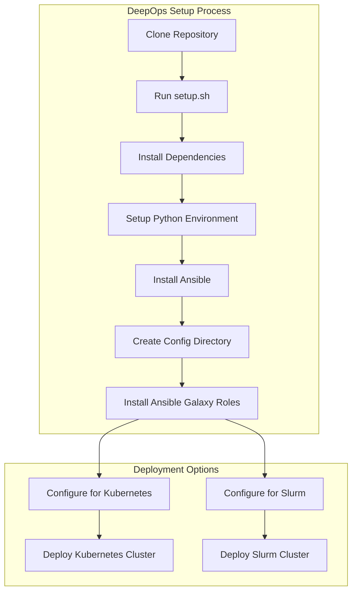
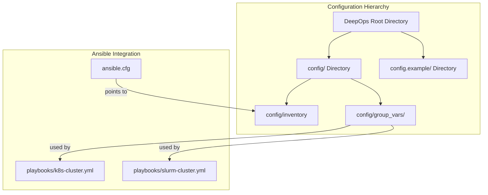
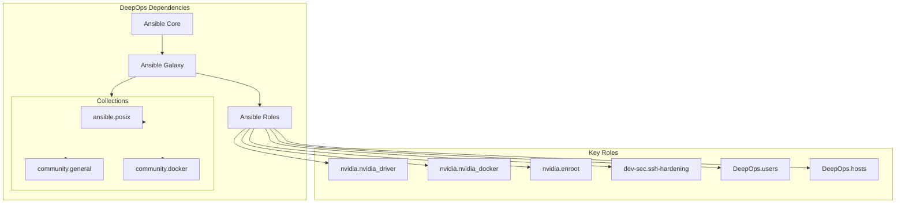
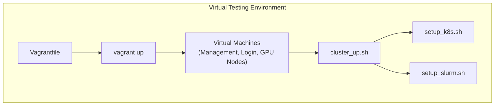

<!-- source: DeepWiki mcp.deepwiki.com · repo NVIDIA/deepops · page 1.1 Getting Started · fetched 2026-10-26 -->

# Getting Started

<details>
<summary>Relevant source files</summary>

The following files were used as context for generating this wiki page:

- [.github/workflows/ansible-lint-roles.yml](.github/workflows/ansible-lint-roles.yml)
- [.gitignore](.gitignore)
- [ansible.cfg](ansible.cfg)
- [config.example/requirements.yml](config.example/requirements.yml)
- [playbooks/slurm-cluster/easybuild-modules.yml](playbooks/slurm-cluster/easybuild-modules.yml)
- [playbooks/slurm-cluster/files/cve_2021_44228.options](playbooks/slurm-cluster/files/cve_2021_44228.options)
- [playbooks/slurm-cluster/logging.yml](playbooks/slurm-cluster/logging.yml)
- [playbooks/slurm-cluster/open-ondemand.yml](playbooks/slurm-cluster/open-ondemand.yml)
- [playbooks/slurm-cluster/slurm-validation.yml](playbooks/slurm-cluster/slurm-validation.yml)
- [playbooks/slurm-cluster/spack-modules.yml](playbooks/slurm-cluster/spack-modules.yml)
- [playbooks/slurm-cluster/templates/filebeat.conf](playbooks/slurm-cluster/templates/filebeat.conf)
- [roles/netapp-trident/.ansible-lint](roles/netapp-trident/.ansible-lint)
- [roles/requirements.yml](roles/requirements.yml)
- [scripts/deepops/ansible-lint-roles.sh](scripts/deepops/ansible-lint-roles.sh)
- [scripts/setup.sh](scripts/setup.sh)
- [src/containers/pxe/docker-compose.yml](src/containers/pxe/docker-compose.yml)
- [virtual/.gitignore](virtual/.gitignore)
- [virtual/k8s_environment.sh](virtual/k8s_environment.sh)

</details>


This guide provides instructions for setting up and configuring NVIDIA DeepOps. It covers the initial repository setup, dependency installation, and configuration preparation. For deployment-specific information, see [Kubernetes Deployment](#2) or [Slurm Deployment](#3).

## Prerequisites

Before starting with DeepOps, ensure your system meets the following requirements:

| Requirement | Details |
|-------------|---------|
| Operating System | Ubuntu, CentOS, or RHEL (see supported versions below) |
| Python | Python 3 |
| Network Access | Internet connectivity for package installation |
| Permissions | Sudo access on the management node |

Supported operating systems:
- Ubuntu 18.04 LTS or newer
- CentOS/RHEL 7.x or 8.x

Sources: [scripts/setup.sh:29-36]()

## Setup Process

DeepOps uses a setup script to bootstrap the environment with required dependencies and configuration. This process prepares your system to run Ansible playbooks that will deploy either a Kubernetes or Slurm cluster.

### Initial Setup Workflow



Sources: [scripts/setup.sh:67-88](), [scripts/setup.sh:90-127](), [scripts/setup.sh:142-149](), [scripts/setup.sh:152-169]()

### Clone the Repository

```bash
git clone https://github.com/NVIDIA/deepops.git
cd deepops
```

### Run the Setup Script

The `setup.sh` script installs required dependencies, creates a Python virtual environment, and prepares the repository for deployment:

```bash
./scripts/setup.sh
```

This script:
1. Installs system dependencies (git, virtualenv, sshpass, wget)
2. Creates a Python virtual environment at `/opt/deepops/env`
3. Installs Ansible and other required Python packages
4. Copies default configuration files to `config/` directory
5. Installs Ansible Galaxy roles and collections

Sources: [scripts/setup.sh:1-191]()

### Activate the Python Virtual Environment

After the setup script completes, activate the Python virtual environment:

```bash
source /opt/deepops/env/bin/activate
```

The setup script also adds this command to your `.bashrc` file, so it will be activated automatically in new shell sessions.

Sources: [scripts/setup.sh:182-185]()

## Configuration Structure

DeepOps uses a configuration directory structure to manage deployment settings. The setup script creates a copy of the example configuration that you can customize.



Sources: [ansible.cfg:1-26](), [scripts/setup.sh:142-149](), [.gitignore:7-10]()

### Inventory Configuration

The core of your DeepOps configuration is the inventory file at `config/inventory`. This file defines the servers in your cluster and their roles. Edit this file to include your server hostnames or IP addresses.

Example inventory structure:
```ini
[all]
mgmt01 ansible_host=10.0.0.1

[kube-master]
mgmt01

[etcd]
mgmt01

[kube-node]
mgmt01

[k8s-cluster:children]
kube-master
kube-node
```

For Slurm clusters:
```ini
[all]
login01 ansible_host=10.0.0.1
node01 ansible_host=10.0.0.2

[slurm-master]
login01

[slurm-node]
node01

[slurm-cluster:children]
slurm-master
slurm-node
```

Sources: [ansible.cfg:5]()

### Configuration Variables

DeepOps uses Ansible group variables to configure the deployment. The default variables are copied from `config.example/group_vars/` to `config/group_vars/`. You can modify these files to customize your deployment.

Key configuration files:
- `config/group_vars/all.yml` - Common variables for all hosts
- `config/group_vars/k8s-cluster.yml` - Kubernetes-specific variables
- `config/group_vars/slurm-cluster.yml` - Slurm-specific variables

Sources: [scripts/setup.sh:144-146]()

## Component Dependencies

DeepOps relies on several external Ansible roles and collections, which are installed automatically by the setup script.



Sources: [roles/requirements.yml:1-74](), [scripts/setup.sh:152-169]()

## Virtual Testing Environment

DeepOps includes a virtual testing environment that allows you to deploy a test cluster using Vagrant. This is useful for testing your configuration before deploying to physical hardware.



Sources: [virtual/.gitignore:1-6](), [virtual/k8s_environment.sh:1-9]()

## Next Steps

After completing the initial setup and configuration, proceed to deploy either a Kubernetes or Slurm cluster:

### For Kubernetes Deployment

Deploy a Kubernetes cluster with NVIDIA GPU support:

```bash
ansible-playbook -l k8s-cluster playbooks/k8s-cluster.yml
```

For more details about Kubernetes deployment options, see [Kubernetes Deployment](#2).

### For Slurm Deployment

Deploy a Slurm cluster for HPC workloads:

```bash
ansible-playbook -l slurm-cluster playbooks/slurm-cluster.yml
```

For more details about Slurm deployment options, see [Slurm Deployment](#3).

Sources: [playbooks/slurm-cluster/slurm-validation.yml:1-214](), [playbooks/slurm-cluster/logging.yml:1-87]()

## Troubleshooting

If you encounter issues during the setup process:

1. Ensure all prerequisites are installed
2. Check that your Python version is compatible (Python 3.6+)
3. Verify that the virtual environment is activated (`source /opt/deepops/env/bin/activate`)
4. Check for errors in the Ansible output
5. Review the inventory file to ensure all hosts are correctly configured
6. Run the Ansible playbook with the `-v` flag for verbose output

For Ansible-related issues, the repository includes a linting tool to check role quality:

```bash
./scripts/deepops/ansible-lint-roles.sh
```

Sources: [scripts/deepops/ansible-lint-roles.sh:1-48](), [.github/workflows/ansible-lint-roles.yml:1-32]()

---

