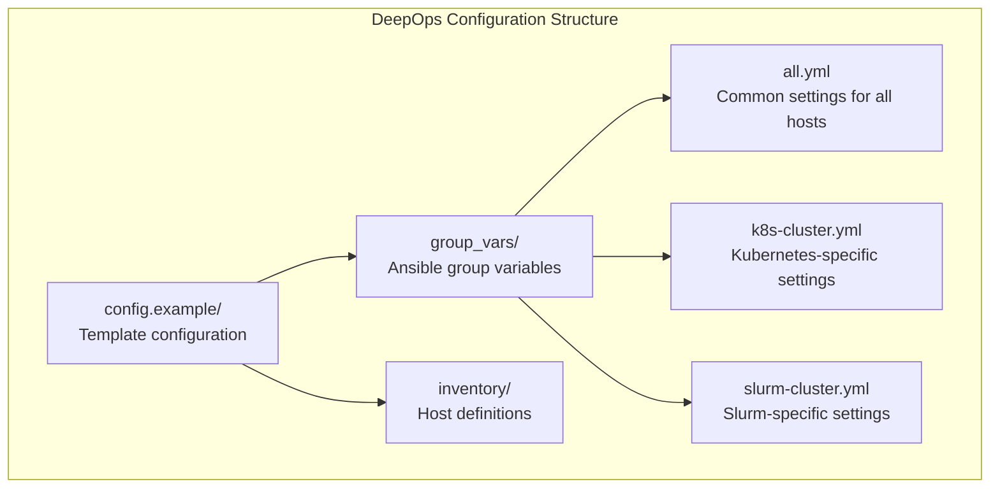
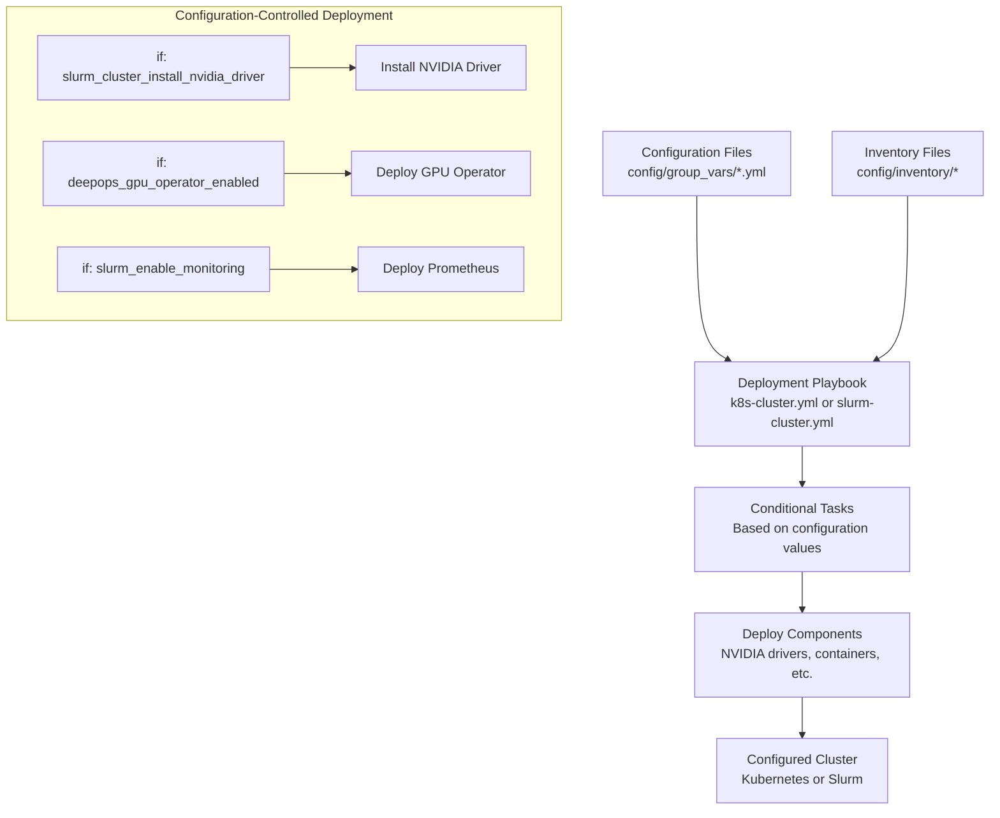
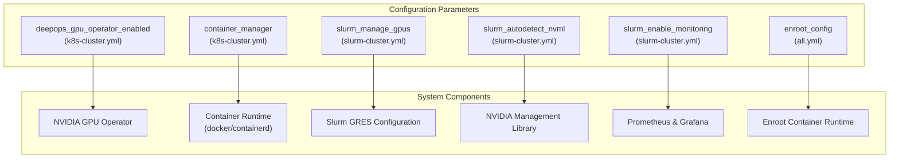
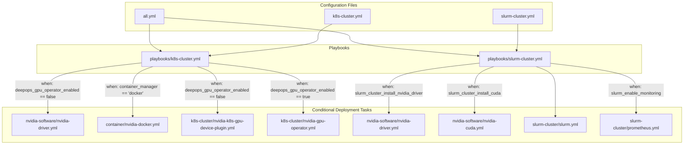

<!-- source: DeepWiki mcp.deepwiki.com · repo NVIDIA/deepops · page 1.2 Configuration System · fetched 2026-10-26 -->

# Configuration System

<details>
<summary>Relevant source files</summary>

The following files were used as context for generating this wiki page:

- [config.example/group_vars/all.yml](config.example/group_vars/all.yml)
- [config.example/group_vars/k8s-cluster.yml](config.example/group_vars/k8s-cluster.yml)
- [config.example/group_vars/slurm-cluster.yml](config.example/group_vars/slurm-cluster.yml)
- [playbooks/k8s-cluster.yml](playbooks/k8s-cluster.yml)
- [playbooks/slurm-cluster.yml](playbooks/slurm-cluster.yml)
- [playbooks/slurm-cluster/alertmanager.yml](playbooks/slurm-cluster/alertmanager.yml)
- [roles/facts/files/gpus.fact](roles/facts/files/gpus.fact)
- [roles/facts/tasks/main.yml](roles/facts/tasks/main.yml)
- [roles/pyxis/defaults/main.yml](roles/pyxis/defaults/main.yml)
- [roles/pyxis/tasks/main.yml](roles/pyxis/tasks/main.yml)
- [roles/pyxis/tasks/pyxis.yml](roles/pyxis/tasks/pyxis.yml)
- [roles/slurm/defaults/main.yml](roles/slurm/defaults/main.yml)
- [roles/slurm/tasks/compute.yml](roles/slurm/tasks/compute.yml)
- [roles/slurm/tasks/controller.yml](roles/slurm/tasks/controller.yml)
- [roles/slurm/tasks/main.yml](roles/slurm/tasks/main.yml)
- [roles/slurm/tasks/munge.yml](roles/slurm/tasks/munge.yml)
- [roles/slurm/vars/redhat.yml](roles/slurm/vars/redhat.yml)
- [roles/slurm/vars/ubuntu.yml](roles/slurm/vars/ubuntu.yml)
- [scripts/k8s/install_helm.sh](scripts/k8s/install_helm.sh)

</details>


The Configuration System in DeepOps provides a structured way to customize and deploy GPU-accelerated computing clusters. This page explains how configuration works in DeepOps, what can be configured, and how to modify default settings for your environment. For information about actual deployment procedures, see [Getting Started](#1.1).

## Configuration Overview

DeepOps uses Ansible as its configuration management system, with a hierarchical structure of configuration files that determine how clusters are deployed and configured. Configuration files define everything from basic networking to GPU support, container registries, and monitoring services.



Sources: [config.example/group_vars/all.yml](), [config.example/group_vars/k8s-cluster.yml](), [config.example/group_vars/slurm-cluster.yml]()

## Configuration Workflow

When deploying a cluster, DeepOps uses your configuration files to determine which components to install and how to configure them. The workflow follows these steps:



Sources: [playbooks/k8s-cluster.yml:169-177](), [playbooks/k8s-cluster.yml:289-293](), [playbooks/slurm-cluster.yml:43-46](), [playbooks/slurm-cluster.yml:96-106]()

## Configuration Files and Structure

The main configuration files are organized in the `config.example/group_vars/` directory. When setting up DeepOps, you typically copy this directory to `config/group_vars/` and modify the files as needed.

### Key Configuration Files

| File | Purpose | Affects |
|------|---------|---------|
| `all.yml` | Common configuration for all deployments | Network, users, NVIDIA software, container runtime |
| `k8s-cluster.yml` | Kubernetes-specific configuration | Container manager, GPU operator, dashboard, storage |
| `slurm-cluster.yml` | Slurm-specific configuration | Slurm settings, job scheduler, GPU management, monitoring |

### Parameter to Component Mapping

The following diagram shows how key configuration parameters directly control which components are deployed and how they are configured:



Sources: [config.example/group_vars/all.yml:151-153](), [config.example/group_vars/k8s-cluster.yml:15-16](), [config.example/group_vars/k8s-cluster.yml:25-26](), [config.example/group_vars/slurm-cluster.yml:11-12](), [config.example/group_vars/slurm-cluster.yml:22-23](), [config.example/group_vars/slurm-cluster.yml:223-229](), [config.example/group_vars/all.yml:180-188]()

## Common Configuration Options

### Network Configuration

The network configuration in `all.yml` controls settings such as DNS, NTP, and proxy. Key parameters include:

- `chrony_install`: Enable/disable NTP configuration using Chrony
- `chrony_config_server`: List of NTP servers
- `deepops_set_hostname`: Control whether hostnames are set based on inventory 

Sources: [config.example/group_vars/all.yml:26-41]()

### User Management

User configuration in `all.yml` defines which users are created during deployment:

```yaml
users:
  - username: nvidia
    name: nvidia
    password: $6$IrxI27V4ogJFfgTV$RvNskQFvXZzE9AF...
    groups: ['sudo']
    uid: 10007
    home: /home/nvidia
```

Sources: [config.example/group_vars/all.yml:98-105]()

### NVIDIA GPU Configuration

GPU-related settings in `all.yml` control how NVIDIA drivers and tools are installed:

- `nvidia_driver_force_install`: Force installation even if GPU not detected
- `gpu_clock_reset` and `gpu_clock_lock`: Control GPU clock settings
- `install_dcgm`: Enable installation of NVIDIA Datacenter GPU Manager

Sources: [config.example/group_vars/all.yml:121-142](), [config.example/group_vars/all.yml:265-266]()

### Container Runtime

Container runtime configuration across files affects which runtime is used and how it's configured:

- `docker_install`: Whether to install Docker
- `container_manager`: Container runtime for Kubernetes (docker, containerd, crio)
- `docker_insecure_registries`: List of insecure container registries
- `enroot_config`: Configuration for Enroot container runtime in Slurm

Sources: [config.example/group_vars/all.yml:152-169](), [config.example/group_vars/all.yml:180-188](), [config.example/group_vars/k8s-cluster.yml:14-15]()

## Kubernetes-Specific Configuration

The `k8s-cluster.yml` file contains Kubernetes-specific configuration options:

### GPU Support in Kubernetes

GPU support in Kubernetes can be configured in two ways:

1. Using the GPU Operator (controlled by `deepops_gpu_operator_enabled`)
2. Using individual components (GPU device plugin, GPU feature discovery)

Sources: [config.example/group_vars/k8s-cluster.yml:25-28](), [playbooks/k8s-cluster.yml:277-293]()

### Storage and Container Registry

Kubernetes storage and registry configuration includes:

- `k8s_nfs_client_provisioner`: Enable NFS client provisioner
- `k8s_deploy_nfs_server`: Deploy an NFS server for persistent storage
- `kube_enable_container_registry`: Enable local container registry

Sources: [config.example/group_vars/k8s-cluster.yml:49-62](), [config.example/group_vars/k8s-cluster.yml:67-71]()

## Slurm-Specific Configuration

The `slurm-cluster.yml` file contains configuration specific to Slurm clusters:

### Slurm Core Configuration

Core Slurm settings that control the job scheduler behavior:

- `slurm_install_prefix`: Installation directory for Slurm
- `slurm_manage_gpus`: Enable GPU management by Slurm
- `slurm_autodetect_nvml`: Auto-detect GPUs using NVIDIA Management Library
- `slurm_enable_ha`: Enable Slurm high-availability mode

You can also override Slurm configuration templates:

```yaml
# slurm_conf_template: "/path/to/slurm.conf"
# slurm_cgroup_conf_template: "/path/to/cgroup.conf"
# slurm_gres_conf_template: "/path/to/gres.conf"
# slurm_dbd_conf_template: "/path/to/slurmdbd.conf"
```

Sources: [config.example/group_vars/slurm-cluster.yml:7-19](), [config.example/group_vars/slurm-cluster.yml:31-33](), [config.example/group_vars/slurm-cluster.yml:38-41]()

### Slurm Container Support

Slurm container support configuration:

- `slurm_install_singularity`: Install Singularity container runtime
- `slurm_install_enroot`: Install Enroot container runtime
- `slurm_install_pyxis`: Install Pyxis (Slurm integration for Enroot)

Sources: [config.example/group_vars/slurm-cluster.yml:69-70](), [config.example/group_vars/slurm-cluster.yml:186-188](), [roles/pyxis/defaults/main.yml:1-4]()

### Monitoring and Logging

Slurm monitoring and logging configuration:

- `slurm_enable_monitoring`: Enable Prometheus and Grafana monitoring
- `slurm_enable_rsyslog_server`/`slurm_enable_rsyslog_client`: Enable rsyslog forwarding

Sources: [config.example/group_vars/slurm-cluster.yml:223-236]()

## Implementation Details

### Role Variables and Defaults

Many configuration options have default values defined in role default files. For example, Slurm defaults are defined in:

```yaml
# From roles/slurm/defaults/main.yml
slurm_version: "23.02.4"
slurm_cluster_name: deepops
slurm_username: slurm
slurm_password: ReplaceWithASecurePasswordInTheVault
```

Sources: [roles/slurm/defaults/main.yml:10-26](), [roles/pyxis/defaults/main.yml:1-4]()

### Platform-Specific Configuration

DeepOps handles platform differences through OS-specific variable files:

- `roles/slurm/vars/ubuntu.yml` - Ubuntu-specific variables
- `roles/slurm/vars/redhat.yml` - RHEL/CentOS-specific variables

Sources: [roles/slurm/vars/ubuntu.yml:1-25](), [roles/slurm/vars/redhat.yml:1-27]()

## Customizing Configuration

To customize DeepOps for your environment:

1. Copy the example configuration to create your working configuration:
   ```bash
   cp -r config.example config
   ```

2. Update the inventory in `config/inventory` to match your cluster hardware

3. Modify configuration files in `config/group_vars/` as needed

4. Run the appropriate deployment playbook:
   ```bash
   # For Kubernetes
   ansible-playbook -i config/inventory playbooks/k8s-cluster.yml
   
   # For Slurm
   ansible-playbook -i config/inventory playbooks/slurm-cluster.yml
   ```

The configuration values in your customized files will override the defaults and determine exactly how your cluster is deployed and configured.

## Configuration Application Flow

The following diagram shows how configuration is applied during deployment, illustrating how parameters control which components are deployed:



Sources: [playbooks/k8s-cluster.yml:169-177](), [playbooks/k8s-cluster.yml:178-188](), [playbooks/k8s-cluster.yml:277-287](), [playbooks/k8s-cluster.yml:289-293](), [playbooks/slurm-cluster.yml:43-46](), [playbooks/slurm-cluster.yml:50-54](), [playbooks/slurm-cluster.yml:79-80](), [playbooks/slurm-cluster.yml:96-106]()

---

