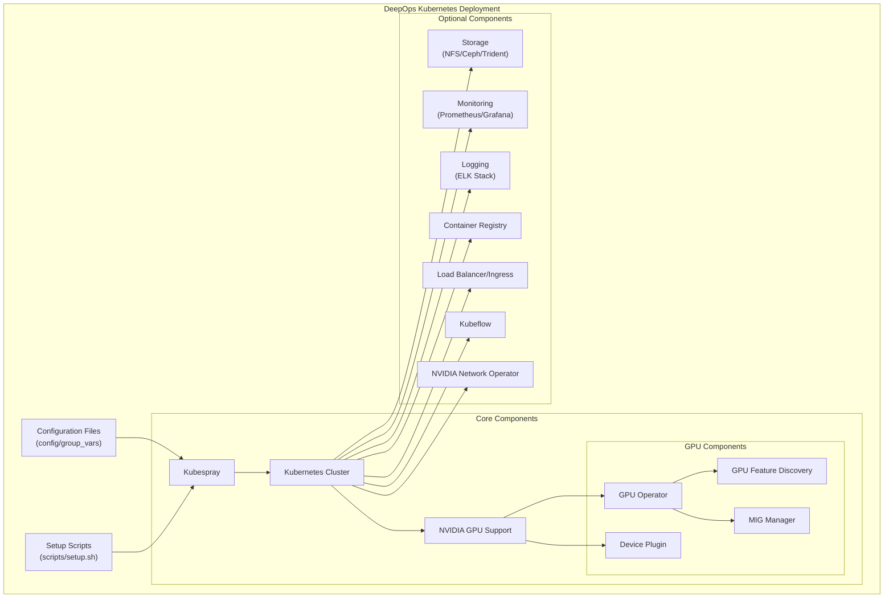
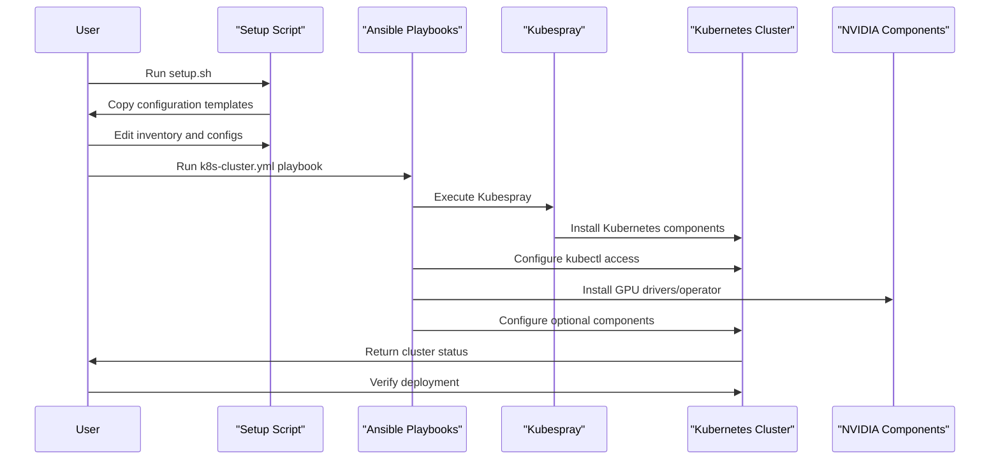

<!-- source: DeepWiki mcp.deepwiki.com · repo NVIDIA/deepops · page 2 Kubernetes Deployment · fetched 2026-10-26 -->

# Kubernetes Deployment

<details>
<summary>Relevant source files</summary>

The following files were used as context for generating this wiki page:

- [config.example/group_vars/all.yml](config.example/group_vars/all.yml)
- [config.example/group_vars/k8s-cluster.yml](config.example/group_vars/k8s-cluster.yml)
- [config.example/group_vars/slurm-cluster.yml](config.example/group_vars/slurm-cluster.yml)
- [docs/k8s-cluster/README.md](docs/k8s-cluster/README.md)
- [docs/k8s-cluster/deep-learning-examples.md](docs/k8s-cluster/deep-learning-examples.md)
- [docs/k8s-cluster/ingress.md](docs/k8s-cluster/ingress.md)
- [docs/k8s-cluster/kubeflow.md](docs/k8s-cluster/kubeflow.md)
- [docs/k8s-cluster/kubernetes-usage.md](docs/k8s-cluster/kubernetes-usage.md)
- [docs/k8s-cluster/logging.md](docs/k8s-cluster/logging.md)
- [docs/k8s-cluster/nvidia-mig.md](docs/k8s-cluster/nvidia-mig.md)
- [docs/k8s-cluster/nvidia-network-operator.md](docs/k8s-cluster/nvidia-network-operator.md)
- [docs/k8s-cluster/rapids-dask.md](docs/k8s-cluster/rapids-dask.md)
- [docs/k8s-cluster/roce-perf-k8s.md](docs/k8s-cluster/roce-perf-k8s.md)
- [docs/k8s-cluster/roce_backend.md](docs/k8s-cluster/roce_backend.md)
- [playbooks/k8s-cluster.yml](playbooks/k8s-cluster.yml)
- [playbooks/slurm-cluster.yml](playbooks/slurm-cluster.yml)
- [playbooks/slurm-cluster/alertmanager.yml](playbooks/slurm-cluster/alertmanager.yml)
- [roles/pyxis/defaults/main.yml](roles/pyxis/defaults/main.yml)
- [roles/pyxis/tasks/main.yml](roles/pyxis/tasks/main.yml)
- [roles/pyxis/tasks/pyxis.yml](roles/pyxis/tasks/pyxis.yml)
- [roles/slurm/defaults/main.yml](roles/slurm/defaults/main.yml)
- [roles/slurm/tasks/compute.yml](roles/slurm/tasks/compute.yml)
- [roles/slurm/tasks/controller.yml](roles/slurm/tasks/controller.yml)
- [roles/slurm/tasks/main.yml](roles/slurm/tasks/main.yml)
- [roles/slurm/tasks/munge.yml](roles/slurm/tasks/munge.yml)
- [roles/slurm/vars/redhat.yml](roles/slurm/vars/redhat.yml)
- [roles/slurm/vars/ubuntu.yml](roles/slurm/vars/ubuntu.yml)
- [scripts/k8s/install_helm.sh](scripts/k8s/install_helm.sh)
- [workloads/examples/k8s/deep-learning-examples/templates/statefulset.yaml](workloads/examples/k8s/deep-learning-examples/templates/statefulset.yaml)
- [workloads/examples/k8s/deep-learning-examples/values.yaml](workloads/examples/k8s/deep-learning-examples/values.yaml)

</details>


This document provides a comprehensive guide for deploying a Kubernetes cluster using DeepOps, with a specific focus on GPU-accelerated infrastructure. DeepOps provides a streamlined approach to deploying Kubernetes with NVIDIA GPU support, enabling data scientists, researchers, and infrastructure engineers to quickly set up a production-ready platform for AI/ML workloads.

## Deployment Architecture

DeepOps uses Kubespray (a collection of Ansible playbooks) under the hood, with additional customizations optimized for GPU-enabled environments. The architecture includes both core components required for basic functionality and optional components for enhanced capabilities.



Sources: [playbooks/k8s-cluster.yml:3-294](). [docs/k8s-cluster/README.md:1-304](), [config.example/group_vars/k8s-cluster.yml:1-96]()

## Deployment Process

The deployment process follows a logical sequence from initial setup to verification and optional component installation.



Sources: [playbooks/k8s-cluster.yml:23-309](), [docs/k8s-cluster/README.md:29-106]()

### Prerequisites

Before beginning the deployment process, ensure you have:

1. A control system to run the deployment process
2. One or more servers with compatible operating systems (Ubuntu, CentOS, or RHEL)
3. Machines with NVIDIA GPUs if you plan to use GPU capabilities
4. Network connectivity between all nodes
5. Sufficient privileges to run commands with sudo

For GPU support, ensure your systems have compatible NVIDIA GPUs with appropriate drivers or plan to deploy them via DeepOps.

Sources: [docs/k8s-cluster/README.md:29-38]()

### Configuration and Installation

1. **Install DeepOps**
   ```bash
   # Clone the repository and set up the DeepOps environment
   ./scripts/setup.sh
   ```

2. **Edit Configuration Files**
   ```bash
   # Edit inventory and add nodes to the "KUBERNETES" section
   vi config/inventory
   
   # Optionally modify configuration parameters
   vi config/group_vars/k8s-cluster.yml
   vi config/group_vars/all.yml
   ```

3. **Configure GPU Support**
   
   DeepOps offers two methods for GPU support:
   
   * Default method: NVIDIA Device Plugin (when `deepops_gpu_operator_enabled: false`)
   * Alternative method: NVIDIA GPU Operator (when `deepops_gpu_operator_enabled: true`)
   
   ```yaml
   # In config/group_vars/k8s-cluster.yml
   deepops_gpu_operator_enabled: true  # Enable GPU Operator
   
   # Enable host-level drivers (must be 'true' for clusters with pre-installed NVIDIA drivers or DGX systems)
   gpu_operator_preinstalled_nvidia_software: true
   ```

4. **Deploy Kubernetes**
   ```bash
   # Deploy Kubernetes using Ansible and Kubespray
   ansible-playbook -l k8s-cluster playbooks/k8s-cluster.yml
   ```

5. **Verify Installation**
   ```bash
   # Verify that Kubernetes is running
   kubectl get nodes
   
   # Verify GPU support (if applicable)
   kubectl get nodes -o=custom-columns=NAME:.metadata.name,GPUs:.status.allocatable.nvidia\\.com/gpu
   ```

Sources: [playbooks/k8s-cluster.yml:22-93](), [docs/k8s-cluster/README.md:42-104](), [config.example/group_vars/k8s-cluster.yml:14-37]()

## GPU Support in Kubernetes

DeepOps offers two primary methods for adding GPU support to Kubernetes:

### NVIDIA GPU Operator

The GPU Operator provides a Kubernetes native way to manage NVIDIA GPU resources, including:

- NVIDIA Driver (container or host-installed)
- NVIDIA Container Runtime
- Device Plugin
- GPU Feature Discovery
- DCGM Exporter for monitoring
- MIG Manager (for A100 GPUs)

```yaml
# In config/group_vars/k8s-cluster.yml
deepops_gpu_operator_enabled: true  # Enable GPU Operator
```

The GPU Operator is deployed as part of the main playbook execution:

```
# From playbooks/k8s-cluster.yml
- name: Install NVIDIA GPU Operator
  import_playbook: k8s-cluster/nvidia-gpu-operator.yml
  tags:
    - nvidia
  when: deepops_gpu_operator_enabled|default(true) | bool == true
```

Sources: [config.example/group_vars/k8s-cluster.yml:23-31](), [playbooks/k8s-cluster.yml:289-293](), [docs/k8s-cluster/README.md:63-73]()

### NVIDIA Device Plugin (Traditional Method)

If not using the GPU Operator, DeepOps can install the components individually:

1. NVIDIA Drivers
2. NVIDIA Docker/Container Runtime
3. NVIDIA GPU Device Plugin
4. GPU Feature Discovery

```
# From playbooks/k8s-cluster.yml
- name: Install NVIDIA driver on GPU servers
  import_playbook: nvidia-software/nvidia-driver.yml
  vars:
    hostlist: "k8s-cluster"
  tags:
    - nvidia
  when: deepops_gpu_operator_enabled|default(true) | bool == false or
        gpu_operator_preinstalled_nvidia_software|default(true)

- name: Install k8s GPU feature discovery
  import_playbook: k8s-cluster/nvidia-k8s-gpu-feature-discovery.yml
  tags:
    - nvidia
  when: deepops_gpu_operator_enabled|default(true) | bool == false

- name: Install k8s GPU device plugin
  import_playbook: k8s-cluster/nvidia-k8s-gpu-device-plugin.yml
  tags:
    - nvidia
  when: deepops_gpu_operator_enabled|default(true) | bool == false
```

Sources: [playbooks/k8s-cluster.yml:169-287](), [docs/k8s-cluster/README.md:63-73](), [config.example/group_vars/k8s-cluster.yml:23-31]()

### Multi-Instance GPU (MIG) Support

For NVIDIA A100 GPUs, MIG allows partitioning a single GPU into multiple instances. DeepOps supports MIG through the GPU Operator or standalone configuration:

```yaml
# Set the MIG labeling and use strategy to none, single, or mixed
k8s_gpu_mig_strategy: "mixed"
```

The MIG strategy determines how GPU resources are exposed to Kubernetes:
- `none`: MIG devices aren't enabled (default)
- `single`: Each GPU is configured with identical MIG geometries
- `mixed`: Different GPUs can have different MIG configurations

Sources: [config.example/group_vars/k8s-cluster.yml:31](), [docs/k8s-cluster/nvidia-mig.md:1-116]()

## Optional Components

DeepOps provides several optional components that can be deployed to enhance your Kubernetes cluster:

### Storage Options

#### NFS Client Provisioner (Default)

By default, DeepOps sets up an NFS server on the first Kubernetes master node and configures the NFS client provisioner:

```yaml
# In config/group_vars/k8s-cluster.yml
k8s_nfs_client_provisioner: true
k8s_deploy_nfs_server: true
k8s_nfs_server: '{{ groups["kube-master"][0] }}'
k8s_nfs_export_path: '/export/deepops_nfs'
```

You can configure this to use an existing NFS server by modifying these settings.

Sources: [config.example/group_vars/k8s-cluster.yml:50-62](), [docs/k8s-cluster/README.md:124-151]()

#### Other Storage Options

DeepOps also provides support for:
- Rook/Ceph cluster (deprecated)
- NetApp Astra Trident

### Monitoring

Deploy Prometheus and Grafana for monitoring your Kubernetes cluster and GPUs:

```bash
./scripts/k8s/deploy_monitoring.sh
```

This includes:
- Prometheus for metrics collection
- Grafana for visualization (accessible at http://<kube-master>:30200)
- NVIDIA DCGM for GPU metrics

Sources: [docs/k8s-cluster/README.md:189-216]()

### Logging

DeepOps supports centralized logging with ELK (Elasticsearch, Logstash, Kibana) stack:

```bash
# Follow the ELK Logging Guide
# Kibana will be available at http://<kube-master>:30700
```

Additionally, syslog forwarding can be configured:

```yaml
# In config/group_vars/k8s-cluster.yml
kube_enable_rsyslog_server: true
kube_enable_rsyslog_client: true
```

Sources: [docs/k8s-cluster/logging.md:1-92](), [config.example/group_vars/k8s-cluster.yml:88-95](), [docs/k8s-cluster/README.md:222-237]()

### Container Registry

DeepOps can deploy a local container registry:

```yaml
# In config/group_vars/k8s-cluster.yml
kube_enable_container_registry: false  # Set to true to enable
docker_insecure_registries: "{{ groups['kube-master']|map('regex_replace', '^(.*)$', '\\1:5000')|list + ['registry.local:31500']}}"
```

Deploy the registry with:
```bash
ansible-playbook --tags container-registry playbooks/k8s-cluster/container-registry.yml
```

Sources: [config.example/group_vars/k8s-cluster.yml:65-86](), [docs/k8s-cluster/README.md:239-242]()

### Load Balancer and Ingress

For exposing services externally, DeepOps provides:

1. **MetalLB Load Balancer**: Deploy with `./scripts/k8s/deploy_loadbalancer.sh`
2. **NGINX Ingress Controller**: Deploy with `./scripts/k8s/deploy_ingress.sh`

Sources: [docs/k8s-cluster/ingress.md:1-58](), [docs/k8s-cluster/README.md:247-253]()

### Kubeflow

For running machine learning workloads, DeepOps supports Kubeflow deployment:

```bash
./scripts/k8s/deploy_kubeflow.sh
```

Kubeflow will be accessible at http://<kube-master>:31380 with default credentials:
- Username: deepops@example.com
- Password: deepops

Sources: [docs/k8s-cluster/kubeflow.md:1-131](), [docs/k8s-cluster/README.md:253-256]()

### NVIDIA Network Operator

For high-performance networking in GPU clusters:

```bash
ansible-playbook playbooks/k8s-cluster/nvidia-network-operator.yaml
```

This deploys components for RDMA over Converged Ethernet (RoCE) or InfiniBand networking.

Sources: [docs/k8s-cluster/nvidia-network-operator.md:1-282](), [docs/k8s-cluster/roce-perf-k8s.md:1-410]()

## Cluster Maintenance

DeepOps leverages Kubespray for cluster maintenance operations:

### Adding Nodes

1. Add the new nodes to your `config/inventory` file
2. Run the scale-up playbook:
   ```bash
   ansible-playbook -l k8s-cluster submodules/kubespray/scale.yml
   ```

### Removing Nodes

```bash
ansible-playbook submodules/kubespray/remove-node.yml --extra-vars "node=nodename0,nodename1"
```

### Cluster Upgrade

Refer to the Kubespray upgrade documentation for detailed steps.

### Cluster Reset

To completely reset the cluster:

```bash
ansible-playbook submodules/kubespray/reset.yml
```

Sources: [docs/k8s-cluster/README.md:261-303]()

## Running Workloads

DeepOps provides examples for running various AI/ML workloads:

### Basic GPU Job

```yaml
apiVersion: batch/v1
kind: Job
metadata:
  name: gpu-job
spec:
  template:
    spec:
      containers:
      - name: gpu-container
        image: nvidia/cuda:11.0-base
        command: ["nvidia-smi"]
        resources:
          limits:
            nvidia.com/gpu: 1
      restartPolicy: Never
```

### Using NGC Container Registry

DeepOps supports the NVIDIA NGC container registry for optimized deep learning containers:

1. Generate an NGC API Key
2. Create a Kubernetes secret for the NGC registry
3. Use the secret in your deployments:
   ```yaml
   imagePullSecrets:
     - name: nvcr.dgxkey
   ```

### Deep Learning Examples

DeepOps provides helm charts for deploying various deep learning examples:

```bash
helm install <EXAMPLE_NAME> workloads/examples/k8s/deep-learning-examples --set exampleName=<EXAMPLE_NAME>
```

Sources: [docs/k8s-cluster/kubernetes-usage.md:1-116](), [docs/k8s-cluster/deep-learning-examples.md:1-282](), [workloads/examples/k8s/deep-learning-examples/values.yaml:1-28]()

## Conclusion

DeepOps provides a comprehensive solution for deploying Kubernetes with GPU support, along with a wide range of add-on components for AI/ML workloads. By following this guide, you can deploy a production-ready Kubernetes cluster optimized for GPU workloads.

For specific configurations and advanced scenarios, refer to the other pages in the DeepOps documentation.

---

