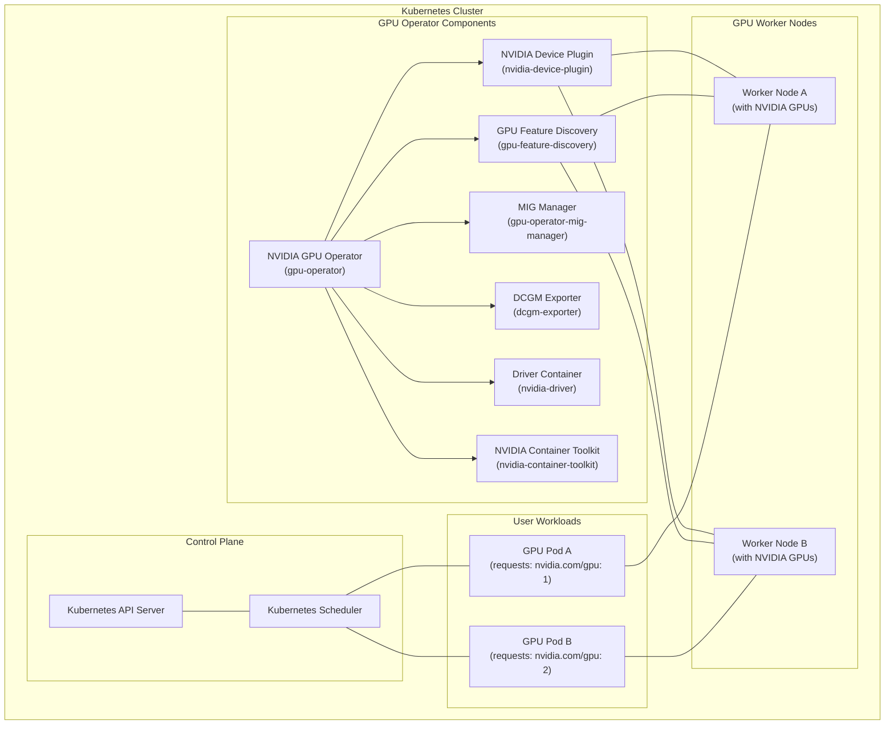
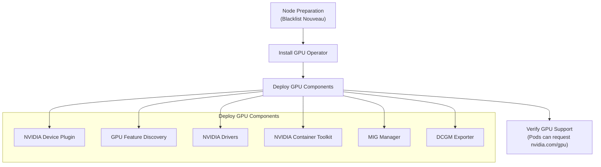
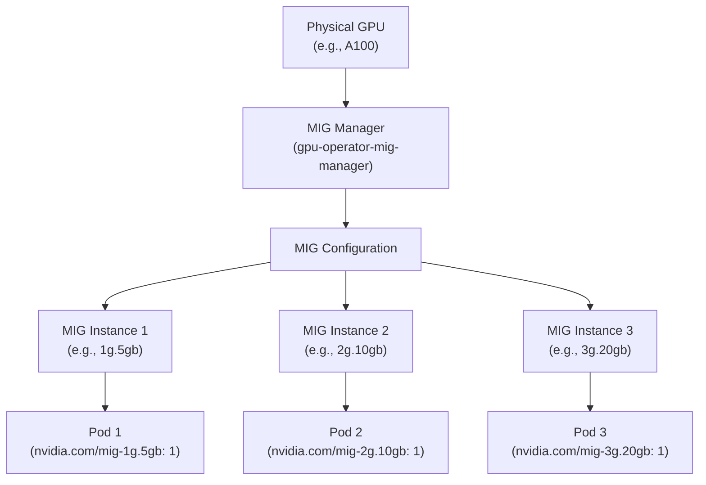

<!-- source: DeepWiki mcp.deepwiki.com · repo NVIDIA/deepops · page 2.1 GPU Support in Kubernetes · fetched 2026-10-26 -->

# GPU Support in Kubernetes

<details>
<summary>Relevant source files</summary>

The following files were used as context for generating this wiki page:

- [roles/alertmanager/defaults/main.yml](roles/alertmanager/defaults/main.yml)
- [roles/alertmanager/handlers/main.yml](roles/alertmanager/handlers/main.yml)
- [roles/alertmanager/tasks/main.yml](roles/alertmanager/tasks/main.yml)
- [roles/alertmanager/templates/alertmanager.yml.j2](roles/alertmanager/templates/alertmanager.yml.j2)
- [roles/alertmanager/templates/docker.alertmanager.service.j2](roles/alertmanager/templates/docker.alertmanager.service.j2)
- [roles/nvidia-gpu-operator-node-prep/files/blocklist-nouveau.conf](roles/nvidia-gpu-operator-node-prep/files/blocklist-nouveau.conf)
- [roles/nvidia-gpu-operator-node-prep/files/nvidia-driver.conf](roles/nvidia-gpu-operator-node-prep/files/nvidia-driver.conf)
- [roles/nvidia-gpu-operator-node-prep/handlers/main.yml](roles/nvidia-gpu-operator-node-prep/handlers/main.yml)
- [roles/nvidia-gpu-operator-node-prep/tasks/main.yml](roles/nvidia-gpu-operator-node-prep/tasks/main.yml)
- [roles/nvidia-gpu-operator/defaults/main.yml](roles/nvidia-gpu-operator/defaults/main.yml)
- [roles/nvidia-gpu-operator/tasks/k8s.yml](roles/nvidia-gpu-operator/tasks/k8s.yml)
- [roles/nvidia-gpu-operator/tasks/main.yml](roles/nvidia-gpu-operator/tasks/main.yml)
- [roles/nvidia-gpu-operator/tasks/nvaie.yml](roles/nvidia-gpu-operator/tasks/nvaie.yml)
- [roles/nvidia-gpu-operator/templates/client_configuration_token.tok](roles/nvidia-gpu-operator/templates/client_configuration_token.tok)
- [roles/nvidia-gpu-operator/templates/gridd.conf](roles/nvidia-gpu-operator/templates/gridd.conf)
- [roles/nvidia-k8s-gpu-device-plugin/defaults/main.yml](roles/nvidia-k8s-gpu-device-plugin/defaults/main.yml)
- [roles/nvidia-k8s-gpu-device-plugin/tasks/main.yml](roles/nvidia-k8s-gpu-device-plugin/tasks/main.yml)
- [roles/nvidia-k8s-gpu-feature-discovery/defaults/main.yml](roles/nvidia-k8s-gpu-feature-discovery/defaults/main.yml)
- [roles/nvidia-k8s-gpu-feature-discovery/meta/main.yml](roles/nvidia-k8s-gpu-feature-discovery/meta/main.yml)
- [roles/nvidia-k8s-gpu-feature-discovery/tasks/main.yml](roles/nvidia-k8s-gpu-feature-discovery/tasks/main.yml)
- [roles/nvidia-mig-manager/defaults/main.yml](roles/nvidia-mig-manager/defaults/main.yml)

</details>


This document provides details on how DeepOps enables and manages NVIDIA GPU support in Kubernetes clusters. It covers the deployment of the NVIDIA GPU Operator and related components that allow Kubernetes to recognize, schedule, and manage GPU resources efficiently.

For information about general Kubernetes deployment, see [Kubernetes Deployment](#2), and for monitoring GPU metrics in Kubernetes, see [Monitoring in Kubernetes](#2.2).

## Overview

DeepOps provides robust GPU support in Kubernetes through NVIDIA's cloud-native components. The main goal is to simplify the management of GPU resources within Kubernetes, enabling containerized applications to access and use GPUs efficiently.

The primary components are:

- **NVIDIA GPU Operator**: Automates the deployment of GPU components in Kubernetes
- **NVIDIA Device Plugin**: Exposes GPU resources to Kubernetes
- **GPU Feature Discovery**: Labels nodes with GPU capabilities for better scheduling
- **MIG Manager**: Enables Multi-Instance GPU support for resource partitioning

Sources: [roles/nvidia-gpu-operator/defaults/main.yml:1-57](), [roles/nvidia-k8s-gpu-device-plugin/defaults/main.yml:1-7](), [roles/nvidia-k8s-gpu-feature-discovery/defaults/main.yml:1-7]()

## Architecture



Sources: [roles/nvidia-gpu-operator/tasks/main.yml:1-16](), [roles/nvidia-gpu-operator/tasks/k8s.yml:1-17](), [roles/nvidia-k8s-gpu-device-plugin/tasks/main.yml:1-18](), [roles/nvidia-k8s-gpu-feature-discovery/tasks/main.yml:1-18]()

## NVIDIA GPU Operator

The NVIDIA GPU Operator is the central component for GPU support in Kubernetes. It automates the deployment of all necessary components to run GPU workloads, including drivers, device plugins, and monitoring tools.

### Deployment Process



DeepOps installs the GPU Operator using Helm with a configurable set of parameters. The primary configuration happens in the [roles/nvidia-gpu-operator/defaults/main.yml:1-57]() file.

Key parameters include:
- Chart version (currently `v23.3.2`)
- MIG strategy (`mixed` by default, allowing both MIG and non-MIG modes)
- Component enablement flags for drivers, toolkit, DCGM, and MIG Manager

For systems with pre-installed NVIDIA drivers (like DGX), DeepOps configures the GPU Operator to skip driver installation:

```yaml
gpu_operator_preinstalled_nvidia_software: true
```

This setting automatically sets:
```yaml
gpu_operator_enable_driver: false
gpu_operator_enable_toolkit: true
```

Sources: [roles/nvidia-gpu-operator/tasks/main.yml:1-16](), [roles/nvidia-gpu-operator/tasks/k8s.yml:1-17](), [roles/nvidia-gpu-operator/defaults/main.yml:1-57]()

## NVIDIA Device Plugin

The NVIDIA Device Plugin is deployed as part of the GPU Operator or can be deployed separately. It's responsible for:

1. Discovering NVIDIA GPUs on Kubernetes nodes
2. Advertising them as consumable resources to the Kubernetes API server
3. Managing the allocation of GPU devices when containers request them

The device plugin enables Kubernetes pods to request GPU resources using the `nvidia.com/gpu` resource type:

```yaml
resources:
  limits:
    nvidia.com/gpu: 1
```

DeepOps configures the device plugin with the [roles/nvidia-k8s-gpu-device-plugin/defaults/main.yml:1-7]() settings, including:
- Chart version (currently `0.14.0`)
- MIG strategy (matches the GPU Operator setting)
- Initialization error handling

Sources: [roles/nvidia-k8s-gpu-device-plugin/tasks/main.yml:1-18](), [roles/nvidia-k8s-gpu-device-plugin/defaults/main.yml:1-7]()

## GPU Feature Discovery

The GPU Feature Discovery component automatically labels Kubernetes nodes with the properties of their GPUs. These labels include:

- GPU model
- GPU architecture
- CUDA version
- Driver version
- Memory
- MIG capabilities

This labeling enables workload scheduling based on GPU features through standard Kubernetes node selectors:

```yaml
nodeSelector:
  nvidia.com/gpu.product: Tesla-V100
```

DeepOps deploys this component with the settings in [roles/nvidia-k8s-gpu-feature-discovery/defaults/main.yml:1-7](), including:
- Chart version (currently `0.8.0`)
- MIG strategy configuration

Sources: [roles/nvidia-k8s-gpu-feature-discovery/tasks/main.yml:1-18](), [roles/nvidia-k8s-gpu-feature-discovery/defaults/main.yml:1-7]()

## MIG Support

DeepOps supports NVIDIA Multi-Instance GPU (MIG) technology, which enables a single GPU to be partitioned into multiple isolated GPU instances. This is particularly useful for multi-tenant environments where GPU resources need to be efficiently shared.

MIG support is configured through the `k8s_gpu_mig_strategy` parameter, which can be set to:
- `single` - All GPUs on a node operate in the same mode (all with MIG or all without)
- `mixed` - GPUs on a node can be in different modes (default in DeepOps)

The MIG Manager component, part of the GPU Operator, handles the configuration and management of MIG instances.



Sources: [roles/nvidia-gpu-operator/defaults/main.yml:17-27](), [roles/nvidia-mig-manager/defaults/main.yml:1-4]()

## Support for vGPU and NVIDIA AI Enterprise

DeepOps also provides support for NVIDIA vGPU and NVIDIA AI Enterprise (NVAIE) environments. This requires additional configuration for licensing and authentication.

### vGPU Licensing Configuration

For vGPU deployments, DeepOps supports both traditional license server and NLS (NVIDIA License System) approaches:

1. For traditional license server:
   - Set `vgpu_grid_license_server` to the license server IP
   - Disable NLS by setting `gpu_operator_nvaie_nls_enabled: false`

2. For NVIDIA License System (NLS):
   - Set `gpu_operator_nvaie_nls_enabled: true`
   - Configure `gpu_operator_nvaie_nls_token` with the NLS token

### NVIDIA AI Enterprise

NVAIE is enabled by setting `gpu_operator_nvaie_enable: true`, which requires additional NGC registry authentication:

```yaml
gpu_operator_registry_username: "$oauthtoken"
gpu_operator_registry_password: "<NGC API key>"
gpu_operator_registry_email: "<NGC email>"
```

When NVAIE is enabled, DeepOps uses a different Helm repository (`https://helm.ngc.nvidia.com/nvaie`) and chart (`nvaie/gpu-operator`).

Sources: [roles/nvidia-gpu-operator/defaults/main.yml:38-56](), [roles/nvidia-gpu-operator/tasks/nvaie.yml:1-60](), [roles/nvidia-gpu-operator/templates/gridd.conf:1-6]()

## Node Preparation for GPU Support

Before the GPU Operator can be deployed, DeepOps prepares nodes by:

1. Unloading and blacklisting the open-source Nouveau driver
2. Loading required kernel modules (i2c_core, ipmi_msghandler)
3. Updating the initial RAM disk (initramfs)

This preparation ensures that the NVIDIA drivers can be properly installed and function correctly.

```yaml
# Blacklisting Nouveau
blacklist nouveau
options nouveau modeset=0

# Required kernel modules
i2c_core
ipmi_msghandler
```

> **Note**: As of GPU Operator version 1.9.0, this node preparation is now handled by the GPU Operator itself and is mainly kept for backward compatibility.

Sources: [roles/nvidia-gpu-operator-node-prep/tasks/main.yml:1-38](), [roles/nvidia-gpu-operator-node-prep/files/blocklist-nouveau.conf:1-3](), [roles/nvidia-gpu-operator-node-prep/files/nvidia-driver.conf:1-3]()

## Configuration Options Reference

| Parameter | Default Value | Description |
|-----------|---------------|-------------|
| `gpu_operator_chart_version` | `v23.3.2` | Version of the GPU Operator Helm chart |
| `k8s_gpu_mig_strategy` | `mixed` | MIG strategy (single or mixed) |
| `gpu_operator_enable_driver` | `true` (false for DGX) | Enable NVIDIA driver installation |
| `gpu_operator_enable_toolkit` | `true` | Enable NVIDIA Container Toolkit |
| `gpu_operator_enable_dcgm` | `false` | Enable DCGM for monitoring |
| `gpu_operator_enable_migmanager` | `true` | Enable MIG Manager |
| `gpu_operator_namespace` | `gpu-operator` | Kubernetes namespace for GPU Operator |
| `gpu_operator_driver_version` | `525.105.17` | NVIDIA driver version |
| `k8s_gpu_plugin_chart_version` | `0.14.0` | Version of the device plugin chart |
| `k8s_gpu_feature_discovery_chart_version` | `0.8.0` | Version of the feature discovery chart |

Sources: [roles/nvidia-gpu-operator/defaults/main.yml:1-57](), [roles/nvidia-k8s-gpu-device-plugin/defaults/main.yml:1-7](), [roles/nvidia-k8s-gpu-feature-discovery/defaults/main.yml:1-7]()

## Troubleshooting

If you encounter issues with GPU support in your Kubernetes cluster, check the following:

1. Verify that GPU nodes are properly prepared:
   ```bash
   lsmod | grep -i nvidia
   ```

2. Check if the GPU Operator pods are running:
   ```bash
   kubectl get pods -n gpu-operator
   ```

3. Verify GPU resources are available:
   ```bash
   kubectl get nodes -o json | jq '.items[].status.capacity["nvidia.com/gpu"]'
   ```

4. For vGPU issues, verify the license configuration:
   ```bash
   kubectl get configmap licensing-config -n gpu-operator -o yaml
   ```

5. For MIG configuration issues, check the MIG Manager logs:
   ```bash
   kubectl logs -n gpu-operator -l app=gpu-operator-mig-manager
   ```

Sources: [roles/nvidia-gpu-operator/tasks/k8s.yml:1-17](), [roles/nvidia-gpu-operator/tasks/nvaie.yml:1-60]()

---

