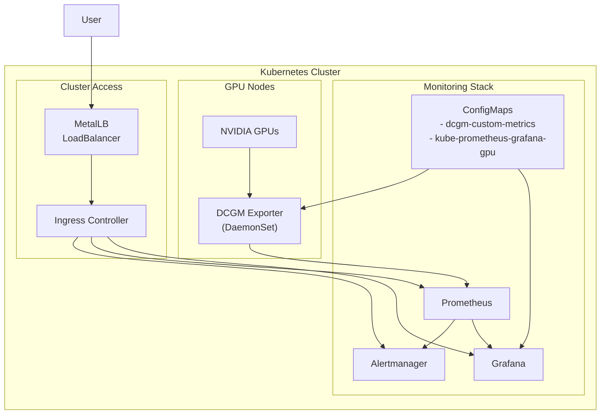
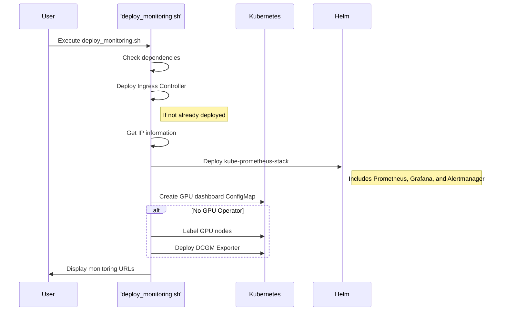
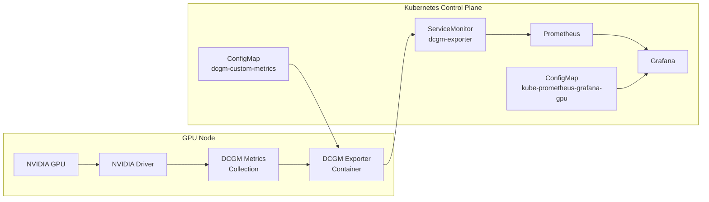

<!-- source: DeepWiki mcp.deepwiki.com · repo NVIDIA/deepops · page 2.2 Monitoring in Kubernetes · fetched 2026-10-26 -->

# Monitoring in Kubernetes

<details>
<summary>Relevant source files</summary>

The following files were used as context for generating this wiki page:

- [config.example/env.sh](config.example/env.sh)
- [config.example/helm/dcgm-exporter.yml](config.example/helm/dcgm-exporter.yml)
- [config.example/helm/metallb-resources.yml](config.example/helm/metallb-resources.yml)
- [config.example/helm/metallb.yml](config.example/helm/metallb.yml)
- [config.example/helm/monitoring-no-persist.yml](config.example/helm/monitoring-no-persist.yml)
- [config.example/helm/monitoring.yml](config.example/helm/monitoring.yml)
- [scripts/airgap/build_offline_cache.sh](scripts/airgap/build_offline_cache.sh)
- [scripts/common.sh](scripts/common.sh)
- [scripts/generic/install_docker.sh](scripts/generic/install_docker.sh)
- [scripts/k8s/debug.sh](scripts/k8s/debug.sh)
- [scripts/k8s/deploy_ingress.sh](scripts/k8s/deploy_ingress.sh)
- [scripts/k8s/deploy_loadbalancer.sh](scripts/k8s/deploy_loadbalancer.sh)
- [scripts/k8s/deploy_monitoring.sh](scripts/k8s/deploy_monitoring.sh)
- [scripts/k8s/setup_remote_k8s.sh](scripts/k8s/setup_remote_k8s.sh)
- [scripts/k8s/verify_gpu.sh](scripts/k8s/verify_gpu.sh)
- [workloads/jenkins/scripts/get-k8s-debug.sh](workloads/jenkins/scripts/get-k8s-debug.sh)
- [workloads/jenkins/scripts/get-slurm-debug.sh](workloads/jenkins/scripts/get-slurm-debug.sh)
- [workloads/jenkins/scripts/run-gpu-job.sh](workloads/jenkins/scripts/run-gpu-job.sh)
- [workloads/jenkins/scripts/verify-ingress-config.sh](workloads/jenkins/scripts/verify-ingress-config.sh)

</details>


## Purpose and Scope

This document describes the monitoring system for Kubernetes clusters deployed with DeepOps, focusing on the components, deployment process, configuration, and GPU-specific monitoring capabilities. The monitoring stack in DeepOps includes Prometheus, Grafana, Alertmanager, and NVIDIA DCGM Exporter for comprehensive observability of cluster performance, resource utilization, and GPU metrics.

For information about GPU support in Kubernetes, see [GPU Support in Kubernetes](#2.1).

## Monitoring Architecture

The monitoring system in DeepOps leverages industry-standard tools to provide a comprehensive observability platform for Kubernetes clusters with GPU resources.

### Architecture Diagram



Sources: [scripts/k8s/deploy_monitoring.sh:101-158](), [scripts/k8s/deploy_ingress.sh:10-62](), [scripts/k8s/deploy_loadbalancer.sh:1-49]()

## Components

The monitoring stack consists of the following components:

| Component | Purpose | Configuration |
|-----------|---------|---------------|
| Prometheus | Time-series database that collects and stores metrics | [config.example/helm/monitoring.yml:5-55]() |
| Grafana | Visualization platform for metrics and dashboards | [config.example/helm/monitoring.yml:72-87]() |
| Alertmanager | Handles alerts from Prometheus | [config.example/helm/monitoring.yml:57-70]() |
| DCGM Exporter | Collects NVIDIA GPU metrics | [workloads/services/k8s/dcgm-exporter.yml]() |
| Ingress Controller | Provides external access to services | [scripts/k8s/deploy_ingress.sh]() |
| MetalLB | LoadBalancer implementation for bare metal clusters | [scripts/k8s/deploy_loadbalancer.sh]() |

Sources: [scripts/k8s/deploy_monitoring.sh:36-45]()

## Deployment Process

The monitoring stack is deployed using Helm charts and Kubernetes manifests. The deployment process is orchestrated by the `deploy_monitoring.sh` script.

### Deployment Flow



Sources: [scripts/k8s/deploy_monitoring.sh:228-291]()

### Prerequisites

Before deploying the monitoring stack, ensure:

1. A working Kubernetes cluster with kubectl access
2. Helm installed (`scripts/k8s/install_helm.sh`)
3. A default StorageClass for persistent volumes (optional but recommended)
4. GPU nodes with NVIDIA drivers installed

### Deployment Steps

To deploy the monitoring stack:

```bash
./scripts/k8s/deploy_monitoring.sh
```

The script supports several options:

| Option | Description |
|--------|-------------|
| `-h` | Display help message |
| `-p` | Print monitoring URLs |
| `-d` | Delete monitoring namespace and CRDs |
| `-x` | Disable persistent data storage |
| `-w` | Wait and poll until all services are responding |

Sources: [scripts/k8s/deploy_monitoring.sh:36-83]()

## Configuration

### Default Configuration

The monitoring stack is configured using Helm values files in the `config/helm/` directory. Two main configuration files are provided:

1. `monitoring.yml` - Standard configuration with persistent storage
2. `monitoring-no-persist.yml` - Configuration without persistent storage

### Persistent Storage

By default, the monitoring stack is configured to use persistent storage for Prometheus data. This requires a default StorageClass to be configured in the Kubernetes cluster.

If no StorageClass is available, you can:
- Run with the `-x` flag to disable persistent storage
- Set up an NFS provisioner using `ansible-playbook playbooks/k8s-cluster/nfs-client-provisioner.yml`
- Deploy Rook-Ceph using `./scripts/k8s/deploy_rook.sh`

Sources: [scripts/k8s/deploy_monitoring.sh:228-254]()

## GPU Monitoring

DeepOps provides specialized monitoring for NVIDIA GPUs in the Kubernetes cluster.

### GPU Metrics Flow



Sources: [scripts/k8s/deploy_monitoring.sh:161-190](), [config.example/helm/monitoring.yml:16-52]()

### GPU Monitoring Configuration

The GPU monitoring setup includes:

1. DCGM Exporter DaemonSet - Runs on all GPU nodes to collect metrics
2. Custom metrics ConfigMap - Defines which GPU metrics to collect
3. GPU Dashboard ConfigMap - Provides a pre-configured Grafana dashboard for GPU metrics
4. ServiceMonitor - Configures Prometheus to scrape metrics from the DCGM Exporter

When deploying the monitoring stack, GPU nodes are automatically labeled with `hardware-type=NVIDIAGPU`.

Sources: [scripts/k8s/deploy_monitoring.sh:169-177]()

### GPU Operator Integration

If the NVIDIA GPU Operator is deployed in the cluster, it includes its own DCGM Exporter instance. In this case, the DeepOps monitoring script will detect this and not deploy a separate DCGM Exporter.

The script checks for the presence of the NVIDIA Device Plugin in the `kube-system` or `gpu-operator` namespace to determine whether to deploy its own DCGM Exporter.

Sources: [scripts/k8s/deploy_monitoring.sh:279-286]()

## Accessing the Monitoring Stack

After deployment, the monitoring stack is accessible through the Ingress or via NodePorts.

### URLs and Credentials

The deployment script outputs the URLs for accessing each component:

```
Grafana: http://grafana-<IP>.nip.io/     admin user: admin     admin password: deepops
Prometheus: http://prometheus-<IP>.nip.io/
Alertmanager: http://alertmanager-<IP>.nip.io/
```

If using NodePort, the services are accessible at:
- Grafana: `http://<master-ip>:30200/`
- Prometheus: `http://<master-ip>:30500/`
- Alertmanager: `http://<master-ip>:30400/`

Sources: [scripts/k8s/deploy_monitoring.sh:199-225]()

### Default Credentials

The default credentials for Grafana are:
- Username: `admin`
- Password: `deepops`

Sources: [scripts/k8s/deploy_monitoring.sh:73](), [config.example/helm/monitoring.yml:73]()

## Troubleshooting

### Debug Information

To collect debug information about the monitoring stack and the Kubernetes cluster, run:

```bash
./scripts/k8s/debug.sh
```

This script collects logs, configuration, and status information about the cluster, including the monitoring components.

Sources: [scripts/k8s/debug.sh:1-79]()

### Common Issues

1. **No Persistent Storage**: If the cluster doesn't have a default StorageClass, Prometheus deployment will fail. Use the `-x` flag to deploy without persistent storage or set up a storage provider.

2. **Ingress Not Available**: If the Ingress controller deployment fails, the monitoring stack will still be accessible via NodePorts.

3. **GPU Metrics Not Appearing**: Verify that the DCGM Exporter is running on all GPU nodes and that the ServiceMonitor is correctly configured.

## Advanced Configuration

### Air-Gapped Deployments

For air-gapped environments, DeepOps provides a script to build an offline cache of all dependencies:

```bash
./scripts/airgap/build_offline_cache.sh
```

The script downloads all Helm charts, container images, and other dependencies needed for the monitoring stack.

Sources: [scripts/airgap/build_offline_cache.sh:1-106]()

### Custom Metrics

To add custom GPU metrics, modify the `dcgm-custom-metrics` ConfigMap. The default metrics are defined in the `config/files/k8s-cluster/dcgm-custom-metrics.csv` file.

Sources: [scripts/k8s/deploy_monitoring.sh:32]()

### Custom Dashboards

To add custom Grafana dashboards, create a ConfigMap in the monitoring namespace and label it with `grafana_dashboard=1`. The dashboards will be automatically imported into Grafana.

Sources: [scripts/k8s/deploy_monitoring.sh:161-166]()

---

