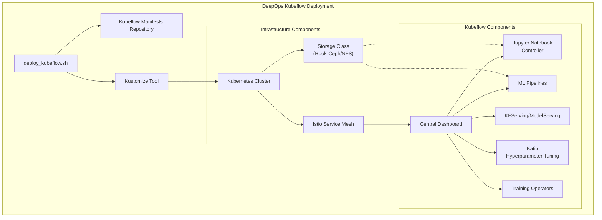
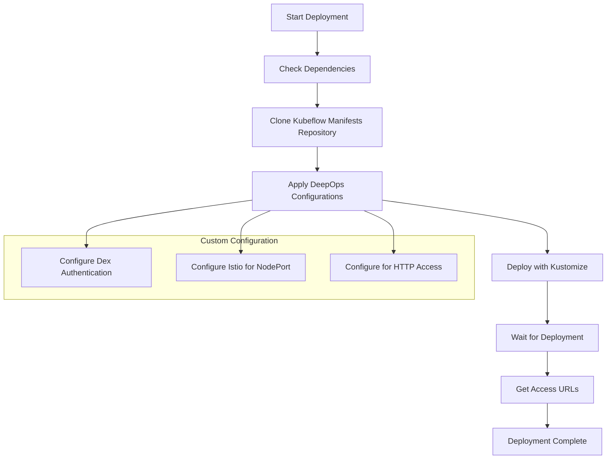
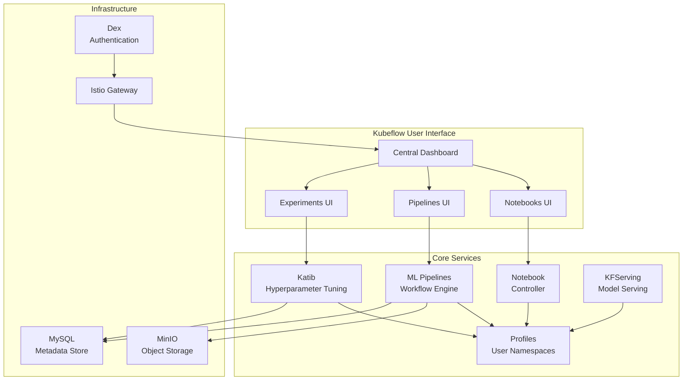

<!-- source: DeepWiki mcp.deepwiki.com · repo NVIDIA/deepops · page 2.3 Kubeflow Deployment · fetched 2026-10-26 -->

# Kubeflow Deployment

<details>
<summary>Relevant source files</summary>

The following files were used as context for generating this wiki page:

- [config.example/helm/rapids-dask.yml](config.example/helm/rapids-dask.yml)
- [docs/k8s-cluster/helm.md](docs/k8s-cluster/helm.md)
- [playbooks/k8s-cluster/container-registry.yml](playbooks/k8s-cluster/container-registry.yml)
- [roles/k8s-internal-container-registry/defaults/main.yml](roles/k8s-internal-container-registry/defaults/main.yml)
- [roles/k8s-internal-container-registry/tasks/main.yml](roles/k8s-internal-container-registry/tasks/main.yml)
- [roles/k8s-internal-container-registry/templates/values.yaml](roles/k8s-internal-container-registry/templates/values.yaml)
- [scripts/k8s/deploy_dashboard_user.sh](scripts/k8s/deploy_dashboard_user.sh)
- [scripts/k8s/deploy_kubeflow.sh](scripts/k8s/deploy_kubeflow.sh)
- [scripts/k8s/deploy_rook.sh](scripts/k8s/deploy_rook.sh)
- [workloads/examples/k8s/ingress-loadbalancer.yml](workloads/examples/k8s/ingress-loadbalancer.yml)
- [workloads/examples/k8s/ingress-nodeport.yml](workloads/examples/k8s/ingress-nodeport.yml)
- [workloads/services/k8s/dgxie/values.yaml](workloads/services/k8s/dgxie/values.yaml)

</details>


This document provides instructions for deploying Kubeflow on a Kubernetes cluster using DeepOps. Kubeflow is a machine learning toolkit for Kubernetes that makes deploying machine learning workflows on Kubernetes simple, portable, and scalable. This guide covers the prerequisites, deployment process, access methods, and management of your Kubeflow installation.

## Overview

DeepOps provides a streamlined deployment script for Kubeflow that handles the deployment of all required components, including:

- Kubeflow core components
- Istio for service mesh capabilities
- Dex for authentication
- Required storage components



Sources: [scripts/k8s/deploy_kubeflow.sh:1-288]()

## Prerequisites

Before deploying Kubeflow, ensure your environment meets the following requirements:

### 1. Kubernetes Cluster

A functioning Kubernetes cluster deployed via DeepOps. If you haven't deployed a Kubernetes cluster yet, refer to [Kubernetes Deployment](#2).

### 2. Storage Class

Kubeflow requires a default StorageClass for persisting data. The deployment script checks for this requirement:

```bash
kubectl get storageclass 2>&1 | grep "(default)" >/dev/null 2>&1
```

If no default StorageClass is found, the script will suggest:
- Using the NFS client provisioner: `ansible-playbook playbooks/k8s-cluster/nfs-client-provisioner.yml`
- Or provisioning Ceph storage: `./scripts/k8s/deploy_rook.sh`

Sources: [scripts/k8s/deploy_kubeflow.sh:104-111](), [scripts/k8s/deploy_rook.sh:1-202]()

### 3. System Requirements

Ensure your Kubernetes nodes have sufficient resources to run Kubeflow components:
- At least 4 CPUs per node
- At least 8GB RAM per node
- Sufficient disk space for Kubeflow components and user workloads

## Deployment Process

The Kubeflow deployment in DeepOps follows this process:



Sources: [scripts/k8s/deploy_kubeflow.sh:81-175]()

### Deployment Steps

1. **Run the deployment script**:

   ```bash
   ./scripts/k8s/deploy_kubeflow.sh
   ```

   This will:
   - Install required dependencies
   - Clone the Kubeflow manifests repository
   - Apply DeepOps-specific configurations
   - Deploy Kubeflow using Kustomize

2. **Wait for deployment to complete**:

   The script will print the Kubeflow dashboard URL once deployment is complete. Depending on your hardware, deployment may take 10-30 minutes.

3. **Verify the deployment** (optional):

   You can use the `-w` flag to wait for Kubeflow to be fully deployed and accessible:

   ```bash
   ./scripts/k8s/deploy_kubeflow.sh -w
   ```

Sources: [scripts/k8s/deploy_kubeflow.sh:280-287]()

### Customization Options

The deployment script uses several environment variables that can be set to customize the deployment:

| Variable | Description | Default |
|----------|-------------|---------|
| `KUBEFLOW_TIMEOUT` | Timeout for polling Kubeflow to start (seconds) | 600 |
| `KUBEFLOW_DEPLOY_TIMEOUT` | Timeout for the deployment process (seconds) | 1200 |
| `KUBEFLOW_MANIFESTS_VERSION` | Version of Kubeflow to deploy | v1.7.0 |
| `KUBEFLOW_MANIFESTS_URL` | URL of Kubeflow manifests repository | https://github.com/kubeflow/manifests |
| `KUBEFLOW_MANIFESTS_DEST` | Local destination for Kubeflow manifests | ${CONFIG_DIR}/kubeflow-install/manifests |

Sources: [scripts/k8s/deploy_kubeflow.sh:14-31]()

## Accessing Kubeflow

After deployment completes, the script will print connection information for the Kubeflow dashboard. You can also get this information again by running:

```bash
./scripts/k8s/deploy_kubeflow.sh -p
```

The default deployment configures Kubeflow to be accessible via:

1. **HTTP NodePort**:
   - URL: `http://<master-ip>:<nodePort>`
   - This is displayed in the terminal output after deployment

Sources: [scripts/k8s/deploy_kubeflow.sh:236-244](), [scripts/k8s/deploy_kubeflow.sh:248-259]()

### Authentication

By default, DeepOps configures Kubeflow with multi-user authentication through Dex. The default configurations are stored in:

```
${CONFIG_DIR}/files/kubeflow/dex-config-map.yaml
${CONFIG_DIR}/files/kubeflow/user-namespace-params.env
```

When accessing Kubeflow for the first time, you will need to:
1. Create a user account through the Dex authentication screen
2. Log in with your credentials
3. Create a namespace where your Kubeflow resources will reside

Sources: [scripts/k8s/deploy_kubeflow.sh:24-26]()

## Architecture Details

Kubeflow consists of several key components that work together to provide a comprehensive ML platform on Kubernetes:



Sources: [scripts/k8s/deploy_kubeflow.sh:12]()

### Key Components

1. **Central Dashboard**: The main interface for accessing all Kubeflow components

2. **Jupyter Notebooks**: Interactive Python notebooks for ML development
   - Notebook Controller: Manages Jupyter notebook servers
   - Jupyter Web App: Interface for creating and managing notebooks

3. **ML Pipelines**: Component for building and managing ML workflows
   - Pipeline Execution engine
   - Pipeline UI
   - MinIO for artifact storage
   - MySQL for metadata

4. **Katib**: Hyperparameter tuning and neural architecture search
   - Experiment controller
   - MySQL database for storing results

5. **Authentication and User Management**:
   - Dex: Identity service for authentication
   - Profiles: User namespace management

6. **Infrastructure Components**:
   - Istio: Service mesh providing routing and security
   - Storage: Persistent volume claims for notebooks and pipelines

## Management Operations

### Checking Deployment Status

To check if all Kubeflow components are running:

```bash
kubectl get pods -n kubeflow
```

The script polls for the following deployments to be available:
```
profiles-deployment
notebook-controller-deployment
centraldashboard
ml-pipeline
minio
mysql
jupyter-web-app-deployment
katib-mysql
```

Sources: [scripts/k8s/deploy_kubeflow.sh:12](), [scripts/k8s/deploy_kubeflow.sh:216-233]()

### Uninstalling Kubeflow

To remove Kubeflow from your cluster:

```bash
./scripts/k8s/deploy_kubeflow.sh -d
```

This removes the Kubeflow components but preserves the CRDs, istio-system namespace, and cert-manager that might be used by other applications.

Sources: [scripts/k8s/deploy_kubeflow.sh:188-211]()

### Debugging Tips

1. **Check pod status**:
   ```bash
   kubectl get pods -n kubeflow
   kubectl describe pod <pod-name> -n kubeflow
   ```

2. **View logs**:
   ```bash
   kubectl logs <pod-name> -n kubeflow
   ```

3. **Verify storage**:
   ```bash
   kubectl get pvc -n kubeflow
   ```

4. **Check Istio Gateway**:
   ```bash
   kubectl get svc -n istio-system
   ```

## Integrating with Other DeepOps Components

### Container Registry

If you're using the DeepOps internal container registry, you can use it to store custom container images for Kubeflow:

```bash
docker tag mymodel:latest registry.local:31500/mymodel:latest
docker push registry.local:31500/mymodel:latest
```

Then use the image in your Kubeflow pipelines or notebook servers.

Sources: [playbooks/k8s-cluster/container-registry.yml:1-23](), [roles/k8s-internal-container-registry/defaults/main.yml:1-22]()

### Ingress Configuration

By default, Kubeflow is deployed with Istio Ingress configured as NodePort. If you want to use an external load balancer, you can:

1. Deploy MetalLB using the DeepOps playbooks
2. Configure an Ingress resource for Kubeflow

Example configurations for Ingress are available in:
- NodePort configuration: [workloads/examples/k8s/ingress-nodeport.yml:1-24]()
- LoadBalancer configuration: [workloads/examples/k8s/ingress-loadbalancer.yml:1-24]()

## Conclusion

This document outlined the process for deploying Kubeflow on a DeepOps-managed Kubernetes cluster. Follow the deployment steps to set up a comprehensive machine learning platform that can handle the entire ML lifecycle from data preparation to model serving.

For general Kubernetes deployment information, see [Kubernetes Deployment](#2).
For GPU support in your Kubernetes cluster, which enhances ML workloads in Kubeflow, see [GPU Support in Kubernetes](#2.1).

---

