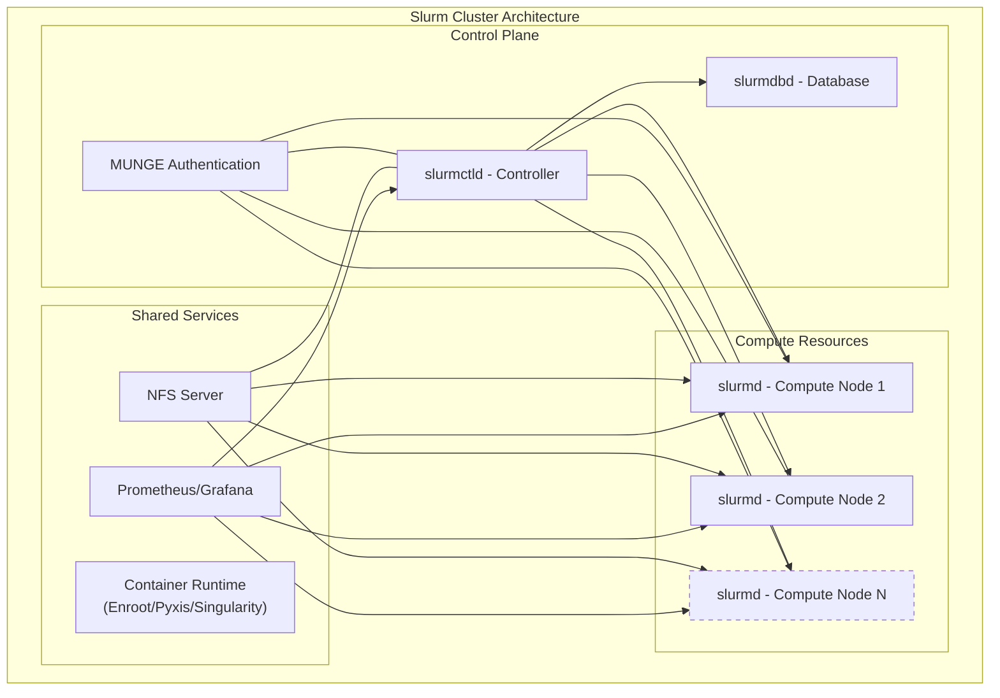
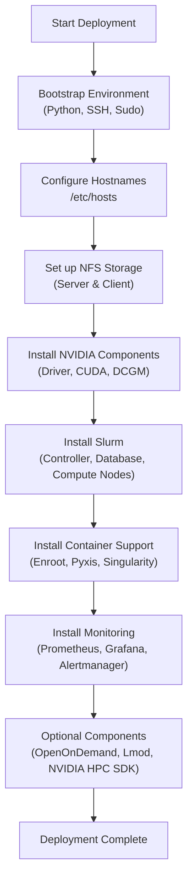
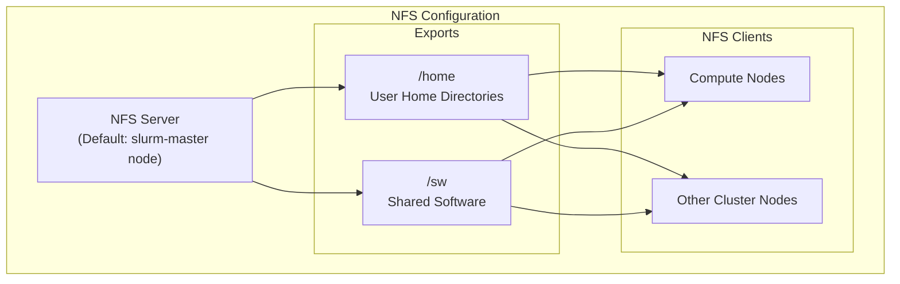
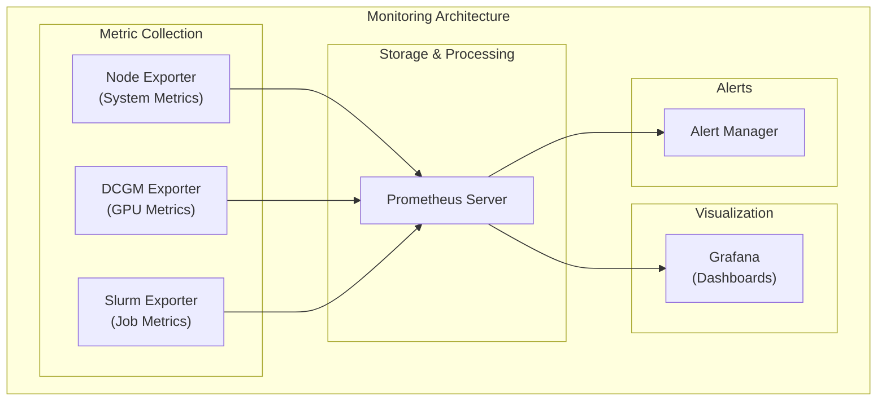

<!-- source: DeepWiki mcp.deepwiki.com · repo NVIDIA/deepops · page 3 Slurm Deployment · fetched 2026-10-26 -->

# Slurm Deployment

<details>
<summary>Relevant source files</summary>

The following files were used as context for generating this wiki page:

- [config.example/group_vars/all.yml](config.example/group_vars/all.yml)
- [config.example/group_vars/k8s-cluster.yml](config.example/group_vars/k8s-cluster.yml)
- [config.example/group_vars/slurm-cluster.yml](config.example/group_vars/slurm-cluster.yml)
- [docs/slurm-cluster/README.md](docs/slurm-cluster/README.md)
- [docs/slurm-cluster/dcgm.md](docs/slurm-cluster/dcgm.md)
- [docs/slurm-cluster/large-deployments.md](docs/slurm-cluster/large-deployments.md)
- [docs/slurm-cluster/nvml.md](docs/slurm-cluster/nvml.md)
- [docs/slurm-cluster/ood.md](docs/slurm-cluster/ood.md)
- [docs/slurm-cluster/slurm-monitor.md](docs/slurm-cluster/slurm-monitor.md)
- [docs/slurm-cluster/slurm-nfs.md](docs/slurm-cluster/slurm-nfs.md)
- [docs/slurm-cluster/slurm-perf-cluster.md](docs/slurm-cluster/slurm-perf-cluster.md)
- [docs/slurm-cluster/slurm-prolog-epilog/epilog-dcgmstats](docs/slurm-cluster/slurm-prolog-epilog/epilog-dcgmstats)
- [docs/slurm-cluster/slurm-prolog-epilog/hyperthreadingoff](docs/slurm-cluster/slurm-prolog-epilog/hyperthreadingoff)
- [docs/slurm-cluster/slurm-prolog-epilog/hyperthreadingon](docs/slurm-cluster/slurm-prolog-epilog/hyperthreadingon)
- [docs/slurm-cluster/slurm-prolog-epilog/prolog-dcgmstats](docs/slurm-cluster/slurm-prolog-epilog/prolog-dcgmstats)
- [docs/slurm-cluster/slurm-prolog-epilog/prolog-ecc](docs/slurm-cluster/slurm-prolog-epilog/prolog-ecc)
- [docs/slurm-cluster/slurm-prolog-epilog/prolog-mps](docs/slurm-cluster/slurm-prolog-epilog/prolog-mps)
- [docs/slurm-cluster/slurm-prolog-epilog/prolog-mps-per-gpu](docs/slurm-cluster/slurm-prolog-epilog/prolog-mps-per-gpu)
- [docs/slurm-cluster/slurm-usage.md](docs/slurm-cluster/slurm-usage.md)
- [docs/slurm-cluster/software-modules.md](docs/slurm-cluster/software-modules.md)
- [playbooks/k8s-cluster.yml](playbooks/k8s-cluster.yml)
- [playbooks/slurm-cluster.yml](playbooks/slurm-cluster.yml)
- [playbooks/slurm-cluster/alertmanager.yml](playbooks/slurm-cluster/alertmanager.yml)
- [roles/pyxis/defaults/main.yml](roles/pyxis/defaults/main.yml)
- [roles/pyxis/tasks/main.yml](roles/pyxis/tasks/main.yml)
- [roles/pyxis/tasks/pyxis.yml](roles/pyxis/tasks/pyxis.yml)
- [roles/slurm/defaults/main.yml](roles/slurm/defaults/main.yml)
- [roles/slurm/tasks/compute.yml](roles/slurm/tasks/compute.yml)
- [roles/slurm/tasks/controller.yml](roles/slurm/tasks/controller.yml)
- [roles/slurm/tasks/main.yml](roles/slurm/tasks/main.yml)
- [roles/slurm/tasks/munge.yml](roles/slurm/tasks/munge.yml)
- [roles/slurm/vars/redhat.yml](roles/slurm/vars/redhat.yml)
- [roles/slurm/vars/ubuntu.yml](roles/slurm/vars/ubuntu.yml)
- [scripts/k8s/install_helm.sh](scripts/k8s/install_helm.sh)

</details>


This page describes how to deploy a Slurm cluster using DeepOps. Slurm is an open-source workload manager designed for Linux clusters of all sizes. The DeepOps Slurm deployment provides a complete solution for high-performance computing (HPC) environments with NVIDIA GPUs, including job scheduling, resource management, monitoring, and container support.

For detailed information about using Slurm after deployment, see [Slurm Usage](#5) documentation.

## Architecture Overview

Below is a high-level architectural diagram of a Slurm cluster deployed with DeepOps:



Sources:
- [playbooks/slurm-cluster.yml:1-139]()
- [roles/slurm/tasks/main.yml:1-47]()
- [config.example/group_vars/slurm-cluster.yml:1-237]()

## Deployment Workflow

The following diagram illustrates the typical workflow for deploying a Slurm cluster with DeepOps:



Sources:
- [playbooks/slurm-cluster.yml:1-139]()
- [docs/slurm-cluster/README.md:1-246]()

## Prerequisites

Before deploying a Slurm cluster, ensure you have:

1. A control system to run the install process
2. One or more servers for Slurm controllers/login nodes
3. One or more servers for Slurm compute nodes
4. All nodes must have a supported operating system installed
5. Network connectivity between all nodes

For hardware-specific requirements like DGX systems, refer to [DGX Systems](#6.1) documentation.

Sources:
- [docs/slurm-cluster/README.md:20-25]()
- [docs/slurm-cluster/slurm-perf-cluster.md:32-42]()

## Installation Process

### 1. Set up your provisioning machine

```bash
./scripts/setup.sh
```

This installs Ansible and other required software on the provisioning machine.

### 2. Create and edit the Ansible inventory

Edit the inventory file to define your cluster structure:

```bash
vi config/inventory
```

Example inventory structure:
```
[slurm-master]
login01

[slurm-node]
node01
node02
node03

[slurm-cluster:children]
slurm-master
slurm-node
```

For high-availability deployments with multiple Slurm controllers, set `slurm_enable_ha: true` in your configuration.

### 3. Install Slurm

```bash
ansible-playbook -l slurm-cluster playbooks/slurm-cluster.yml
```

This playbook performs the complete Slurm cluster deployment.

Sources:
- [docs/slurm-cluster/README.md:26-78]()
- [playbooks/slurm-cluster.yml:1-159]()

## Key Components

### 1. Slurm Controller

The Slurm controller (`slurmctld`) is the central management daemon that tracks resource status, manages the job queue, and assigns work to compute nodes.

Key configuration files:
- `/etc/slurm/slurm.conf`: Main Slurm configuration
- `/etc/slurm/slurmdbd.conf`: Slurm database configuration
- `/etc/slurm/cgroup.conf`: Control group configuration

Sources:
- [roles/slurm/tasks/controller.yml:1-200]()
- [roles/slurm/defaults/main.yml:8-20]()

### 2. Slurm Compute Nodes

Compute nodes run the `slurmd` daemon and execute jobs assigned by the controller.

Key configuration:
- GPU detection and integration
- Resource limits and cgroups
- Security and access controls via PAM

Sources:
- [roles/slurm/tasks/compute.yml:1-212]()
- [config.example/group_vars/slurm-cluster.yml:11-22]()

### 3. Shared Storage with NFS

The deployment configures shared storage for user home directories and software:



Sources:
- [config.example/group_vars/slurm-cluster.yml:74-101]()
- [playbooks/slurm-cluster.yml:59-69]()

### 4. Container Support

DeepOps Slurm deployment includes integration with container technologies:

1. **Enroot**: Container runtime for unprivileged containers
2. **Pyxis**: Slurm plugin for container execution
3. **Singularity** (optional): Alternative container runtime

Configuration for container registry cache is also included to optimize container pulls.

Sources:
- [config.example/group_vars/slurm-cluster.yml:173-194]()
- [roles/pyxis/tasks/main.yml:1-46]()
- [roles/pyxis/tasks/pyxis.yml:1-69]()
- [playbooks/slurm-cluster.yml:152-158]()

### 5. Monitoring Stack

The monitoring solution includes:

1. **Prometheus**: Metrics collection and storage
2. **Grafana**: Visualization dashboards
3. **Alertmanager**: Alert management
4. **Exporters**: Node exporter, DCGM exporter, Slurm exporter



Sources:
- [config.example/group_vars/slurm-cluster.yml:222-237]()
- [playbooks/slurm-cluster.yml:96-126]()
- [playbooks/slurm-cluster/alertmanager.yml:1-11]()

## Configuration Options

DeepOps provides extensive configuration options for Slurm deployment. The primary configuration files are:

1. `config/group_vars/all.yml`: Global settings
2. `config/group_vars/slurm-cluster.yml`: Slurm-specific settings

Key configuration parameters include:

| Configuration Parameter | Description | Default Value |
|-------------------------|-------------|---------------|
| `slurm_version` | Slurm software version | "23.02.4" |
| `slurm_install_prefix` | Installation prefix | "/usr/local" |
| `slurm_cluster_name` | Cluster name | "deepops" |
| `slurm_manage_gpus` | Enable GPU management | true |
| `slurm_autodetect_nvml` | Detect GPUs using NVML | true |
| `slurm_enable_monitoring` | Enable Prometheus/Grafana | true |
| `slurm_enable_nfs_server` | Set up NFS server | true |
| `slurm_install_lmod` | Install Lmod for software modules | true |
| `slurm_install_enroot` | Install Enroot container runtime | true |
| `slurm_install_pyxis` | Install Pyxis Slurm plugin | true |
| `slurm_install_nhc` | Install Node Health Check | yes |
| `slurm_restrict_node_access` | Restrict SSH to nodes with jobs | true |

Sources:
- [config.example/group_vars/slurm-cluster.yml:1-237]()
- [roles/slurm/defaults/main.yml:1-146]()
- [config.example/group_vars/all.yml:1-308]()

## Advanced Features

### GPU Integration

Slurm is configured to manage NVIDIA GPUs, including:

1. **Automatic GPU detection**: Using NVML for precise resource tracking
2. **GPU topology awareness**: NUMA and PCIe topology for optimized scheduling
3. **Support for Multi-Instance GPU (MIG)**: For partitioning A100 and A30 GPUs

For MIG configuration, see [docs/slurm-cluster/nvml.md]().

Sources:
- [config.example/group_vars/slurm-cluster.yml:11-22]()
- [docs/slurm-cluster/nvml.md:1-227]()

### Node Health Check

The deployment includes Node Health Check (NHC) to verify that compute nodes are functioning correctly:

- Validates that CPU, memory, and GPUs are present
- Verifies essential services are running
- Automatically drains malfunctioning nodes

Sources:
- [config.example/group_vars/slurm-cluster.yml:198-212]()
- [docs/slurm-cluster/README.md:196-204]()

### Prolog and Epilog Scripts

DeepOps includes several prolog and epilog scripts that run before and after jobs:

- MPS (Multi-Process Service) management
- DCGM statistics collection
- ECC settings
- Hyperthreading control

Sources:
- [docs/slurm-cluster/README.md:190-194]()
- [docs/slurm-cluster/slurm-prolog-epilog/prolog-mps:1-25]()
- [docs/slurm-cluster/slurm-prolog-epilog/epilog-dcgmstats:1-9]()

### Software Module Management

The deployment can optionally install software module systems:

1. **Lmod**: Environment module system
2. **Spack**: Package manager for HPC software
3. **EasyBuild**: Software build and installation framework

Sources:
- [config.example/group_vars/slurm-cluster.yml:109-132]()
- [docs/slurm-cluster/software-modules.md:1-139]()

## Scaling for Large Deployments

For larger clusters, DeepOps provides options to:

1. **Cache container pulls**: Through container registry cache
2. **Separate functions on different hardware**:
   - Separate login nodes
   - Dedicated monitoring node
   - External NFS server
3. **Manually generate static configuration files**

Sources:
- [docs/slurm-cluster/large-deployments.md:1-146]()

## Validation

DeepOps includes a validation playbook to verify your Slurm deployment:

```bash
ansible-playbook -l slurm-cluster playbooks/slurm-cluster/slurm-validation.yml
```

This playbook verifies:
- Connectivity across nodes
- Job submission functionality
- GPU accessibility from jobs
- Container runtime functionality
- Multi-node communication using NCCL tests

Sources:
- [docs/slurm-cluster/README.md:77-184]()

## Related Documentation

- For more detailed information on using Slurm after deployment, see [Slurm Usage](#5)
- For monitoring information, see [Slurm Monitoring](#5.3)
- For special hardware considerations, see [DGX Systems](#6.1)
- For air-gapped deployments, see [Air-gapped Deployments](#6.2)

---

