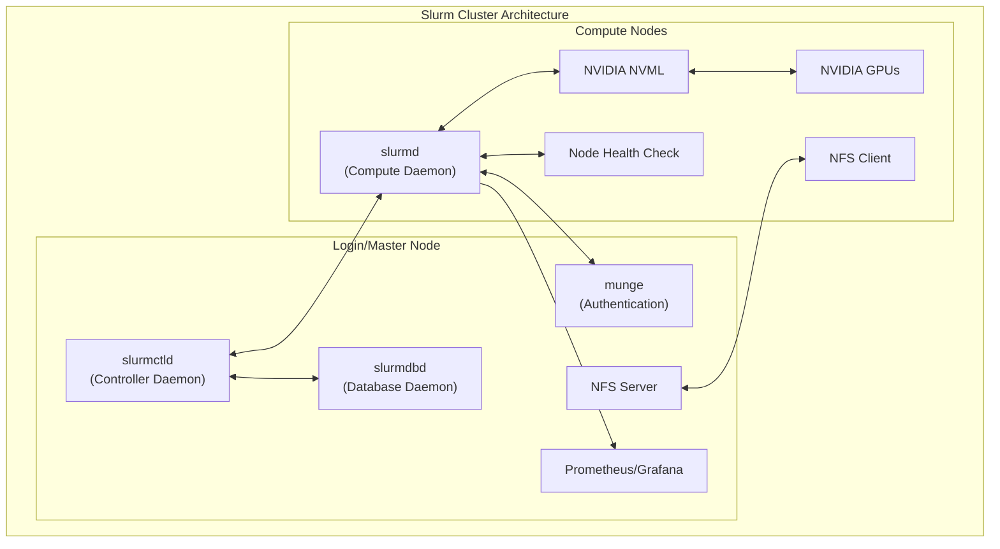
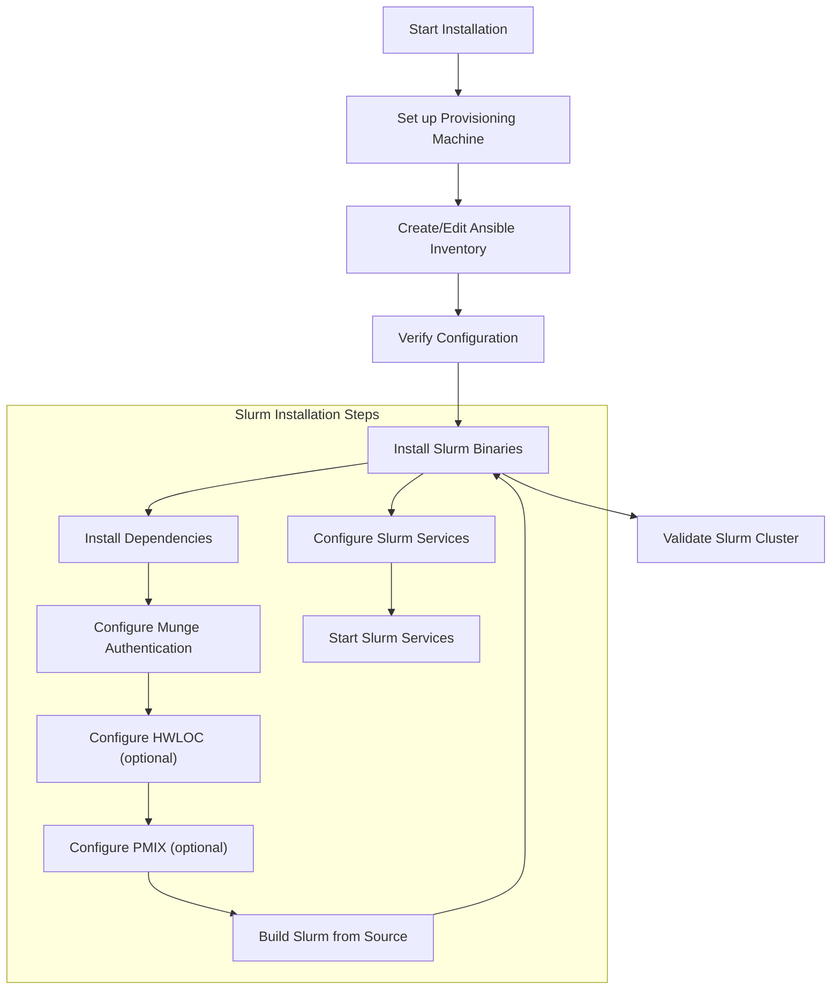
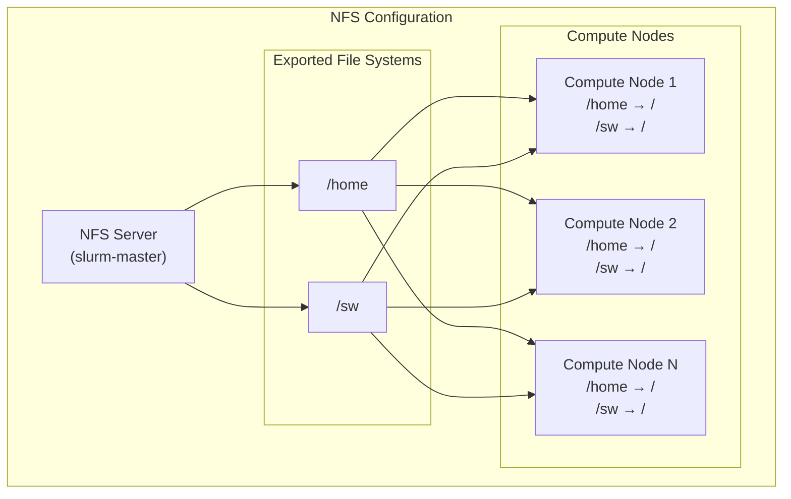
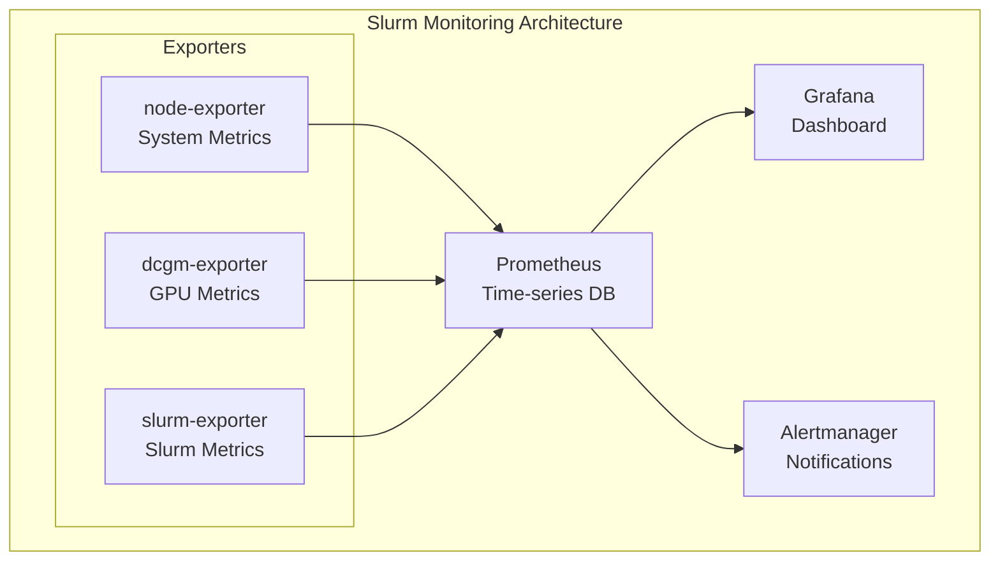

<!-- source: DeepWiki mcp.deepwiki.com · repo NVIDIA/deepops · page 3.1 Slurm Installation and Configuration · fetched 2026-10-26 -->

# Slurm Installation and Configuration

<details>
<summary>Relevant source files</summary>

The following files were used as context for generating this wiki page:

- [docs/slurm-cluster/README.md](docs/slurm-cluster/README.md)
- [docs/slurm-cluster/dcgm.md](docs/slurm-cluster/dcgm.md)
- [docs/slurm-cluster/large-deployments.md](docs/slurm-cluster/large-deployments.md)
- [docs/slurm-cluster/nvml.md](docs/slurm-cluster/nvml.md)
- [docs/slurm-cluster/ood.md](docs/slurm-cluster/ood.md)
- [docs/slurm-cluster/slurm-monitor.md](docs/slurm-cluster/slurm-monitor.md)
- [docs/slurm-cluster/slurm-nfs.md](docs/slurm-cluster/slurm-nfs.md)
- [docs/slurm-cluster/slurm-perf-cluster.md](docs/slurm-cluster/slurm-perf-cluster.md)
- [docs/slurm-cluster/slurm-prolog-epilog/epilog-dcgmstats](docs/slurm-cluster/slurm-prolog-epilog/epilog-dcgmstats)
- [docs/slurm-cluster/slurm-prolog-epilog/hyperthreadingoff](docs/slurm-cluster/slurm-prolog-epilog/hyperthreadingoff)
- [docs/slurm-cluster/slurm-prolog-epilog/hyperthreadingon](docs/slurm-cluster/slurm-prolog-epilog/hyperthreadingon)
- [docs/slurm-cluster/slurm-prolog-epilog/prolog-dcgmstats](docs/slurm-cluster/slurm-prolog-epilog/prolog-dcgmstats)
- [docs/slurm-cluster/slurm-prolog-epilog/prolog-ecc](docs/slurm-cluster/slurm-prolog-epilog/prolog-ecc)
- [docs/slurm-cluster/slurm-prolog-epilog/prolog-mps](docs/slurm-cluster/slurm-prolog-epilog/prolog-mps)
- [docs/slurm-cluster/slurm-prolog-epilog/prolog-mps-per-gpu](docs/slurm-cluster/slurm-prolog-epilog/prolog-mps-per-gpu)
- [docs/slurm-cluster/slurm-usage.md](docs/slurm-cluster/slurm-usage.md)
- [docs/slurm-cluster/software-modules.md](docs/slurm-cluster/software-modules.md)
- [roles/openmpi/molecule/default/converge.yml](roles/openmpi/molecule/default/converge.yml)
- [roles/openmpi/molecule/default/prepare.yml](roles/openmpi/molecule/default/prepare.yml)
- [roles/openmpi/molecule/default/verify.yml](roles/openmpi/molecule/default/verify.yml)
- [roles/openmpi/tasks/main.yml](roles/openmpi/tasks/main.yml)
- [roles/slurm/meta/main.yml](roles/slurm/meta/main.yml)
- [roles/slurm/tasks/build.yml](roles/slurm/tasks/build.yml)
- [roles/slurm/tasks/hwloc.yml](roles/slurm/tasks/hwloc.yml)
- [roles/slurm/tasks/pmix.yml](roles/slurm/tasks/pmix.yml)
- [roles/slurm/tasks/service-files.yml](roles/slurm/tasks/service-files.yml)

</details>


## Purpose and Scope

This document details the process of installing and configuring a Slurm cluster using NVIDIA DeepOps. It covers the steps to deploy Slurm as a workload manager for GPU-accelerated computing clusters, including installation, basic configuration options, and essential components. For related information on node health checking in Slurm clusters, see [Node Health Checking](#3.2), and for software module management in Slurm, see [Software Module Management](#3.3).

## Overview of Slurm in DeepOps

Slurm is one of the two primary deployment options in DeepOps (alongside Kubernetes) for managing GPU-enabled compute clusters. It provides job scheduling, resource allocation, and monitoring capabilities tailored specifically for high-performance computing workloads.



Sources: 
- [docs/slurm-cluster/README.md:1-246]()
- [docs/slurm-cluster/slurm-monitor.md:1-105]()
- [docs/slurm-cluster/nvml.md:1-227]()

## Prerequisites

Before installing Slurm with DeepOps, ensure you have:

1. **Hardware Requirements**:
   - A control system to run the installation process
   - A server to act as the Slurm controller/login node
   - One or more servers with NVIDIA GPUs to act as compute nodes

2. **Operating System Requirements**:
   - A supported Linux distribution installed on all nodes (Ubuntu or RHEL/CentOS)
   - SSH access to all nodes from the provisioning machine
   - User with sudo privileges on all nodes

Sources:
- [docs/slurm-cluster/README.md:20-25]()
- [docs/slurm-cluster/slurm-perf-cluster.md:32-42]()

## Installation Process

The installation of Slurm in DeepOps follows these major steps:



Sources:
- [docs/slurm-cluster/README.md:26-76]()
- [roles/slurm/tasks/build.yml:1-252]()

### 1. Set Up Provisioning Machine

First, set up the provisioning machine with the DeepOps repository and dependencies:

```bash
# Clone the DeepOps repository
git clone https://github.com/NVIDIA/deepops.git
cd deepops

# Install software prerequisites and copy default configuration
./scripts/setup.sh
```

This will install Ansible and other required software, and copy the example configuration to the `config` directory.

Sources:
- [docs/slurm-cluster/README.md:32-39]()

### 2. Create and Edit Ansible Inventory

The Ansible inventory defines the servers in your cluster and their roles:

```bash
# Edit the inventory file
vi config/inventory
```

Example inventory structure:

```ini
[all]
login-node-01
compute-node-01
compute-node-02

[slurm-master]
login-node-01

[slurm-node]
compute-node-01
compute-node-02

[slurm-nfs]
login-node-01

[slurm-nfs-client:children]
slurm-node

[slurm-metric:children]
slurm-master

[slurm-login:children]
slurm-master

[slurm-cluster:children]
slurm-master
slurm-node
slurm-nfs
slurm-nfs-client
slurm-metric
slurm-login
```

You can also customize configuration parameters in `config/group_vars/slurm-cluster.yml`.

Sources:
- [docs/slurm-cluster/README.md:41-58]()
- [docs/slurm-cluster/large-deployments.md:67-145]()

### 3. Verify Configuration

Verify that your Ansible control node can reach all servers:

```bash
ansible all -m raw -a "hostname"
```

Sources:
- [docs/slurm-cluster/README.md:62-64]()

### 4. Install Slurm

Run the Ansible playbook to install and configure Slurm:

```bash
# NOTE: If SSH requires a password, add: `-k`
# NOTE: If sudo on remote machine requires a password, add: `-K`
# NOTE: If SSH user is different than current user, add: `-u <user>`
ansible-playbook -l slurm-cluster playbooks/slurm-cluster.yml
```

This playbook will:
1. Install and configure Slurm packages
2. Configure NFS for shared storage
3. Set up monitoring with Prometheus and Grafana
4. Configure node health checks

Sources:
- [docs/slurm-cluster/README.md:66-75]()

## Slurm Build and Configuration Process

DeepOps builds and installs Slurm from source to ensure optimal configuration for GPU clusters.

### Build Process

The Slurm build process includes:

1. Checking for existing Slurm installation and comparing versions
2. Installing build dependencies
3. Downloading Slurm source code
4. Building and installing Slurm components

```bash
# The build process is managed by Ansible with variables controlling:
slurm_version: "21.08.8"               # Slurm version to build
slurm_force_rebuild: false             # Force rebuild even if already installed
slurm_install_prefix: "/usr/local"     # Installation prefix
slurm_configure: "./configure ..."     # Configure options
```

The build process also includes building supporting libraries if enabled:
- MUNGE (authentication)
- HWLOC (Hardware Locality)
- PMIX (Process Management Interface)

Sources:
- [roles/slurm/tasks/build.yml:33-252]()
- [roles/slurm/tasks/hwloc.yml:1-114]()
- [roles/slurm/tasks/pmix.yml:1-128]()

### Configuring System Services

After building Slurm, DeepOps sets up the necessary service files for systemd:

- `slurmctld.service` - Slurm controller daemon (on master nodes)
- `slurmdbd.service` - Slurm database daemon (on master nodes)
- `slurmd.service` - Slurm compute daemon (on compute nodes)

Sources:
- [roles/slurm/tasks/service-files.yml:1-24]()

## GPU Support Configuration

### NVML Integration

DeepOps supports GPU auto-detection through NVIDIA Management Library (NVML). This integration allows Slurm to automatically discover and configure GPUs on compute nodes.

To enable NVML auto-detection, set the following variable in your DeepOps configuration:

```yaml
slurm_autodetect_nvml: true
```

If building a new cluster, follow the standard deployment steps. For an existing cluster, run:

```bash
ansible-playbook -l slurm-cluster -e '{"slurm_force_rebuild": true}' playbooks/slurm-cluster/slurm.yml
```

Sources:
- [docs/slurm-cluster/nvml.md:1-59]()

### Multi-Instance GPU (MIG) Support

For systems with NVIDIA A100 or other MIG-capable GPUs, DeepOps can configure MIG instances for more granular GPU resource allocation:

```bash
ansible-playbook -l slurm-node -e mig_manager_profile="all-1g.10gb" playbooks/nvidia-software/nvidia-mig.yml
```

For MIG configurations, you'll need to customize the `slurm.conf` to specify the number and type of MIG instances:

```
NodeName=dgx01 Gres=gpu:3g.40gb:8,gpu:2g.20gb:8,gpu:1g.10gb:16 CPUs=256 ...
```

Sources:
- [docs/slurm-cluster/nvml.md:61-226]()

## Shared Filesystem Configuration

DeepOps configures NFS for sharing data across the Slurm cluster by default.



To customize the NFS configuration, you can modify the following variables:

```yaml
# NFS exports from the server
nfs_exports:
  - path: "/home"
    options: "*(rw,sync,no_root_squash)"
  - path: "/sw"
    options: "*(rw,sync,no_root_squash)"

# NFS mounts on clients
nfs_mounts:
  - mountpoint: "/home"
    server: "login-node-01"
    path: "/home"
    options: "defaults,nofail,noatime"
  - mountpoint: "/sw"
    server: "login-node-01"
    path: "/sw"
    options: "defaults,nofail,noatime"
```

To use a separate NFS server or disable NFS:

```yaml
# For separate NFS server
slurm_enable_nfs_server: false
nfs_client_group: "slurm-cluster"

# To disable NFS completely
slurm_enable_nfs_server: false
slurm_enable_nfs_client_nodes: false
```

Sources:
- [docs/slurm-cluster/slurm-nfs.md:1-96]()

## Monitoring Configuration

DeepOps sets up monitoring for Slurm clusters using Prometheus and Grafana:



The monitoring stack includes:

- **Prometheus**: Time-series database collecting metrics
- **Grafana**: Visualization dashboard for metrics (accessible at http://\<slurm-master\>:3000)
- **DCGM Exporter**: Exports GPU metrics
- **Node Exporter**: Exports system metrics
- **Slurm Exporter**: Exports Slurm-specific metrics

Sources:
- [docs/slurm-cluster/README.md:205-213]()
- [docs/slurm-cluster/slurm-monitor.md:1-105]()
- [docs/slurm-cluster/dcgm.md:1-19]()

## Advanced Configuration Options

### Prolog and Epilog Scripts

DeepOps includes prolog and epilog scripts for Slurm that enable special configurations when jobs start and finish:

1. **MPS (Multi-Process Service)**: Enable NVIDIA MPS for better GPU sharing
2. **DCGM Stats**: Collect detailed GPU statistics during job execution
3. **ECC**: Enable/disable ECC on GPUs
4. **Hyperthreading**: Enable/disable CPU hyperthreading

These scripts are triggered by job comments. For example:
```bash
# Submit job with MPS enabled
sbatch --comment=mps myjob.sh
```

Sources:
- [docs/slurm-cluster/README.md:191-194]()
- [docs/slurm-cluster/slurm-prolog-epilog/prolog-mps:1-24]()
- [docs/slurm-cluster/slurm-prolog-epilog/prolog-mps-per-gpu:1-59]()
- [docs/slurm-cluster/slurm-prolog-epilog/prolog-dcgmstats:1-11]()
- [docs/slurm-cluster/slurm-prolog-epilog/epilog-dcgmstats:1-9]()
- [docs/slurm-cluster/slurm-prolog-epilog/prolog-ecc:1-23]()
- [docs/slurm-cluster/slurm-prolog-epilog/hyperthreadingon:1-9]()
- [docs/slurm-cluster/slurm-prolog-epilog/hyperthreadingoff:1-14]()

### Large Cluster Deployments

For larger clusters, DeepOps provides options to:

1. **Cache container pulls**: Deploy a caching proxy to reduce pulls from upstream registries
2. **Generate static configuration files**: Manually create and manage static files for cluster-wide configuration
3. **Separate specific functions**:
   - Separate login nodes
   - Separate monitoring node
   - Separate NFS server

Example configuration for separating login nodes:
```ini
# Instead of:
[slurm-login:children]
slurm-master

# Use:
[slurm-login]
login01
login02
```

Sources:
- [docs/slurm-cluster/large-deployments.md:1-146]()

### Container Support

DeepOps installs container support for Slurm by default:

- **Pyxis**: Slurm plugin for container execution
- **Enroot**: Unprivileged container runtime
- **Singularity**: Optional container platform that can be enabled with `slurm_cluster_install_singularity: yes`

This allows running containerized workloads within Slurm jobs, which is particularly useful for reproducible research and standardized environments.

Sources:
- [docs/slurm-cluster/README.md:238-240]()

## Validation and Usage

### Validating the Slurm Installation

DeepOps provides a validation playbook to verify that Slurm can run GPU jobs:

```bash
ansible-playbook -l slurm-cluster playbooks/slurm-cluster/slurm-validation.yml
```

This runs NCCL tests across all nodes to verify cluster connectivity and performance.

Sources:
- [docs/slurm-cluster/README.md:77-184]()

### Basic Slurm Usage

After installation, users can interact with the Slurm cluster using standard Slurm commands:

```bash
# Check cluster status
sinfo

# Run a job on a node
srun hostname

# Request GPUs
srun --gres=gpu:2 nvidia-smi

# Start an interactive session
srun --pty /bin/bash
```

For more information on using Slurm, refer to the Slurm usage documentation.

Sources:
- [docs/slurm-cluster/slurm-usage.md:1-142]()

## Optional Features

### Open OnDemand

Open OnDemand provides a web interface for Slurm clusters, allowing users to submit and monitor jobs through a browser. 

To install Open OnDemand, set `install_open_ondemand: yes` before running the `slurm-cluster.yml` playbook.

After installation, access Open OnDemand at http://\<slurm-master\>:9050/.

Sources:
- [docs/slurm-cluster/README.md:234-236]()
- [docs/slurm-cluster/ood.md:1-59]()

### Software Module Management

DeepOps can install and configure software module management systems:

1. **Spack**: A flexible package manager for HPC
2. **EasyBuild**: A software build and installation framework

To install Spack:
```bash
ansible-playbook -l slurm-cluster playbooks/slurm-cluster/spack-modules.yml
```

To install EasyBuild:
```bash
ansible-playbook -l slurm-cluster playbooks/slurm-cluster/easybuild-modules.yml
```

Sources:
- [docs/slurm-cluster/software-modules.md:1-139]()

## Summary

This document has covered the process of installing and configuring a Slurm cluster with NVIDIA DeepOps, including the build process, GPU integration, shared filesystem setup, monitoring configuration, and advanced options for customizing your Slurm deployment. For specific use cases or larger deployments, refer to the additional documentation on large deployments, high-performance configurations, and specialized hardware support.

---

