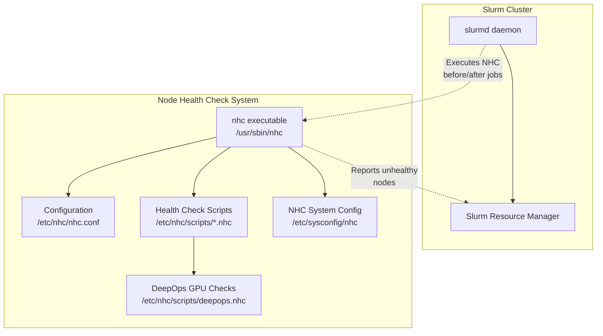
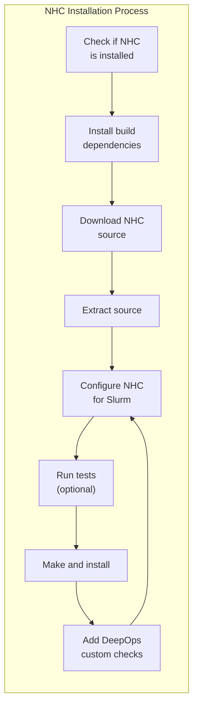
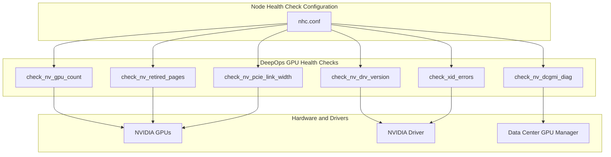

<!-- source: DeepWiki mcp.deepwiki.com · repo NVIDIA/deepops · page 3.2 Node Health Checking · fetched 2026-10-26 -->

# Node Health Checking

<details>
<summary>Relevant source files</summary>

The following files were used as context for generating this wiki page:

- [roles/nhc/defaults/main.yml](roles/nhc/defaults/main.yml)
- [roles/nhc/files/deepops.nhc](roles/nhc/files/deepops.nhc)
- [roles/nhc/tasks/main.yml](roles/nhc/tasks/main.yml)
- [roles/nhc/templates/nhc.conf.example-dgxa100](roles/nhc/templates/nhc.conf.example-dgxa100)
- [roles/nhc/templates/nhc.conf.j2](roles/nhc/templates/nhc.conf.j2)
- [roles/nhc/templates/sysconfig_nhc.j2](roles/nhc/templates/sysconfig_nhc.j2)
- [roles/nhc/vars/main.yml](roles/nhc/vars/main.yml)
- [roles/nhc/vars/ubuntu-20.04.yml](roles/nhc/vars/ubuntu-20.04.yml)
- [roles/nhc/vars/ubuntu.yml](roles/nhc/vars/ubuntu.yml)

</details>


Node Health Check (NHC) is a system for monitoring and validating the health status of compute nodes in a Slurm cluster. This document covers how to configure and use NHC in DeepOps, with a focus on GPU-specific health checks.

For general information about Slurm deployment, see [Slurm Deployment](#3).

## Overview

The Node Health Check (NHC) system provides a framework to detect and respond to various hardware, software, and configuration issues on compute nodes. When integrated with Slurm, NHC can automatically mark problematic nodes as down and prevent job scheduling on unhealthy nodes.

DeepOps extends NHC with GPU-specific health checks designed for NVIDIA GPU clusters, including checks for driver versions, PCIe link width, retired pages, and more.



Sources: [roles/nhc/tasks/main.yml:86-93](roles/nhc/tasks/main.yml:86-93), [roles/nhc/templates/sysconfig_nhc.j2](roles/nhc/templates/sysconfig_nhc.j2)

## Installation and Configuration

DeepOps installs NHC by building from source and configuring it to work with Slurm. The installation process is handled by Ansible during the Slurm cluster deployment.



Sources: [roles/nhc/tasks/main.yml:14-76](roles/nhc/tasks/main.yml:14-76), [roles/nhc/defaults/main.yml](roles/nhc/defaults/main.yml)

### Default Configuration

The default NHC configuration in DeepOps provides essential checks for:

1. CPU and memory configuration
2. Filesystem mount status and space
3. Network interfaces
4. Critical system services
5. GPU-specific checks when GPUs are present

This configuration is applied through Ansible templates, which adjust checks based on the detected hardware.

Sources: [roles/nhc/templates/nhc.conf.j2](roles/nhc/templates/nhc.conf.j2), [roles/nhc/tasks/main.yml:86-93](roles/nhc/tasks/main.yml:86-93)

### Slurm Integration

NHC is integrated with Slurm through the system configuration, which tells NHC to use Slurm as the resource manager. This integration allows Slurm to automatically execute health checks and take action based on the results.

Key configuration settings:

```
PATH=/sbin:/usr/sbin:/bin:/usr/bin:/usr/local/bin
NHC_RM=slurm
SLURM_SINFO=/usr/local/bin/sinfo
SLURM_SCONTROL=/usr/local/bin/scontrol
```

Sources: [roles/nhc/templates/sysconfig_nhc.j2](roles/nhc/templates/sysconfig_nhc.j2)

## GPU-Specific Health Checks

DeepOps extends NHC with custom checks specifically designed for GPU clusters. These checks help ensure that GPUs are functioning correctly and are properly configured.



Sources: [roles/nhc/files/deepops.nhc](roles/nhc/files/deepops.nhc), [roles/nhc/templates/nhc.conf.j2:23-46](roles/nhc/templates/nhc.conf.j2:23-46)

The table below describes the GPU-specific health checks provided by DeepOps:

| Check Function | Description | Command Used |
|----------------|-------------|-------------|
| `check_nv_drv_version` | Verifies GPU driver matches expected version | `/proc/driver/nvidia/version` |
| `check_nv_gpu_count` | Ensures expected number of GPUs are visible | `nvidia-smi -L` |
| `check_nv_retired_pages` | Checks for pending retired GPU memory pages | `nvidia-smi --query-gpu=retired_pages.pending` |
| `check_nv_pcie_link_width` | Confirms PCIe link width meets expectations | `nvidia-smi --query-gpu=pcie.link.width.current` |
| `check_nv_dcgmi_diag` | Runs DCGM diagnostic checks | `dcgmi diag -r 1` |
| `check_xid_errors` | Examines system logs for GPU XID errors | `journalctl` |

Sources: [roles/nhc/files/deepops.nhc:3-97](roles/nhc/files/deepops.nhc:3-97)

### Example GPU Checks

The default configuration enables GPU checks automatically when GPUs are detected:

```

# Check GPU count
 {{ ansible_hostname }} || check_nv_gpu_count {{ ansible_local.gpus.count }}

# Optional: run Data Center GPU Manager diagnostic as health check.
# Requires that DCGM be installed.
# {{ ansible_hostname }} || check_nv_dcgmi_diag

# Optional: check NVIDIA driver version against expected version.
# {{ ansible_hostname }} || check_nv_drv_version 450.51.06

# Optional: check for retired pages pending.
# {{ ansible_hostname }} || check_nv_retired_pages

# Optional: check PCIe width is correct for your configuration
# {{ ansible_hostname }} || check_nv_pcie_link_width 16

```

Sources: [roles/nhc/templates/nhc.conf.j2:23-46](roles/nhc/templates/nhc.conf.j2:23-46)

## Example NHC Configuration for DGX Systems

DeepOps includes an example NHC configuration specifically for NVIDIA DGX A100 systems. This configuration provides a comprehensive set of checks for high-end GPU servers, including:

1. CPU and memory validation
2. Network interface checks (Ethernet and InfiniBand)
3. PCIe link width validation
4. Storage and filesystem checks
5. Service monitoring
6. GPU health verification

This example can be used as a template for configuring NHC on similar high-performance systems.

Sources: [roles/nhc/templates/nhc.conf.example-dgxa100](roles/nhc/templates/nhc.conf.example-dgxa100)

## Customizing NHC Configuration

To customize NHC for your environment, you can modify the following:

1. **Main NHC Configuration**: Edit `/etc/nhc/nhc.conf` to adjust which checks run on which nodes
2. **System Configuration**: Configure `/etc/sysconfig/nhc` to change runtime behavior
3. **Custom Checks**: Add your own checks to `/etc/nhc/scripts/`

### NHC Configuration Syntax

The syntax of the NHC configuration file uses patterns to match hostnames followed by checks to run:

```
# Format: <hostmask> || <check> [<check> ...]
node01 || check_hw_cpuinfo 2 32 64
node[02-10] || check_hw_physmem 128GB 256GB
* || check_fs_mount_rw /
* || check_ps_service -u root sshd
```

Sources: [roles/nhc/templates/nhc.conf.j2](roles/nhc/templates/nhc.conf.j2)

## Troubleshooting NHC

If nodes are being incorrectly marked as unhealthy, you can:

1. Run NHC manually on a node with debugging output:
   ```
   /usr/sbin/nhc -d
   ```

2. Check which specific tests are failing:
   ```
   /usr/sbin/nhc -d | grep FAIL
   ```

3. Verify that the GPU-specific checks are working correctly:
   ```
   /usr/sbin/nhc -d | grep -E 'check_nv_|GPU'
   ```

## Best Practices

1. **Start Simple**: Begin with basic checks and gradually add more as you understand your environment
2. **Monitor Impact**: Some checks (like DCGM diagnostics) can be resource-intensive
3. **Regular Updates**: Update health check criteria when hardware or software configurations change
4. **Driver Version Management**: Use `check_nv_drv_version` to enforce consistent driver versions across the cluster
5. **Custom Checks**: Develop site-specific checks for your unique hardware or configuration needs

Sources: [roles/nhc/files/deepops.nhc](roles/nhc/files/deepops.nhc), [roles/nhc/templates/nhc.conf.j2](roles/nhc/templates/nhc.conf.j2), [roles/nhc/templates/nhc.conf.example-dgxa100](roles/nhc/templates/nhc.conf.example-dgxa100)

---

