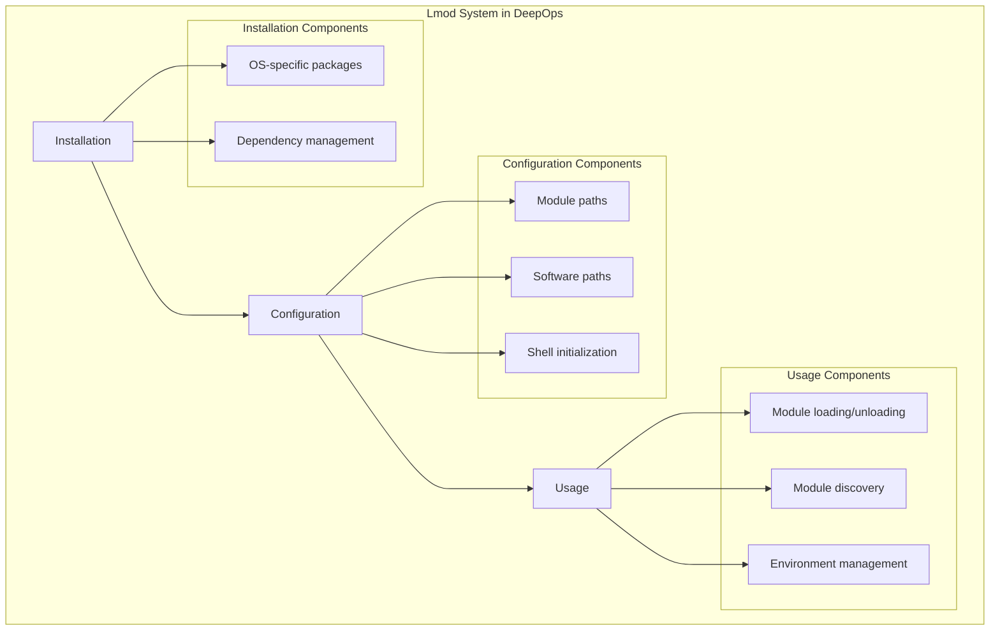
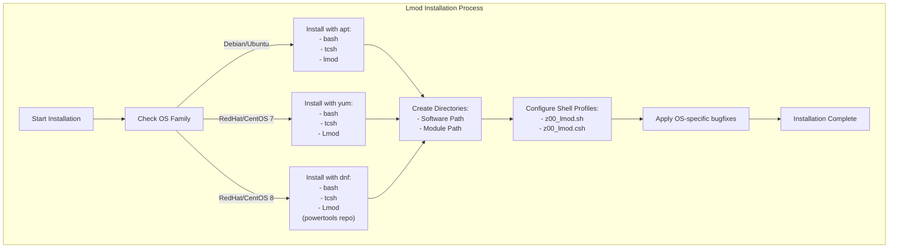
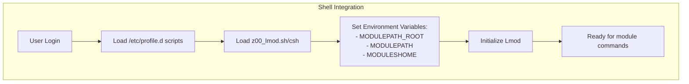

<!-- source: DeepWiki mcp.deepwiki.com · repo NVIDIA/deepops · page 3.3 Software Module Management · fetched 2026-10-26 -->

# Software Module Management

<details>
<summary>Relevant source files</summary>

The following files were used as context for generating this wiki page:

- [roles/lmod/tasks/main.yml](roles/lmod/tasks/main.yml)
- [roles/lmod/templates/z00_lmod.csh](roles/lmod/templates/z00_lmod.csh)

</details>


This document describes how DeepOps implements software environment module management for Slurm clusters using the Lmod system. Lmod allows users and administrators to dynamically modify their environment by loading and unloading software modules, making it easy to manage multiple versions of software, dependencies, and toolchains in HPC environments.

For information about overall Slurm deployment, see [Slurm Deployment](#3). For details on Slurm installation and configuration, see [Slurm Installation and Configuration](#3.1).

## What is Lmod?

Lmod is a modern environment module system that enables users to easily switch between different versions of compilers, libraries, and applications. It is specifically designed for HPC environments and is widely used in Slurm-based clusters.

Key features of Lmod in DeepOps:

- Dynamic modification of environment variables (PATH, LD_LIBRARY_PATH, etc.)
- Support for module hierarchies
- Compatible with both bash and csh/tcsh shells
- Consistent environment management across the cluster

Sources: [roles/lmod/tasks/main.yml:1-5]()

## Lmod Architecture in DeepOps



Sources: [roles/lmod/tasks/main.yml:20-48]()

## Installation Process

DeepOps installs Lmod using the Ansible role system. The installation process varies depending on the operating system:

| OS Family | OS Version | Package Manager | Package Name |
|-----------|------------|-----------------|--------------|
| Debian/Ubuntu | All | apt | lmod |
| RedHat/CentOS | 7 | yum | Lmod |
| RedHat/CentOS | 8 | dnf | Lmod (from powertools repo) |

The installation also includes necessary dependencies like bash and tcsh shell support.



Sources: [roles/lmod/tasks/main.yml:20-48]()

## Directory Structure

DeepOps sets up two primary directories for Lmod:

1. **Software Path** (`sm_software_path`): Where software packages are installed
2. **Module Path** (`sm_module_path`): Where module files are stored

The Ansible role creates these directories with appropriate permissions:

```
Module Root Directory (sm_module_root)
├── Module Path (sm_module_path)
│   ├── Core modules
│   └── OS-specific modules
└── Software Path (sm_software_path)
    ├── Application 1
    │   ├── Version 1
    │   └── Version 2
    ├── Application 2
    └── ...
```

Sources: [roles/lmod/tasks/main.yml:50-62]()

## Shell Configuration

DeepOps configures both bash and csh/tcsh shells to automatically initialize Lmod when a user logs in:

1. **Bash/sh configuration**: Implemented through `/etc/profile.d/z00_lmod.sh`
2. **Csh/tcsh configuration**: Implemented through `/etc/profile.d/z00_lmod.csh`

The configuration sets important environment variables:

- `MODULEPATH_ROOT`: Base directory for module hierarchy
- `MODULEPATH`: Actual path to look for modules
- `MODULESHOME`: Location of Lmod installation



Sources: [roles/lmod/tasks/main.yml:64-84](), [roles/lmod/templates/z00_lmod.csh:1-50]()

## Ubuntu-Specific Bugfix

For Ubuntu 18.04, DeepOps implements a bugfix related to the posix_c Lua module by creating a symbolic link:

```
/usr/lib/x86_64-linux-gnu/lua/5.X/posix.so → /usr/lib/x86_64-linux-gnu/lua/5.X/posix_c.so
```

This addresses a known Debian bug (#891541) that could prevent Lmod from functioning correctly.

Sources: [roles/lmod/tasks/main.yml:86-103]()

## Basic Usage

Once installed, users can interact with Lmod using standard module commands:

| Command | Description |
|---------|-------------|
| `module avail` | Show available modules |
| `module list` | Show currently loaded modules |
| `module load <module>` | Load a module |
| `module unload <module>` | Unload a module |
| `module purge` | Unload all modules |
| `module show <module>` | Show details about a module |
| `module help <module>` | Get help for a module |

Example session:
```bash
$ module avail
$ module load gcc/9.3.0
$ module load cuda/11.0
$ module list
$ module unload cuda
$ module purge
```

## Customizing Lmod in DeepOps

To customize the Lmod installation in DeepOps, you can modify the following variables in your inventory or group variables:

| Variable | Description | Default |
|----------|-------------|---------|
| `sm_module_root` | Base directory for module hierarchy | Varies by OS |
| `sm_module_path` | Path to module files | Set in configuration |
| `sm_software_path` | Path to installed software | Set in configuration |

The default configuration ensures that modules are available across the cluster and provide a consistent environment for all users.

Sources: [roles/lmod/tasks/main.yml:50-62](), [roles/lmod/templates/z00_lmod.csh:31-34]()

## Creating Custom Modules

While DeepOps provides the Lmod infrastructure, it does not include predefined module files. Administrators should create their own module files based on installed software.

A typical module file structure might look like:

```
<sm_module_path>/
├── Core/
│   ├── compiler/
│   │   ├── gcc/7.3.0.lua
│   │   └── gcc/9.3.0.lua
│   ├── cuda/
│   │   ├── 10.2.lua
│   │   └── 11.0.lua
│   └── ...
└── <OS-specific>/
    └── ...
```

## Integration with Slurm

Lmod integrates well with Slurm by providing a consistent software environment across compute nodes. Users can specify required modules in their job scripts:

```bash
#!/bin/bash
#SBATCH --job-name=test
#SBATCH --nodes=1
#SBATCH --ntasks=1

# Load required modules
module purge
module load gcc/9.3.0
module load cuda/11.0
module load openmpi/4.0.3

# Run application
./my_application
```

This ensures that jobs run with the same software environment regardless of which compute node they land on.

---

