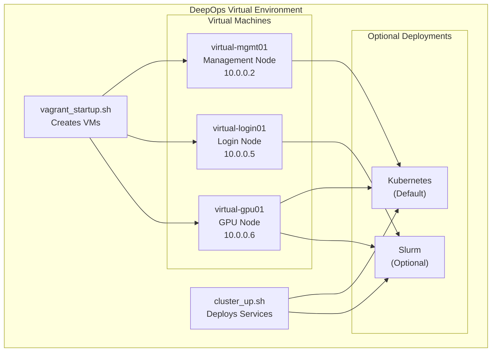
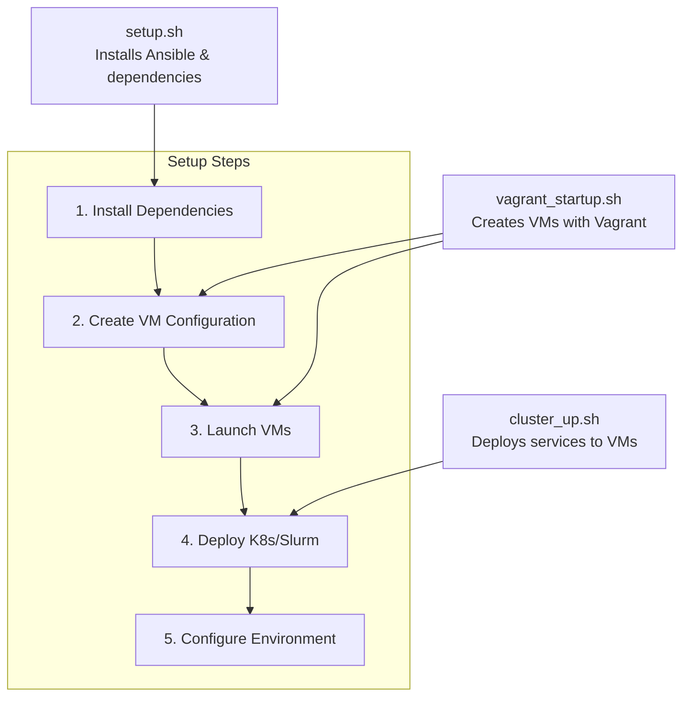
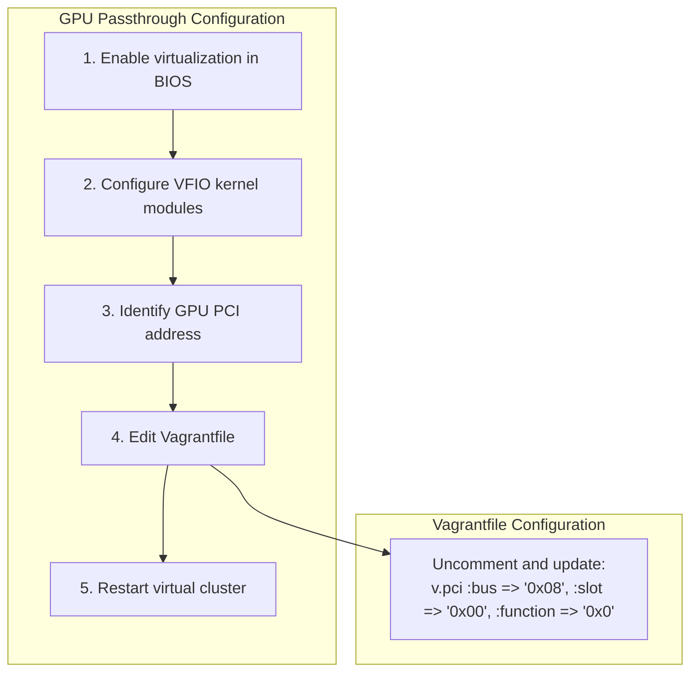

<!-- source: DeepWiki mcp.deepwiki.com · repo NVIDIA/deepops · page 4 Virtual Testing Environment · fetched 2026-10-26 -->

# Virtual Testing Environment

<details>
<summary>Relevant source files</summary>

The following files were used as context for generating this wiki page:

- [config.example/inventory](config.example/inventory)
- [virtual/README.md](virtual/README.md)
- [virtual/cluster_up.sh](virtual/cluster_up.sh)
- [virtual/vagrant_shutdown.sh](virtual/vagrant_shutdown.sh)
- [virtual/vagrant_startup.sh](virtual/vagrant_startup.sh)
- [virtual/virtual_inventory](virtual/virtual_inventory)
- [virtual/virtual_inventory_full](virtual/virtual_inventory_full)

</details>


## Purpose and Scope

The Virtual Testing Environment in DeepOps provides a way to deploy and test DeepOps clusters on a single machine using virtualization. This feature is particularly useful for:

1. Learning how to deploy DeepOps with limited hardware resources
2. Testing new features or configurations before implementing them in production
3. Development and troubleshooting of DeepOps components
4. Demonstrating DeepOps capabilities in a controlled environment

For information about deploying in the virtual environment specifically for Kubernetes, see [Virtual Kubernetes Setup](#4.1). For Slurm-specific virtual deployment information, see [Virtual Slurm Setup](#4.2).

Sources: [virtual/README.md:1-8]()

## System Architecture

The Virtual Testing Environment creates a set of virtual machines (VMs) using Vagrant and libvirt. These VMs form a miniature cluster that can run either Kubernetes, Slurm, or both, depending on your configuration.

### Default Virtual Cluster Architecture



Sources: [virtual/README.md:31-66](), [virtual/virtual_inventory:1-67](), [virtual/cluster_up.sh:1-52]()

### VM Roles and Configuration

The default virtual environment creates three VMs with the following roles:

| VM Name | IP Address | vCPU | RAM | Storage | Primary Role |
|---------|------------|------|-----|---------|--------------|
| virtual-mgmt01 | 10.0.0.2 | 4 | 4GB | 32GB | Kubernetes master node |
| virtual-login01 | 10.0.0.5 | 2 | 2GB | 32GB | Slurm master/login node |
| virtual-gpu01 | 10.0.0.6 | 2 | 16GB | 32GB | Compute node (K8s/Slurm) |

For resource-intensive applications like Kubeflow, additional resources should be allocated to virtual-mgmt01.

Sources: [virtual/README.md:11-20](), [virtual/virtual_inventory:10-14]()

## Requirements

### Hardware Requirements

The host machine should have at least:
- 8 vCPU cores
- 22 GB RAM
- 96 GB available storage

If you plan to deploy resource-intensive applications like Kubeflow, you'll need to allocate more resources.

### Operating System Requirements

The virtual environment has been tested on:
- Ubuntu 18.04 (or greater)
- CentOS 7.6 (or greater)

### Virtualization Prerequisites

Your host machine must have virtualization enabled in the BIOS and support for KVM. The setup scripts will install the necessary packages (Vagrant, libvirt, QEMU, etc.) on the host system.

Sources: [virtual/README.md:9-29](), [virtual/vagrant_startup.sh:15-129]()

## Setup Process

The setup process consists of three main scripts that handle different aspects of the virtual environment deployment:



Sources: [virtual/README.md:31-77](), [virtual/cluster_up.sh:1-52](), [virtual/vagrant_startup.sh:1-172]()

### 1. Running the Setup Script

From the main DeepOps directory:

```bash
./scripts/setup.sh
```

This installs Ansible and other dependencies needed for deployment.

### 2. Starting the Virtual Cluster

Navigate to the virtual directory and run:

```bash
cd virtual
./vagrant_startup.sh
```

This script:
1. Installs Vagrant and required dependencies if not already present
2. Creates SSH keys if needed
3. Sets up the Vagrantfile based on your OS (Ubuntu or CentOS)
4. Launches the VMs using Vagrant and libvirt

By default, this creates three VMs: virtual-mgmt01, virtual-login01, and virtual-gpu01.

### 3. Deploying Services to the Cluster

After the VMs are running, deploy the cluster services:

```bash
./cluster_up.sh
```

This script:
1. Sets up the configuration directory with the virtual inventory
2. Deploys Kubernetes by default
3. Deploys Slurm if the `DEEPOPS_ENABLE_SLURM` environment variable is set

Sources: [virtual/README.md:31-66](), [virtual/cluster_up.sh:1-52]()

## Customization Options

### Operating System Selection

By default, the VMs run Ubuntu 20.04. You can change the OS by setting environment variables:

```bash
export DEEPOPS_VAGRANT_OS=centos  # Options: ubuntu, centos
export DEEPOPS_OS_VERSION=8       # For Ubuntu: 18.04, 20.04; For CentOS: 7, 8
```

### Deploying Slurm

By default, only Kubernetes is deployed. To also deploy Slurm:

```bash
export DEEPOPS_ENABLE_SLURM=1
```

### Larger Clusters

For a larger cluster with multiple management and GPU nodes:

```bash
export DEEPOPS_FULL_INSTALL=true
```

This creates six VMs:
- virtual-mgmt01, virtual-mgmt02, virtual-mgmt03
- virtual-login01
- virtual-gpu01, virtual-gpu02

Sources: [virtual/README.md:156-207](), [virtual/vagrant_startup.sh:135-144](), [virtual/virtual_inventory_full:1-87]()

## Using GPU Passthrough

If your host has NVIDIA GPUs, you can configure the virtual environment to pass through a GPU to the virtual-gpu01 VM.



### Steps to Enable GPU Passthrough

1. Ensure virtualization and IOMMU are enabled in your BIOS
2. Configure your host system to load VFIO modules
3. Find your GPU's PCI address using `lspci -nnk | grep NVIDIA`
4. Edit the Vagrantfile to uncomment the PCI passthrough configuration
5. Update the bus, slot, and function values to match your GPU
6. Restart the virtual cluster

Sources: [virtual/README.md:110-154](), [virtual/README.md:209-354]()

## Managing the Virtual Environment

### Accessing the VMs

You can SSH into any of the VMs using Vagrant:

```bash
# From the virtual directory
vagrant ssh virtual-mgmt01
vagrant ssh virtual-login01
vagrant ssh virtual-gpu01
```

### Setting Up Kubernetes Environment

After deployment, you can set up the local Kubernetes environment:

```bash
source k8s_environment.sh
```

This configures `kubectl` to connect to your virtual Kubernetes cluster.

### Destroying the Cluster

When you're done, you can destroy the virtual cluster:

```bash
./vagrant_shutdown.sh
```

This removes all VMs and associated resources.

Sources: [virtual/README.md:78-100](), [virtual/vagrant_shutdown.sh:1-36]()

## Resource Allocation Customization

For resource-intensive applications, you may need to increase the resources allocated to VMs:

### Increasing CPU and Memory

Edit the Vagrantfile to adjust resources:

1. For management node: Recommended v.memory = 16384, v.cpus = 8
2. For GPU node: Recommended v.cpus = 8

### Increasing Disk Space

Add to each VM configuration in the Vagrantfile:

```ruby
v.machine_virtual_size = 100  # 100 GB disk
```

After starting the VM, you'll need to resize the filesystem:

```bash
vagrant ssh virtual-mgmt01
sudo fdisk /dev/sda  # Follow: d, 3, n, p, 3, enter, enter, no, p, w
sudo resize2fs /dev/sda3
```

Sources: [virtual/README.md:156-198]()

## Troubleshooting

### Common Issues

1. **GPU Passthrough Problems**: Ensure IOMMU is enabled in BIOS and the correct PCI address is used
2. **Resource Constraints**: If VMs fail to start, ensure your host has sufficient resources
3. **Networking Issues**: If VMs can't communicate, check firewall settings on the host

### Verification Commands

Check the status of VMs:
```bash
virsh list --all
```

Verify libvirt network:
```bash
virsh net-list
```

Sources: [virtual/README.md:101-109]()

---

