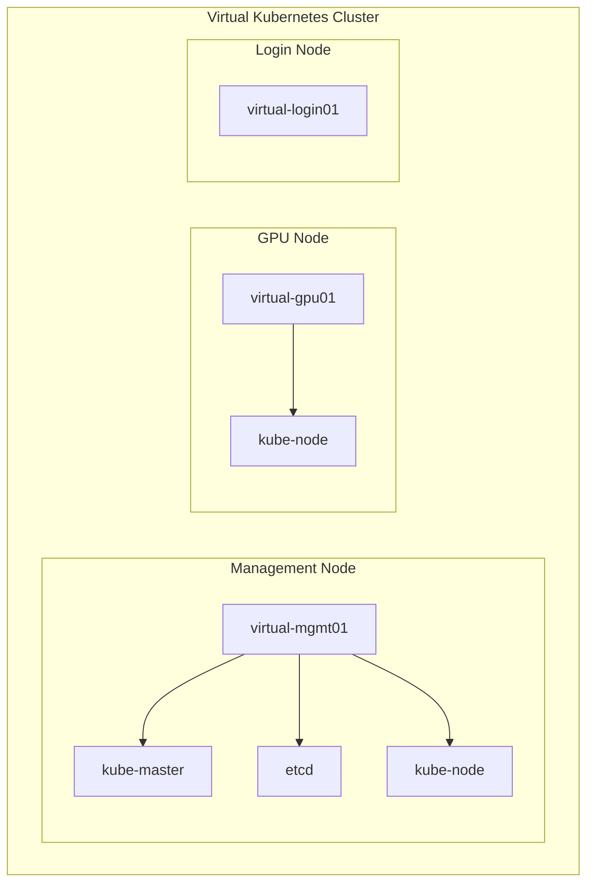
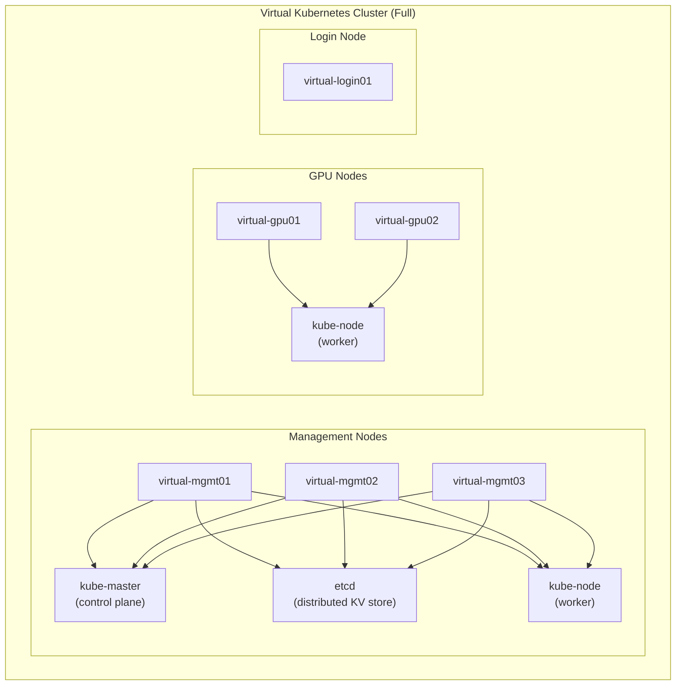
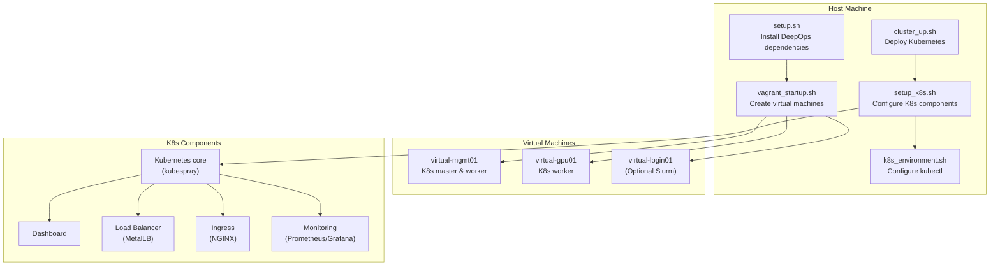
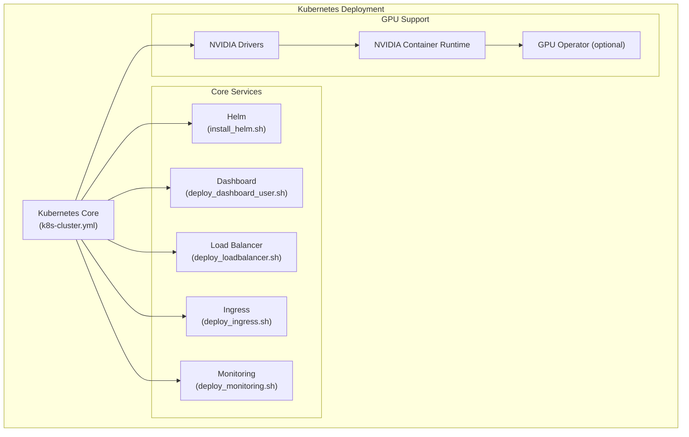

<!-- source: DeepWiki mcp.deepwiki.com · repo NVIDIA/deepops · page 4.1 Virtual Kubernetes Setup · fetched 2026-10-26 -->

# Virtual Kubernetes Setup

<details>
<summary>Relevant source files</summary>

The following files were used as context for generating this wiki page:

- [config.example/inventory](config.example/inventory)
- [virtual/README.md](virtual/README.md)
- [virtual/scripts/setup_k8s.sh](virtual/scripts/setup_k8s.sh)
- [virtual/scripts/setup_slurm.sh](virtual/scripts/setup_slurm.sh)
- [virtual/vagrant_shutdown.sh](virtual/vagrant_shutdown.sh)
- [virtual/vagrant_startup.sh](virtual/vagrant_startup.sh)
- [virtual/vars_files/virt_k8s.yml](virtual/vars_files/virt_k8s.yml)
- [virtual/vars_files/virt_slurm.yml](virtual/vars_files/virt_slurm.yml)
- [virtual/virtual_inventory](virtual/virtual_inventory)
- [virtual/virtual_inventory_full](virtual/virtual_inventory_full)

</details>


## Purpose and Scope

This document details the process of setting up a Kubernetes cluster in the DeepOps virtual testing environment. The virtual setup provides a convenient way to deploy and test Kubernetes configurations using a set of virtual machines without requiring physical hardware. This is particularly useful for development, testing, and learning purposes before deploying to production environments.

For information about setting up Slurm in the virtual environment, see [Virtual Slurm Setup](#4.2).

Sources: [virtual/README.md:1-8]()

## System Overview

The virtual Kubernetes setup in DeepOps creates a configurable Kubernetes cluster running on virtual machines managed by Vagrant and libvirt. By default, it creates a 3-node setup with specific roles, though this can be expanded for larger test environments.

### Default Virtual Cluster Architecture



The default setup consists of three virtual machines:
- **virtual-mgmt01**: Serves as the Kubernetes master node (control plane) and also participates as a worker node
- **virtual-gpu01**: Functions as a Kubernetes worker node, can be configured for GPU passthrough
- **virtual-login01**: Not directly part of Kubernetes, used for Slurm if that is enabled

Sources: [virtual/virtual_inventory:10-30](), [virtual/README.md:16-18]()

### Full Cluster Option

When using the expanded setup (activated by the `DEEPOPS_FULL_INSTALL` environment variable), the architecture includes more nodes:



This expanded setup provides a more production-like environment with HA control plane (3 management nodes) and multiple worker nodes.

Sources: [virtual/virtual_inventory_full:10-42](), [virtual/README.md:49-50]()

## Hardware and Software Requirements

### Hardware Requirements

The host machine should provide sufficient resources for the virtual machines:

| VM Name | vCPU | RAM | Storage |
|---------|------|-----|---------|
| virtual-mgmt01 | 4 | 4GB | 32GB |
| virtual-login01 | 2 | 2GB | 32GB |
| virtual-gpu01 | 2 | 16GB | 32GB |
| **Total** | **8** | **22GB** | **96GB** |

For resource-intensive applications like Kubeflow, more resources should be allocated to the management node.

### Software Requirements

- Host OS: Ubuntu 18.04+ or CentOS 7.6+
- Virtualization must be enabled in BIOS
- Required software (automatically installed by the setup script):
  - Vagrant
  - libvirt and related packages
  - qemu-kvm
  - Other virtualization dependencies

Sources: [virtual/README.md:9-29](), [virtual/vagrant_startup.sh:19-129]()

## Deployment Process

### 1. Initial Setup

First, run the DeepOps setup script from the main repository directory:

```bash
./scripts/setup.sh
```

This installs Ansible and other required software on the provisioning machine.

Sources: [virtual/README.md:33-39]()

### 2. Start the Virtual Machines

Navigate to the virtual directory and run the startup script:

```bash
cd virtual
./vagrant_startup.sh
```

This script:
- Installs Vagrant and its dependencies if not already present
- Configures the appropriate Vagrantfile based on your desired OS
- Launches the virtual machines using Vagrant and libvirt

By default, Ubuntu is used as the VM operating system. You can change this by setting environment variables.

Sources: [virtual/README.md:41-54](), [virtual/vagrant_startup.sh:1-172]()

### 3. Deploy Kubernetes

Once the VMs are running, deploy Kubernetes by running:

```bash
./cluster_up.sh
```

This runs the Ansible playbooks to deploy DeepOps components, including Kubernetes, to the Vagrant VMs.

Sources: [virtual/README.md:56-66]()

### 4. Configure Kubernetes Environment

After deployment, set up your local environment to interact with the Kubernetes cluster:

```bash
source k8s_environment.sh
```

This configures `kubectl` to communicate with the virtual cluster.

Sources: [virtual/README.md:68-76]()

## Deployment Workflow

The following diagram illustrates the key components and workflow of the virtual Kubernetes setup process:



The setup process involves several scripts that work together to create and configure the virtual environment:

1. The `setup.sh` script installs required dependencies
2. `vagrant_startup.sh` creates the virtual machines
3. `cluster_up.sh` calls Ansible playbooks including `setup_k8s.sh`
4. `setup_k8s.sh` deploys Kubernetes and additional components
5. `k8s_environment.sh` configures kubectl for cluster access

Sources: [virtual/README.md:33-76](), [virtual/scripts/setup_k8s.sh:1-57]()

## Customization Options

### Operating System Selection

By default, the virtual machines run Ubuntu 20.04. You can change this by setting environment variables before running `vagrant_startup.sh`:

```bash
export DEEPOPS_VAGRANT_OS=centos
export DEEPOPS_OS_VERSION=8
```

Supported OS options:
- Ubuntu 18.04/20.04
- CentOS 7/8

Sources: [virtual/README.md:161-167](), [virtual/vagrant_startup.sh:9-11]()

### Cluster Size

To deploy a larger cluster with more nodes:

```bash
export DEEPOPS_FULL_INSTALL=true
./vagrant_startup.sh
./cluster_up.sh
```

This will create a 6-node cluster with 3 management nodes and 2 GPU nodes, providing a high-availability configuration.

Sources: [virtual/README.md:49-50](), [virtual/vagrant_startup.sh:135-144]()

### GPU Passthrough

To enable GPU passthrough for virtual-gpu01:

1. Identify your GPU's PCI bus address using `lspci`
2. Edit the Vagrantfile to uncomment and update the PCI configuration with your GPU's bus information
3. Restart the virtual environment

```bash
./vagrant_shutdown.sh
./vagrant_startup.sh
./cluster_up.sh
```

This allows the virtual-gpu01 VM to directly access the physical GPU.

Sources: [virtual/README.md:110-154]()

### Resource Allocation

To increase resources for VMs (recommended for running resource-intensive applications):

1. Edit the Vagrantfile to increase CPU, memory, and disk space
2. For management node: recommended v.memory = 16384, v.cpus = 8
3. For GPU node: recommended v.cpus = 8
4. Resize disk partitions on each VM after increasing virtual disk size

Sources: [virtual/README.md:157-198]()

## Kubernetes Components

The setup_k8s.sh script deploys several important Kubernetes components:



The deployment provides:
- Core Kubernetes with kubespray
- Kubernetes Dashboard for web-based management
- MetalLB load balancer for service exposure
- NGINX Ingress for routing external traffic
- Prometheus and Grafana for monitoring
- NVIDIA drivers and container runtime for GPU support
- Optional GPU Operator for advanced GPU management

Sources: [virtual/scripts/setup_k8s.sh:29-57]()

## Using the Virtual Kubernetes Cluster

### Accessing the Cluster

After deployment, you can interact with the cluster using kubectl:

```bash
# If you've sourced the environment file
kubectl get nodes
kubectl get pods --all-namespaces
```

### Connecting to Virtual Machines

To log into any of the VMs:

```bash
# From the virtual directory
vagrant ssh virtual-mgmt01
vagrant ssh virtual-gpu01
```

Sources: [virtual/README.md:78-92]()

### Shutting Down the Cluster

To destroy the virtual cluster and shut down the VMs:

```bash
./vagrant_shutdown.sh
```

This will remove all VMs and their associated resources.

Sources: [virtual/README.md:94-108](), [virtual/vagrant_shutdown.sh:1-36]()

## Troubleshooting

### Common Issues

1. **Insufficient Resources**: If the VMs fail to start or perform poorly, ensure your host has sufficient resources
2. **Virtualization Not Enabled**: Make sure virtualization is enabled in BIOS
3. **GPU Passthrough Issues**: Check that IOMMU is properly enabled and the correct PCI bus is specified
4. **Network Connectivity**: Ensure the host machine can properly create and manage virtual networks

If the `vagrant destroy` command fails when shutting down, the `vagrant_shutdown.sh` script will attempt to manually destroy the VMs using virsh commands.

Sources: [virtual/vagrant_shutdown.sh:9-31]()

## Related Documentation

For more information on using the deployed Kubernetes cluster, refer to the [Kubernetes Usage Guide](#2).

Sources: [virtual/README.md:80-82]()

---

