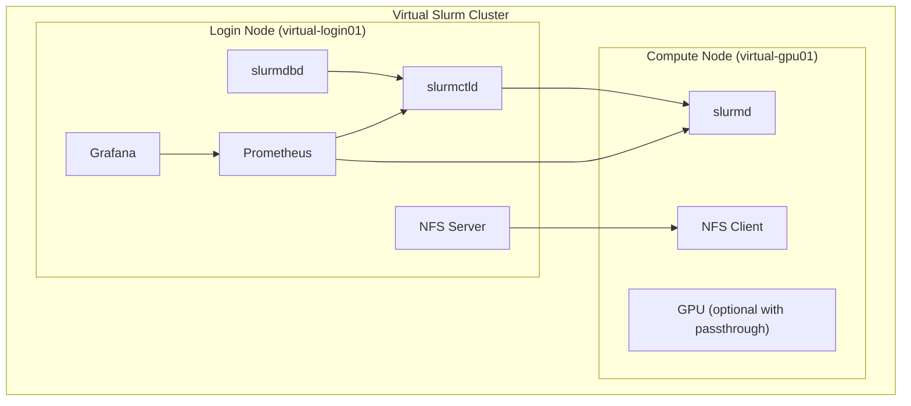
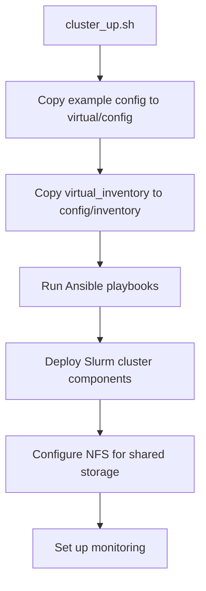
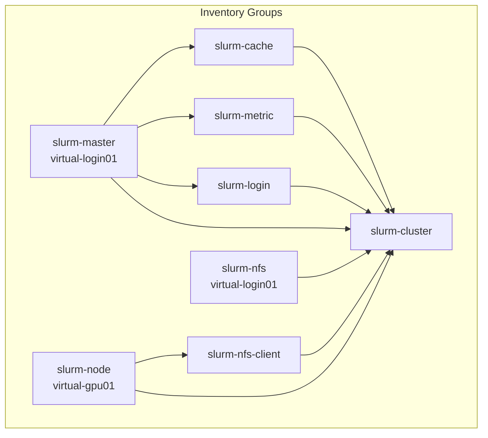

<!-- source: DeepWiki mcp.deepwiki.com · repo NVIDIA/deepops · page 4.2 Virtual Slurm Setup · fetched 2026-10-26 -->

# Virtual Slurm Setup

<details>
<summary>Relevant source files</summary>

The following files were used as context for generating this wiki page:

- [config.example/inventory](config.example/inventory)
- [virtual/README.md](virtual/README.md)
- [virtual/cluster_up.sh](virtual/cluster_up.sh)
- [virtual/vagrant_shutdown.sh](virtual/vagrant_shutdown.sh)
- [virtual/vagrant_startup.sh](virtual/vagrant_startup.sh)
- [virtual/virtual_inventory](virtual/virtual_inventory)
- [virtual/virtual_inventory_full](virtual/virtual_inventory_full)

</details>


## Purpose and Scope

This document explains how to set up and use a Slurm cluster in the DeepOps virtual testing environment. The virtual Slurm setup allows you to deploy a functional Slurm cluster using Vagrant and libvirt, providing a way to test and develop with Slurm before deploying to a production environment. For information about setting up Kubernetes in the virtual environment, see [Virtual Kubernetes Setup](#4.1).

## Architecture

The virtual Slurm environment creates a small cluster with dedicated nodes for management and computation:



Sources: [virtual/virtual_inventory:32-67](), [virtual/README.md:16-18]()

## VM Specifications

By default, the virtual environment includes the following VMs:

| VM | vCPU | RAM | Storage | Role |
|----|------|-----|---------|------|
| virtual-login01 | 2 | 2 GB | 32 GB | Slurm master/login node |
| virtual-gpu01 | 2 | 16 GB | 32 GB | Slurm compute node |
| virtual-mgmt01 | 4 | 4 GB | 32 GB | Management node (for K8s) |

The host system should have at least 8 vCPU, 22 GB RAM, and 96 GB storage to accommodate these VMs.

Sources: [virtual/README.md:11-20]()

## Setup Process

### 1. Initial Setup

From the main DeepOps directory, run the setup script to install Ansible and other dependencies:

```bash
./scripts/setup.sh
```

Sources: [virtual/README.md:35-39](), [virtual/cluster_up.sh:15-16]()

### 2. Start the Virtual Environment

Navigate to the virtual directory and run the vagrant startup script:

```bash
cd virtual
./vagrant_startup.sh
```

This script:
- Installs Vagrant and necessary plugins if not already installed
- Sets up the libvirt provider
- Creates the VMs according to the specified Vagrantfile

Sources: [virtual/README.md:41-54](), [virtual/vagrant_startup.sh:1-154]()

### 3. Deploy Slurm

By default, only Kubernetes is deployed. To enable Slurm deployment, set the `DEEPOPS_ENABLE_SLURM` environment variable before running `cluster_up.sh`:

```bash
export DEEPOPS_ENABLE_SLURM=1
./cluster_up.sh
```

The deployment process:



Sources: [virtual/README.md:56-66](), [virtual/cluster_up.sh:25-51]()

## Configuration Options

The following environment variables customize the virtual Slurm setup:

| Variable | Description | Default |
|----------|-------------|---------|
| DEEPOPS_ENABLE_SLURM | Enable Slurm deployment | Not set (disabled) |
| DEEPOPS_VAGRANT_OS | VM operating system | ubuntu |
| DEEPOPS_OS_VERSION | OS version | 20.04 |
| DEEPOPS_FULL_INSTALL | Deploy a larger cluster (6 VMs) | Not set |
| DEEPOPS_LARGE_SLURM | Deploy a larger Slurm cluster | Not set |

Sources: [virtual/README.md:59-61](), [virtual/vagrant_startup.sh:8-11](), [virtual/cluster_up.sh:33-37]()

## Slurm Components and Inventory Structure

The inventory defines the virtual Slurm cluster components:



Sources: [virtual/virtual_inventory:35-67](), [config.example/inventory:45-78]()

## Using the Virtual Slurm Cluster

### Connecting to the VMs

To connect to any of the VM nodes:

```bash
# Must be in the deepops/virtual directory
vagrant ssh virtual-login01  # Connect to Slurm master
vagrant ssh virtual-gpu01    # Connect to Slurm compute node
```

Sources: [virtual/README.md:84-92]()

### Running Slurm Commands

Once connected to the Slurm master node (virtual-login01), you can interact with the cluster:

```bash
# Check cluster status
sinfo

# Submit a job
sbatch job_script.sh

# Check job queue
squeue

# View job accounting information
sacct
```

## Enabling GPU Passthrough

If your host has a physical GPU, you can configure GPU passthrough for the virtual-gpu01 VM:

1. Identify your GPU's PCI bus address:
   ```bash
   lspci -nnk | grep NVIDIA
   ```

2. In the Vagrantfile, find the `#BUS-GPU01` marker and uncomment/update the `v.pci` line:
   ```ruby
   v.pci :bus => '0x08', :slot => '0x00', :function => '0x0'
   ```

3. Restart the virtual environment:
   ```bash
   ./vagrant_shutdown.sh
   ./vagrant_startup.sh
   export DEEPOPS_ENABLE_SLURM=1
   ./cluster_up.sh
   ```

Sources: [virtual/README.md:110-154]()

## Larger Slurm Clusters

For testing multi-node configurations, you can deploy a larger virtual cluster:

### Full Installation (6 VMs)

```bash
export DEEPOPS_FULL_INSTALL=true
./vagrant_startup.sh
export DEEPOPS_ENABLE_SLURM=1
./cluster_up.sh
```

This deploys:
- 3 management nodes (virtual-mgmt01, virtual-mgmt02, virtual-mgmt03)
- 1 login node (virtual-login01)
- 2 GPU nodes (virtual-gpu01, virtual-gpu02)

Sources: [virtual/README.md:48-50](), [virtual/virtual_inventory_full:1-87]()

## Destroying the Virtual Cluster

To destroy the virtual Slurm cluster and clean up resources:

```bash
./vagrant_shutdown.sh
```

This destroys all VMs created by Vagrant. Verify no VMs are running with:

```bash
virsh list --all
```

Sources: [virtual/README.md:94-108](), [virtual/vagrant_shutdown.sh:1-36]()

## Troubleshooting

If you encounter issues with the virtual Slurm setup:

1. Verify the VMs are running:
   ```bash
   virsh list
   ```

2. Check Slurm service status on the master node:
   ```bash
   vagrant ssh virtual-login01
   sudo systemctl status slurmctld
   ```

3. Check Slurm service status on compute nodes:
   ```bash
   vagrant ssh virtual-gpu01
   sudo systemctl status slurmd
   ```

4. Review Slurm logs:
   ```bash
   vagrant ssh virtual-login01
   sudo cat /var/log/slurm/slurmctld.log
   ```

5. If the host doesn't have enough resources, modify the Vagrantfile to reduce VM resource allocation.

## Resource Customization

For resource-intensive workloads, you may need to increase VM resources:

1. For the login node (Slurm master), increase RAM and CPU:
   ```bash
   # Edit the Vagrantfile and modify:
   v.memory = 4096  # Increase from 2048
   v.cpus = 4       # Increase from 2
   ```

2. For GPU nodes, ensure sufficient RAM:
   ```bash
   # Edit the Vagrantfile and modify:
   v.memory = 24576  # Increase from 16384
   ```

Sources: [virtual/README.md:170-174]()

---

