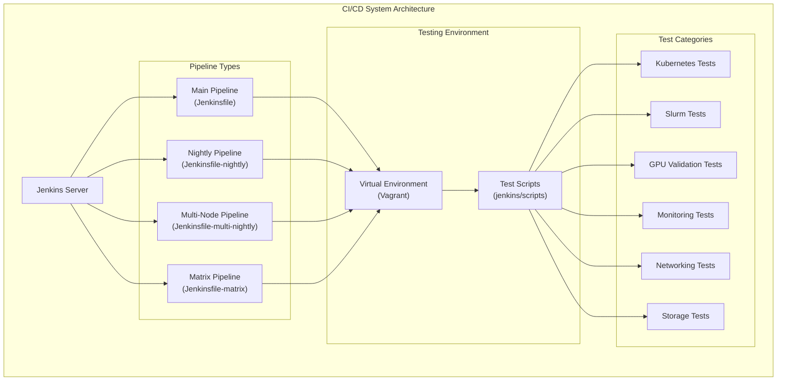
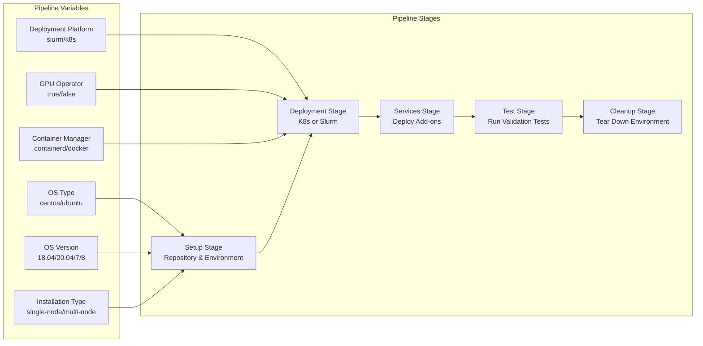
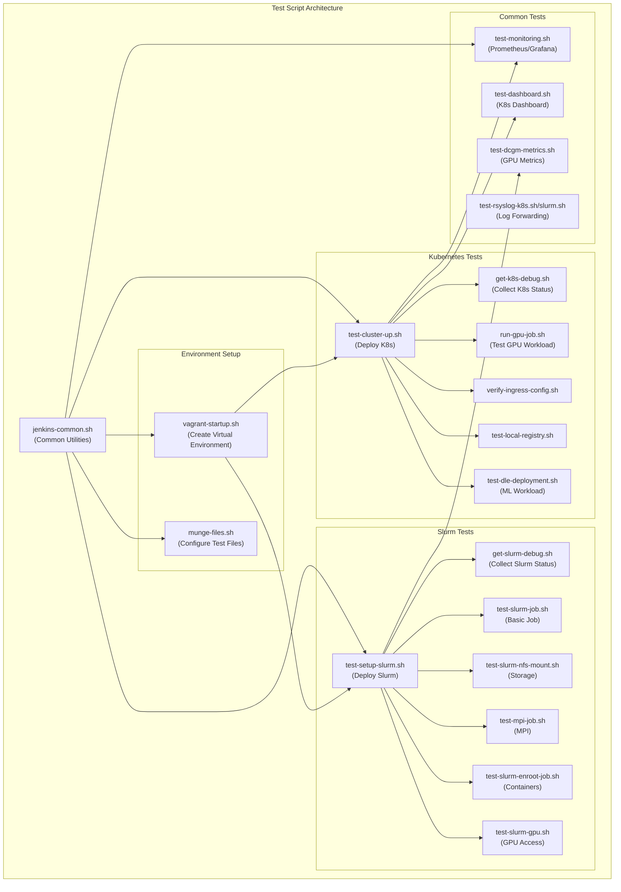
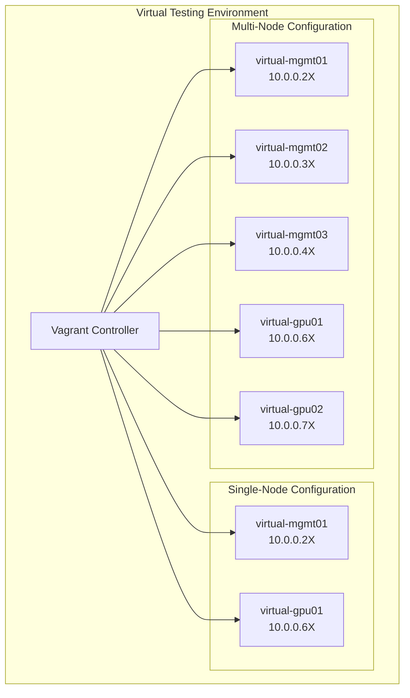
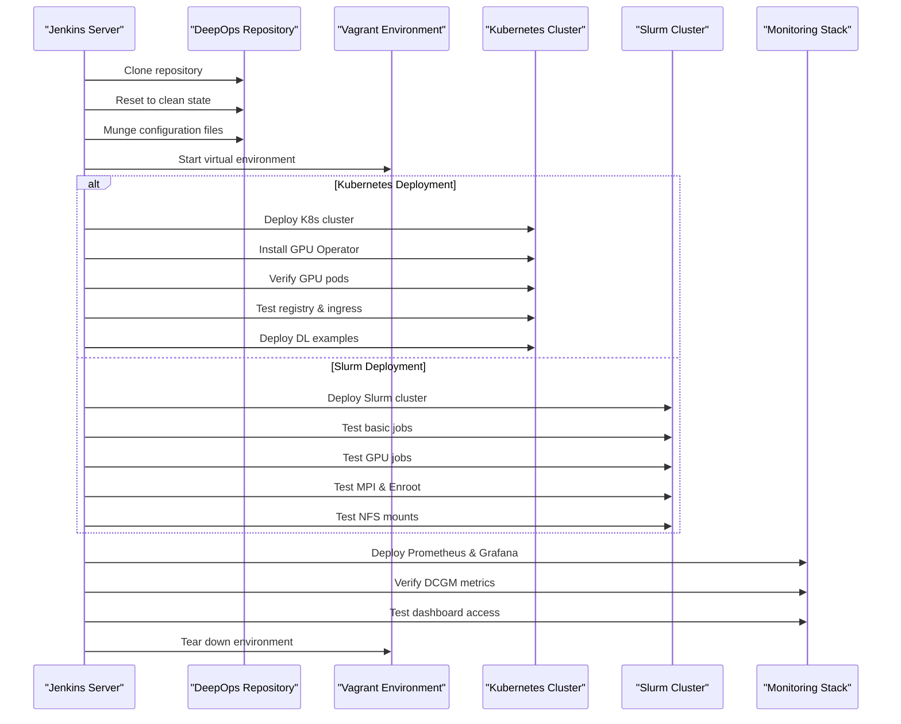

<!-- source: DeepWiki mcp.deepwiki.com · repo NVIDIA/deepops · page 5 CI/CD and Testing · fetched 2026-10-26 -->

# CI/CD and Testing

<details>
<summary>Relevant source files</summary>

The following files were used as context for generating this wiki page:

- [workloads/jenkins/Jenkinsfile](workloads/jenkins/Jenkinsfile)
- [workloads/jenkins/Jenkinsfile-matrix](workloads/jenkins/Jenkinsfile-matrix)
- [workloads/jenkins/Jenkinsfile-multi-nightly](workloads/jenkins/Jenkinsfile-multi-nightly)
- [workloads/jenkins/Jenkinsfile-nightly](workloads/jenkins/Jenkinsfile-nightly)
- [workloads/jenkins/scripts/jenkins-common.sh](workloads/jenkins/scripts/jenkins-common.sh)
- [workloads/jenkins/scripts/test-dcgm-metrics.sh](workloads/jenkins/scripts/test-dcgm-metrics.sh)
- [workloads/jenkins/scripts/test-deepops-registry-mirror.sh](workloads/jenkins/scripts/test-deepops-registry-mirror.sh)
- [workloads/jenkins/scripts/test-dle-deployment.sh](workloads/jenkins/scripts/test-dle-deployment.sh)
- [workloads/jenkins/scripts/test-monitoring.sh](workloads/jenkins/scripts/test-monitoring.sh)
- [workloads/jenkins/scripts/vagrant-startup.sh](workloads/jenkins/scripts/vagrant-startup.sh)

</details>


This page documents the continuous integration, continuous deployment (CI/CD), and testing framework used in DeepOps. It explains the testing architecture, automated test suites, and how the system validates both Kubernetes and Slurm deployments across different configurations.

For hardware validation procedures, see [Burn-in Testing](#5.2).

## 1. CI/CD Architecture Overview

DeepOps employs Jenkins as its primary CI/CD platform. The system runs multiple test pipelines that validate different deployment configurations and components of the framework.



Sources: [workloads/jenkins/Jenkinsfile:1-147](), [workloads/jenkins/Jenkinsfile-nightly:1-251](), [workloads/jenkins/Jenkinsfile-multi-nightly:1-251](), [workloads/jenkins/Jenkinsfile-matrix:1-258]()

## 2. Jenkins Pipeline Structure

DeepOps utilizes several Jenkins pipeline configurations to handle different testing scenarios:

### 2.1 Main Pipeline (Jenkinsfile)

The standard pipeline performs basic validation tests on a single-GPU configuration. It tests both Kubernetes and Slurm deployments with default settings.

### 2.2 Nightly Pipeline (Jenkinsfile-nightly)

Runs an extensive test suite nightly with a single GPU:
- Kubernetes deployment with GPU Operator
- Slurm deployment
- All services and add-ons (monitoring, dashboards, etc.)

### 2.3 Multi-Node Nightly Pipeline (Jenkinsfile-multi-nightly)

Similar to the nightly pipeline but uses two GPUs to test multi-node scenarios.

### 2.4 Matrix Pipeline (Jenkinsfile-matrix)

Allows customized test configurations by specifying combinations of:
- Operating systems (Ubuntu/CentOS)
- OS versions (18.04, 20.04, 7, 8)
- Deployment platforms (Kubernetes/Slurm)
- Container managers (containerd/docker)
- Full/single-node installations
- GPU Operator configurations



Sources: [workloads/jenkins/Jenkinsfile-matrix:9-54](), [workloads/jenkins/Jenkinsfile-matrix:85-224]()

## 3. Test Script Architecture

The testing system utilizes a collection of shell scripts located in `workloads/jenkins/scripts/` that perform specific validation tasks. These scripts share common utilities and environment variables through `jenkins-common.sh`.



Sources: [workloads/jenkins/scripts/jenkins-common.sh:1-56](), [workloads/jenkins/scripts/vagrant-startup.sh:1-10](), [workloads/jenkins/scripts/test-monitoring.sh:1-149](), [workloads/jenkins/scripts/test-dcgm-metrics.sh:1-48](), [workloads/jenkins/scripts/test-dle-deployment.sh:1-42]()

## 4. Test Categories

The DeepOps CI/CD system validates several critical areas of functionality:

### 4.1 Kubernetes Deployment Tests

Tests that validate the deployment and functionality of Kubernetes clusters:

- Basic cluster deployment and stability
- GPU Operator functionality
- Container runtime validation (containerd/docker)
- GPU accessibility from pods
- Networking components (Ingress)
- Storage systems

### 4.2 Slurm Deployment Tests

Tests focused on validating Slurm HPC clusters:

- Basic cluster deployment and functionality
- Job submission and execution
- GPU accessibility from jobs
- MPI workloads
- Container integration (Enroot)
- NFS mounting and shared storage

### 4.3 Monitoring and Observability Tests

Tests for monitoring infrastructure:

- Prometheus and Grafana deployment
- DCGM metrics for GPU monitoring
- Alert Manager functionality
- Dashboard accessibility
- Log forwarding with rsyslog

The monitoring test suite validates both the deployment of the monitoring stack and the collection of GPU-specific metrics through DCGM.

```
# Example DCGM metrics validated in tests
DCGM_FI_DEV_GPU_TEMP
DCGM_FI_DEV_POWER_USAGE
DCGM_FI_DEV_GPU_UTIL
DCGM_FI_DEV_MEM_COPY_UTIL
DCGM_FI_DEV_MEM_CLOCK
DCGM_FI_DEV_SM_CLOCK
```

Sources: [workloads/jenkins/scripts/test-monitoring.sh:10-148](), [workloads/jenkins/scripts/test-dcgm-metrics.sh:40-48]()

### 4.4 Deep Learning Examples Tests

Tests that deploy and validate Deep Learning Examples:

- Jupyter notebook accessibility
- PyTorch model deployment
- End-to-end ML workflow validation

Sources: [workloads/jenkins/scripts/test-dle-deployment.sh:9-42]()

## 5. Virtual Testing Environment

DeepOps uses Vagrant to create virtual testing environments that simulate multi-node clusters. This provides a consistent, reproducible environment for testing deployments.

### 5.1 Vagrant Configuration

The testing environment typically consists of:

- One management node (for Kubernetes control plane or Slurm controller)
- One or more GPU nodes (with virtual or passthrough GPUs)
- In multi-node tests, additional compute nodes



Sources: [workloads/jenkins/scripts/vagrant-startup.sh:1-10](), [workloads/jenkins/scripts/jenkins-common.sh:17-42]()

### 5.2 GPU Resource Management

The Jenkins environment locks GPU resources using the `lock` directive to ensure tests have exclusive access to physical GPUs. The number of GPUs allocated depends on the test type:

- Standard tests use 1 GPU
- Multi-node tests use 2 GPUs

```
# Example from Jenkinsfile showing GPU resource locking
lock(resource: null, label: 'gpu', quantity: 1, variable: 'GPUDATA') {
  // Test tasks run here with exclusive GPU access
}
```

Sources: [workloads/jenkins/Jenkinsfile:18-136](), [workloads/jenkins/Jenkinsfile-multi-nightly:23-239]()

## 6. Test Execution Workflow

The typical test workflow follows this sequence:

1. **Environment Setup**
   - Reset repository to clean state
   - Configure test-specific parameters
   - Start Vagrant virtual environment

2. **Deployment**
   - Deploy Kubernetes or Slurm cluster
   - Install required components (GPU drivers, containers)
   - Verify cluster status

3. **Component Testing**
   - Test basic functionality (jobs, pods)
   - Test GPU access
   - Test additional services (NFS, MPI, etc.)

4. **Monitoring Testing**
   - Deploy monitoring stack
   - Verify metrics collection
   - Test dashboard access

5. **Cleanup**
   - Tear down environment
   - Remove test configurations

The diagram below illustrates the full test execution workflow:



Sources: [workloads/jenkins/Jenkinsfile-nightly:16-239](), [workloads/jenkins/Jenkinsfile:16-136]()

## 7. Test Matrix Configuration

The matrix pipeline enables testing across multiple configurations by defining a matrix of deployment options:

| Parameter | Available Options |
|-----------|------------------|
| OS Type | ubuntu, centos |
| OS Version | 18.04, 20.04, 7, 8 |
| Deployment | k8s, slurm |
| Container Manager | containerd, docker |
| GPU Operator | true, false |
| Installation Type | single-node, multi-node |

Each combination is tested independently, providing comprehensive coverage of deployment scenarios.

Sources: [workloads/jenkins/Jenkinsfile-matrix:12-54]()

## 8. Adding New Tests

To add new tests to the CI/CD system:

1. Create a new test script in `workloads/jenkins/scripts/`
2. Source the `jenkins-common.sh` file for common utilities
3. Add the test to the appropriate Jenkins pipeline file
4. Use timeouts to prevent hanging tests
5. Include proper error handling and debugging output

Tests should be modular, focusing on validating specific functionality with clear success/failure criteria.

---

