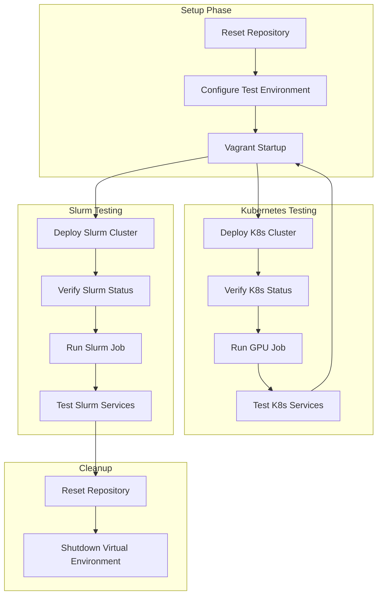
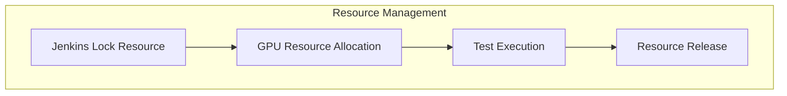
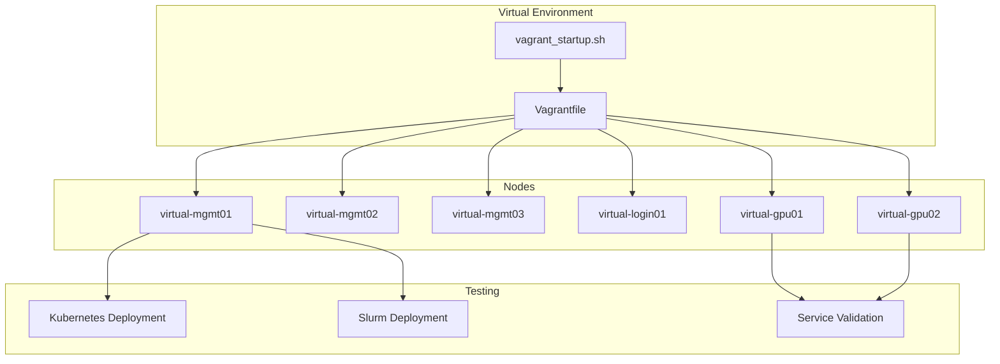
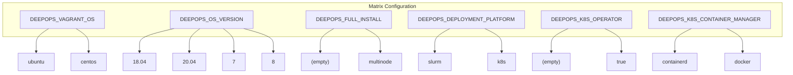
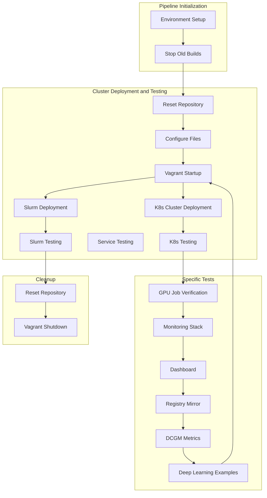
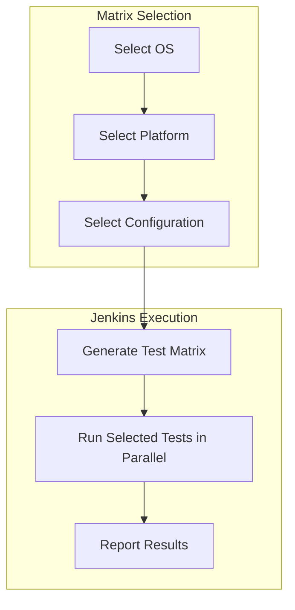

<!-- source: DeepWiki mcp.deepwiki.com · repo NVIDIA/deepops · page 5.1 Jenkins Pipelines · fetched 2026-10-26 -->

# Jenkins Pipelines

Relevant source files

The following files were used as context for generating this wiki page:

- [workloads/jenkins/Jenkinsfile](workloads/jenkins/Jenkinsfile)
- [workloads/jenkins/Jenkinsfile-matrix](workloads/jenkins/Jenkinsfile-matrix)
- [workloads/jenkins/Jenkinsfile-multi-nightly](workloads/jenkins/Jenkinsfile-multi-nightly)
- [workloads/jenkins/Jenkinsfile-nightly](workloads/jenkins/Jenkinsfile-nightly)
- [workloads/jenkins/scripts/jenkins-common.sh](workloads/jenkins/scripts/jenkins-common.sh)
- [workloads/jenkins/scripts/test-dcgm-metrics.sh](workloads/jenkins/scripts/test-dcgm-metrics.sh)
- [workloads/jenkins/scripts/test-deepops-registry-mirror.sh](workloads/jenkins/scripts/test-deepops-registry-mirror.sh)
- [workloads/jenkins/scripts/test-dle-deployment.sh](workloads/jenkins/scripts/test-dle-deployment.sh)
- [workloads/jenkins/scripts/test-monitoring.sh](workloads/jenkins/scripts/test-monitoring.sh)
- [workloads/jenkins/scripts/vagrant-startup.sh](workloads/jenkins/scripts/vagrant-startup.sh)

## Purpose and Scope

This document describes the Jenkins continuous integration (CI) pipelines used for testing the DeepOps framework. The pipelines automatically validate that DeepOps deployments function correctly across different configurations, testing both Kubernetes and Slurm clusters with NVIDIA GPU support. For information about burn-in testing for hardware validation, see [Burn-in Testing](#5.2).

## Pipeline Types

DeepOps implements several Jenkins pipeline types to serve different testing needs:

| Pipeline Type | File | Purpose | GPU Resources |
|---------------|------|---------|--------------|
| Standard | Jenkinsfile | Basic deployment verification | 1 |
| Nightly | Jenkinsfile-nightly | Extended testing run on a nightly schedule | 1 |
| Multi-nightly | Jenkinsfile-multi-nightly | Extended testing with multi-node support | 2 |
| Matrix | Jenkinsfile-matrix | Customizable test matrix across various configurations | 1 or 2 |

Sources: [workloads/jenkins/Jenkinsfile:1-147](), [workloads/jenkins/Jenkinsfile-nightly:1-251](), [workloads/jenkins/Jenkinsfile-multi-nightly:1-251](), [workloads/jenkins/Jenkinsfile-matrix:1-258]()

## Pipeline Structure

### Pipeline Workflow

All DeepOps Jenkins pipelines follow a similar workflow with the following major stages:

Sources: [workloads/jenkins/Jenkinsfile:9-137](), [workloads/jenkins/Jenkinsfile-nightly:9-241]()

### Resource Allocation

The pipelines use a locking mechanism to allocate GPU resources for testing. This prevents resource contention when multiple pipelines run in parallel.

Sources: [workloads/jenkins/Jenkinsfile:17-23](), [workloads/jenkins/Jenkinsfile-nightly:22-23](), [workloads/jenkins/Jenkinsfile-multi-nightly:22-23]()

## Test Components

### Kubernetes Tests

The Kubernetes test suite verifies the following components:

| Test Component | Description | Script |
|----------------|-------------|--------|
| Cluster Deployment | Deploy K8s cluster via Kubespray | test-cluster-up.sh |
| GPU Support | Verify GPU visibility and operation | run-gpu-job.sh |
| Ingress | Test ingress controller configuration | verify-ingress-config.sh |
| Registry | Verify local container registry | test-local-registry.sh |
| Monitoring | Test Prometheus, Grafana, and DCGM | test-monitoring.sh |
| Dashboard | Verify K8s dashboard deployment | test-dashboard.sh |
| Deep Learning Examples | Test NVIDIA DL examples deployment | test-dle-deployment.sh |

Sources: [workloads/jenkins/Jenkinsfile:41-84](), [workloads/jenkins/scripts/test-monitoring.sh:1-149]()

### Slurm Tests

The Slurm test suite verifies the following components:

| Test Component | Description | Script |
|----------------|-------------|--------|
| Cluster Deployment | Deploy Slurm cluster | test-setup-slurm.sh |
| Basic Jobs | Run basic Slurm jobs | test-slurm-job.sh |
| GPU Jobs | Verify GPU support in Slurm | test-slurm-gpu.sh |
| NFS | Test NFS mount functionality | test-slurm-nfs-mount.sh |
| MPI | Test MPI job execution | test-mpi-job.sh |
| Container Support | Verify Enroot container integration | test-slurm-enroot-job.sh |
| DCGM Metrics | Test GPU metrics collection | test-dcgm-metrics.sh |

Sources: [workloads/jenkins/Jenkinsfile:91-134](), [workloads/jenkins/scripts/test-dcgm-metrics.sh:1-48]()

## Test Environment Architecture

The Jenkins pipelines create a virtual testing environment using Vagrant to simulate a DeepOps deployment.

Sources: [workloads/jenkins/scripts/vagrant-startup.sh:1-10](), [workloads/jenkins/scripts/jenkins-common.sh:1-57]()

## Matrix Pipeline Configuration

The Matrix pipeline allows testing across multiple configuration combinations. The following diagram shows the configuration options:

Sources: [workloads/jenkins/Jenkinsfile-matrix:12-54]()

## Pipeline Execution Stages

The following diagram details the execution flow in the nightly pipelines:

Sources: [workloads/jenkins/Jenkinsfile-nightly:9-241](), [workloads/jenkins/Jenkinsfile-multi-nightly:9-241]()

## Configuration Variables

The Jenkins pipelines use environment variables to control test behavior:

| Variable | Description | Default | Options |
|----------|-------------|---------|---------|
| DEEPOPS_NIGHTLY | Flag for nightly build testing | - | true |
| DEEPOPS_FULL_INSTALL | Enable multi-node testing | empty | multinode |
| DEEPOPS_VAGRANT_OS | Base OS for virtual machines | ubuntu | ubuntu, centos |
| DEEPOPS_OS_VERSION | OS version | 20.04 | 18.04, 20.04, 7, 8 |
| DEEPOPS_K8S_OPERATOR | Use GPU Operator for K8s | empty | true |
| DEEPOPS_K8S_OPERATOR_EXISTING_SOFTWARE | Use existing drivers with GPU Operator | empty | true |
| DEEPOPS_K8S_CONTAINER_MANAGER | Container runtime to use | containerd | containerd, docker |

Sources: [workloads/jenkins/Jenkinsfile:3-7](), [workloads/jenkins/Jenkinsfile-matrix:12-21](), [workloads/jenkins/scripts/jenkins-common.sh:20-28]()

## Test Execution Example

Below is an example of how the K8s monitoring test is executed, illustrating a typical test pattern in the DeepOps Jenkins pipelines:

1. The monitoring deployment script is sourced
2. The deployment is verified by checking endpoint responses
3. DCGM metrics are verified in Prometheus
4. The monitoring stack is deleted and verified
5. The monitoring stack is redeployed without persistence and tested again

This pattern of deploy → verify → delete → redeploy with variations is common across multiple tests.

Sources: [workloads/jenkins/scripts/test-monitoring.sh:1-149]()

## Custom Test Execution

To run only specific tests, the Matrix pipeline can be used with custom configuration options. This allows testing specific combinations of OS, deployment platform, and other variables without running the full test suite.

Sources: [workloads/jenkins/Jenkinsfile-matrix:59-258]()

---

