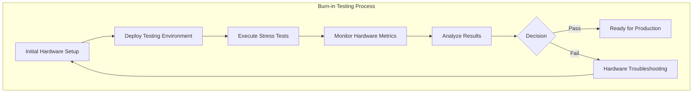
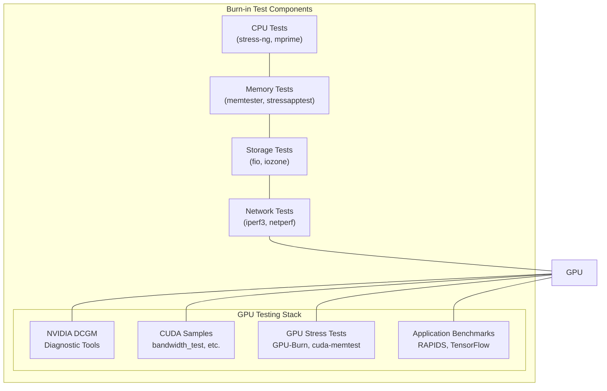
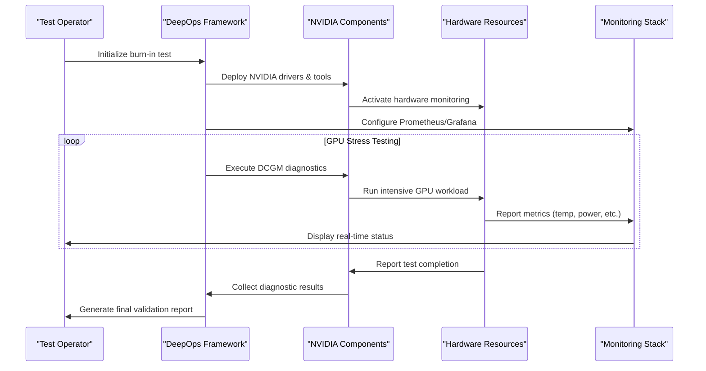
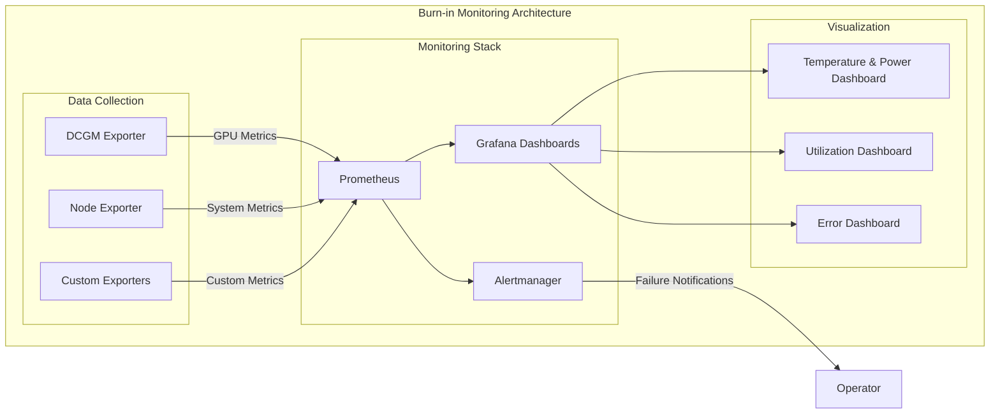

<!-- source: DeepWiki mcp.deepwiki.com · repo NVIDIA/deepops · page 5.2 Burn-in Testing · fetched 2026-10-26 -->

# Burn-in Testing

<details>
<summary>Relevant source files</summary>

The following files were used as context for generating this wiki page:

- [workloads/examples/k8s/dask-rapids/README.md](workloads/examples/k8s/dask-rapids/README.md)
- [workloads/jenkins/README.md](workloads/jenkins/README.md)

</details>


## Introduction

This document describes the burn-in testing methods and procedures for hardware validation in DeepOps deployments. Burn-in testing is a critical process for ensuring hardware reliability and stability before deploying production workloads. For continuous integration testing of DeepOps components, see [Jenkins Pipelines](#5.1).

## Overview of Burn-in Testing

Burn-in testing in DeepOps focuses on validating hardware components by subjecting them to high-stress workloads over extended periods. This process helps identify early failures (infant mortality) and ensures that systems can reliably handle demanding AI/ML and HPC workloads.



Sources: workloads/jenkins/README.md

## Burn-in Testing Components

DeepOps provides a framework for comprehensive hardware validation across different system components, with special emphasis on GPU testing.



Sources: workloads/examples/k8s/dask-rapids/README.md

## Setup Testing Environment

Before conducting burn-in tests, you need to set up an appropriate testing environment. DeepOps provides flexible options for testing infrastructure.

### Virtual Environment Testing

For initial validation without physical hardware:

1. Use the DeepOps virtual testing environment with Vagrant
2. Deploy a test cluster with simulated GPU resources
3. Run lightweight verification tests

### Physical Hardware Testing

For comprehensive burn-in testing:

1. Deploy a minimal DeepOps environment on target hardware
2. Configure hardware monitoring (Prometheus/Grafana)
3. Ensure proper access to GPU metrics via DCGM

## GPU Burn-in Test Workflow

The following workflow outlines the GPU-specific burn-in testing process in DeepOps environments:



Sources: workloads/examples/k8s/dask-rapids/README.md

## Core Testing Tools

### NVIDIA DCGM Diagnostics

NVIDIA Data Center GPU Manager (DCGM) provides robust diagnostic capabilities for GPU hardware validation:

1. Run the DCGM diagnostics tool to perform comprehensive GPU testing:
   ```bash
   dcgmi diag -r 3
   ```

2. Test levels available:
   - Level 1: Quick sanity checks
   - Level 2: Medium-duration deployment validation
   - Level 3: Extended stress tests for burn-in

### CUDA Samples Tests

CUDA samples include multiple tools useful for testing specific GPU functionality:

1. Memory bandwidth testing:
   ```bash
   bandwidth_test --memory=pinned
   ```

2. Device query for basic health check:
   ```bash
   deviceQuery
   ```

### Application-based Testing

For workload-specific validation, DeepOps includes examples of real-world applications:

1. Deploy RAPIDS and Dask for data science workload testing
2. Run performance benchmarks to validate expected performance

Table: Recommended GPU Burn-in Tests

| Test Category | Tool | Purpose | Duration |
|---------------|------|---------|----------|
| Diagnostic | DCGM Level 3 | Comprehensive hardware validation | 60+ minutes |
| Memory | cuda-memtest | VRAM error detection | 24+ hours |
| Compute | GPU-Burn | Sustained computational load | 8+ hours |
| Thermal | NVVS | Thermal & power stability | 2+ hours |
| Application | RAPIDS Benchmark | Real-world workload simulation | Varies |

Sources: workloads/examples/k8s/dask-rapids/README.md

## CPU and System Testing

While GPUs are often the focus, comprehensive burn-in should include all system components:

### CPU Stress Testing

Use industry-standard tools compatible with DeepOps:

1. stress-ng for CPU, memory, and I/O stress testing
2. Prime95/mprime for intense CPU validation

### Storage Testing

Validate storage system performance and reliability:

1. fio for flexible I/O testing
2. dd for simple throughput testing

### Network Testing

Verify network performance critical for distributed workloads:

1. iperf3 for throughput testing
2. netperf for detailed network performance metrics

## Monitoring During Burn-in

DeepOps integrates comprehensive monitoring capabilities essential for burn-in testing:



### Grafana Dashboards

Configure the following Grafana dashboards for burn-in monitoring:

1. GPU Thermal & Power Dashboard
   - Temperature trends
   - Power consumption
   - Thermal throttling events

2. GPU Utilization Dashboard
   - SM utilization
   - Memory utilization
   - PCIe bandwidth

3. Error Tracking Dashboard
   - XID errors
   - ECC errors (if supported)
   - System errors

## Automating Burn-in Testing

For large deployments, automating the burn-in process is valuable:

### Jenkins Integration

DeepOps uses Jenkins for CI/CD and can extend this for burn-in testing:

1. Create dedicated Jenkins pipelines for hardware validation
2. Integrate with resource allocation to test specific hardware

Example Jenkins pipeline configuration:
```
lock(resource: null, label: 'gpu', quantity: 2, variable: 'GPUDATA')
```

This reserves GPU resources for testing as shown in the Jenkins README.

### Automated Test Suite

Create a comprehensive test suite that includes:

1. System initialization and configuration
2. Sequential execution of test workloads
3. Results collection and analysis
4. Reporting and notification

## Analyzing Results and Acceptance Criteria

### Key Metrics to Monitor

1. **Stability Indicators**:
   - System uptime during testing
   - Process completion without errors
   - Absence of kernel or driver errors

2. **Performance Indicators**:
   - Consistent performance across test runs
   - Performance within expected ranges
   - No unexplained performance degradation

3. **Hardware Health Indicators**:
   - Temperature remains within safe ranges
   - No ECC memory errors (if supported)
   - Power draw within specifications

### Acceptance Criteria

Define clear acceptance criteria for passing burn-in:

| Component | Pass Criteria | Warning Threshold | Fail Criteria |
|-----------|---------------|-------------------|---------------|
| GPU | No errors, temp < 85°C | Temp 85-90°C | Any XID errors, temp > 90°C |
| CPU | No errors, temp < 75°C | Temp 75-80°C | Any crashes, temp > 80°C |
| Memory | No errors | Single correctable error | Multiple or uncorrectable errors |
| Storage | Expected throughput | 10% below expected | 20% below expected or any errors |
| Network | Expected bandwidth | 10% below expected | 20% below expected or packet loss |

## Recommended Burn-in Duration

The appropriate burn-in duration depends on deployment criticality:

1. **Standard Deployment**: 24-48 hours
2. **Critical Production**: 72+ hours
3. **Research/Development**: 8-24 hours

## Conclusion

Effective burn-in testing is essential for ensuring hardware reliability in DeepOps deployments. Following the procedures outlined in this document will help identify hardware issues before they impact production workloads and provide confidence in system stability for demanding AI/ML and HPC applications.

For information about continuous integration testing of DeepOps components, see [Jenkins Pipelines](#5.1).

Sources: workloads/jenkins/README.md, workloads/examples/k8s/dask-rapids/README.md

---

