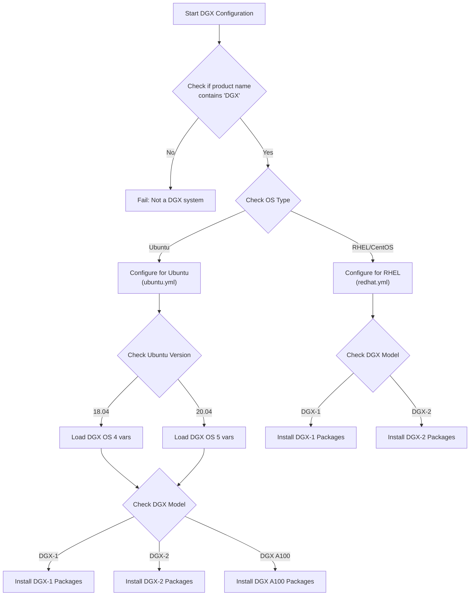
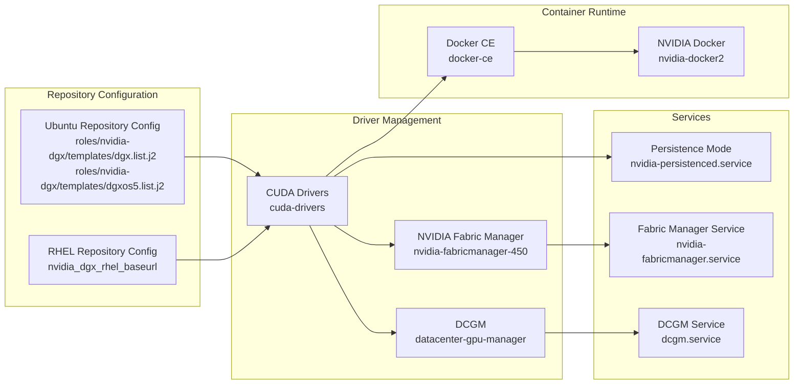
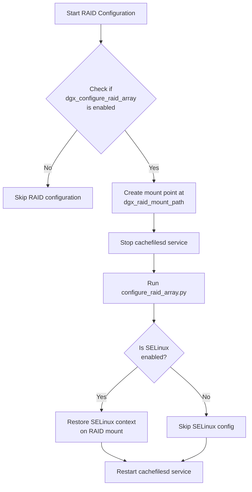
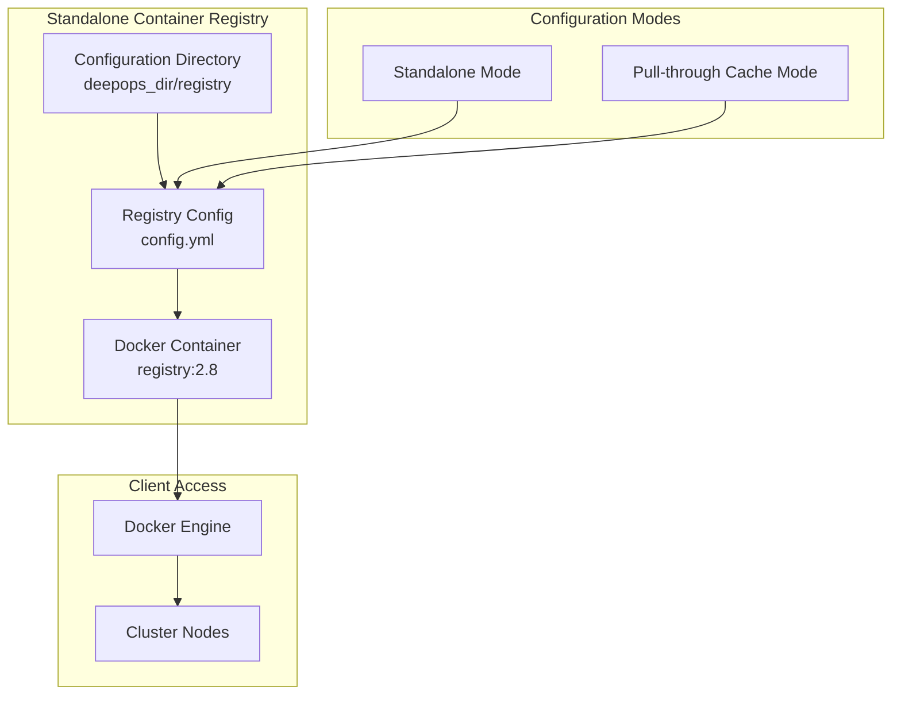
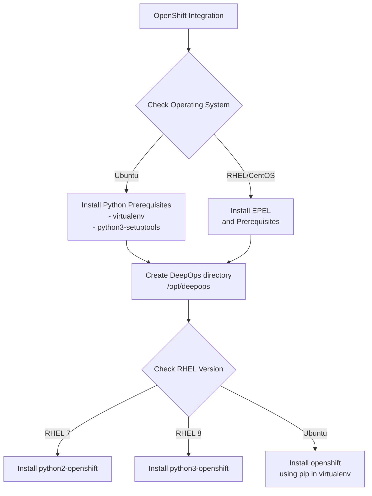

<!-- source: DeepWiki mcp.deepwiki.com · repo NVIDIA/deepops · page 6 Advanced Topics · fetched 2026-10-26 -->

# Advanced Topics

<details>
<summary>Relevant source files</summary>

The following files were used as context for generating this wiki page:

- [roles/lmod/defaults/main.yml](roles/lmod/defaults/main.yml)
- [roles/nvidia-dgx/defaults/main.yml](roles/nvidia-dgx/defaults/main.yml)
- [roles/nvidia-dgx/handlers/main.yml](roles/nvidia-dgx/handlers/main.yml)
- [roles/nvidia-dgx/tasks/configure-raid.yml](roles/nvidia-dgx/tasks/configure-raid.yml)
- [roles/nvidia-dgx/tasks/main.yml](roles/nvidia-dgx/tasks/main.yml)
- [roles/nvidia-dgx/tasks/redhat.yml](roles/nvidia-dgx/tasks/redhat.yml)
- [roles/nvidia-dgx/tasks/ubuntu.yml](roles/nvidia-dgx/tasks/ubuntu.yml)
- [roles/nvidia-dgx/templates/dgx.list.j2](roles/nvidia-dgx/templates/dgx.list.j2)
- [roles/nvidia-dgx/templates/dgxos5.list.j2](roles/nvidia-dgx/templates/dgxos5.list.j2)
- [roles/nvidia-dgx/vars/dgxa100.yml](roles/nvidia-dgx/vars/dgxa100.yml)
- [roles/nvidia-dgx/vars/redhat.yml](roles/nvidia-dgx/vars/redhat.yml)
- [roles/nvidia-dgx/vars/ubuntu-18.04.yml](roles/nvidia-dgx/vars/ubuntu-18.04.yml)
- [roles/nvidia-dgx/vars/ubuntu-20.04.yml](roles/nvidia-dgx/vars/ubuntu-20.04.yml)
- [roles/nvidia_cuda/defaults/main.yml](roles/nvidia_cuda/defaults/main.yml)
- [roles/nvidia_dcgm/defaults/main.yml](roles/nvidia_dcgm/defaults/main.yml)
- [roles/openshift/defaults/main.yml](roles/openshift/defaults/main.yml)
- [roles/openshift/tasks/main.yml](roles/openshift/tasks/main.yml)
- [roles/standalone-container-registry/defaults/main.yml](roles/standalone-container-registry/defaults/main.yml)
- [roles/standalone-container-registry/tasks/main.yml](roles/standalone-container-registry/tasks/main.yml)
- [roles/standalone-container-registry/templates/config.yml](roles/standalone-container-registry/templates/config.yml)

</details>


This page covers advanced deployment scenarios and hardware-specific configurations in DeepOps. It includes specialized topics for NVIDIA DGX systems, air-gapped deployments, and OpenShift integration. These topics are intended for users with specific deployment requirements that go beyond standard Kubernetes or Slurm cluster configurations covered in the main deployment guides ([Kubernetes Deployment](#2) and [Slurm Deployment](#3)).

## DGX Systems Support

DeepOps provides specialized support for NVIDIA DGX systems, including DGX-1, DGX-2, and DGX A100. This support ensures optimal configuration of these high-performance computing systems designed specifically for AI/ML workloads.

### Supported DGX Platforms

DeepOps includes tailored configurations for different DGX hardware platforms:

| DGX Model | OS Support | GPU Configuration | Key Features |
|-----------|------------|------------------|--------------|
| DGX-1 | Ubuntu 18.04/20.04, RHEL/CentOS 7 | 8x V100 GPUs | NVIDIA CUDA, Docker integration, Mellanox networking |
| DGX-2 | Ubuntu 18.04/20.04, RHEL/CentOS 7 | 16x V100 GPUs | NVSwitch fabric, NVMe storage options |
| DGX A100 | Ubuntu 18.04/20.04, RHEL/CentOS 7 | 8x A100 GPUs | Higher memory bandwidth, Multi-Instance GPU (MIG) |

The platform detection is handled automatically in the Ansible playbooks via product name detection:



Sources: [roles/nvidia-dgx/tasks/main.yml:1-25](), [roles/nvidia-dgx/tasks/ubuntu.yml:1-67]()

### DGX OS Configuration

DeepOps configures DGX systems based on the DGX OS version, with distinct handling for:

- **DGX OS 4**: Based on Ubuntu 18.04 LTS
- **DGX OS 5**: Based on Ubuntu 20.04 LTS
- **RHEL/CentOS-based** deployments

Each OS configuration includes:

1. Repository configuration
2. Driver installation
3. NVIDIA container runtime setup
4. System management tools
5. Monitoring components

The configuration process sets up appropriate package repositories and authenticates them using GPG keys specific to each OS version:



Sources: [roles/nvidia-dgx/tasks/ubuntu.yml:123-146](), [roles/nvidia-dgx/tasks/redhat.yml:16-22](), [roles/nvidia-dgx/tasks/ubuntu.yml:330-341]()

### RAID Configuration for DGX Systems

DeepOps includes support for configuring RAID arrays on DGX systems. This is particularly important for optimizing storage performance for AI/ML workloads. The RAID configuration is controlled by the `dgx_configure_raid_array` variable.

When enabled, the system:

1. Creates a mount point at the path specified in `dgx_raid_mount_path` (default: `/raid`)
2. Configures a proper filesystem on the array
3. Sets up cachefilesd for improved filesystem performance



Sources: [roles/nvidia-dgx/tasks/configure-raid.yml:1-21](), [roles/nvidia-dgx/defaults/main.yml:12-19]()

## Air-gapped Deployments

DeepOps supports deployment in air-gapped environments where direct internet access is restricted or unavailable. This is critical for secure facilities or environments with network isolation requirements.

### Standalone Container Registry

A key component for air-gapped deployments is setting up a local container registry to host Docker images required by DeepOps components. The standalone container registry role provides this functionality.



Sources: [roles/standalone-container-registry/tasks/main.yml:1-59](), [roles/standalone-container-registry/defaults/main.yml:1-22]()

### Container Registry Configuration

The container registry can be deployed in two modes:

1. **Standalone Mode**: Hosts container images locally without internet access
2. **Pull-through Cache**: Acts as a caching proxy for an upstream registry (e.g., Docker Hub)

Key configuration parameters include:

| Parameter | Description | Default |
|-----------|-------------|---------|
| `standalone_container_registry_image` | Registry container image | `registry:2.8` |
| `standalone_container_registry_port` | Registry listen port | `5000` |
| `standalone_container_registry_name` | Container name | `deepops-registry` |
| `standalone_container_registry_cache_enable` | Enable pull-through cache | `false` |
| `standalone_container_registry_cache_upstream` | Upstream registry URL | `https://registry-1.docker.io` |
| `standalone_container_registry_cache_username` | Optional auth username | - |
| `standalone_container_registry_cache_password` | Optional auth password | - |

The pull-through cache is particularly useful for reducing external bandwidth usage while still allowing access to internet resources.

To configure the registry as a pull-through cache, set the following in your DeepOps configuration:

```yaml
standalone_container_registry_cache_enable: true
standalone_container_registry_cache_upstream: "https://registry-1.docker.io"
```

For private repositories or higher rate limits, you can configure authentication:

```yaml
standalone_container_registry_cache_username: "your_username"
standalone_container_registry_cache_password: "your_password"
```

Sources: [roles/standalone-container-registry/templates/config.yml:1-18](), [roles/standalone-container-registry/defaults/main.yml:5-22]()

### Air-gapped Deployment Process

The general process for an air-gapped deployment involves:

1. Setting up a standalone container registry on a node with temporary internet access
2. Populating the registry with all required container images
3. Configuring the DeepOps deployment to use the local registry
4. Proceeding with the regular deployment process using local resources

This approach requires careful planning to ensure all necessary container images and software packages are available locally before beginning the deployment.

## OpenShift Integration

DeepOps includes support for OpenShift integration, allowing you to leverage NVIDIA GPU resources in an OpenShift environment.

### OpenShift Prerequisites

The OpenShift role in DeepOps installs the necessary dependencies to integrate with OpenShift environments:



Sources: [roles/openshift/tasks/main.yml:1-47](), [roles/openshift/defaults/main.yml:1-5]()

### OpenShift Python Client

The core of the OpenShift integration is the installation of the OpenShift Python client, which enables Ansible to interact with OpenShift clusters using the `k8s_raw` module.

For Ubuntu systems, DeepOps creates a Python virtual environment and installs the OpenShift client within it:

```
/opt/deepops/venv/
```

For RHEL/CentOS systems, the appropriate package is installed based on the OS version:

- RHEL/CentOS 7: `python2-openshift`
- RHEL/CentOS 8: `python3-openshift`

This integration allows DeepOps to deploy and manage NVIDIA GPU resources in an OpenShift environment, including:

1. NVIDIA GPU operator deployment
2. GPU resource management
3. GPU monitoring and metrics

Sources: [roles/openshift/tasks/main.yml:18-47](), [roles/openshift/defaults/main.yml:1-5]()

## Custom CUDA Configuration for Advanced Workloads

For specialized AI/ML workloads, DeepOps provides flexibility in CUDA version configuration, especially important for DGX systems where CUDA compatibility is critical.

### DGX-specific CUDA Configuration

The CUDA configuration can be customized for specific DGX models:

```yaml
# Default CUDA version
cuda_version: cuda-toolkit

# DGX-specific versions (if needed)
cuda_dgx_1_version: "cuda-toolkit=11.7.0-1"
cuda_dgx_2_version: "cuda-toolkit=11.8.0-1"
cuda_dgx_a100_version: "cuda-toolkit=12.2.0-1"
```

This allows tailoring CUDA versions to different DGX hardware platforms based on compatibility and performance requirements.

For adding CUDA binaries to the system path, DeepOps can create a profile script:

```
/etc/profile.d/cuda-vars.sh
```

This ensures CUDA tools are available in the environment for all users.

Sources: [roles/nvidia_cuda/defaults/main.yml:1-19]()

### Hardware-specific Considerations

When deploying advanced configurations, especially with DGX systems, consider:

1. **Driver compatibility**: Ensure NVIDIA drivers match the CUDA version
2. **Fabric Manager**: For systems with NVSwitch (DGX-2, DGX A100), ensure Fabric Manager is properly configured
3. **Multi-Instance GPU (MIG)**: For A100 systems, consider MIG configuration for workload isolation
4. **InfiniBand/RDMA**: Configure high-speed networking correctly for optimal performance

The DGX role automatically handles many of these considerations, but they may need customization for specific workloads.

Sources: [roles/nvidia-dgx/vars/ubuntu-20.04.yml:135-188](), [roles/nvidia-dgx/vars/ubuntu-18.04.yml:226-248]()

---

