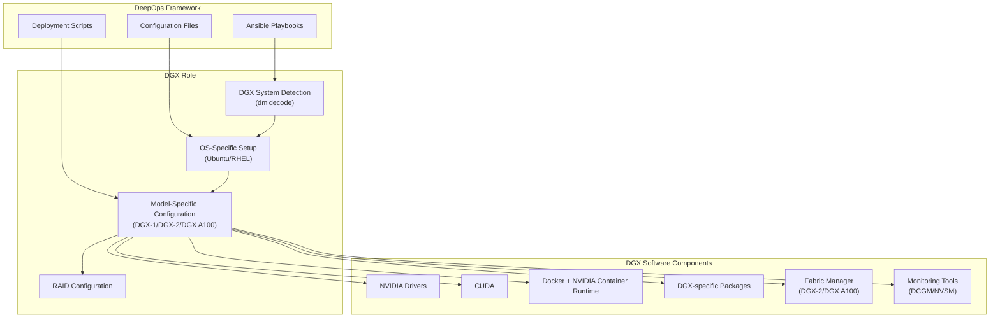
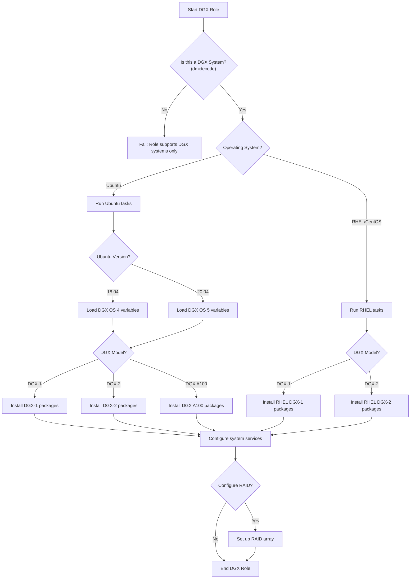
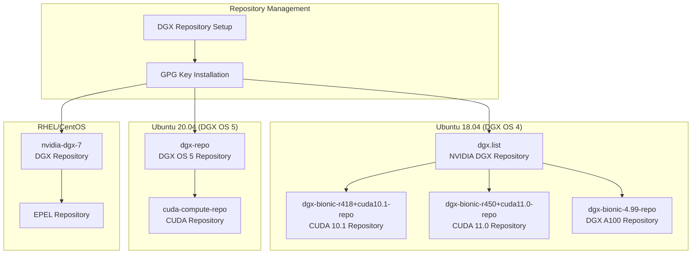
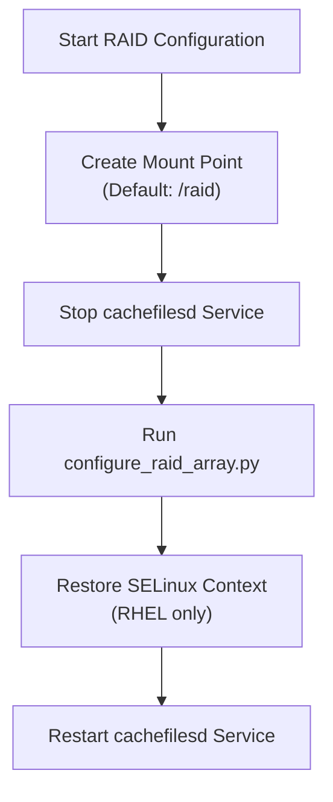
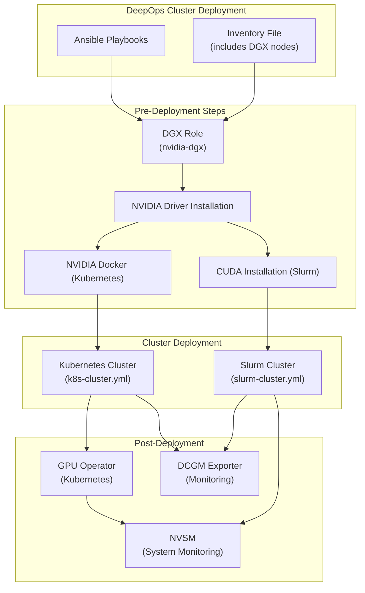

<!-- source: DeepWiki mcp.deepwiki.com · repo NVIDIA/deepops · page 6.1 DGX Systems · fetched 2026-10-26 -->

# DGX Systems

Relevant source files

The following files were used as context for generating this wiki page:

- [roles/nvidia-dgx/handlers/main.yml](roles/nvidia-dgx/handlers/main.yml)
- [roles/nvidia-dgx/tasks/configure-raid.yml](roles/nvidia-dgx/tasks/configure-raid.yml)
- [roles/nvidia-dgx/tasks/main.yml](roles/nvidia-dgx/tasks/main.yml)
- [roles/nvidia-dgx/tasks/redhat.yml](roles/nvidia-dgx/tasks/redhat.yml)
- [roles/nvidia-dgx/tasks/ubuntu.yml](roles/nvidia-dgx/tasks/ubuntu.yml)
- [roles/nvidia-dgx/templates/dgx.list.j2](roles/nvidia-dgx/templates/dgx.list.j2)
- [roles/nvidia-dgx/templates/dgxos5.list.j2](roles/nvidia-dgx/templates/dgxos5.list.j2)
- [roles/nvidia-dgx/vars/dgxa100.yml](roles/nvidia-dgx/vars/dgxa100.yml)
- [roles/nvidia-dgx/vars/redhat.yml](roles/nvidia-dgx/vars/redhat.yml)
- [roles/nvidia-dgx/vars/ubuntu-18.04.yml](roles/nvidia-dgx/vars/ubuntu-18.04.yml)
- [roles/nvidia-dgx/vars/ubuntu-20.04.yml](roles/nvidia-dgx/vars/ubuntu-20.04.yml)

This document provides technical details on deploying and managing NVIDIA DGX systems using DeepOps. It covers DGX-specific configurations, software components, and management tools that are automatically installed and configured when using DeepOps with DGX hardware.

## Supported DGX Models and Operating Systems

DeepOps includes specialized support for the following NVIDIA DGX systems:

| DGX Model | Description | Supported Operating Systems |
|-----------|-------------|----------------------------|
| DGX-1     | First-generation DGX system with 8 NVIDIA V100 GPUs | Ubuntu 18.04 (DGX OS 4), Ubuntu 20.04 (DGX OS 5), RHEL/CentOS 7 |
| DGX-2     | Second-generation DGX system with 16 NVIDIA V100 GPUs and NVSwitch | Ubuntu 18.04 (DGX OS 4), Ubuntu 20.04 (DGX OS 5), RHEL/CentOS 7 |
| DGX A100  | Latest-generation DGX system with 8 NVIDIA A100 GPUs | Ubuntu 18.04 (DGX OS 4.99), Ubuntu 20.04 (DGX OS 5), RHEL/CentOS 7 |

Sources: [roles/nvidia-dgx/tasks/main.yml:1-5](), [roles/nvidia-dgx/tasks/ubuntu.yml:1-7]()

## DGX Integration in DeepOps

The following diagram illustrates how DGX-specific configurations are integrated within the DeepOps framework:

Sources: [roles/nvidia-dgx/tasks/main.yml](), [roles/nvidia-dgx/tasks/ubuntu.yml](), [roles/nvidia-dgx/tasks/redhat.yml]()

## Detection and Configuration Process

DeepOps automatically detects DGX systems and applies the appropriate configurations based on the model and operating system. The process flow is shown below:

Sources: [roles/nvidia-dgx/tasks/main.yml](), [roles/nvidia-dgx/tasks/ubuntu.yml:9-21](), [roles/nvidia-dgx/tasks/redhat.yml:1-4]()

## Software Components

The following table shows the key software components installed for each DGX model and operating system:

| Component | DGX-1 | DGX-2 | DGX A100 | Purpose |
|-----------|-------|-------|----------|---------|
| NVIDIA Drivers | ✓ | ✓ | ✓ | GPU drivers (version varies by model) |
| CUDA | ✓ | ✓ | ✓ | CUDA toolkit for GPU computing |
| Docker + NVIDIA Container Runtime | ✓ | ✓ | ✓ | Container runtime with GPU support |
| NVIDIA Fabric Manager | | ✓ | ✓ | NVSwitch fabric management |
| DCGM | ✓ | ✓ | ✓ | Data Center GPU Manager for monitoring |
| NVSM | ✓ | ✓ | ✓ | NVIDIA System Management for hardware monitoring |
| Mellanox OFED | ✓ | ✓ | ✓ | Mellanox networking drivers and tools |

Sources: [roles/nvidia-dgx/vars/ubuntu-18.04.yml](), [roles/nvidia-dgx/vars/ubuntu-20.04.yml](), [roles/nvidia-dgx/vars/redhat.yml]()

## Package Repository Structure

DeepOps sets up the appropriate package repositories based on the DGX model and operating system:

Sources: [roles/nvidia-dgx/tasks/ubuntu.yml:90-146](), [roles/nvidia-dgx/tasks/redhat.yml:5-22](), [roles/nvidia-dgx/templates/dgx.list.j2](), [roles/nvidia-dgx/templates/dgxos5.list.j2]()

## DGX-specific Package Installation

Different packages are installed based on the detected DGX model. The following table highlights the key model-specific packages:

| DGX-1 Packages | DGX-2 Packages | DGX A100 Packages |
|----------------|----------------|-------------------|
| dgx1-ota-update-meta | dgx2-ota-update-meta | dgx-a100-ota-update-meta |
| storcli | nvme-cli | nvme-cli |
| nvidia-conf-cachefilesd | nvidia-nvme-smartd | nvidia-nvme-smartd |
| nvidia-ipmisol | nvidia-ipmisol | nvidia-ipmisol |
| | nvidia-fabricmanager-450 | nvidia-fabricmanager-450 |
| | nvidia-acs-disable | nvidia-acs-disable |
| | msecli | msecli |

Sources: [roles/nvidia-dgx/vars/ubuntu-20.04.yml:120-188](), [roles/nvidia-dgx/tasks/ubuntu.yml:209-288]()

## RAID Configuration

DGX systems often come with multiple storage drives configured in a RAID array. DeepOps provides automation for configuring the RAID array:

Sources: [roles/nvidia-dgx/tasks/configure-raid.yml](), [roles/nvidia-dgx/tasks/main.yml:16-18]()

## Service Management

DeepOps ensures that critical services for DGX systems are enabled and running:

| Service | Purpose | Models |
|---------|---------|--------|
| openibd.service | Mellanox InfiniBand drivers | All |
| dcgm.service / nvidia-dcgm.service | Data Center GPU Manager | All |
| nvidia-persistenced.service | Persistent mode daemon | All |
| nvidia-fabricmanager.service | NVSwitch fabric manager | DGX-2, DGX A100 |
| cachefilesd | Cache filesystem daemon | All |
| docker | Container runtime | All |

Sources: [roles/nvidia-dgx/tasks/ubuntu.yml:329-341](), [roles/nvidia-dgx/handlers/main.yml]()

## Integration with DeepOps Clusters

DGX systems can be integrated into either Kubernetes or Slurm clusters deployed by DeepOps. The following diagram shows how DGX systems fit within the cluster architecture:

Sources: [roles/nvidia-dgx/tasks/ubuntu.yml](), [roles/nvidia-dgx/tasks/redhat.yml]()

## Conclusion

The NVIDIA DGX role in DeepOps provides comprehensive automation for deploying and configuring DGX systems within the larger cluster environment. It handles all aspects of DGX-specific software installation and configuration, enabling these specialized AI systems to be easily integrated into both Kubernetes and Slurm clusters.

---

