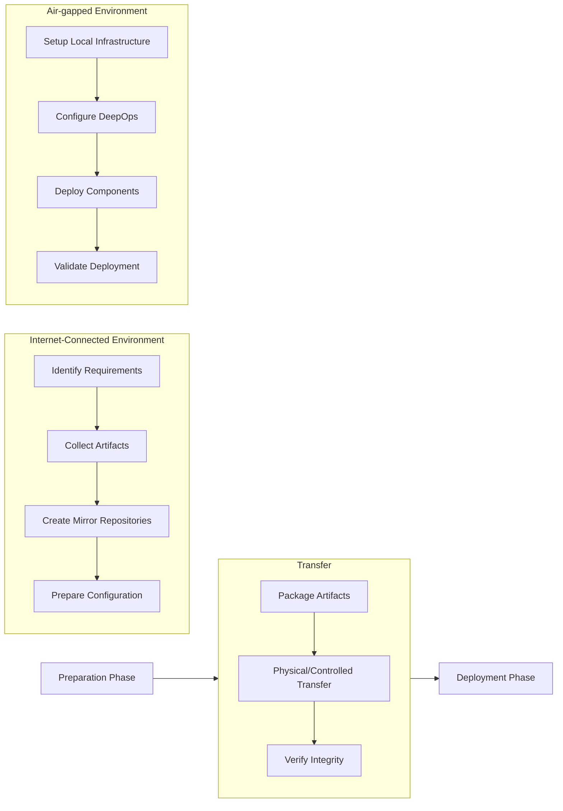
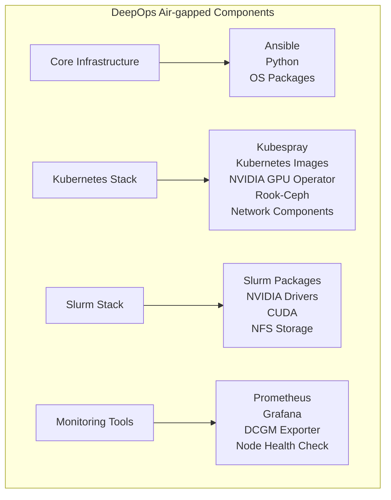
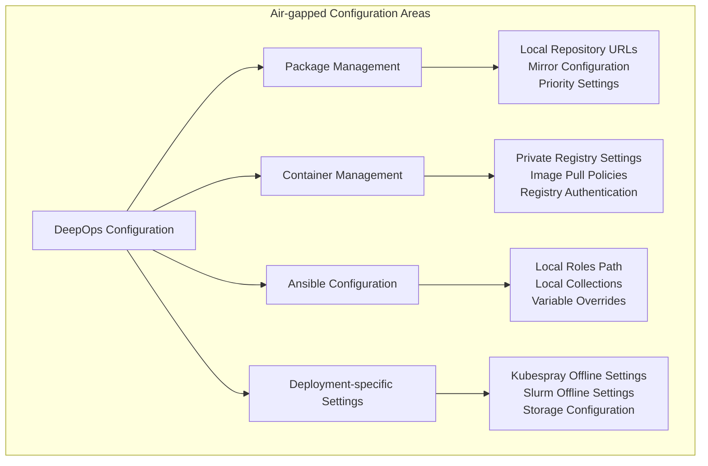

<!-- source: DeepWiki mcp.deepwiki.com · repo NVIDIA/deepops · page 6.2 Air-gapped Deployments · fetched 2026-10-26 -->

# Air-gapped Deployments

Relevant source files

The following files were used as context for generating this wiki page:

- [playbooks/bootstrap/bootstrap-rook.yml](playbooks/bootstrap/bootstrap-rook.yml)

## Introduction

This document provides guidance for deploying DeepOps in air-gapped environments - computing environments that are isolated from the internet for security, compliance, or operational reasons. In such environments, standard deployment processes that rely on internet connectivity for downloading packages, container images, and other dependencies cannot be used directly.

Air-gapped deployments are common in secure facilities, regulated industries, critical infrastructure, and environments with sensitive data where network isolation is a security requirement.

## Air-gapped Deployment Challenges

Deploying DeepOps in air-gapped environments presents several challenges:

- No access to public package repositories (apt, yum)
- No access to container registries (Docker Hub, NGC)
- No access to code repositories (GitHub)
- No access to Python package repositories (PyPI)
- Limited ability to download drivers, firmware, and other binaries

## Deployment Approach

The air-gapped deployment process involves three distinct phases:

### Phase 1: Preparation (Internet-Connected Environment)

1. **Identify Required Components**
   - Determine which DeepOps components you need (Kubernetes or Slurm)
   - Create a comprehensive list of all required artifacts

2. **Collect Artifacts**
   - Clone the complete DeepOps repository
   - Download all required OS packages and dependencies
   - Pull all necessary container images
   - Gather Python dependencies and Ansible collections

3. **Create Mirror Repositories**
   - Set up mirrored package repositories for your OS
   - Create a container image registry mirror
   - Mirror any other required repositories

4. **Prepare Configuration Files**
   - Modify DeepOps configuration files to use local resources
   - Create offline installation scripts if needed

### Phase 2: Transfer

1. **Package Artifacts**
   - Bundle all collected components logically
   - Create checksums for verification
   - Document the contents and versions

2. **Perform Transfer**
   - Use approved transfer methods based on security requirements
   - Physical media (hard drives, optical media)
   - Approved network transfer mechanisms
   - Data diodes or other secure transfer appliances

3. **Verify Transfer**
   - Validate checksums after transfer
   - Ensure all components are intact and unmodified

### Phase 3: Deployment (Air-gapped Environment)

1. **Set Up Local Infrastructure**
   - Configure local package repositories
   - Set up private container registry
   - Establish file servers for other artifacts

2. **Configure DeepOps for Offline Use**
   - Apply modified configurations for local resources
   - Update inventory files and group variables
   - Ensure all external references point to local resources

3. **Execute Deployment**
   - Follow standard DeepOps deployment procedures with offline adjustments
   - Deploy components in the correct order
   - Validate each component as it is deployed

Sources:
- System architecture diagrams

## Key Components Requiring Air-gapped Handling

### Core Infrastructure Components

1. **Ansible and Python**
   - Ansible packages and dependencies
   - Required Python modules
   - Configuration management tools

2. **Operating System Packages**
   - Base system requirements
   - Package dependencies (e.g., `xfsprogs` needed for Rook-Ceph as seen in `bootstrap-rook.yml`)

### Kubernetes Deployment Components

1. **Kubespray and Kubernetes**
   - Container images for Kubernetes control plane
   - etcd, CoreDNS, and other core services
   - Kubernetes management tools

2. **NVIDIA GPU Support**
   - GPU Operator container images
   - Device plugin
   - Driver containers
   - GPU Feature Discovery containers

3. **Supporting Services**
   - Storage solutions (Rook-Ceph)
   - Networking components (MetalLB, Ingress controllers)
   - Monitoring tools (Prometheus, Grafana, exporters)

### Slurm Deployment Components

1. **Slurm and Dependencies**
   - Slurm packages
   - Munge authentication
   - PMIx libraries

2. **NVIDIA Components**
   - GPU drivers
   - CUDA toolkit
   - Related libraries

3. **Storage and Monitoring**
   - NFS or other shared storage components
   - Monitoring tools (DCGM, Node Health Check)

Sources:
- System architecture diagrams
- [playbooks/bootstrap/bootstrap-rook.yml:1-13]()

## Configuration for Air-gapped Deployments

Several configuration areas require modification for air-gapped deployments:

### Package Management Configuration

- Configure package managers to use local repositories:
  - Update `/etc/apt/sources.list` or `/etc/yum.repos.d/` configurations
  - Ensure proper repository signing keys are available
  - Configure repository priorities if needed

### Container Management Configuration

- Set up a private container registry:
  - Configure registry authentication if required
  - Ensure proper image tagging matches expected references
  - Configure container runtimes to use the private registry

### Ansible Configuration

- Configure Ansible to use local resources:
  - Set `roles_path` to point to local roles
  - Configure collections to use local paths
  - Modify playbook variables to reference local resources

### DeepOps-specific Configuration

- For Kubernetes deployments:
  - Modify Kubespray variables for offline installation
  - Update container image references
  - Configure storage and networking for offline use

- For Slurm deployments:
  - Update package source configurations
  - Configure NVIDIA driver and CUDA installation for offline use
  - Set up storage systems for offline operation

Sources:
- System architecture diagrams

## Detailed Preparation Steps

### 1. Package Repositories

For Debian/Ubuntu systems:
1. Create a local mirror using tools like `apt-mirror` or `aptly`
2. Include repos for:
   - Base OS packages
   - NVIDIA drivers and CUDA
   - Kubernetes (if applicable)
   - Slurm (if applicable)

For RedHat/CentOS systems:
1. Create a local mirror using tools like `reposync` and `createrepo`
2. Include repos for:
   - Base OS packages
   - EPEL
   - NVIDIA drivers and CUDA
   - Kubernetes (if applicable)
   - Slurm (if applicable)

### 2. Container Images

For Kubernetes deployments, collect at minimum:
1. Kubernetes infrastructure images (from Kubespray)
2. NVIDIA GPU Operator images
3. Monitoring stack images (Prometheus, Grafana)
4. Storage solution images (Rook-Ceph)
5. Networking images (MetalLB, Ingress controllers)

### 3. Python Dependencies

Create a local PyPI mirror with all required packages:
1. Python dependencies for Ansible
2. Python dependencies for DeepOps scripts
3. Python dependencies for monitoring tools

## Best Practices

1. **Comprehensive Documentation**
   - Document all modifications made for air-gapped deployment
   - Maintain records of all locally stored artifacts and their versions
   - Create detailed procedures for future updates

2. **Version Consistency**
   - Maintain consistent versions across all components
   - Test compatibility between components before deployment
   - Create a versioning strategy for updates

3. **Testing**
   - Use the virtual environment capabilities in DeepOps to test the air-gapped configuration
   - Create a small test deployment before proceeding to production
   - Validate all functionality in the air-gapped environment

4. **Security**
   - Validate the integrity of all transferred artifacts
   - Implement proper access controls for local repositories
   - Follow security best practices even in isolated environments

Sources:
- System architecture diagrams

## Troubleshooting Air-gapped Deployments

Common issues and their solutions:

| Issue | Symptoms | Solution |
|-------|----------|----------|
| Missing packages | Installation fails with "package not found" errors | Ensure all packages and dependencies are in local repositories |
| Container image pull failures | Kubernetes pods fail to start with image pull errors | Verify images exist in local registry with correct tags |
| Repository configuration errors | Package manager cannot access repository | Check local repository configuration and indexing |
| Python dependency issues | Scripts fail with import errors | Ensure all Python packages are in local PyPI mirror |
| Certificate/SSL issues | HTTPS connection failures | Configure systems to use local CA or disable SSL verification where appropriate |

## Maintenance Considerations

Maintaining an air-gapped DeepOps deployment requires:

1. **Security Updates**
   - Establish a process for regularly collecting and applying security patches
   - Create a secure methodology for introducing updates

2. **Component Updates**
   - Plan for periodic updates of DeepOps components
   - Test updates in a staging environment before applying to production

3. **Configuration Management**
   - Version control all configuration changes
   - Document the rationale for modifications
   - Maintain backups of working configurations

4. **Update Procedures**
   - Create clear procedures for bringing updates into the air-gapped environment
   - Establish testing protocols for updates before deployment
   - Document rollback procedures in case of issues

Sources:
- System architecture diagrams

## Conclusion

Deploying DeepOps in air-gapped environments requires careful planning, preparation, and configuration. By following the three-phase approach outlined in this guide and addressing the specific needs of each component, you can successfully deploy GPU-accelerated infrastructure in environments without internet access.

For virtual environment testing of air-gapped configurations, see [Virtual Testing Environment](#4) for guidance on setting up test environments.

---

