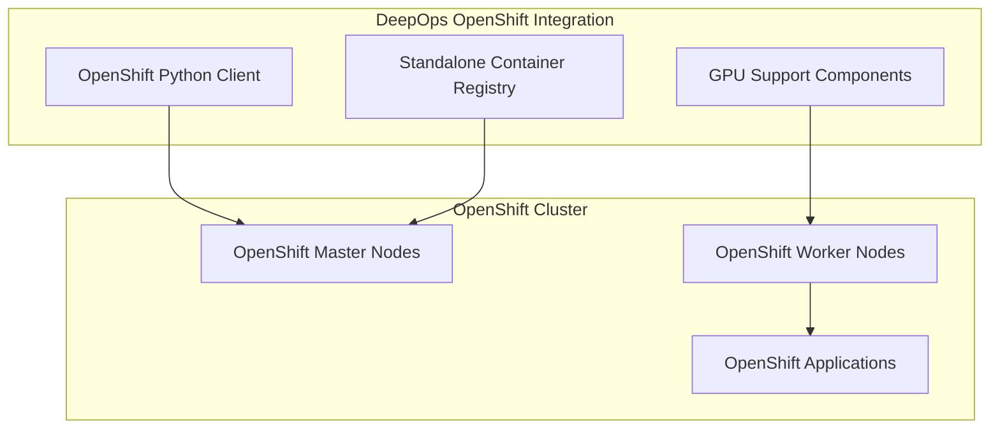
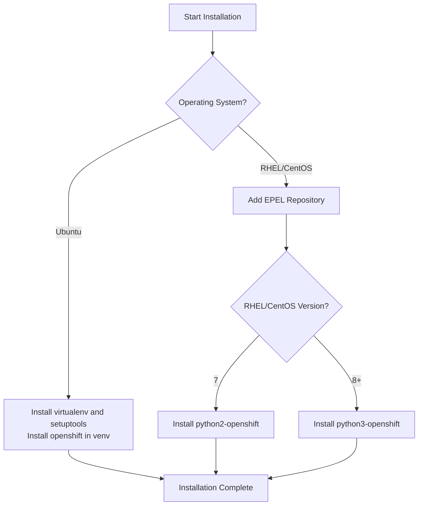
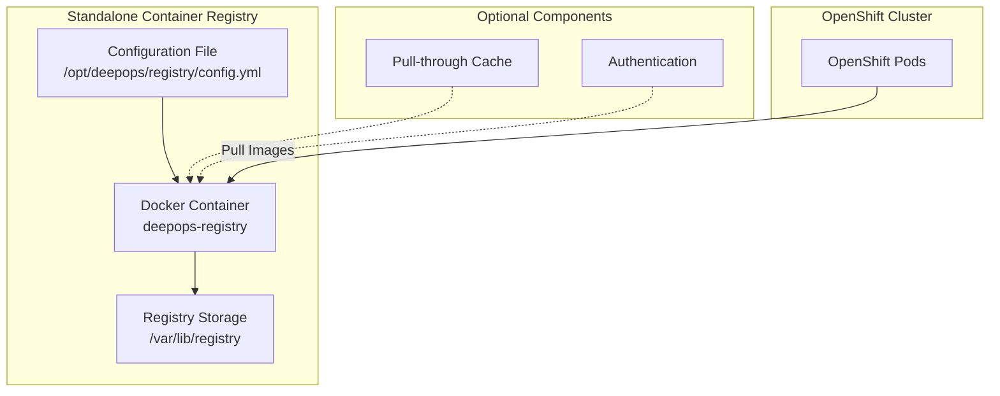
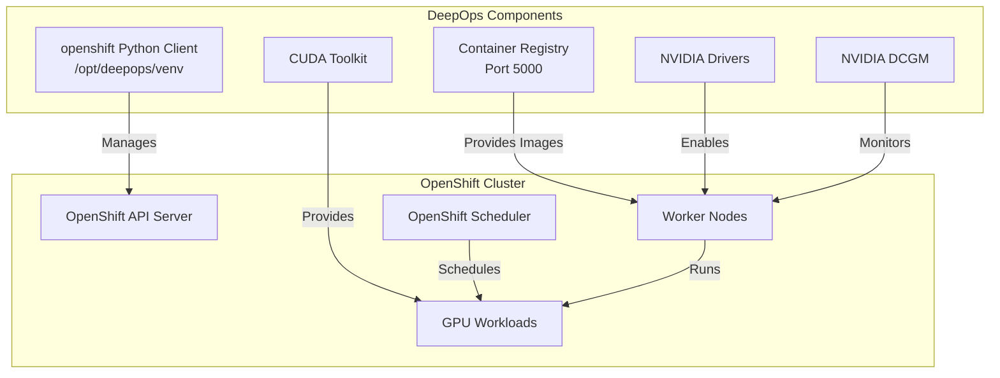

<!-- source: DeepWiki mcp.deepwiki.com · repo NVIDIA/deepops · page 6.3 OpenShift Integration · fetched 2026-10-26 -->

# OpenShift Integration

<details>
<summary>Relevant source files</summary>

The following files were used as context for generating this wiki page:

- [roles/lmod/defaults/main.yml](roles/lmod/defaults/main.yml)
- [roles/nvidia-dgx/defaults/main.yml](roles/nvidia-dgx/defaults/main.yml)
- [roles/nvidia_cuda/defaults/main.yml](roles/nvidia_cuda/defaults/main.yml)
- [roles/nvidia_dcgm/defaults/main.yml](roles/nvidia_dcgm/defaults/main.yml)
- [roles/openshift/defaults/main.yml](roles/openshift/defaults/main.yml)
- [roles/openshift/tasks/main.yml](roles/openshift/tasks/main.yml)
- [roles/standalone-container-registry/defaults/main.yml](roles/standalone-container-registry/defaults/main.yml)
- [roles/standalone-container-registry/tasks/main.yml](roles/standalone-container-registry/tasks/main.yml)
- [roles/standalone-container-registry/templates/config.yml](roles/standalone-container-registry/templates/config.yml)

</details>


## Purpose and Scope

This document outlines how DeepOps integrates with Red Hat OpenShift, providing tooling and configurations to enable GPU support and container infrastructure in OpenShift environments. The integration primarily focuses on setting up the necessary components to manage GPU workloads in OpenShift clusters and supporting infrastructure like container registries. 

For information about general Kubernetes deployments that are not specific to OpenShift, see [Kubernetes Deployment](#2).

## Overview of OpenShift Integration

DeepOps provides functionality to support OpenShift environments primarily through:

1. Installation of OpenShift Python client for Kubernetes management
2. Support for standalone container registry that can work with OpenShift
3. GPU enablement in OpenShift environments

The integration focuses on ensuring GPU capabilities and proper container infrastructure, rather than deploying OpenShift itself (which is typically handled by Red Hat tools).



Sources: [roles/openshift/tasks/main.yml](), [roles/standalone-container-registry/tasks/main.yml]()

## OpenShift Python Client Installation

The core of the OpenShift integration is the installation of the OpenShift Python client, which enables the use of the `k8s_raw` Ansible module to interact with OpenShift/Kubernetes clusters.

### Installation Process

DeepOps installs the OpenShift Python client differently depending on the operating system:

- **Ubuntu**: Installs in a Python virtual environment
- **RHEL/CentOS 7**: Installs the `python2-openshift` package
- **RHEL/CentOS 8+**: Installs the `python3-openshift` package



Sources: [roles/openshift/tasks/main.yml](), [roles/openshift/defaults/main.yml]()

## Key Components for OpenShift Integration

### 1. OpenShift Python Client

The OpenShift Python client provides an interface to interact with OpenShift API. DeepOps installs this client to enable Ansible playbooks to manage OpenShift resources.

Key configurations:
- Installation location: `/opt/deepops/venv` (for Ubuntu)
- System packages for RHEL/CentOS

| Operating System | Package |
|-----------------|---------|
| Ubuntu | `openshift` (via pip in virtualenv) |
| RHEL/CentOS 7 | `python2-openshift` |
| RHEL/CentOS 8+ | `python3-openshift` |

Sources: [roles/openshift/tasks/main.yml:18-47](), [roles/openshift/defaults/main.yml]()

### 2. Standalone Container Registry

DeepOps can set up a standalone container registry that can be used with OpenShift for storing and distributing container images. This registry can also be configured as a pull-through cache to improve performance and reduce external bandwidth usage.



Configuration options:
- Registry port: 5000 (default)
- Registry name: deepops-registry
- Configuration directory: `/opt/deepops/registry`
- Optional pull-through cache configuration available

Sources: [roles/standalone-container-registry/tasks/main.yml](), [roles/standalone-container-registry/defaults/main.yml](), [roles/standalone-container-registry/templates/config.yml]()

### 3. GPU Support

DeepOps includes capabilities to enable GPU support in OpenShift environments by installing necessary drivers and components:

- NVIDIA drivers
- CUDA toolkit
- DCGM (Data Center GPU Manager) for monitoring

These components allow OpenShift to schedule and run GPU-accelerated workloads.

Key configuration files:
- CUDA configuration: [roles/nvidia_cuda/defaults/main.yml]()
- DCGM configuration: [roles/nvidia_dcgm/defaults/main.yml]()

Sources: [roles/nvidia_cuda/defaults/main.yml](), [roles/nvidia_dcgm/defaults/main.yml]()

## Deployment Process

The following process outlines how to deploy the OpenShift integration components:

1. **Install OpenShift Python Client**:
   ```
   ansible-playbook -l <target_hosts> playbooks/openshift.yml
   ```

2. **Deploy Standalone Container Registry** (optional):
   ```
   ansible-playbook -l <registry_host> playbooks/container-registry.yml
   ```

3. **Configure GPU Support** for OpenShift worker nodes:
   ```
   ansible-playbook -l <gpu_nodes> playbooks/nvidia-software.yml
   ```

## Configuration Examples

### Configure Pull-through Cache for Container Registry

To configure the container registry as a pull-through cache, set the following variables in your inventory:

```yaml
standalone_container_registry_cache_enable: true
standalone_container_registry_cache_upstream: "https://registry-1.docker.io"
# Optional authentication for upstream registry
standalone_container_registry_cache_username: "your_username"
standalone_container_registry_cache_password: "your_password"
```

Sources: [roles/standalone-container-registry/defaults/main.yml:14-21](), [roles/standalone-container-registry/templates/config.yml:10-17]()

### CUDA Version Configuration

To specify a particular CUDA version for your OpenShift GPU nodes:

```yaml
cuda_version: "cuda-toolkit=12.2.0-1"  # Example for specific version
```

Sources: [roles/nvidia_cuda/defaults/main.yml:2-4]()

## Common Issues and Troubleshooting

| Issue | Solution |
|-------|----------|
| OpenShift Python client installation fails | Ensure Python and pip are properly installed. For Ubuntu, verify virtualenv is accessible. For RHEL/CentOS, check EPEL repository is properly configured. |
| Container registry not accessible | Verify Docker is running, port 5000 is open in the firewall, and the container is running with `docker ps`. |
| GPU not recognized in OpenShift | Ensure NVIDIA drivers are properly installed and visible using `nvidia-smi`. Verify NVIDIA device plugin is running in the OpenShift cluster. |

## Integration Architecture



Sources: [roles/openshift/tasks/main.yml](), [roles/standalone-container-registry/tasks/main.yml](), [roles/nvidia_cuda/defaults/main.yml](), [roles/nvidia_dcgm/defaults/main.yml]()

## Related Documentation

For more information about specific components:

- For DGX-specific configurations with OpenShift, see [DGX Systems](#6.1)
- For deployments in restricted environments, see [Air-gapped Deployments](#6.2)
- For general Kubernetes deployment information, see [Kubernetes Deployment](#2)